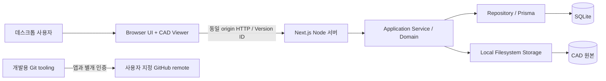
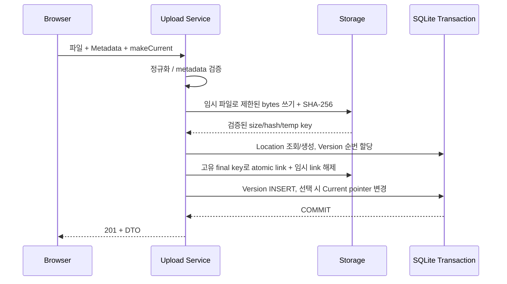
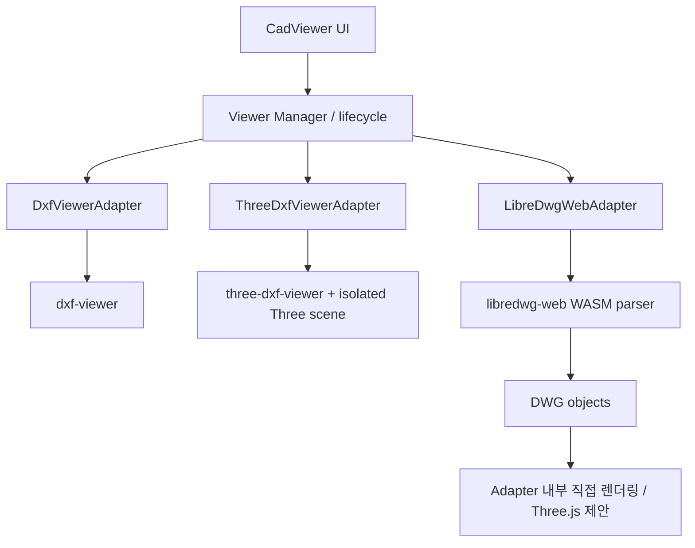
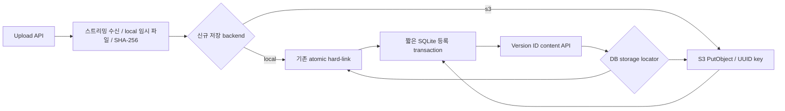

# Architecture 초안

## Issue #31 P4-D0 — 사내 LAN HTTP 경량 계정·영속 외곽선 **설계 전용** (2026-10-25)

- **Owner 결정:** 인터넷 인바운드 제한된 사내 LAN 여러 PC → `http://서버IP:포트` → 앱 로컬 계정/서버 관리 세션. 권한·작업자 식별·감사 목적이며 HTTPS/TLS·OIDC/SSO/MFA 구축은 이번 범위에서 제외. HTTP는 비밀번호·세션이 네트워크에서 노출/변조될 수 있어 LAN 격리가 TLS 대체 수단 아님을 명시한다. 서버 접근 제한/프록시 Backend 비노출, 안전한 비밀번호 해시, HttpOnly/SameSite cookie(HTTP에서 Secure 미설정), 서버 소유 세션/CSRF·Origin 및 요청별 Role/Scope 재검증은 최소 계약. 기간·계정 초기화·네트워크 허용 대역은 미확정.
- **서버 경계(미구현):** Browser/ViewerManager/Adapter → Next API(Route) → `AuthSession` 검증 → `requirePermission(action, site/version)` → Service/Domain canonical source bytes SHA/Stable Handle/WCS + verified TRANSLATE/ROTATE(Scale/Shear/반사 금지) → Prisma transaction(CAS 409, `CadOutline`, `AuditEvent`, 연결 `CadMemo` broken-anchor 처리) → 응답. `User`·`AuthSession`·`UserRoleGrant`·`UserSiteGrant`는 개념 제안이며 실제 모델/엔드포인트를 추가하지 않는다.
- **객체 불변식:** SOURCE는 immutable DXF의 `versionId/sourceSha256/unique Handle/instancePath`, GENERATED는 server UUID. Canonical `baseGeometry`와 `transform`을 분리하고 `effectiveGeometry`는 서버 계산만 신뢰; 기존 `attestation.ts` canonical-only가 편집된 좌표를 자동 승인하지 않는다. `OutlineType`은 전체 앱 공통 ID 카탈로그로 두되, 작업 객체는 Editor의 실제 Site/Version Scope로 제한.
- **라이프사이클:** `DELETED` 논리 삭제 + 감사 보존, 같은 트랜잭션에서 연결 `CadMemo`의 마지막 유효 WCS 유지·`BROKEN_ANCHOR` 및 참조 해제(#83/#84). 세션 Show/Hide는 Viewer/UI 상태만 변경하고 공유 테이블/다른 사용자/Revision을 수정하지 않는다. 영속 결과는 #71/#73의 권한 검증된 조회를 거쳐 복원, 기존 임시 브라우저 `GeneratedDocument`/Undo/Redo/JSON v1/v2와 혼동하지 않는다.
- **유일한 운영 게이트:** Owner 7개 정책 승인=D0 문서 계약. Account bootstrap/TTL, 권한 관리자, 감사 retention, Version 삭제/FK 정책, HTTP 잔여 위험·LAN 범위, 실제 P0/P5 실DXF 수용 및 보안/백업·Migration 시험이 해당 단계에서 완료되기 전 신규 로그인/서버 관리·영속 API/Schema/Migration·공유 메모 영속 기능은 **BLOCKED**. 기존 공개 CAD 조회 API를 무심코 변경하지 않는다.
- **범위·참조:** [ADR-048/049](Decisions.md), [Database](Database.md), [Issue31](Issue31.md), [TestPlan](TestPlan.md); #49/#54/#55/#56(브라우저 생성 편집), #60(로그 조회), #65(Global Type), #71/#73(영속 타입·Tree), #83/#84(메모 Snap), #91(Export). API/Prisma/Docker/Viewer code 변경 0.


## Issue #54 / E4 — WCS Translate gesture/ghost/Document projection (v0.40.0)

- **입력:** `CadViewer` 숫자 폼 → `parseWcsTranslation`(strict finite/delta bound/zero) + `selectedTranslationIds`(SOURCE/mixed/stale/hidden fail-closed) → `ViewerManager.executeGeneratedCommand(Translate)` → `ThreeDxfViewerAdapter` mode gate → `GeneratedDocument.execute` 전체 기하 사전 검증·원자 commit/History 1단계.
- **드래그:** `SelectionController`의 GENERATED 전용 모드+이미 선택된 Geometry 경계 hit + 5px threshold → `GeneratedDragHandlers.begin/move/end/cancel`. CSS canvas 좌표의 `screenToWorld` camera.unproject를 시작/현재 포인터에 독립 수행하여 WCS XY Δ 계산. Source selection/Box drag, Ctrl additive, wheel/Pan/Space 및 touch second pointer와 경쟁시키지 않는다.
- **미리보기 단일 책임:** Adapter `dragGhostGroup`(Scene-only) 생성, `document.stage(Translate 0)`로 첫 검증, `Ghost.position=(dx,dy)`로만 피드백한다. `validTranslationPreview`의 유한/1e12 bounds 초과 또는 ESC/cancel/lostcapture/blur/Zoom/Fit/Resize/selection/mode/viewer lifecycle이면 stage 취소·ghost/material/geometry dispose. 카메라 변경 시 현재 gesture 폐기, WCS 결과를 화면 픽셀 단위로 저장하지 않는다. Ghost 상태는 `data-generated-drag-preview` 테스트 마커로 확인 가능.
- **한 번만 Commit:** pointerup에서 최신 UUID/Scope/Visibility/전체 Selection을 재검증, `stage(Translate(dx,dy))→commitPending` 한 번. E2 `applyAffine`가 기준 Polygon/MultiPolygon/Hole 전체 좌표·범위를 검증. 기존 Document `documentChanged`는 GPU savedGroup/Hits/Overlay selection/Tree/JSON/History를 재투영하되 Source/Worker/Index/파일/DB는 갱신하지 않는다. `getSavedOutlines`/Tree Focus는 이동 후 bounds 사용.
- **지원 경계:** #31 검증된 DXF+three-dxf-viewer만, 서버 CRUD/Prisma/API/Current/Source bytes/SHA/Layer 불변. 더 나은 관찰성/대량 프레임 최적화·실 GPU/OS native FS는 후속 실측 필요. [Issue54](Issue54.md), [ADR-047](Decisions.md), [TC-E4](TestPlan.md).

## Issue #53 / E3 — GeneratedDocument Delete adapter/UX 연결 (v0.39.0)

- **흐름:** Toolbar / #43 Tree Row / 선택 GENERATED의 Canvas 우클릭 / Canvas 초점 Delete·Backspace → `domain/generated-delete.ts`의 `prepareGeneratedDelete`(현재 선택·Version/SHA·전부 GENERATED·UUID·존재/visible/동일 scope) → 확인창 대상 이름/개수 → `assertGeneratedDeleteCurrent`로 대상·scope 재검증 → `ViewerManager.executeGeneratedCommand({type:'Delete',ids})` → `ThreeDxfViewerAdapter` 모드 검사 → E2 `GeneratedDocument.execute` 최종 검증·원자 변경.
- **유일한 삭제 API:** #43의 이력 없는 `discardLegacy/deleteSavedOutline`를 제거해 UI/코드 경로 모두 E2 Validation/Undo로 통과시킨다. 단일 행 동작은 Manager `selectSavedOutline`로 선택을 한 개로 교체하고 Confirm을 요구하며, SOURCE가 포함된 혼합 선택은 이 경로에서도 거부된다.
- **동기화/자원:** E2 `documentChanged`의 기존 `savedGroups` GPU cache에서 삭제된 그룹만 Scene 제거 + geometry/material release, 선택 controller의 `setGeneratedObjects`에서 삭제 ID 자동 해제 및 ObjectSelection 갱신. Scene/Tree/기존 v1·v2 JSON/Undo/Redo는 동일 Document의 파생 상태. 기준 Source RenderCoverage/레이어·Worker Preview·원본 DXF bytes/SHA는 변경 없음.
- **UI 이벤트 수명주기:** SelectionController는 Canvas의 이전 tabindex를 보존한 뒤 포커스 가능하게 하고 dispose 시 복원. 키 입력은 Canvas 대상인지, 편집 모드인지, 텍스트 포커스 여부를 검사한다. 생성 ON은 별도 SELECT/Worker 모드이며 삭제는 OFF 후 `objects/generated`에서 가능. Dialog `alertdialog`와 Window 캡처 단축키 Escape 우선순위가 native/CSS Fullscreen보다 앞선다.
- **Scope:** Version/Renderer/reload/dispose 시 Document·History·선택/Popup 모두 소멸. 인증/DB/영구 저장 API 변경 없음. [Issue53](Issue53.md)·ADR-046·[TestPlan](TestPlan.md). 실 GPU 누수 계측/실도면 시험 별도.


## Issue #67 — Web runtime의 native 전달은 Standalone 단일 책임 (v0.38.1)

- `dependencies → builder → .next/standalone → runtime`: Next `outputFileTracingIncludes`의 `node_modules/better-sqlite3/**/*`, `generated/prisma/**/*` 및 `serverExternalPackages`는 동적 native/Prisma require에 필요하므로 유지한다. Web Docker runtime은 `.next/standalone` 단독 COPY하고 후속 패키지 중복 COPY는 제거. Native `build/Release/better_sqlite3.node` 존재 + memory DB 실행이 Build-time fail-closed gate다.
- 웹/마이그레이터 분리(#28/#66), Debian glibc/Node22.14, UID10001, `/data`, `node server.js`, HEALTHCHECK, Compose migrate→app, OCI paired digest/tag, schema·서비스·보안/Viewer는 **변경하지 않는다**. `prepareStandaloneAssets`는 font/typeface/LibreDWG JS/WASM 및 static을 유지한다.
- PR Docker Job이 실제 layer TAR 경로/SHA-256 중복 및 최종 파일 동등성, `docker inspect .Size` 비압축 전후 크기/History·du를 검증한다. 동일한 HEAD·OS/arch로 빌드하지 않은 과거 값과 OCI index/attestation/config, `docker save|gzip` proxy는 GHCR 전송 비용으로 해석하지 않는다. 신규 published immutable digest OCI 압축 layer 검증은 정식 릴리스 단계에서 수행. [Issue67](Issue67.md), ADR-045 참조.


### E2 #52 PR #79 리뷰 보완 — Document capacity 및 stage 검증

- WCS Polygon area는 첫 정점 상대좌표 삼각 합으로 계산하여 (1e9,1e9) 부동소수점 상쇄 회피.
- undo 가능한 Delete patch는 객체 수·좌표 예약량으로 산정하고, 새 append 시 초과하는 경우 호환 불가 과거 Undo를 폐기한다. 같은 Document 이벤트로 Scene/Tree/History 숫자 정합을 유지한다.
- Adapter selection/source mode 변경에서 준비된 stage를 취소하고, `commitPending(currentSelection)`은 최신 선택을 문서에서 검증해 old selection 우회 commit을 차단. 상세 [Issue52](Issue52.md).


## Issue #52 / E2 — 브라우저 GeneratedDocument / Command / Scene Adapter (v0.38.0)

- **단일 상태** `domain/generated-document.ts`의 `GeneratedDocument(scope)`는 생성 객체 순서·UUIDv4·legacy local-N 연결·불변 base WCS GeoJSON Polygon/MultiPolygon/Hole·sourceEntityIds/algorithm·속성·최종 affine을 소유한다. immutable/structurally shared before/after patch로 Undo/Redo 수행하며 기존 Worker computed Source/Preview와 별개다.
- **변환 계약** `[a,b,c,d,e,f]`(WCS XY, x'=a*x+c*y+e, y'=b*x+d*y+f). Translate/Rotate CCW(+deg)는 기존 transform 왼쪽에 곱하며 각 ring/vertex에 동일 적용한다. baseline은 재계산하거나 변경하지 않는다. 공통 `canvasEditCapability` 이후 Document가 selected IDs, scope, UUID, 제한, geometry 결과를 재검증. `stage/commit/cancel`은 UI의 드래그 확정 1회 = history 1회 계약을 제공한다(E4/E5 실제 핸들 제외).
- **Adapter**: `ThreeDxfViewerAdapter`의 `documentChanged`는 `GeneratedDocument`에서 `savedGroup` GPU cache와 생성 HitIndex, 선택 강조를 동기 갱신한다. 제거/교체 그룹의 Geometry/Material을 dispose, 변경 없는 그룹은 재사용. `getSavedOutlines`는 같은 Document로부터 기존 JSON v1/typed v2 데이터 projection, `getSavedOutlineStates`는 #43 Tree, `getGeneratedObjects`는 UUID·baseGeometry/transform/edited/provenance projection. Source RenderCoverage/Geometry Worker 인덱스는 재생성하지 않는다.
- **UI/Manager**: `ViewerManager`는 명령+Undo/Redo 함수 전달만 담당하며 React는 버튼과 입력 영역에 영향을 주지 않는 단축키·세션 임시 경고를 렌더링한다. `domain/generated-keyboard.ts`가 text/contenteditable/native 키 처리 격리. 렌더러 전환/로드 실패/Dispose에서 문서·이력·이벤트·GPU 해제.
- **성능·범위**: 최대 생성 객체 100개, 문서 총 WCS 정점 100,000개, History 100개/추정 16MiB. 변환은 O(vertices) 파생 RenderGeometry, 이력은 참조 공유. WebGL 메모리는 브라우저별로 별도 실측 필요. 지원 DXF+three-dxf-viewer만; 기존 #31 P4 서버 attestation은 editable geometry를 canonical과 동일하다고 승인하지 않는다. 상세 [Issue52](Issue52.md)/ADR-044.


## Issue #66 — Migrator runtime closure만 분리 (v0.37.1)

```text
src/package.json + src/package-lock.json
        | (npm ci / Node 22.14.0 / Debian glibc)
        +--> dependencies --> builder (generate + Next build) --> runtime (기존 standalone)
        |
        +--> migrator-dependencies
             - prepare-migrator-package.mjs: locked direct runtime manifest 파생
             - npm prune --omit=dev --offline --legacy-peer-deps
             - Prisma CLI/tsx/@prisma client/native 및 웹·테스트 제외 검증
                       |
runtime-base (UID 10001, glibc, OpenSSL/CA, /data)
        +--------------+----> migrator
             - pruned modules + runtime manifest
             - prisma config/schema/migrations/generated client
             - deploy.ts/env.mjs/storage-config/backfill.ts
             - server/db, backfill, password, logger, domain/cad
             - tsx scripts/deploy.ts → prisma migrate deploy → backfill → exit
```

- 폐쇄망 런타임 이미지에는 `npm ci`/registry 접근이 없다. 전체 `npm ci`은 Build stage에서 기존과 동일하고 pruning은 설치된 lock graph를 **오프라인으로 축소**한다. Prisma CLI가 도구 내부에 포함하는 필수 @prisma 패키지는 유지하며, migration에 불필요한 React 등 peer 자동 설치는 억제하고 실제 Prisma/SQLite CLI 실행을 이미지에서 검증한다.
- **변경 없음:** 웹 standalone/public/fonts/WASM, Prisma DB schema, API/Viewer, Compose `migrate -> app` 성공 종속, 공용 `/data`, UID 10001·CA/OpenSSL, tag/digest pair 및 후보 쌍 검증/승격. 의도적 불량 DB/SQL은 비정상 종료로 fail closed.
- 관측 경계: PR CI의 `docker image inspect`는 local **uncompressed** 크기, `docker save|gzip`는 proxy. Main publish의 `imagetools inspect --raw`는 **linux/amd64 OCI layer compressed size**이며 중복 digest 공유량을 따로 계산. [Issue66](Issue66.md), [ADR-043](Decisions.md).
## Issue #51 / E1 — 통합 객체 선택의 책임과 참조 경계 (v0.37.0)

- `CadViewer`는 UI 객체 모드·Origin별 카운트·read-only 안내만 관리하고 DXF file/Scene 직접 조작은 금지. `ViewerManager`는 `getCanvasObjectSelection/getCanvasEditCapability/getGeneratedObjects/clearCanvasObjectSelection`과 `setSelectionMode`를 전달한다.
- `ThreeDxfViewerAdapter`는 기존 `SavedOutline`의 JSON local-N과 별개로 세션 전용 불변 UUIDv4(HTTP `getRandomValues` 호환)를 관리한다. GENERATED Ref에는 current versionId/sourceSha256를 담고 `GeneratedOutlineObject`의 Geometry/Type/Provenance는 E2 확장 계약으로 노출한다.
- `SelectionController`는 #31 `RenderCoverage.selectable`+SpatialIndex Source 경로를 유지한 채 보이는 GENERATED 확정 Geometry만 동적 후보로 추가. `generated-hit-test.ts`는 WCS point/stroke/Polygon hole/box 포함·교차를 순수 함수로 판단한다. Tree의 onSelect(additive)도 동일 Controller Set에 위임하고 Adapter overlay highlight를 동기화한다. Preview와 미검증 Source는 후보에서 제외한다.
- 모드는 Pan 기본, #40 `select` Source-only 생성 Worker, `objects` 통합, `generated` 전용. 일반 모드에서 겹침은 SOURCE 우선. ESC/Space/숨김/Reload/Dispose 및 DB/P4 보안 경계는 기존 규약을 유지한다. Details [Issue51](Issue51.md), [ADR-042](Decisions.md).


## Issue #43 / U6 v0.36.0 — 브라우저 외곽선 트리·Overlay 분리

- Flow: U1 ViewerMenuBar outline-tree controlled toggle → ViewerAppShell right dock → OutlineTreePanel(buildOutlineTree) → CadViewer handlers → ViewerManager → ThreeDxfViewerAdapter saved child THREE.Group. Tree projection은 confirm/remove/show/hide/select 이벤트에서만 업데이트; Canvas/Adapter는 도킹 상태에 의존하지 않는다.
- Three Adapter는 SavedOutline 형식(v1 JSON 포함)과 별도 Map(id, group), selected highlight Group, local ID monotonic counter를 가진다. Visibility는 Source Layer/Worker와 무관한 Group.visible이고 Tree는 typeId 키로 그룹화, typed name은 최신 catalog 또는 생성 당시 snapshot. 미분류는 legacy 그룹.
- focusSavedOutline은 순수 outlineGeometryBounds로 Polygon/MultiPolygon 내 outer/hole/disjoint islands 전체의 유한 WCS 범위를 계산하고 거부 조건 검증 후 기존 focusBounds를 호출, 별도 Overlay를 강조한다. Group/Canvas/렌더 자원은 기존 dispose 시 정리하며 Reload/Renderer/Version 간 참조 전달 금지.
- #65 ScopedOutlineCatalog가 실제 서버에서 내려오기 전 타입 관리/실제 typed confirmation/Server GET/영속 저장은 **BLOCKED**. 운영 E2E 두 관리자 타입·재접속 복원은 현 코드에서 미충족, DB/API/마이그레이션 없음. [Issue43](Issue43.md), ADR-040.


## Issue #42 / U5 v0.35.0 — OutlineAssignment·JSON v2, 서버 종속 경계

```text
[future #65: verified session + Version/Scope active catalog]
        | (currently NOT implemented; no server catalog/DB API)
        v
CadViewer (selectableOutlineTypes + resolveOutlineAssignment)
        | confirmOutline(assignment?)    [kind/geometry left untouched]
        v
ViewerManager -> CadViewerAdapter -> ThreeDxfViewerAdapter
        | SavedOutline { id, result.kind, result.geometry, ...typeId/name }
        +--> Canvas temporary overlay (browser only)
        +--> buildOutlineExport -> v1 legacy / v2 typed or mixed
        +--> #43 Tree (future)
```

- Domain `outline-assignment.ts` is a **local check only**, not a privileged backend or proof that a client value is authentic. `ScopedOutlineCatalog` carries `versionId/sourceSha256/scopeKey/types` and rejects lab null scopes and mismatching sources. Actual server catalog binding is **intentionally absent** until #65 IdP/RBAC/Scope/Audit approval.
- Adapter accepts an optional `OutlineAssignment` for future typed local confirmation; existing U3 call without assignment is legacy/unclassified. No new geometry invocation, Worker recompute, CAD byte rewrite, database or route. Mixed exports explicitly encode null metadata for legacy.
- Server writes (P4) remain disabled until server-owned immutable DXF bytes/SHA→stable Handle→canonical XY geometry reparse/recompute, authenticated role/site/version scope, revision CAS(409), audit and rollback are implemented. Browser JSON cannot authorize writes. Details: [Issue42](Issue42.md), [Issue31](Issue31.md).


### Issue #41 / PR #64 — 브라우저 UUID와 Alert E2E 경계 보완

- `OutlineTypeManagerPreview`의 생성 이벤트는 `preview-uuid.ts`의 `createPreviewUuid()`를 사용. secure context `crypto.randomUUID` 우선, 비보안 HTTP에서는 `crypto.getRandomValues(Uint8Array(16))`→RFC UUIDv4; 난수 API 없음은 오류 반환(fail-closed). 보안 의미 없는 UI 메모리 ID일 뿐 서버 인증/DB UUID 발급의 대체 아님.
- 테스트는 `page.getByRole('alert')` 대신 `outline-type-prototype`을 선조로 제한하여 Next 내장 route announcer와 UI validation을 분리. 이 변경은 ViewerManager/Adapter/원본 Canvas/실 관리 API/DB/OutlineKind를 건드리지 않는다. [Issue41](Issue41.md)·[FailureLedger](FailureLedger.md).


## Issue #41 / v0.34.0 — U4 타입 카탈로그 안전 시안 (2026-10-25)

- **현재:** `/lab/outline-types` Server page → `OutlineTypeManagerPreview` Client component → `domain/outline-type.ts` 순수 validation 및 불변 command functions → React state only. `/api/outline-types`는 구현하지 않아 404; Prisma/Storage/ViewerManager/실제 CadOutline JSON에 접근하는 경로도 없음.
- 모델: `OutlineType { id, name, description|null, active, sortOrder, scopeKey:null(미결정), revision, createdAt, updatedAt }` 및 `OutlineTypeInput`/`OutlineTypePatch`. 이름 trim/NFC, Cc/Cf/Cs 차단, 간이 Unicode lowercase key(비활성 포함) 중복거부, ID 불변, 수정 revision 예상값 비교(충돌 fail-closed), soft deactivate/restore 및 독립 정렬.
- **운영 후속 설계:** 인증 session/OIDC 유효성(issuer/audience/signature) → verified Admin+scope+CSRF/Origin → API/Service → transaction (DB scope Unique, revision CAS 409, FK, audit) → outbox? (감사 보존기간 결정 후) → #42 outline assignment/#43 tree. 일괄 삭제·데이터 이전·원본 도면 변경 금지.
- Viewer `viewer-menu-outline-types`는 그대로 disabled. 타입 메뉴의 실제 인터랙션, DB/migration, Site scope selection 및 세션 유지 AC는 보안 Owner 승인 후 별도 구현. #31 P4 보존 정책/Source SHA 재검증을 재사용하며 기존 Viewer Canvas load effect 불변. [Issue41](Issue41.md).


## Issue #40 / v0.33.0 — Outline Tool U3 제어 (2026-10-25)

- `ViewerMenuBar`는 controlled `outlineToolEnabled`·`outlineAvailable`·비활성 사유 및 toggle callback만 렌더하며 ViewerManager/Worker 직접 의존성은 없다. `ViewerAppState`의 기존 `set-outline-tool` reducer를 유지하고 초기값 OFF. `ViewerAppShell`의 `viewer-tools-dock` host는 활성 도구 또는 OFF 중 임시 확정 데이터 읽기 도크가 있을 때만 표시한다.
- `CadViewer`의 ON은 `ViewerManager.setSelectionMode('select')`. OFF는 동기 revision 증가 및 `cancelOutlinePreview()`(Worker 종료 + Preview Sequence 무효화) → `clearOutlineSelection()`(기존 레이어/Geometry 선택 Overlay 정리) → `setSelectionMode('pan')` 순으로 처리한다. `outlineEnabledRef`는 React reducer commit 전의 비동기 callback을 차단하며 request revision은 지연 `previewOutline` rejection을 걸러낸다. 별도 load effect 의존성·Canvas ref는 추가하지 않는다.
- `outline-tool-policy.ts`는 DXF/three-dxf-viewer/ready/!loading/64-hex SHA/mapped Entity>0을 fail-closed 검사한다. mapped Entity는 기존 `render-coverage.ts`의 Source Handle+Type+Layer+WCS Bounds audit를 통과한 결과이다. 서버 저장용 SHA bytes 재계산·RBAC의 대체가 아니다.
- 기존 Adapter `savedGroup`은 생성 세션에서 **확정된** Geometry 별도 Overlay를 보유하며 OFF 시 메모리에서 유지된다. OFF인 경우 `outline-saved-tools`에서 JSON 내보내기 접근을 제공하지만 새 선택·계산/확정/삭제 조작을 허용하지 않는다. Overlay 표시 토글/트리(#43)는 독립 후속.
- `choose/reload`·실패·Version 교체에서 tool bit·request revision·selection/Worker/Preview와 함께 Adapter 수명주기를 종료한다. CSS/native fullscreen과 레이어 패널 전환은 이 전환을 유발하지 않는다. #31 P4 DB/API 승인 이전 영속 쓰기 없음. 설계 추적: [Issue40](Issue40.md), [ADR-036](Decisions.md).


## Issue #39 / U2 v0.32.0 — 메뉴·레이어 상태 단일화 및 포커스 경계

- 상태: `CadViewer`가 `viewerAppReducer.layerPanelOpen`과 실제 `selectedLayers`를 별개로 보유. 메뉴 `toggle-layers`·패널 `close-layers`를 동일 reducer에 전달. 기존 `ViewerManager.showLayer()`는 checkbox와 전체 선택/해제에서만 호출.
- `layerAvailable`은 immersive/three-dxf-viewer/ready/1+ layer에서만 true. 가능하면 `ViewerAppShell`의 `viewer-layer-dock` DOM을 닫혀도 계속 유지하고 `layerPanelOpen=false`일 때 host를 CSS hidden+panel unmount 처리. React `cad-canvas` sibling/ref는 그대로이며 load effect dependency 변경 없음.
- `ViewerMenuBar`는 지속적인 button ref와 `aria-pressed/aria-expanded/aria-controls`를 제공, 불가능할 때 비활성/controls 제거. 패널 내부 접기 onClose는 reducer close 후 메뉴 focus(`preventScroll`)로 포커스 유실 방지. 숨겨진 도크는 탭/접근성 트리에 노출되지 않음.
- #38의 compactPanel=layers 기반 모바일 문서 흐름/20dvh 상한, center `ResizeObserver`와 검색 overlay/하단 #31 도구는 유지. `fullscreenchange`는 앱 패널 상태 변경 효과가 없음. Renderer 전환/재로드 시에만 U1 reset, 레이어 선택은 새 도면 기준 초기화.
- `DESIGN.md` 파일은 이 저장소에 없으므로 현행 [Architecture](Architecture.md)·[Issue38](Issue38.md)·[ADR-033/035](Decisions.md)를 참조. 서버/Schema/파일/DXF 파서·Adapter 변경 없음. [Issue39](Issue39.md).

### PR #48 첫 CI 및 접근성 리뷰에 따른 U3 제어 보강

- 상태/Ref cleanup 함수(`stopOutlineEditing`, `resetOutline`)는 `useCallback`으로 안정화하여 `ViewerManager.load` effect dependency에 명시한다. Renderer 버튼은 두 명시적 JSX command로 렌더하여 `choose()`의 Ref cleanup을 JSX `map` 렌더 단계와 분리한다. `react-hooks/refs` 검사는 CI 게이트이며 우회하지 않는다.
- `SelectionController`의 window capture `Space` 처리에서는 button/link/menu/summary 등 대화형 포커스의 native keyboard click을 양보한다. Canvas/비대화형 대상의 Space+drag 임시 Pan은 유지하고 ESC 선택→검색→fullscreen 단일 계층 처리는 이전 정책대로 한다. 검증: `TC-U3-E2E-001/002`. 상세 [Issue40](Issue40.md), [FailureLedger](FailureLedger.md).

## Issue #45 / v0.31.0 — Current-only 목록 조회와 이력 관리 경계 (2026-10-25)

- 홈 Server Component(`src/app/page.tsx`)가 `currentOnlyListParams(raw)`로 공통 `listQuery` 검증 후 **홈 전용 URLSearchParams.current=true**를 적용한다. 조회는 `CadListService.search(scoped.params)`→`CadListRepository.list`의 기존 `CadLocation.current_version_id=v.id` SQL 조건을 사용한다. DOM에서 숨기기만 하지 않으므로 count/offset/빈 상태가 일관된다.
- `/api/cad-files`는 기존 `listQuery`를 유지한다. `current=false`는 API에서 non-Current 이력, 홈에서는 Current-only로 정규화된다. `current=true`는 query의 표시 값으로 유지하여 페이지네이션 링크에 실린다. 검색 form 초기화(`/`)도 서버에서 Current-only.
- 토글 UI 및 그 전용 `currentOnlyToggleUrl` 삭제. 홈에서 `위치별 버전 관리`→`/masters`, 마스터 트리의 모든 `floors` 노드에서 `/cad/locations/{id}` 링크 제공. 직접 상세 라우트/이전 버전 열람 및 현재 버전 지정 기능은 그대로다. Current 없는 Location도 접근 가능.
- 자료 구조/API/Repository SQL/Prisma migration 및 원본 CAD 변경은 없다. 상세 트레이드오프: [ADR-034](Decisions.md), 수용/검증: [Issue45](Issue45.md).


## Issue #38 / U1 v0.30.0 — 공통 앱 셸·도킹 상태 분리

- `CadViewer`는 `ViewerSource`, `ViewerManager`, Renderer·레이어·검색·외곽선 생명주기를 계속 소유한다. 신규 `ViewerAppShell`은 같은 fullscreen 루트 내부에 `ViewerMenuBar`·기존 조작 툴바·flex workspace(좌 레이어/중 Canvas+검색/우 트리 슬롯)·하단 #31 도구 도크·상태바·native spinner를 배치한다.
- `viewer-app-state.ts`의 순수 reducer가 `layerPanelOpen=true`, `outlineToolEnabled=false`, `outlineTreeOpen=false`, `compactPanel=layers` 초기값을 정의한다. 메뉴는 props/callback만 사용하며 Manager/Adapter 호출하지 않는다. 기존 layer 체크 callback은 `CadViewer`→`ViewerManager.showLayer()`를 유지한다.
- Workspace: 넓은 화면은 좌/우 도크가 공간을 점유하고 center `min-width:0`을 사용한다. `md` 미만은 active compact 패널 하나만 위쪽 문서 흐름에 놓고 최대 20dvh, 중앙 flex-1은 실제 가용 면적을 사용한다. 22dvh 상한 도구 도크가 Canvas를 덮지 않는다. 중앙 ResizeObserver는 resize 이벤트를 전파하고 Renderer 자체 resize 처리는 유지한다.
- 같은 `<div ref={container}>`와 Manager load 의존성은 도킹 열기·닫기와 무관하게 유지되어 불필요한 Viewer 재생성·source 다운로드를 피한다. Renderer/Version/reload만 기존 cleanup·load 규칙을 따른다.
- ESC는 SelectionController의 capture handler가 취소를 `defaultPrevented`로 표시한 경우 CSS exit 방지; 검색 패널 닫기, native fullscreen 해제, CSS 종료 순. `CadTextSearch`는 셸 내 bounded overlay 및 controlled `open`으로 상태 전달. native fullscreen에서도 동일 하위 DOM/로딩 overlay 사용.
- U2(#39)에서 controlled 레이어 패널 세부 UX, U3(#40)에서 outline tool 토글, U6(#43)에서 우측 트리 슬롯을 연결한다. U4 관리자 타입/#31 P4 데이터 영속 API는 보안 승인 전 금지. 상세 [Issue38](Issue38.md)·[Decisions ADR-033](Decisions.md).


## Issue #25 v0.29.0 — CSS immersive 공통 Viewer shell

- PR #36 P2 반영: Browser Native Fullscreen의 top layer는 z-index가 높은 형제 global overlay보다 우선하므로 `CadViewer` 내부에 `isNativeFullscreen && useGlobalLoading().isLoading` 기반 `GlobalLoadingOverlay`를 추가한다. 일반 CSS immersive의 로딩 화면은 기존 Provider overlay 하나만 사용한다. 로딩 상태는 Provider 단일 소스에서 조회하고 별도 카운터를 만들지 않는다. 이는 Native Fullscreen에서 renderer switch/reload 동안 사용자 조작을 차단하기 위한 동등한 시각·접근성 계약이다.

- `/cad/versions/[versionId]/viewer` 서버 Page는 기존 `context().list.version()`과 Renderer format validation을 유지하고 파일명·원본·Version·Location 메타데이터를 `CadViewer` props로 전달한다. 주소/Version URL/Link 생성 규칙은 변경하지 않는다.
- 클라이언트 `CadViewer`가 하나의 mounted shell을 소유하며, 최초 `isFullscreen=true`를 **CSS viewport-filling**으로 렌더링한다. 외부 페이지가 가진 헤더/본문 공간을 사용하지 않는다. 일반 화면으로 전환해도 shell·canvas DOM은 그대로 둔다. Canvas wrapper `relative min-h-0 flex-1` + immersive `height:100dvh`/canvas `h-full`, 일반 `h-[65vh]`.
- 표준 native Fullscreen API는 별도 `isNativeFullscreen` 상태를 브라우저 `fullscreenchange`로 동기화하며 사용자가 버튼을 누를 때만 호출한다. CSS immersive와 native는 다른 상태: native ESC는 native만 해제, CSS ESC는 CSS immersive를 해제한다. `requestFullscreen` 거부로 CSS가 풀리지 않는다.
- 툴바·도면 이름/위치, 상태/오류/재시도, 링크/원본 다운로드를 shell 내부에 유지. immersive `FullscreenLayerPanel`, normal `LayerDropdown`, Renderer-neutral `CadTextSearch`와 #31 outline overlay를 기존 Manager/Adapter 경계 안에서 사용. 모드 변화는 `ViewerManager.load` effect dependencies에 포함하지 않는다.
- 루트 레이아웃 헤더 `data-app-header`는 immersive 중 `inert`; `html.cad-viewer-immersive` body/root는 scroll lock. cleanup 시 focus/inert/overflow 복원. 글로벌 로딩 오버레이의 `z-[1000]`는 shell의 `z-[90]`보다 위. 일반 Viewer에서 툴바는 가로 스크롤.
- React/Next Browser 전용 Fullscreen 호출을 클라이언트에서만 수행. DXF 두 Viewer 및 DWG WASM 경로는 Adapter 구현·원본 API·DB/Schema를 수정하지 않는다. 자세한 AC는 [Issue25](Issue25.md).


## Issue #31 v0.28.3 — Source fidelity 및 영속 데이터 신뢰 경계

- `outline-geometry`의 BLOCK 재귀는 지원 불가 자식을 만나면 partial flag를 루트 INSERT에 전파하여 stable=false로 만들고, 기존 `render-coverage`는 이를 선택 후보에서 제외한다. ARC/CIRCLE의 최대 512 샘플 제한을 넘는 목표 sagitta는 경고·제외하며 누락을 정상 Geometry로 숨기지 않는다.
- `server/outline/attestation.ts`는 나중에 **승인된** P4 저장 서비스가 호출할 수 있는 순수 canonical Source 검증 모듈로, 클라이언트에서 넘어온 좌표는 신뢰하지 않고 동일 원본 bytes의 SHA/ID/INSUNITS 확인 후 재계산한다. Polygon 대칭차 면적이 상대 1e-10/절대 1e-8을 벗어나면 거부한다. API, AuthN/AuthZ, Migration, immutable Storage 구현은 이 모듈의 책임이 아니다.
- Synthetic 1k/10k/100k CPU 벤치를 CI에서 실행한다. Private Playwright 실DXF 수용은 별도 config(5회 Load, Render mapping/selection, timings/browser heap)로 사용자가 승인한 내부 CAD만 테스트하고 공개 CI에 업로드하지 않는다.


## Issue #31 v0.28.2 — ESM/CJS import 경계와 빌드 실패 안전장치

- `polygon-clipping@0.15.7`의 Browser ESM 엔트리는 default 객체만 Export하고 CommonJS는 `module.exports={union,...}`을 제공한다. Worker `outline-compute.ts`는 `import polygonClipping from 'polygon-clipping'` / `polygonClipping.union(...)`을 사용해 양쪽에서 일치하도록 한다. Viewer Adapter/원본 CAD·SQLite는 변경하지 않는다.
- `scripts/build-diagnostics.mjs`는 Webpack 출력의 unresolved import/export 진단을 분류한다. `scripts/run.mjs`는 Next build 시 stdout/stderr를 tee하면서 최근 16KiB에서 해당 패턴을 검사하고, child `close` 후 경고가 확인되면 exit 1 처리한다. PR CI와 Docker 이미지 빌드에 동일 정책 적용.
- Browser E2E는 **실제 Next Production bundle**에서 Worker PRECISE 수행·임시 확정·JSON Export까지 흐르는 데이터를 읽고 좌표/면적/Hash를 검사한다. 사내의 read-only 실DXF 분석 CLI는 Source/CPU의 관측에만 해당하므로 WebGL/Renderer 수용 대체 불가.
- P4는 명시적 인증·역할·사업장/Version Scope·감사 정책 Owner 승인 이전에 영속 DB/API를 구현하지 않는다. [Issue31](Issue31.md).


## Issue #31 P0/P5 후속 구조 / P4 fail-closed (0.28.1 검증 전)

`ThreeDxfViewerAdapter`가 DXF Source index 및 `Object3D.userData.entity` Handle/Type/Layer/WorldXY Bounds를 `render-coverage`로 대조하고, 일치한 Source Entity만 `SelectionController`에 넘긴다. 1:N render fragments는 bbox union으로 대조한다. Handle 없는/유형 불일치 Entity는 오선택 방지를 위해 제외. 이 bbox는 영속 ID가 아닌 안전한 **선택 가능성 검증**에만 사용한다.

`SelectionSpatialIndex`는 grid 후보 retrieval과 대형 객체 Overflow 처리/광역 선택 fallback을 담당, 정확한 선분 geometry hit 검사 및 레이어 체크는 Controller에 남긴다. Viewer가 Worker index 왕복·render mapping·spatial build ms와 매핑 제외 수를 표시한다. Opt-in `tests/benchmark/outline-benchmark.ts`은 독립 CPU synthetic 1k/10k/100k 측정 JSON을 stdout에 출력한다.

`domain/outline-draft.ts`는 P4 JSON 검증용 순수 읽기 전용 기능이다. DB CRUD/Route/Auth는 선택되지 않은 Security Policy 때문에 구현하지 않는다. [Issue31](Issue31.md), [Database](Database.md).


## Issue #26와 Issue #31 통합: Viewer 공통 기능 경계

- Main에서 도입한 2D Outline 선택·외곽선 프리뷰/Worker/임시 JSON 기능은 유지하고, 같은 ViewerManager에 인덱스 조회 및 world XY focusBounds를 추가했다. 두 기능은 별도 브라우저 Worker와 독립 데이터 모델을 가지며 원본 DXF Version은 ViewerSource로 재사용한다.
- ThreeDxfViewerAdapter는 원본 THREE scene 및 SelectionController/Outline overlay를 보존하면서 camera/controls target만 검색 focusBounds로 이동한다. dxf-viewer는 GetOrigin 기반 SetView로 이동한다. 검색 상태는 Viewer shell의 우측 UI이며 Outline 도구는 별도 UI로 유지된다.
- UI React Ref를 렌더 중 직접 읽지 않도록 stable callback getter를 유지하며, 캐시된 index 반환에 따른 Effect 정리 타이밍에서도 working 상태를 종료하도록 수정했다.
- 최종 CLI/Brower CI와 복잡한 실제 도면의 두 기능 동시 시험은 미실행.


## GitHub Issue #26 — 브라우저 DXF 내부 텍스트 색인과 Camera focus

Current Version의 CAD bytes는 기존 ViewerSource를 재사용한다. Lazy Web Worker (text-index.worker.ts)가 plain DXF TEXT/MTEXT/INSERT group code로 별도 순수 인덱스를 만들고, ViewerSource는 인덱스를 Version URL 단위로 보관한다. Renderer 전환에는 재다운로드/색인 없이 재사용한다. Version 교체 또는 강제 재로드 시 모든 Worker·index를 폐기한다.

UI CadTextSearch는 Adapter 인스턴스나 THREE scene을 직접 조작하지 않는다. ViewerManager.focusBounds에 world XY bounds를 넘기고 dxf-viewer Adapter는 GetOrigin을 보정한 SetView, three-dxf-viewer Adapter는 orthographic camera와 OrbitControls target을 갱신한다. BLOCK affine 좌표 변환, MTEXT 문자열 정규화 및 지원 제외 정책은 out/Issue26.md가 단일 기준이다. DWG 별도 Worker/LINE 렌더링은 변경하지 않는다.


## Issue #31 — 선택·외곽선의 Client-Only 경계

`CadViewer` → `ViewerManager` 선택/미리보기 capability → `ThreeDxfViewerAdapter` → `SelectionController`(DOM Pointer/Space/ESC) 및 별도 Web Worker(`outline-geometry` DXF WCS index, `outline-compute` Convex/Polygon Union). 원본 렌더 Scene과 분리된 GPU Overlay 세 그룹(선택/미리보기/임시 결과), dispose·Renderer/Version 전환 시 Worker와 이벤트 및 Geometry를 폐기한다. 서버 도면 Version 조회에서 source SHA만 읽어 주입하며 새 쓰기 route/DB schema는 없다. [Issue31](Issue31.md)에 capability matrix·정확도 한계 기록.


## GitHub #28 — build/runtime 구조

- Build graph: `dependencies` → `builder`(Prisma generate/Next standalone/static/font/WASM) → `runtime`(standalone 웹+SQLite native)와 `migrator`(Prisma CLI/tsx/backfill). `phase1`은 용량 측정 전용이며 게시하지 않는다.
- `migrator`는 단일 /data SQLite에서 migration→backfill 성공 종료 후 `app` 시작 조건을 제공한다. 웹은 DB 초기화 실행에 의존하지 않으며 `server.js`를 0.0.0.0:3000에서 실행한다. 기존 데이터 계층/API/Viewer adapters는 수정하지 않는다.
- 브라우저 정적 파일과 한글 TTF/OFL/license, LibreDWG JS/WASM을 standalone public/static에 포함한다. 실제 native trace 로딩/정적 HTTP는 Docker CI로 검증한다. 상세: `Issue28.md`.


상태: 실행 기반·DB·Upload 구현에 이어 목록·검색·Location 상세를 연결했다. Viewer는 승인된 후속 설계이다. 승인 기록은 [Decisions](Decisions.md), DB 정의는 [Database](Database.md), 테스트/Unit 의존성은 [TestPlan](TestPlan.md)을 기준으로 한다.

## GitHub #6 — 도면 표시 이름

- Domain 순수 함수가 사용자 이름 정규화 및 위치/실제 Version 번호의 표시 이름을 결정한다. Client의 미리보기는 같은 포맷을 사용하되 아직 확정되지 않은 버전 번호를 예측하지 않는다.
- 사용자 입력만 nullable `drawing_name`으로 저장한다. NULL은 기본 이름이며 기존 행 backfill이 필요 없다. 실제 버전이 할당된 뒤 등록 응답과 조회 DTO에서 표시 이름을 파생한다. DB 상세는 Database.md가 단일 기준이다.
- multipart 입력 필드 한도를 새 선택 필드까지 확장한다. UI는 DTO/Domain helper를 사용하고 파일명·저장 경로를 바꾸지 않는다. 표시 이름은 등록 결과·공유 목록·Viewer·삭제 확인에서 일치시키며 원본 파일명 검색 계약은 유지한다.

## GitHub #5 — 레이어 선택 UI

- 레이어 드롭다운은 Client Component로 두고 기존 `radix-ui` DropdownMenu의 CheckboxItem을 사용한다. 개별 선택 시 메뉴를 유지하며 전체 선택/해제와 선택 개수를 제공한다. UI의 controlled 선택 상태와 Manager.showLayer를 연결하고 브라우저 전용 Adapter 경계를 유지한다.
- 새 load 완료 시 Adapter.getLayers의 목록을 모두 선택 상태로 초기화한다. 재로드/Renderer/Version 전환·실패 시 이전 선택/메뉴를 제거한다. 보존 범위는 현재 로드된 Viewer의 메뉴 닫기/열기뿐이다. 도면 원본·Version 메타데이터에는 저장하지 않는다.
- Layer0 및 단순 명명 레이어는 합성 fixture로 검증한다. 복잡한 BLOCK/INSERT 상속과 upstream Layer 지원 범위 확장은 이번 UI 변경에 포함하지 않는다.

## GitHub #4 — 삭제 대화창 표시 구조

- 삭제 대화창은 기존 `radix-ui` Dialog의 Portal을 통해 body에 표시해 표의 `whitespace-nowrap`와 overflow 컨테이너에서 분리한다. panel에 normal wrapping·긴 문자열 분할·viewport 기준 최대 높이/내부 스크롤을 명시한다. UI 상태와 기존 DELETE 요청 흐름은 DeleteButton에 유지하고 DB/API를 변경하지 않는다.
- Dialog의 modal focus 관리와 Title/Description을 사용한다. 처리 중 닫기를 막고, 취소/닫기·정리 대기 확인 후 입력을 초기화한다. 검증 결과는 TestReport U-ISSUE4-20260911에 기록한다.

## System Context

### Unit DELETE — 0.17.0 도입 / 0.17.1 게시 전 보완

- 비밀번호 정책과 검증은 서버 전용 module로 둔다. Node 22의 비동기 scrypt, 랜덤 salt 16 bytes, key 32 bytes, N=32768/r=8/p=3 및 maxmem 64 MiB를 사용한다. 알고리즘/파라미터/salt/hash를 버전 있는 문자열로 저장하고 허용된 형식·파라미터와 canonical base64url만 검증한다. 길이가 같은 key를 timingSafeEqual로 비교하며 클라이언트 hash를 비밀번호 대체 토큰으로 받지 않는다. 등록과 삭제 모두 동시 KDF는 프로세스 전체 최대 2개, 대기열은 최대 16개이며 대기열 초과는429이다. hash 계산 중 DB 쓰기 transaction을 잡지 않는다. 근거: [Node 22 crypto](https://nodejs.org/docs/latest-v22.x/api/crypto.html#cryptoscryptpassword-salt-keylen-options-callback), [OWASP Password Storage](https://cheatsheetseries.owasp.org/cheatsheets/Password_Storage_Cheat_Sheet.html).
- 등록 multipart에 `deletePassword` 필드를 추가한다. 파일 수신/필드 수·크기 제한을 갱신하고 평문은 서버 hash 계산에만 사용한다. repository의 등록 메서드는 transaction 진입 전에 hash를 계산하고 기존 public DTO에는 포함하지 않는다. UI는 password input과 삭제용이라는 짧은 안내를 제공하며 성공/취소 시 입력을 비운다. 신규 등록 필수 입력 변경에 따라 기존 모든 fixture/API 호출도 갱신한다.
- `DELETE /api/cad-files/[versionId]`는 `application/json`의 `{password}`만 받고 실제 body를 최대 1 KiB로 제한한다. UUID·동일 origin을 검증하며 query/path/header에서 비밀번호를 받지 않는다. 비밀번호 불일치 403 `INVALID_DELETE_PASSWORD`, 입력 오류 400, 없는 Version 404, 시도 제한 429, DB 실패 500/503의 안전한 응답과 requestId를 반환한다. 비동기 검증 전에 Version별 시도를 예약하며60초 내 최대5회, 삭제 성공 시 해제한다. 429는 Retry-After로 남은 대기 시간을 안내한다. 카운터는 TTL·10,000개 상한의 단일 프로세스 메모리로 관리하며 상한에서 새 키를 거부하고 기존 제한을 지우지 않는다. 임의 forwarded IP를 신뢰하지 않는다.
- Service는 hash를 조회해 transaction 밖에서 비밀번호를 검증한 뒤, 짧은 쓰기 transaction에서 대상 존재/hash 불변을 재확인한다. 대상이 Current이면 pointer를 NULL로 변경하고, 삭제 원본 locator를 `CadDeletionJob`에 기록한 뒤 Version 행을 삭제한다. 다른 Version·Current는 보존한다. 실패 시 모두 rollback한다. DB가 삭제 승인/작업 상태의 유일한 기준이다.
- DB 삭제 commit이 확인된 다음에만 해당 job의 local/S3 원본을 삭제한다. 성공 또는 이미 없음은 job 제거 후 HTTP 200 `{deleted:true,cleanupPending:false}`이다. 스토리지 실패/불확실 완료는 job을 보존하고 HTTP 202 `{deleted:true,cleanupPending:true}`로 도면 삭제와 원본 정리 대기를 구분한다. commit 결과가 불확실하면 원본을 지우지 않고 결과 확인 안내를 반환한다. 원본 삭제 뒤 job 제거 실패도 pending으로 보존하며 반복 삭제는 안전하게 이미 없음을 처리한다.
- 정리 작업은 DB에 기록된 승인된 job만 처리하는 `storage:cleanup` 운영 명령으로 재실행한다. standalone CLI는 Next의 server-only context를 가져오지 않고 앱 환경으로 ConfiguredCadStorage를 만들며 종료 시 storage/DB를 닫는다. 미처리 작업 또는 실패가 있으면 nonzero로 종료한다. 임의 경로 입력/디스크 전체 scan/orphan 일괄 삭제는 하지 않는다. local locator 경로·symlink 보호를 유지하고 S3는 저장된 locator의 bucket/key를 사용한다. S3 versioning/외부 백업의 역사 버전 완전 소거는 지원하지 않는다.
- 목록과 Location에서 공유 삭제 dialog를 사용한다. 대상 파일/Version/위치와 Current 해제 영향, 비밀번호 입력 및 명시적 삭제를 제공한다. 성공/202에 관련 목록·Location·Viewer 캐시를 무효화하고 목록에서 제거한다. 네트워크 결과 불확실은 자동 재삭제하지 않고 목록 확인을 안내한다. 삭제된 직접 링크는 404/안전한 없음 화면이며 이미 브라우저에 받은 bytes까지 원격 회수할 수는 없다.
- 삭제 비밀번호는 삭제 권한만 부여한다. `1234`는 사용자 요청에 따른 기존 행 초기값으로 신규 기본값/관리자 우회가 아니다. hash 또는 password를 current/search/content route에 보내지 않는다. 요청 body·Prisma args를 진단 로그로 직렬화하지 않는다.



단일 Node 서버와 영속 로컬 디스크를 사용한다. SQLite와 파일 저장 때문에 stateless/serverless/Edge 배포를 기본으로 삼지 않는다. Browser는 DB나 디스크에 직접 접근하지 않는다. 원본 CAD를 외부 SaaS로 전송하지 않는다.

## Component 책임과 의존성

Version 직접 링크는 `viewers/core/link.ts`가 현재 HTTP(S) origin, encoded Version ID, 허용 renderer만 조합해 만든다. 목록·Location은 형식 기본 renderer를 사용하고 Viewer는 현재 renderer를 보존한다. URL에는 기존 query/hash, filesystem/S3 locator, 원본 경로, credential/public token을 복사하지 않는다.

| 영역 | 책임 | 경계 |
| --- | --- | --- |
| app / components | 라우팅, 공통 업무용 UI, 오류/로딩/빈 상태 | DB 및 파일 I/O 금지 |
| features/cad-upload | 파일 선택, Metadata 입력, 결과 표시 | 서버 검증을 대체하지 않음 |
| features/cad-list, cad-location | 검색, 페이지, 위치/버전 상세, Current 표시/변경 | Current는 서버 응답에서 파생 |
| Server Route Handlers | 입력 validation, HTTP status, Service 호출 | Node runtime, response DTO에서 저장 경로 제외 |
| server/services | 등록·파일/DB 보상 처리·Current transaction·조회 | Repository와 Storage 조정 |
| domain | 정규화, Version/Current 규칙, 도메인 오류 | React/Next/WebGL에 무관 |
| server/repositories | Prisma query/transaction, parameterized filtering | SQL/ORM 의존을 내부에 제한 |
| server/storage | 안전한 저장 키, streaming/크기 제한, hash, content 제공 | 원본 파일명을 실제 경로로 사용하지 않음 |
| features/cad-viewer | Metadata sidebar, Viewer 선택, Toolbar, metrics/status | 외부 라이브러리 API를 직접 호출하지 않음 |
| viewers/core | Manager, Adapter 계약, capability, metric 이벤트 | 업무 DB에 무관 |
| viewers/* | 각 라이브러리 API, 렌더링 자원 및 생명주기 | Adapter 간 CAD 객체/Three 인스턴스 공유 금지 |
| lib / config | 앱 설정 allowlist, 안전한 error/log 공통 처리 | Git 인증 변수를 앱에 전달하지 않음 |

의존 방향은 UI→Service→Domain/Repository, Viewer UI→Manager→Adapter→외부 라이브러리이다. Server 코드에는 server-only 경계를 적용하고 Viewer는 Client Component 내부에서 dynamic import한다. Top-level import나 SSR 경로에서 DOM/WebGL/WASM을 초기화하지 않는다.

## 소스 배치 계획

```text
src/                         # Next.js project root (src/src 중첩 없음)
  package.json, package-lock.json
  next.config.*, tsconfig.json, eslint.config.*
  app/
  components/ui/
  features/{cad-location,cad-upload,cad-list,cad-viewer}/
  domain/
  viewers/{core,dxf-viewer,three-dxf-viewer,libredwg-web}/
  server/{services,repositories,storage}/
  lib/
  scripts/                   # app-only env launcher, asset preparation
  prisma/                    # schema, migrations, ORM config as applicable
  public/                    # reviewed static assets; CAD originals 금지
  tests/{unit,integration,component,e2e}/
data/                        # runtime only, Git 제외
  db/
  cad/<location-id>/<version-id>/original.<dxf|dwg>
out/                         # 문서만, framework export output 아님
```

## 화면과 API 초안

공통 정보는 네 위치 값, Version, 파일명/형식, 등록일, Current이다. Viewer는 metadata sidebar + 넓은 canvas + renderer selector + 도구/metrics 상태 영역으로 구성한다. DWG 화면은 `libredwg-web`만 표시한다. 키보드로 입력/버튼 접근 가능하게 하고 에러·로딩·Current는 색상 외 문구도 사용한다.

| 화면 | 목적 |
| --- | --- |
| `/` | 모든 Version 목록, 검색/Filter, 페이지 이동 |
| `/cad/upload` | 파일 선택 및 Metadata, Current 체크, 등록 |
| `/cad/locations/[locationId]` | Location 상세·전체 Version·Current 지정 |
| `/cad/versions/[versionId]/viewer` | 선택한 정확한 Version 렌더링 |

`/cad/[locationId]`와 `/cad/[versionId]`의 동적 segment 충돌/ID 의미 혼동을 피하도록 명시적 경로를 사용한다.

| API | 요청·성공 결과 | 오류/검증 |
| --- | --- | --- |
| `POST /api/cad-files` | multipart: file, businessUnit, site, building, floor, registeredAt, makeCurrent → 201 Location/Version DTO 및 duplicate 정보 | 400 metadata/빈 파일/누락, 413 초과, 415 형식, 500 저장 실패 |
| `GET /api/cad-files` | filename, businessUnit, site, building, floor, format, current, page, pageSize → 200 items/total/page | 잘못된 query 400 |
| `GET /api/cad-locations/[locationId]` | Location 및 Version 목록 → 200 | 404 없음 |
| `PUT /api/cad-locations/[locationId]/current` | JSON versionId → 200 새 Current, 같은 요청은 멱등 | 400 ID 오류, 404 없음, 409 소속 불일치 |
| `GET /api/cad-files/[versionId]` | Version Metadata DTO → 200 | 404 없음 |
| `GET /api/cad-files/[versionId]/content` | 원본 bytes, 길이/안전한 content headers → 200 | 404 DB/파일 없음, 400 잘못된 ID |

사업부/사업장/동/층·format·current는 정확 일치, filename은 문자 그대로 부분 검색, 조합은 AND. `%`, `_`는 검색 wildcard로 해석하지 않는다. 기본 정렬 등록일 내림차순→생성시각 내림차순→ID 순으로 결정성을 보장한다. page 기본 1, pageSize 기본 25/최대 100을 제안한다. 검색 시 Current는 pointer 기준으로 계산하며 업데이트 후 목록/상세 캐시를 무효화한다. 일반 SQL LIKE의 언어별 대소문자 동작은 TC-LIST-002로 기록한다.

## 등록 Sequence와 실패 정합성



HTTP 본문은 제한을 적용하며 읽는다. Content-Length만 신뢰하거나 전체 파일을 무제한 formData buffer에 올린 뒤 크기를 확인하는 구조는 피한다. CAD parsing은 Browser Viewer에서 수행하므로 등록 성공과 렌더링 성공을 구분한다. 서버의 확장자·size 검증은 CAD 문법 충실도를 보증하지 않는다.

DB와 filesystem은 하나의 ACID transaction이 아니다. 큰 파일 쓰기/hash는 DB transaction 밖에서 하고 짧은 transaction 안에서는 동일 filesystem의 exclusive hard-link publication과 DB write만 수행한다. 기존 파일이 있으면 EEXIST로 실패하여 overwrite를 방지한다. publication 실패는 DB rollback, DB 실패는 새 파일 정리, process crash로 남은 파일은 운영 복구 대상으로 기록한다. 응답 전 commit이 실패하면 Current를 바꾸지 않는다. commit 여부가 불확실하면 재조회 없이 파일을 삭제하지 않는다. 성공 DB 행을 가리키는 파일은 정리하지 않는다. orphan 정리는 [Operation](Operation.md)의 확인 절차를 따른다.

동시 등록/Current 경쟁은 DB 제약+짧은 쓰기 transaction과 단일 프로세스 queue로 직렬화하고 실패 시 명확한 오류로 처리한다. commit 불확실 작업은 자동 재실행하지 않는다.

## Viewer Manager와 계약 초안



계약은 mount(container), load(ArrayBuffer, cancellation context), fitToView, zoomIn, zoomOut, resize, dispose 및 capabilities/metrics/error callback을 제공하는 방향이다. Pan은 canvas controls가 담당한다. 기능별 `supported / partial / unsupported / unverified`와 사유를 노출한다. 실제 API 확인 후 계약을 확정하며 외부 API 이름을 추측해 구현하지 않는다.

- DXF: content API→ArrayBuffer→선택 Adapter. 라이브러리가 URL/File만 받으면 Adapter 내부 임시 Blob URL/File로 감싸고 종료 시 해제한다.
- DWG: content API→ArrayBuffer→WASM 초기화→직접 parse→DWG 객체→Adapter 내부 drawing primitives→화면. DXF 문자열·파일을 생성하거나 DXF Viewer로 전달하지 않는다. 승인된 Unit 7A 최소 실험에서 검증하고 Unit 7B에서 등록 도면에 연결한다.
- 상태: idle→loading→ready/partial/error→disposed. 미지원 Entity는 warning과 개수/형식으로 표시하며 빈 canvas를 SUCCESS로 처리하지 않는다.
- 전환은 load generation/취소 토큰으로 이전 비동기 결과를 무시한다. unmount/실패 시에도 listener, observer, RAF, GPU geometry/material/texture, controls, Blob URL, Worker/WASM 할당을 정리한다. Strict Mode의 반복 mount와 이중 dispose를 검증한다.
- Worker는 라이브러리 호환성 실험 후 도입한다. DWG는 취소/반복 load 격리를 위해 전용 Worker 우선 검토; worker 종료만으로 모든 GPU/메인스레드 자원이 해제된다고 가정하지 않는다.
- 한글용 재배포 가능한 font와 WASM/worker 파일은 같은 origin에서 제공한다. 적용 라이선스/폰트 경로/해시와 결손 glyph를 기록한다. CAD의 원래 글꼴과 동일하다고 가정하지 않는다.

## 라이브러리 근거와 검증 상태

2026-09-07 공식 README/저장소 파일 조사. 아래 정보는 설치/실행 결과가 아니며 Unit 0B/7A에서 npm 배포본, lock 및 실제 Type/API를 대조한다. 검증된 exact version만 package에 고정하고 변경 시 해당 Viewer를 재시험한다.

| 기술 | 공식 근거로 확인한 역할 | 초기 확인/검증 과제 |
| --- | --- | --- |
| dxf-viewer | Three.js 기반 DXF WebGL Viewer, worker 지원 구조, Layer 숨김/표시 | 조회 package 1.0.48, MPL-2.0; 문서에 text styling/MTEXT/linetype/encoding 등의 미완성 항목 존재. 실제 Sample로 재확인 |
| three-dxf-viewer | DXF를 Three 객체로 생성; Layer/Select/Hover/Snap 유틸리티를 문서화 | 조회 package 1.0.44, MIT; Scene/camera/control와 자원 수명은 Adapter에서 관리, 실제 package/peer 조합 고정 필요 |
| @mlightcad/libredwg-web | LibreDWG WASM JavaScript parser, raw/wrapper API | 조회 package 0.7.10, GPL-3.0; 완성형 viewport 아님. parse→direct render, allocation/free API, WASM asset 검증 필요 |

출처: [dxf-viewer README](https://github.com/vagran/dxf-viewer), [package](https://github.com/vagran/dxf-viewer/blob/master/package.json), [three-dxf-viewer README](https://github.com/ieskudero/three-dxf-viewer), [package](https://raw.githubusercontent.com/ieskudero/three-dxf-viewer/master/package.json), [LibreDWG JS README](https://github.com/mlightcad/libredwg-web/blob/master/bindings/javascript/README.md), [package](https://github.com/mlightcad/libredwg-web/blob/master/bindings/javascript/package.json).

LibreDWG README의 예제와 배포본이 다를 수 있으므로 `dwg_free` 대상/함수 signature를 실제 타입·소스와 대조한다. 조회 build 설정은 큰 WASM 초기 메모리를 지정하지만 실제 Browser 사용량은 측정 전 미확정이다. 라이선스 표시는 조사 사실이며 제품 배포 정책 결론은 내리지 않는다. 새 외부 Viewer 제품을 임의 도입하지 않는다.

## 오류 처리와 관측

서버 오류는 `{error:{code,message,requestId}}` 형태로 제한하고 원본 경로·SQL·stack·Secret을 UI에 노출하지 않는다. 상세 개발 로그는 requestId로 연결하되 env/인증 헤더/파일 bytes를 기록하지 않는다. 파서가 raw CAD 내용을 console에 출력하는지도 검사한다.

Viewer는 FETCH_FAILED, FILE_NOT_FOUND, PARSE_FAILED, VIEWER_INIT_FAILED, WASM_LOAD_FAILED, DWG_PROCESS_FAILED, UNSUPPORTED_ENTITY 등을 사용자 문구에 매핑한다. 일부 Entity 미지원은 partial로, 전체 불능은 error로 구분한다. 오류 후 재시도/목록 이동 경로를 제공한다.

측정 정의와 비교 양식은 TestPlan/TestReport를 기준으로 한다. Performance API와 필요한 최소 계측만 사용하고 별도 모니터링 플랫폼을 추가하지 않는다.

## Unit OBS — 업로드 요청 진단 설계 (0.16.0)

- Route Handler가 origin 검증·context 초기화 전에 서버 UUID/시작 시각을 만들고 업로드 범위에 전달한다. 명시 인자 또는 서버 전용 AsyncLocalStorage로 동시 요청을 격리한다. 사용자 입력 ID를 무검증 로그 식별자로 신뢰하지 않는다. 성공/실패 응답의 `X-Request-Id`와 기존 `{error:{code,message,requestId}}`를 연결한다.
- 서버 전용 모듈은 한 줄 JSON 이벤트를 stdout/stderr에 기록한다. 공통 필드는 event, timestamp, appVersion, requestId, stage, elapsedMs, outcome이고 해당 시 backend/status/error를 추가한다. 수신·검증·저장·DB 등록·정리·응답은 실제 계층 경계에서 기록하며 최초 실패 단계와 보상/정리 단계를 구분한다.
- 오류는 허용 필드인 name/code, 정제된 message/stack, 제한된 cause chain 및 필요한 S3 HTTP 상태 등으로 표현한다. env/요청·응답/SDK 객체/Prisma query·parameters·meta/입력 메타데이터·파일명·원본 locator를 직렬화하지 않는다. credential·URL·경로·SQL·사용자 입력이 포함될 수 있는 메시지는 마스킹 또는 억제한다. 순환 cause·개행 로그 주입·장문을 제한하고 안전하게 제거하기 어려운 문자열은 코드/범주로 대체한다.
- S3 wrapper의 공개 CadError는 원래 예외를 서버 전용 cause로 보존한다. 불확실 PUT의 object UUID 및 cleanup pending 등 기존 복구 단서는 같은 ID로 연결한다. PUT/COMMIT 불확실 원본 보존, DB 부재 확인 후 보상 삭제 정책은 유지한다.
- 수신/등록 오류 후 정리 실패는 최초 원인을 덮지 않고 별도 경고로 남긴다. DB 등록 확정 뒤 임시 파일 정리만 실패하면 성공을 유지하고 경고를 남긴다. 진단 자체가 업무 결과를 바꾸지 않아야 한다.
- 클라이언트는 HTTP 상태·응답 형태를 함께 판별한다. 공개 문구는 허용 코드 매핑을 사용하고 raw HTML/임의 JSON/브라우저 예외 메시지를 화면·저장·Console에 포함하지 않는다. 정상 등록 구조가 아닌 2xx도 결과 불확실로 안내한다. 공개 진단은 시각/버전/상태/코드/서버 ID/고정 안내만 포함한다.
- 펼침 상세는 줄바꿈/스크롤, 읽기 전용 텍스트 선택, 복사, 로컬 Blob JSON 저장을 제공한다. Blob URL은 해제한다. HTTP/Clipboard 미지원·거부 시 직접 선택/저장 안내를 유지한다. Console에는 동일한 공개 진단만 보조 출력한다.
- Docker Compose app에 `local` 로그 드라이버와 max-size 10m, max-file 5 순환 보관을 명시한다. 로그는 컨테이너 수명에 연결되므로 교체 전 수집 절차를 Operation에 둔다. 신규 DB table/외부 전송은 없다.

## 향후 확장 경계

Storage 인터페이스 뒤 object storage, Repository 뒤 DBMS, Viewer Adapter 추가, 권한/감사, 실도면 기반 성능 최적화를 확장할 수 있다. 현재 구현에는 포함하지 않는다. 실제 모델 변경·배포 환경 변경·라이브러리 대체가 필요하면 근거와 영향을 먼저 기록한다.

## 2026-09-07 실행 순서 변경

사용자가 계획 실행을 승인했다. DXF 두 Viewer와 공통 관리 기능·계측·회귀를 먼저 구현하고, libredwg-web은 그 다음 MINOR 버전으로 진행한다. DWG 선행 실험은 DXF 구현의 조건에서 제외한다. 최신 단계/승인 상태는 Decisions의 ADR-011과 TestPlan을 따른다. 기존 미실행 기록은 당시 상태이며 실제 완료 후 갱신한다.

실제 기반 버전: Next 16.3.4, React 19.2.8, TypeScript 5.9.3, Prisma/client/SQLite adapter 7.10.0, Tailwind 4.3.3, Vitest 5.0.0, Playwright 1.63.0. src/package.json과 lock이 설치 기준이다. Prisma 8 RC는 선택하지 않았다.

## Unit 3 — 목록 및 버전 상세 구현

`app/page.tsx` → `CadListService` → `CadListRepository` → SQLite JOIN으로 등록된 모든 버전을 조회한다. `/cad/locations/{locationId}`에서 위치별 버전과 Current 변경을 제공한다. 기존 등록/content/current API는 유지한다.

- `GET /api/cad-files`: filename, businessUnit, site, building, floor, format(DXF/DWG), current(true/false), page, pageSize. 응답은 items/total/page/pageSize이다. 기본 25개, 최대 100개; page는 1부터이다. 중복/잘못된 조건은 400이다.
- `GET /api/cad-locations/{locationId}`: 안전한 위치 메타데이터와 versions. 잘못된 ID는 400, 없는 Location은 404이다.
- 파일명은 SQLite `instr`로 대소문자 구분 부분 일치; `%`, `_`, 인용부호는 문자 그대로 처리한다. 위치는 trim/NFC 후 정확히 비교하며 조건은 AND이다. SQL 값은 parameter binding을 사용한다.
- 등록일 DESC, 생성일 DESC, ID ASC의 결정적 정렬. count/rows는 기존 트랜잭션 큐를 공유하여 하나의 조회 snapshot을 사용한다. 조회 DTO에는 storage path/hash가 없다.
- 목록/상세는 force-dynamic, JSON 조회는 no-store. 등록·Current 변경은 revalidatePath, 클라이언트 성공 후 router.refresh로 이전 목록을 갱신한다.
- 빈 결과·잘못된 조건·로딩·일반 서버 오류를 구분한다. 없는 Viewer 링크를 제공하지 않는다. DB Schema/migration 변경 없음.

## Unit 4 — dxf-viewer 구현

- 실제 설치: dxf-viewer 1.0.48(MPL-2.0), Three.js 전이 의존 버전은 package-lock 기준. upstream source는 수정하지 않았다. [공식 소스](https://github.com/vagran/dxf-viewer/tree/master/src)의 실제 설치본 API와 대조했다.
- 경로: `/cad/versions/{versionId}/viewer`. Server page는 Service/Repository의 안전한 메타데이터를 사용한다. DXF만 도면 보기 링크를 제공하고 DWG 직접 접근은 후속 구현 안내이다.
- Client effect → ViewerManager → 동적 import DxfViewerAdapter → DxfViewer. 원본 ID content API → ArrayBuffer → 임시 Blob URL → Web Worker의 SetupWorker/Load → WebGL. Worker는 webpack 자산이며 CDN을 사용하지 않는다.
- 실제 API: Load, FitView/GetBounds/GetOrigin, SetView/GetCamera, Render, Destroy. Zoom은 현재 camera zoom을 반영한 view width 변경, Pan은 내장 OrbitControls, Resize는 autoResize이다.
- Manager는 fetch AbortController와 세대 번호로 이전 초기화/Load 결과를 취소한다. Adapter는 Worker 처리 120초 timeout, Blob URL 해제, Destroy 및 context loss/canvas 제거를 수행한다. Layer/hover/select/snap은 이번 UI에 미제공이다.
- 사용자 상태: 로딩/표시/빈 도면/실패/재시도. WebGL 생성 실패와 원본 조회 실패를 안내하며 파서 예외는 일반화한다. parse timing·Entity count·memory 수치는 아직 측정하지 않는다.
- 글꼴을 번들하지 않아 TEXT/한글 누락 가능성을 항상 안내한다. 공식 문서의 기능 설명과 실제 LINE/CIRCLE 검증을 구분한다. DB Schema 변경 없음.

## Unit 5 — 두 번째 Adapter 및 글꼴

- `three-dxf-viewer` 1.0.44(MIT)는 getFromPath(url, fontJsonUrl)로 Group을 반환한다. 설치된 dist/main.js와 README를 확인했다. 패키지 자체에 Three 0.171 코드가 포함되어 있고 앱 Scene/Camera/OrbitControls도 직접 의존 Three 0.171.0으로 고정한다. dxf-viewer의 Three 0.161 전이 의존은 별도로 유지한다.
- Browser 동적 import 후 별도 Scene, OrthographicCamera, WebGLRenderer, OrbitControls와 ResizeObserver를 생성한다. 외부 라이브러리 소스 수정 없음. getFromFile은 내부 Blob URL 해제를 제공하지 않아 Wrapper 소유 Blob URL을 getFromPath로 전달한다.
- Adapter는 ASCII DXF SECTION/EOF 구조를 사전 확인하고 library의 null/실패를 오류로 처리한다. 빈 도면은 bounds 기준이다. 검정 배경 대비를 위해 순수 검정 material을 흰색으로 보정하되 전역 캐시 재료를 변경하지 않도록 clone한다.
- 생성 geometry/material/texture, controls/observer/canvas/context를 해제하며 늦게 도착한 Group도 해제한다. upstream 전역 material cache는 public clear API가 없어 잔여 위험으로 남는다. three 파싱은 메인 스레드여서 120초 timeout이 동기 parse를 선점하지 못한다.
- `?renderer=dxf-viewer|three-dxf-viewer`로 각각 접근한다. Unit 5의 비교 링크는 전체 페이지 탐색이며 Unit 6의 seamless switching/byte 재사용과 구분한다. DWG는 DXF Adapter로 전달하지 않는다.
- optional Adapter getLayers/showLayer는 실제 object의 entity.layer 메타데이터에 기반한다. 복잡한 INSERT 상속/중첩 Layer는 아직 검증하지 않았다.
- 설치본은 생략된 Z를 가진 일부 2D Entity에서 NaN geometry를 생성했다. Wrapper가 LINE/CIRCLE/ARC/TEXT/MTEXT/INSERT/POINT의 생략된 Z를 0으로 채운 임시 표현을 전달한다. 저장 원본/다운로드 bytes는 유지한다. 유한하지 않은 bounds는 성공으로 표시하지 않는다.
- 같은 한글 TTF를 dxf-viewer는 직접, three-dxf-viewer는 Three TTFLoader로 변환한 JSON으로 사용한다. build/dev 전 변환, 생성물 Git 제외. font 소스/라이선스는 Operation이 기준이다. DB 변경 없음.

## Unit 6 — 같은 화면의 DXF 전환

- Client renderer 버튼/state와 native history.replaceState로 선택 URL을 갱신한다. Server page의 CadViewer key는 renderer가 아닌 Version ID여서 같은 도면의 화면/메타데이터가 유지된다. Unit 5의 전체 페이지 링크를 대체한다.
- ViewerSource는 mounted Version 수명 동안 원본 Promise/ArrayBuffer 하나를 유지한다. 여러 로딩 요청은 같은 다운로드를 기다리고 각 Manager는 bytes.slice(0)로 Adapter 전용 복사본을 받는다. Adapter의 좌표 보완/변경이 다음 Renderer 원본에 영향을 주지 않는다.
- Renderer 변경은 이전 Manager/Adapter만 dispose하고 공유 다운로드는 유지한다. Version 변경/페이지 이탈은 Source를 abort/해제한다. 다시 불러오기는 cache를 비워 새 다운로드를 수행한다. 실패 Promise는 cache에서 제거하여 재시도가 가능하다.
- 선택 변경 즉시 조작 버튼과 Layer 상태를 초기화한다. effect 활성 플래그/Manager generation으로 늦은 factory/Load 결과를 버린다. Renderer별 카메라 위치/Layer 선택은 전환 시 초기화한다.
- 자원 검증은 테스트 전용 Worker/Blob/context 계수로 수행한다. 일반 앱에 진단 전역이나 모니터링 프레임워크를 추가하지 않는다. 도면 크기만큼 원본과 Adapter 복사본 메모리 비용이 있으며 전체 heap/GPU 누수는 별도 평가이다.

## Unit 8A — 관측 가능한 단계의 계측

- Manager는 performance.now로 sourceWaitMs(공유 source 대기), initializeMs(dynamic import/constructor), adapterLoadMs(bytes 복사+Adapter Load), totalMs를 기록한다. firstDisplayMs는 non-empty Load 성공 후 visible document의 다음 animation frame callback을 관찰한 시점이다. GPU presentation 완료가 아니다. hidden/timeout은 null+사유이다.
- 결과는 success/empty/error/cancelled. success는 Load/bounds가 성공한 상태이며 Entity fidelity/누락 여부를 판정하지 않는다. 파서와 prepare의 독립 hook을 쓰지 않으므로 parseMs는 항상 null과 사유를 보관한다.
- sourceMode는 miss/pending/memory. fileBytes는 실제 확보 bytes, three entityCount는 lastDXF.entities 길이(원본 Entity 수); dxf는 메모리 보존 비용을 늘리지 않고 null+사유이다.
- JS heap은 performance.memory.usedJSHeapSize가 있을 때의 비표준 snapshot, 없으면 null이다. GPU/WASM과 전체 process memory를 포함한다고 해석하지 않는다. browser는 userAgent이며 파일 경로/원본 데이터/Secret은 metric에 없다.
- UI는 현재 선택의 최종 기록만 표시/JSON export한다. 이전 선택 취소 기록은 Manager callback으로 제공하지만 stale UI는 덮어쓰지 않는다. JSON schemaVersion=1. Runtime DB에 저장하지 않는다.
- benchmark는 독립 임시 DB, 최대 upload 20 MiB, 1 worker, 생성 도면을 사용한다. 원본 hash/bytes/Entity 수 및 매 회 개별값을 JSONL로 남기며 자동 요약에 포함한다. 이 harness는 일반 E2E와 별도 명령이다.

## Unit 7A — 독립 DWG 기술 실험 (0.9.0)

- `/lab/dwg`에서 local File ArrayBuffer→전용 module Worker→libredwg-web 0.7.10 WASM→DwgDatabase의 model-space LINE→직접 Three.js LineSegments를 표시한다. 업로드/DB 관리 경로와 독립이며 운영 도면 Viewer 연결은 7B이다. DXF 문자열 생성이나 DXF Viewer 호출이 없다.
- 패키지의 역할은 파싱이다. `linePrimitives`와 `line-view`는 앱의 최소 렌더러이며 평면·유한 좌표·표시 가능한 LINE만 처리한다. CIRCLE 및 다른 Entity, 비평면/숨김/PaperSpace LINE은 제외 건수를 기록한다. 색/선종류/두께/레이어 규칙·BLOCK 확장은 아직 구현하지 않았다.
- 실제 0.7.10 raw API: createModule→FS.writeFile→dwg_read_file→LibreDwg.createByWasmInstance(raw).convert(pointer). finally에서 FS.unlink와 raw.dwg_free(pointer), Worker 결과 전달 후 terminate. 포인터와 변환 JS 객체를 혼동하지 않는다. 파서 nonzero error flags는 최소 실험에서 모두 오류로 처리한다.
- 초기 npm ESM import 빌드는 guarded `node:module` 의존성을 Webpack이 해석하여 UnhandledSchemeError가 발생했다. upstream 수정 없이 `scripts/wasm.mjs`가 dist ESM/wasm glue/wasm 및 package/README를 `public/libredwg`에 복사한다. Worker는 webpackIgnore dynamic import로 브라우저 native ESM을 사용한다. 공개 자산은 설치된 고정 배포본 그대로이며 build/dev에 생성하고 Git 제외한다.
- Worker는 요청마다 생성/종료, 60초 timeout 및 교체/unmount 취소를 제공한다. 외부 DWG는 20 MiB 이하의 실험 입력만 허용한다. Worker 종료는 WASM 인스턴스 수명 격리이며 즉시 OS 메모리 반환의 보장은 아니다. 패키지 빌드 옵션 INITIAL_MEMORY=1GB이므로 저메모리 장비 적용성은 별도 검증이 필요하다.
- 공식 근거: [배포본 upstream](https://github.com/mlightcad/libredwg-web), [JS README](https://github.com/mlightcad/libredwg-web/blob/5909bd2bb87fa1168838e1295188f3ee603618eb/bindings/javascript/README.md). 실제 구현 기준은 설치된 0.7.10의 lib/libredwg.js, wasm/libredwg-web.d.ts 및 package.json. 라이선스 표기는 GPL-3.0이다.

## Unit 7B — 등록 DWG Viewer 통합 (0.10.0)

- 목록/Location의 도면 보기→Version 메타데이터 조회→selectRenderer(DWG)=libredwg-web→CadViewer→DWG 전용 Manager→LibreDwgWebAdapter→원본 ID API→Worker→자체 LINE renderer. 서버에서 DB 형식을 DXF/DWG로 검증하며 query의 DXF 선택값을 DWG에 적용하지 않는다. 두 DXF 버튼은 DWG 화면에서 제공하지 않는다.
- Manager는 생성 시 허용 형식을 지정한다(기존 기본값 DXF). 서로 다른 형식 load는 다운로드/Adapter 생성 전에 거부한다. Adapter는 20 MiB 한도·DWG 헤더 확인 후 기존 Worker를 사용한다. 지원하지 않는 revision/손상 본문은 raw parser nonzero flag를 안전한 파싱 오류로 처리한다. 새로운 DWG revision을 검증했다고 주장하지 않는다.
- load 결과에 선택적 warning을 추가했다. 표시 제외 Entity가 있으면 UI에 건수를 표시하고 공통 계측 result='partial', reasons.coverage를 기록한다. 표시할 LINE이 0개여도 제외 Entity가 있으면 empty 성공으로 축소하지 않는다. schemaVersion 1에 partial enum을 추가했으므로 JSON 소비자는 새 결과값을 허용해야 한다. 상세 DWG init/parse/convert 지표 통합은 8B이며 현재 공통 parseMs는 null이다.
- 직접 renderer에 OrthographicCamera/OrbitControls 기반 확대·축소·Pan·Fit 및 Resize 대응을 연결한다. LINE 기하 범위는 7A 그대로이며 스타일/곡선/텍스트/BLOCK은 미구현이다. LINE 이외 파서 지원과 자체 renderer 범위를 구분한다.
- 재시도는 공유 원본 cache를 비우고 이전 Manager/Adapter를 dispose한다. 화면 이탈/교체 시 Worker cancel(AbortError)/terminate, controls/ResizeObserver/geometry/material/WebGL context/canvas를 해제한다. 종료 후 queued Resize/render callback을 차단한다. Adapter가 늦게 완료해도 generation/active 검증으로 이전 결과를 반영하지 않는다.
- Next Client Component 내 dynamic import로 외부 Viewer를 초기화하고 DWG Worker는 7A의 local ESM/WASM 경계를 유지한다. DB/Storage/API contract 및 migration은 변경하지 않았다.

## Unit S3 — 선택 가능한 S3 호환 저장소 (0.11.0)

2026-09-08 사용자가 SeaweedFS와 같은 S3 호환 object storage를 명시적으로 요청했다. 기존 Local Filesystem 요구는 기본 backend로 유지하고 선택적 S3 backend를 추가한다. DB는 SQLite/local disk 그대로이다.



- StorageBackend는 receive/publish/content/removeUncommitted 및 optional prepare 계약이다. ConfiguredCadStorage는 기존 CadStorage의 수신/로컬 경로 보호를 재사용하고 locator로 조회/정리 backend를 결정한다. context는 storage/client를 프로세스에서 재사용한다.
- S3 prepare는 DB transaction **전**에 파일을 PUT한다. 네트워크 지연 동안 SQLite writer transaction을 유지하지 않는다. 성공한 locator를 repo.register에 전달하며 기존 Version/Current transaction은 불변이다. local publish는 기존 transaction 내 exclusive hard-link 방식 그대로이다.
- DB 저장 위치의 단일 정의는 Database.md. 기존 local 상대 경로와 `s3:<bucket>:cad/<object-uuid>/original.<format>`을 구분한다. backend 설정은 새 업로드에만 적용한다. 조회는 저장된 locator를 따르므로 local↔S3 설정 전환 후에도 혼합 조회할 수 있다. endpoint는 한 개의 서버 설정을 사용한다.
- S3ObjectStorage는 @aws-sdk/client-s3 **3.1127.0**(Apache-2.0)을 고정한다. endpoint/region/path-style/access key/secret/session token/timeout을 서버 환경변수로 설정한다. SDK 재시도는 1회(maxAttempts=1), PUT은 If-None-Match=*로 overwrite를 거부한다. 버킷 생성은 앱 기능이 아니다.
- Stream 수신→임시 디스크→PUT read stream, GET→SDK body WebStream→기존 ID API response이다. 전체 CAD를 server memory buffer로 올리지 않는다. ContentLength와 SHA-256 metadata를 전송하며 ETag를 SHA-256로 해석하지 않는다. SDK checksum 정책은 WHEN_REQUIRED로 설정해 S3 호환 구현의 불필요한 checksum 확장을 피한다. 실제 byte/hash 일치는 시험에서 검증한다.
- PUT 실패/응답 유실은 성공 DB 행을 만들지 않고 503을 반환한다. 서버가 저장했는지 불확실하므로 자동 삭제하지 않고 random object ID만 안전한 운영 로그에 남긴다. PUT 성공 후 DB 오류는 해당 locator가 DB에 **없음이 확인될 때만** 새 object를 삭제한다. DB 조회/삭제 실패 또는 COMMIT 불확실 시 보존하고 cleanup pending으로 기록한다.
- GET NoSuchKey는 404, 인증/연결/버킷 문제는 안전한 503이다. 임의 경로/locator는 pattern 검증으로 거부한다. client는 versionId만 전달하며 bucket/key/endpoint/credentials 또는 presigned URL을 받지 않는다. Browser CORS/S3 credentials가 필요하지 않다.
- [AWS S3Client](https://docs.aws.amazon.com/AWSJavaScriptSDK/v3/latest/client/s3/), [PutObject 조건부 요청](https://docs.aws.amazon.com/AmazonS3/latest/API/API_PutObject.html), [SDK checksum 정책](https://docs.aws.amazon.com/sdk-for-javascript/v3/developer-guide/s3-checksums.html), [SeaweedFS 공식 저장소](https://github.com/seaweedfs/seaweedfs). 실제 호환 검증은 SeaweedFS 4.45로 수행하며 다른 제품의 통과를 추정하지 않는다.

## Docker 배포 구조 — Unit DEPLOY

`src/Dockerfile`은 고정 Node 22.14.0 bookworm-slim 기반으로 의존성 설치→Prisma/font/WASM/Next build→runtime을 분리한다. Runtime은 UID10001의 비root 계정이며 `/data`와 Next cache에 필요한 쓰기 권한만 갖는다. Prisma migration CLI를 포함하므로 현재 image는 개발 dependency도 포함한다. image 크기 최적화보다 재현 가능한 native SQLite 실행을 우선했다.

Compose root context `..`의 `.dockerignore`는 root/중첩 Secret, host node_modules/build, CAD/DB를 제외한다. Root `.dockerignore`는 Docker context 필터 위치 제약에 따른 설정 예외이며 실행 소스·Dockerfile·Compose는 src에 유지한다. 앱만 기동하고 기존 SeaweedFS 등 외부 서비스를 생성하거나 변경하지 않는다. S3는 runtime app env로 연결한다.

단일 app container→named `/data` volume의 SQLite/CAD 구조이다. migration 성공 후 `0.0.0.0:3000`으로 실행하고 host publish port를 통해 localhost/LAN 접근을 허용한다. `/api/health`는 DB 조회 readiness이며 S3 원본 전체의 접근성을 보장하지 않는다. 이미지 저장소는 지정 GitHub 소유자의 GHCR이며 image tag/digest와 source commit은 배포 결과에 연결한다.


## GitHub #24 설계

기존 CadLocation ID를 층 ID로 유지하고 상위 master 계층을 연결한다. UI→Route→Domain/Repository 경계, transaction 내 chain 검증, Current 복합 FK를 유지한다. 계층·재사용·법인 구분·호환 정책은 [Issue24](Issue24.md), 실제 schema는 [Database](Database.md)가 기준이다.
