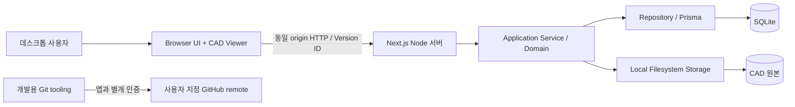
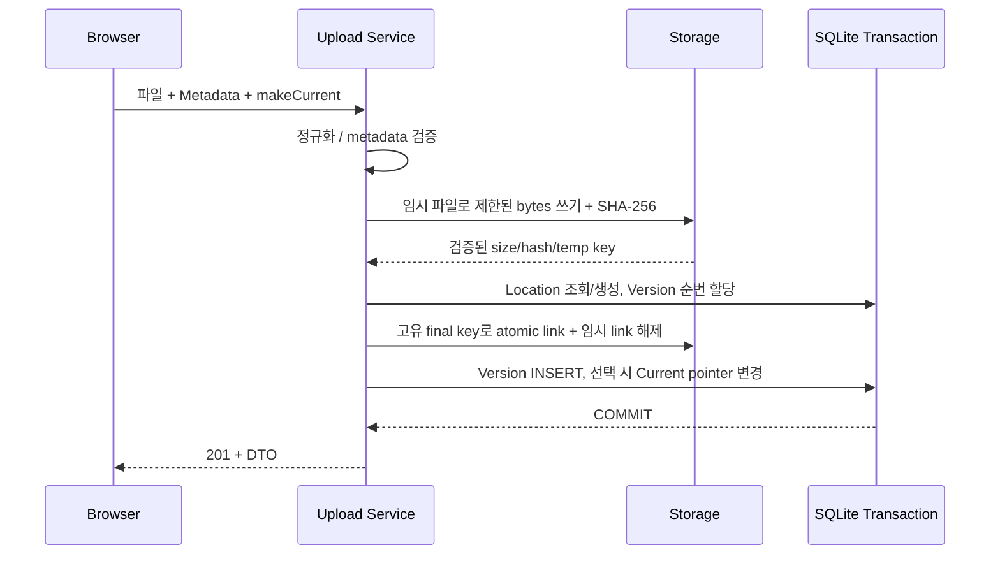
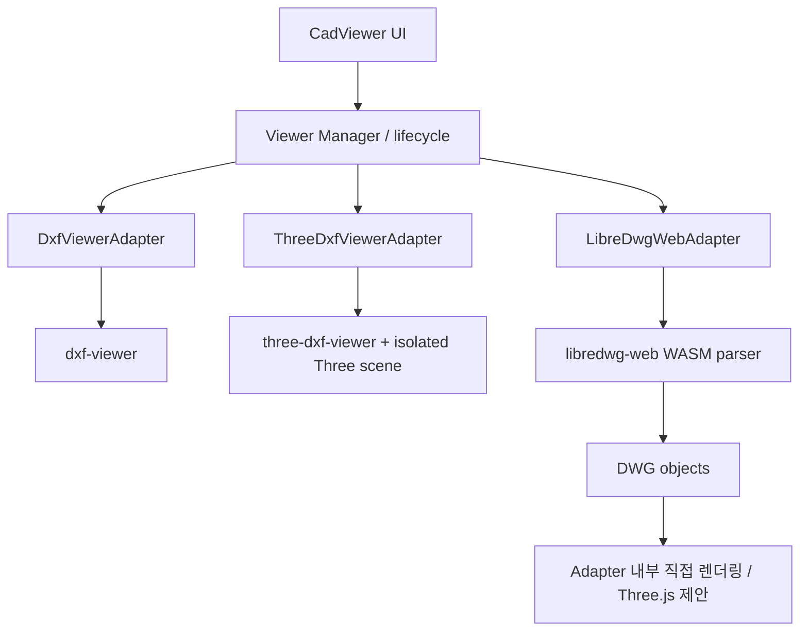
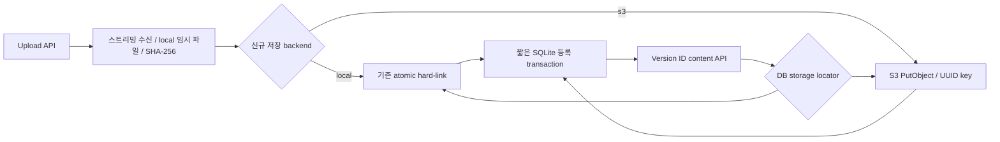

## #273 RF-02 exact Main dispatch after GITHUB_TOKEN squash (2026-11-09)

GitHub Actions `GITHUB_TOKEN`으로 수행한 merge의 push는 다른 Actions push workflow를 자동 트리거하지 않는다. RF-02 Owner integration workflow는 **merge writer job에만** contents:write/pull-requests:write/actions:write를 부여한다. 성공한 protected squash의 PR/sha/tree/one parent readback 후 Main branch ref==mergeSHA를 재확인하고 별도 `main-hold.yml` workflow_dispatch를 SHA+packetSHA256 입력으로 한 번 호출한다(원격 응답 불확실→HALT, 재호출 금지). HOLD workflow는 정확 source SHA와 Packet hash 형식을 확인하며 기존 Main push/Owner manual 사용도 보존한다. RF02 readback은 기존 exact push run 및 별도 exact dispatch run을 다른 타입으로 검사, full name+head SHA+repo ID+branch main+attempt1+HOLD Job SUCCESS를 요구한다. Pending/Cancel/Skip/Failure는 MAIN_VERIFIED 불가. RF-03/04 authorization과 무관.

---

## #273 RF-02 protected integrate workflow (2026-11-08)

기존 RF-01 `parse_packet/plan/read_run/check_jobs`를 공유하는 후속 `release_finalizer_integrate.py`: owner-dispatch identity → exact packet + Main SHA/CAS → strict ruleset 26731716 (squash only, thread resolution, no bypass, required aggregate strict) → GraphQL read-only review-thread pagination + REST reviews → GitHub job evidence / files scope → 정상 PR squash API 요청(정확 HEAD) → actual squash tree/parent readback → Main push `main-hold.yml` exact run·attempt1 proof. POST GraphQL은 쿼리 전용, mutation 아님; 실제 저장소 변경은 integrate 모드의 단일 protected squash뿐. PLAN/readback jobs get-only, integrate job만 `pull-requests:write`. Uncertain PUT 상태는 자동 반복하지 않음. Main run pending과 SUCCESS 명시 구분, GHCR/Issue Closure 격리. 지속 nonce/checkpoint는 후속 RF-01 수리 필요.

---

## #273 RF-01 request scope hardening (2026-11-08)

읽기 전용 Packet V1에 exact GHCR `releaseTarget`, 최대 24h issued/expiry epoch, 고유 AC ID 목록, integration/release/closure Owner Intent를 필수화한다. Owner Intent와 SHA256은 실제 Owner 승인/권한 증명이 아니다. PR/Main workflow와 필수 Job은 attempt1만 PASS로 재사용하며 변경된 source HEAD는 별도 CI가 필요하다. Persistent nonce·checkpoint·protected merge/출고/Close는 미구현; #229 Main/tag HOLD 및 기존 두 보호 환경 승인 유지.

---

## #273 — Release Finalizer 단계별 아키텍처 (2026-11-08)

**외부 요청 1회 ≠ 자동 승인 1회.** `Release Finalizer Request V1`은 저장소 ID, Owner, PR/Issue, source SHA/tree/base, semver, 3 OCI 역할, nonce, stop policy 및 SHA256으로 요청을 고정한다. RF-01은 trusted GitHub API GET의 정확 PR/Source/CI/Main/Squash identity를 read-only로 조회하고, 부족한 증거는 WAIT/HALT로 분류한다. Packet hash는 승인 서명이 아니고 PR CI 성공 역시 GHCR 권한이 아니다. `release-finalizer.yml`은 `workflow_dispatch` PLAN 전용, job read-only token; mutable workflow 없음.

후속 RF-02는 리뷰 thread/Ruleset/필수 PR Check와 HEAD CAS를 검증한 뒤에만 Squash 및 Main exact SHA 확인한다(현재 GitHub auto-merge OFF). RF-03은 기존 독립 protected Candidate/Promotion의 Owner review·OIDC+digest proof를 **정확 release에만** 연결하고 기존 #229 자동 Main/Tag HOLD를 변경하지 않는다. 기존 publisher는 2-image이므로 0.61.1 auto-publish 경로에 사용하지 않는다. RF-04는 근거가 일치하는 Issue AC 완료를 별도 Owner GO로 확인한 뒤만 종료한다. 변이 단계에는 재사용 증거/부분 성공/재시도/동시 Writer/애매한 registry 결과를 fail closed로 처리하는 영속 checkpoint가 필요하다.

구현 상태: RF-01 read-only source+tests 추가; RF-02/03/04 **미구현**, 이를 one-shot 출고 성공으로 취급 금지. [Issue273](Issue273.md), [TestPlan](TestPlan.md) TP-273 참조.

---

## #218 L-05 — 목록 상태 조회 수명주기 (2026-11-08)

기존 `CadTable → SceneStatusProvider → /api/scene-build-jobs → readSceneBuildBatch`를 재사용한다. 서버의 signed Site filtering·페이지 batch SQL·immutable manifest/full DTO/blob 검증이 READY의 기준이며 Job READY만 신뢰하지 않는다. 클라이언트는 화면 DXF ID를 중복 제거하고100개 이하로 나눈 요청을 순차 실행한다. 외부 Provider가 enabled+ID scope별 key로 내부 Provider를 새로 생성해 disabled→enabled와 A→B→A의 commit에서도 이전 상태/Retry를 재사용하지 않는다. 요청 generation/AbortSignal과 현재 목록 identity로 늦은 성공·실패·finally·timer를 무효화하고 이전 목록의 retry 권한을 노출하지 않는다. 최초·수동 갱신·탭 복귀는 전체 목록, 자동 tick은 pending ID만 조회한다. 자동 응답은 요청 ID만 교체/제거하고 다른 terminal 행은 보존한다. 연속 전송 오류의 자동 복구에는 유한 budget을 둔다. 초기/terminal 오류는 별도 상태 갱신으로 복구하고 Job 실패로 재해석하지 않는다.

상태/allowlisted 사유의 순수 표시 계약은 domain, 전송·취소/타이머는 client controller, React UI는 상태·오류·갱신 동작을 담당한다. API 권한·원본/Worker·Scene publisher는 기존 경계를 유지한다. 정확 AC/구현 추적은 Issue218 L05, 실행 결과는 TestReport를 따른다. 소스0.61.1은 등록0.61.0과 같은 G7 schema/data/runtime 계약의 forward COMPATIBLE edge이며 SQL/migration은 없다.

---

## #225 G3 — 기존0.61 구조의 승인 운영 적용 (2026-11-08)

제품 module/interface·Builder/admission·DB 계약 변경 없이 고정된 정식0.61 App/Migrator/CPU Worker를 기존 volume에 적용했다. 현재 App의 두 Scene flags ON 및 별도 CPU Worker1개의 기존 격리 계약을 실제로 확인했다. 기존 Version backfill0이며 실제 지원 범위/운영 검증 한계는 TestReport U-225-G3-20261108, 재기동과 별도 목적지 복구는 Operation이 정본이다.

---

## #225 G2 — 실제 archive 기반 격리 upgrade/readback 도구 (2026-11-08)

제품 구조·Scene/Builder/admission은 변경하지 않는다. `src/tests/oci/or58-g2-upgrade.py`는 기존 OR58/FUP1 복원·G7 정식 upgrade helper·RR2 named/CID child journal을 재사용한다. immutable0.58 archive를 등록 schema로 검사한 뒤 새 소유 volume에서 고정된 출고3digest의0.61 migration, 시작 전 전체 business/CAD 보존, 새 App의 내부 HTTP/원본 SHA 및 정지 후 선택 business 보존을 검사한다. `g2-volume-snapshot.mjs`는 nonroot/read-only 원본에서 행/CAD 해시만 반환하며 이전 열 이름만 bounded env로 받는다. host0600 private baseline을 컨테이너 UID10001에 직접 읽히지 않는다.

Docker CREATED의 빈 runtime NetworkID와 실제 network object identity를 구별한다. 시작 전에 exact network object/name/internal/nonce 및 mount/port/image를 검사하고, 시작 후에는 exact runtime NetworkID를 필수로 한다. 오류는 제한된 stage/code만 공개하며 자원 정리는 durable CID/nonce 소유권으로 한정한다. 실제 첫 실패와 수정·재시도는 TestReport/FailureLedger를 따른다. 실제 clone 정상 인증/Viewer는 이번에 실행하지 않았고 출고 digest에 결합된 기존 signed RR2/RR3 E2E 근거와 분리한다. 이후 동일 immutable archive의 새0.58 replacement-volume 복원은 in-place downgrade와 다르다. 수용 기준은 TestPlan G2C01–07이다.

---

## #225 G1 — OR58 등록 schema와 복사본 동등성 분리 (2026-11-08)

기존 OR58 `sqlite_fingerprint`의 동일 schema/전체 row hash 비교는 복원 충실도이며 등록0.58 schema 적합성과 별개다. G1은 기존 private disposable SQLite extraction에서 등록 release0.58의 `assertDeclaredSchema`를 재사용하여 exact migration history와 허용 DDL/guard를 검증한다. G7 validator의 SQL normalization을 유지하고 별도 Python DDL 정본을 만들지 않는다. exact의 범위는 등록된 application DDL 및 승인된 migration name/checksum/completion/rollback 필드다. 기존 validator가 제외하는 `sqlite_%` 내부 object와 `_prisma_migrations` 자체 DDL의 모든 열까지 검증했다는 뜻은 아니다. manifest의 release/schema/image pair와 빈 historical sourceCommit도 함께 확인한다. 기존 raw DB/WAL/SHM+CAD/asset hash 비교와 local locator 검사 책임은 OR58에 남는다.

검사 실패는 새 restore volume 생성 전 차단한다. 이는 test-only 복구 준비 검증 경로이며 production validator/DB schema·Worker/Scene 또는 운영 백업 실행을 변경하지 않는다. bridge 실패/의존성 부재를 성공으로 간주하지 않는다. 구체 AC는 TestPlan G1S01–06, 실제 실행·기존 archive 재검사 결과는 TestReport가 정본이다. 제품 범위는 지원2D DXF의 좁은 #225 GO-PILOT이며 FUP5 BLOCK/INSERT 구현은 #268의 별도 후속이다.

---

## #225 FUP4 설계 정본 — section/table 경계와 제한된 BLOCK/INSERT (2026-11-08)

**DESIGN_ONLY. 아래 수용은 향후 최소 구현 Unit FUP5의 설계 수용 범위이며 현재 runtime 지원이 아니다.** 현재 FUP3는 아래 기존 계약만 구현했고 실제 전체 DXF는 UNSUPPORTED·payload0이다. 이번에는 converter/fixture/runtime·제품 admission·Builder/Worker/DB/flags·앱0.61.0/운영0.58.0을 변경하지 않는다. Requirements FR-FUP4와 TestPlan TP-225-FUP4가 이 절을 참조한다. 공식 format 사실, 본 실험의 보수적 선택, 추가 검증이 필요한 사항을 구별한다.

### 0. 실제 입력의 집계 관측과 남은 gap

Developer의 private `developer-aggregate.json`·`developer-field-gap.json` 및 최종 `developer-analysis-v2.json`·독립 `developer-verification-v4.json`을 읽어 대조했다(원본 재변환/렌더0). 전체는6section이며 CLASSES98records·OBJECTS114records가 **비어 있지 않다**. HEADER213variables 중203개가 FUP3 whitelist 밖이고 required LWDEFAULT가 없다. TABLE record는 LTYPE26/LAYER24/STYLE8/APPID28/DIMSTYLE16/VPORT1/BLOCK_RECORD147이며 UCS/VIEW는 빈table도 존재한다. LTYPE25개는 noncontinuous명이고23개는 dash를 가지며, LAYER4개는 noncontinuous 참조·24개는plotstyle390, STYLE4개는1071·2개는미지원flags를 가진다. 기존 geometry4종2503records 모두 FUP3가 거부하는5/330을 가진다. 이는 primitive type집계가 곧 지원수라는 해석을 막는다.

BLOCK147definitions 중group70 bit1(anonymous)128개·nonconstantattributeflag1개, 별도name분류는reservedspace2/otherstar128/plainASCII17/nonASCII0이며10rootINSERT에서7개definition이도달가능하고그중anonymous0이다. INSERT285(ENTITIES10/BLOCKS275), shareddefinitions5, 모든BLOCKowner147개는 같은이름BLOCK_RECORD와handle일치, missingrefs/cycles0·최대path3을 관측했다. INSERT scale은default(all1)20/nondefaultpositive3Duniform(sx=sy=sz>0)252/negative-or-mirrored13이다.3Duniform총272,XYpositive+Sz1은20,최종제안Sz∈{1,s}에는272개가field상호환된다. 이수는완전한INSERT수용수와다르다. nondefaultrotation205/normal9/attributes66=4,array0/nonzeroinsertionZ0을관측했다. 이 분류는 sourcefield 관측이며 형상·encoding·지원성 PASS가 아니다. BLOCK_RECORD의147개 모두LAYOUT340이 있고 147개 모두 BLOCK_RECORD record70 field 부재(숫자값0 관측이 아님)이므로 아래units4-required/layoutref-reject profile에도 들어오지 않는다. TEXT/MTEXT/ATTDEF/ATTRIB/DIMENSION/HATCH/LEADER/POINT/VIEWPORT 등 미지원body도 존재한다. 따라서 다음 최소 Unit이 구현되어도 실제전체파일은 계속 UNSUPPORTED·payload0이며, 이 문서는 source의이름/handle/text/font/좌표를 공개하지 않는다. graph expansion의 rawrecord 추정은 array/style/textfidelity나 future5000segment proof를 뜻하지 않는다.

### 1. section/header/table 지원 행렬

공식 DXF는 HEADER/CLASSES/TABLES/BLOCKS/ENTITIES/OBJECTS/optional THUMBNAILIMAGE로 나뉜다. CLASSES는 BLOCKS/ENTITIES/OBJECTS에 나타날 application class 정의이고 OBJECTS는 nongraphical이라는 분류일 뿐이다. **nongraphical=표시에 무관**은 성립하지 않는다. 예를 들어 SORTENTSTABLE은 entity 재생 순서를 바꾼다. [Autodesk file structure](https://help.autodesk.com/cloudhelp/2015/ENU/AutoCAD-DXF/files/GUID-D939EA11-0CEC-4636-91A8-756640A031D3.htm), [CLASSES](https://help.autodesk.com/cloudhelp/2024/ENU/AutoCAD-DXF/files/GUID-6160F1F1-2805-4C69-8077-CA1AEB6B1005.htm), [OBJECTS](https://help.autodesk.com/cloudhelp/2024/ENU/AutoCAD-DXF/files/GUID-2D71EE99-A6BE-4060-9B43-808CF1E201C6.htm), [SORTENTSTABLE](https://help.autodesk.com/cloudhelp/2024/ENU/AutoCAD-DXF/files/GUID-462F4378-F850-4E89-90F2-3C1880F55779.htm)

| 영역 | FUP3 현재 | FUP5 최소 구현 설계 | 이후 별도 의미 검증 |
| --- | --- | --- | --- |
| section 문법 | HEADER→TABLES→ENTITIES만 | HEADER→[CLASSES]→TABLES→BLOCKS→ENTITIES→[OBJECTS], 각1회 이하/필수4section 정확1회·ENDSEC·EOF1개/후행값0. optional section은 **완전히 빈 경우만** 허용 | 비어 있지 않은 CLASSES/OBJECTS는 모든 경우 전체거부. 알려진 CLASS명·instance count0도 예외0; proxy/custom/dictionary/layout/draworder 등을 개별 설계해야 함 |
| HEADER | FUP3 exact whitelist | 같은 AC1018/encoding/INSUNITS4/LWDISPLAY0·default 계약. 추가 변수0 | $INSBASE 등도 unknown으로 전체거부. 공식 HEADER의 drawing insertion base와 개별 BLOCK base를 혼동하지 않음; camera/extents/defaults라는 이유로 임의 생략0 |
| LTYPE/LAYER/STYLE | FUP3 제한 record | 기존 continuous/layer/dormant STYLE 의미 유지. 아래 강화한 handle/owner profile 적용 | dash/complex linetype·text/font·투명도/plot/material 등 FUP3 제외 의미 계속거부 |
| BLOCK_RECORD | 전체거부 | required1 table; 아래 정확 static record+reference profile | LAYOUT340, preview310, xdata1001+ 및280/281 presence는 최소범위에서 거부 |
| APPID | 전체거부 | 빈 table도 거부 | xdata 등록명/flag와 모든 사용처를 함께 검증하는 별도 dormant profile 필요. APPID record 존재가 임의 xdata skip 허가는 아님 |
| DIMSTYLE | 전체거부 | 빈 table도 거부 | STYLE340·BLOCK341–344 등의 참조와 DIMENSION 표현·화살표/text 의미 필요; block만 지원해도 dimension 지원 아님 |
| VPORT/VIEW/UCS | 전체거부 | 빈 table도 거부 | view/UCS/camera/clip 등 구분 후 개별 profile 필요. VPORT는 동일 이름 다중 record가 유효하므로 FUP3 symbol-name uniqueness를 그대로 일반화하지 않음 |
| BLOCKS/INSERT | 전체거부 | 아래 named static XY profile만 | array/attribute/nonuniform/reflection/OCS/3D/xref/dynamic/anonymous/layout 표시 별도 |
| THUMBNAILIMAGE/unknown section/table/header/entity/field | 전체거부 | empty/hidden/unreferenced라도 전체거부·후보0 | 명시적인 field semantics·refs·bounds·독립 golden 없는 blanket-ignore 금지 |

추가 table의 공식 의미는 [APPID](https://help.autodesk.com/cloudhelp/2020/ENU/AutoCAD-DXF/files/GUID-6E3140E9-E560-4C77-904E-480382F0553E.htm), [DIMSTYLE refs](https://help.autodesk.com/cloudhelp/2016/ENU/AutoCAD-DXF/files/GUID-F2FAD36F-0CE3-4943-9DAD-A9BCD2AE81DA.htm), [VPORT](https://help.autodesk.com/cloudhelp/2023/ENU/AutoCAD-DXF/files/GUID-8CE7CC87-27BD-4490-89DA-C21F516415A9.htm)를 확인했다. HEADER 추가 수용0은 format 금지가 아닌 범위 선택이다. [HEADER $INSBASE/$INSUNITS](https://help.autodesk.com/cloudhelp/2015/ENU/AutoCAD-DXF/files/GUID-A85E8E67-27CD-4C59-BE61-4DC9FADBE74A.htm)

### 2. BLOCK_RECORD·BLOCK·INSERT·종료와 reference profile

공식 BLOCK group70은 bit flags(1 anonymous,2 nonconstant attribute definitions,4 xref,8 overlay,16 externally dependent,32 resolved xref/dependent,64 referenced xref)다. **70=0이어도 constant ATTDEF가 없다는 보장은 없다.** group10/20/30은 base point,2/3은 block name,1은 xref path다. Model/Paper 공간도 특별한 block definitions로 표현된다. [Autodesk BLOCK](https://help.autodesk.com/cloudhelp/2024/ENU/AutoCAD-DXF/files/GUID-66D32572-005A-4E23-8B8B-8726E8C14302.htm)

반면 BLOCK_RECORD record70은 **insertion units**이며 table header70의 capacity나 BLOCK70 flags가 아니다.340은 LAYOUT pointer,280은 explodability,281은 scalability다. ObjectARX는 Any/Uniform scaling 정책을 구별한다. 최소 Unit은280/281의 wire enum/default를 추정하지 않고 presence 자체를 거부한다. 이 제외는 의미 미해결 항목을 명시적으로 차단하는 선택이다. [BLOCK_RECORD fields](https://help.autodesk.com/cloudhelp/2026/ENU/AutoCAD-DXF/files/GUID-A1FD1934-7EF5-4D35-A4B0-F8AE54A9A20A.htm), [ObjectARX scaling policy](https://help.autodesk.com/cloudhelp/2026/ENU/OARX-ManagedRefGuide/files/OARX-ManagedRefGuide-Autodesk_AutoCAD_DatabaseServices_BlockScaling.html)

**FUP5 exact 선택**: source를 재작성하지 않고 전체 parse→정의/ref 검증→DAG 검증→확장→world geometry→DTO로 처리한다. 모든 single field는 같은 값 중복도 거부하며, 허용한100 subclass marker만 정확한 집합으로 중복 없이 검증한다. 일반 entity의 field 순서는 가정하지 않는다. [Autodesk common entity field/order](https://help.autodesk.com/cloudhelp/2023/ENU/AutoCAD-DXF/files/GUID-3610039E-27D1-4E23-B6D3-7E60B22BB5BD.htm), [TABLE order/capacity/handles](https://help.autodesk.com/cloudhelp/2017/ENU/AutoCAD-DXF/files/GUID-5AB9300F-F0AC-4ADE-89EA-A9D1D152D8B8.htm)

| record | 최소 exact 허용/필수 의미 | 거부 |
| --- | --- | --- |
| handles/owners 공통 | 모든 TABLE·symbol record·BLOCK/ENDBLK·primitive/INSERT에5 required; FUP3 canonical nonzero hex1..16/no leading zero/uppercase uniqueness를 문서 전체 적용. symbol record330=해당 TABLE5 required; BLOCK/ENDBLK 및 그 body entity330=그 BLOCK_RECORD5 required; ENTITIES entity330=*MODEL_SPACE record5 required.330은 definition owner이며 INSERT의 target은2 이름으로 별도 lookup | dangling/cross-owner/duplicate handle/case collision·owner 추측/repair0. TABLE header는 FUP3 field 집합(330없음);102 reactor/extensiondict/360/xdata/unknown handle pointer는 거부 |
| BLOCK_RECORD TABLE |2=BLOCK_RECORD·5·70 capacity0..256·optional100=AcDbSymbolTable. actual<=capacity; table order는 LTYPE가 LAYER보다 먼저, 나머지 순서 무관 | duplicate table/잘못된 nesting/unknown header field |
| BLOCK_RECORD record |2=name·5·330·70=4(mm) required, optional100={AcDbSymbolTableRecord,AcDbBlockTableRecord}. 각 name은 BLOCK definition과 정확1:1. units는 source metadata로 보존하며 conversion factor를 추가하지 않음 |70 absent/0/다른units,340 포함(0도 거부),280/281/310/xdata/기타field. 이는 전체 DXF 유효성 판정이 아닌 더 좁은 후보 profile |
| 공간 container | *MODEL_SPACE의 record+empty BLOCK/ENDBLK required1, *PAPER_SPACE/*PAPER_SPACE0는각optional1(존재하면같은empty검증). 이3가지이름만 ASCII symbol 규칙의 별도 예약명 예외. base=(0,0,0), layer0, flags0; begin/end의optional67은model0/paper1에정확히일치; paper content0/INSERT target0. top entities는 model container 소유만 | 다른 *예약/anonymous 명, 추가 paper layout·nonempty 공간 BLOCK·공간container marker외의paper-space67=1·410/LAYOUT ref. absent OBJECTS/empty OBJECTS와 양립하는 제한 profile이며 실제 AutoCAD writer의 LAYOUT graph 완전성을 지원한다고 주장하지 않음 |
| named BLOCK begin/end | 일반name은 FUP3 ASCII 규칙·case-normalized unique; begin2=3,70=0,1=empty,8=0,10/20 finite bounded XY·30=0 required;5/330 required; optional100={AcDbEntity,AcDbBlockBegin}, optional67=0(예약papercontainer만1), optional4=bounded ASCII description0..256. end5/330·8=0 required, optional100={AcDbEntity,AcDbBlockEnd}, optional67은begin과같은공간값. BLOCK→0개 이상 body→ENDBLK 정확쌍 | nested BLOCK record/stray/missing ENDBLK,70 nonzero/unknownflag,nonempty1,unsupported body. body가 hidden/unreferenced여도 전부 검증; metadata begin/end layer를 body layer로 덮어쓰지 않음 |
| INSERT | FUP3 commonstyle+5/330·2=존재하는 일반named BLOCK·10/20 XY·30=0 required; optional100={AcDbEntity,AcDbBlockReference}.41/42 absent1 또는 finite **동일한 양수 s**;43은absent1 또는명시값1 또는s (`Sz∈{1,s}`)이며source Sz보존;50 absent0 또는 finite degree0..360(normalize360→0);66 absent0/0,70/71 absent1/1,44/45 absent0/0;210/220/230 absent 또는 완전한(0,0,1) tuple | sx≠sy/negative/zero/NaN/Infinity·Sz∉{1,s}·array count>1/spacing≠0·66≠0·nondefault extrusion/Z·system target·missing name·AcDbMInsertBlock·unknownfield |
| primitive body | 기존 LINE/CIRCLE/ARC/straight LWPOLYLINE geometry profile+commonstyles+5/330, 아래 context 의미 | TEXT/MTEXT/ATTDEF/ATTRIB/POINT/DIMENSION/HATCH/LEADER/VIEWPORT 등 전부. hidden/unreferenced 지원예외0 |
| ATTRIB/SEQEND | 최소 Unit에서는 어떤 위치에서도 전체거부 | invisible/constant attributes도 텍스트 의미가 없어 생략0; INSERT66=1 chain을 ENDBLK로 종료하거나 SEQEND를 block종료로 취급0 |

공식 INSERT66=1은 뒤따르는 ATTRIB sequence와 SEQEND를 요구하며2는 block name, insertion10은 OCS,41/42/43 기본1·50 기본0·70/71 기본1·44/45 기본0·extrusion 기본(0,0,1)이다. [INSERT](https://help.autodesk.com/cloudhelp/2024/ENU/AutoCAD-DXF/files/GUID-28FA4CFB-9D5E-4880-9F11-36C97578252F.htm) ENDBLK는 BLOCK definition 종료이고 SEQEND는 attribute/polyline sequence 종료다. SEQEND의-2는 APP-only라 DXF에 저장되지 않는다. [ENDBLK](https://help.autodesk.com/cloudhelp/2018/ENU/AutoCAD-DXF/files/GUID-27F7CC8A-E340-4C7F-A77F-5AF139AD502D.htm), [SEQEND](https://help.autodesk.com/cloudhelp/2018/ENU/AutoCAD-DXF/files/GUID-FD4FAA74-1F6D-45F6-B132-BF0C4BE6CC3B.htm) ATTRIB70의1 invisible/2 constant/4 verify/8 preset은 BLOCK70 flags와 별개이며 여러 subclass에서 같은 code가 다른 의미를 가질 수 있다. [ATTRIB](https://help.autodesk.com/cloudhelp/2024/ENU/AutoCAD-DXF/files/GUID-7DD8B495-C3F8-48CD-A766-14F9D7D0DD9B.htm)

### 3. 좌표·중첩·world-space 오차 계약

공식 INSERT/CIRCLE/ARC/LWPOLYLINE은 OCS이고 LINE은 WCS 좌표다. OCS origin은 WCS origin이고 extrusion으로 basis가 결정된다. 최소 Unit은 **모든 단계 default extrusion/Z0/thickness0**만 수용하고 Sz∈{1,s}를보존하므로 XY basis가 일치한다. OCS를 무시하여 일반3D를 flatten하는 정책이 아니다. [Autodesk OCS](https://help.autodesk.com/cloudhelp/2020/ENU/AutoCAD-DXF/files/GUID-D99F1509-E4E4-47A3-8691-92EA07DC88F5.htm) ObjectARX는 block MCS→drawing WCS의 위치/normal/scale/rotation mapping을 정의한다. DXF angle은 degree이며 구현 시 radian으로 변환한다. [BlockReference mapping](https://help.autodesk.com/cloudhelp/2019/ENU/OARX-ManagedRefGuide/files/OREFNET-Autodesk_AutoCAD_DatabaseServices_BlockReference.html), [numeric code angle units](https://help.autodesk.com/cloudhelp/2024/ENU/AutoCAD-DXF/files/GUID-3F0380A5-1C15-464D-BC66-2C5F094BCFB9.htm)

아래 식은 공식 mapping에서 도출한 이 설계의 XY 수학 계약이다(열벡터, 오른쪽부터 적용). raw BLOCK base `b`, 그 안의 raw point `p`, INSERT 위치 `t`, `S=diag(sx,sy)`, `Rθ=[[cosθ,-sinθ],[sinθ,cosθ]]`이면:

`M = T(t) · Rθ · S · T(-b)`; `p_parent = t + Rθ S(p-b)`.

즉 base를 먼저 빼고 **scale→rotation→insertion**이다. nested child `Mc`는 parent definition 좌표를 출력하므로 `Mworld=Mouter·…·Mparent·Mchild`; top primitive는 identity다. base를 두 번 빼거나 insertion을 scale하거나 행렬 순서를 바꾸지 않는다. ObjectARX는 modern AutoCAD-created block origin이 보통0이며0 유지 권고라고 설명하지만, 이 후보는 raw nonzero BLOCK base를 위 식으로 검증하며0으로 고치지 않는다. [BlockTableRecord origin](https://help.autodesk.com/cloudhelp/2018/ENU/OARX-ManagedRefGuide/files/OREFNET-Autodesk_AutoCAD_DatabaseServices_BlockTableRecord_Origin.html)

이planarpositiveuniform선택에서(s,s,1)과(s,s,s)는모든sourcebase/insertion/primitiveZ가0일때같은XY/Z0를만든다. Sz1로rewrite하지않으며자손의nonzeroZ가있으면숨김/unused여도전체거부한다. 일반3Duniform/nonuniform지원주장은없다. 최소 Unit의 각 XY scale 및 누적scale `q=∏s`는 `[10^-6,10^6]` 범위, 모든 합성행렬/중간point/base차·translation finite, 최종/중간XY 절댓값≤1e6을 요구한다. 수치overflow·degenerate segment·Float32 collapse는 전체거부한다. 원좌표도 FUP3 bound를 유지한다. **local에서0.05mm tessellate한 결과를 q배 확대하는 방식은 금지**다.

world double analytic curve→world chord의 최대편차≤0.05mm, world double vertex→최종 Float32의 Euclidean 이동≤0.05mm를 별도 검증하여 합≤0.1mm 유지한다. circle/arc는 누적2×2 linear부분 `A`, `σ=||A||₂`, 원radius `r`에 대해 `rσ(1-cos(Δ/2))≤0.05`; `Δ≤π`, circle최소3 segments, `Δmax=min(π,4 asin(sqrt(min(1,0.05/(2rσ)))))`, `N=ceil(sweep/Δmax)`(circle최소3), endpoint는 original parameter에서 직접 world transform. 최소 uniform에서는σ=q다. 작은각도 계산의 cancellation/underflow로 N을 과소추정하면 안 되며 마지막 segment별 error 재검증 및 필요시 bounded 증분한다. Float32 error도 local에서 검사하지 않는다. budget초과는 tolerance를 늘리지 않고 전체거부한다. closed circle/closedLWP는 정확한 closure edge를 유지하고 ARC는 열림; FUP2 source closure flag/중복terminal 정책 유지.

**나중의 별도 affine Unit(현재 거부)**: nonuniform+rotation 중첩은 shear가 될 수 있으므로 단일 scale/rotation으로 재분해하지 않고 완전한 `A,t`를 유지한다. 위σ bound는 affine image 전체의 curve→chord 최대편차 상한이므로 ellipse를 circle로 잘못 저장하지 않고 world polyline으로 tessellate한다. `det(A)<0` reflection은 원래 parameter/vertex순서를 보존하면 world winding이 반전된다. ARC를 반대쪽 complementary sweep로 바꾸지 않고 source CCW sweep·signed world orientation을 구별한다. circle/closedpoly의 closed값은 유지, open ARC는 계속open; index순서를 뒤집어 source semantics를 숨기지 않는다. `det=0`/zero scale은 계속거부. 이 수학은 affine 선형성/연산자norm으로 도출한 설계이며 Autodesk 지원/실행결과 주장 아님. negative/nonuniform wirefields·BLOCK_RECORD281 constraints·normal−Z/OCS는 향후 별도 source/fixture 검증 전 미지원이다.

### 4. recursive layer/style·visibility 계약

공식 block property 규칙은 layer0+BYLAYER가 insertion layer를 따르고 BYBLOCK은 enclosing reference의 개별property를 따르며 nested block에도 적용된다. 이 규칙을 아래 recursive context로 명시한다. [Autodesk block properties](https://help.autodesk.com/cloudhelp/2019/ENU/AutoCAD-Core/files/GUID-25E9F20C-D146-426C-8815-37DF48D2D33F.htm) 색62=0/BYLAYER256, linetype BYBLOCK/BYLAYER, entity visibility60은 공식 common field이며 weight−2는 BYBLOCK이다. [entity fields](https://help.autodesk.com/cloudhelp/2023/ENU/AutoCAD-DXF/files/GUID-3610039E-27D1-4E23-B6D3-7E60B22BB5BD.htm), [lineweight enum](https://help.autodesk.com/cloudhelp/2027/ENU/OARX-RefGuide/files/OARX-RefGuide-AcDb__LineWeight.html)

1. context는 enclosing INSERT의 effective layer·resolved color/linetype/weight·ancestor visibility·locked layer chain이다. top context에는 enclosing INSERT가 없다. INSERT 자신도 parent context에서 먼저 완전히 resolve한 뒤 child context를 만든다. raw entity layer0이면 enclosing INSERT effective layer(최상위는0), 그 외는 자기named layer. BLOCK begin8로 body layer를 바꾸지 않는다.
2. color420 우선, explicit ACI와 FUP3 palette bounds 유지;62 absent/256은 **effective layer** color,62=0은 enclosing INSERT resolved color. linetype BYLAYER→effective layer, BYBLOCK→enclosing resolved continuous, explicit CONTINUOUS 유지. weight−1→effective layer,−2→enclosing resolved weight,−3→LWDEFAULT, nonnegative→explicit. **최상위 primitive/INSERT에서 enclosing context가 필요한 unresolved BYBLOCK property가 하나라도 있으면 거부**하며 임의ACI7/default로 보충하지 않는다. 예외를명확히하면 valid explicit truecolor420+62=0은context가필요없어색상에한해수용한다(fallback62=0보존). linetypeBYBLOCK/weight−2도동시에있으면해당unresolvedproperty때문에거부한다.
3. 설계의 visible식은 `ancestorVisible && !effectiveLayer.off && !effectiveLayer.frozen && entity60!=1`; INSERT가false이면 named childlayer가visible이어도 자손false다. 모든hidden/unreferenced 정의도 geometry/unknownfield/ref/precision과 expanded budget 검증을 면제받지 않는다. layer off/frozen의 표시 의미는 공식이며 ancestor conjunction은 이 제한 renderer의 명시적 recursive 계약이다. [Autodesk layer states](https://help.autodesk.com/cloudhelp/2025/ENU/AutoCAD-Core/files/GUID-6B3E3B5D-3AE2-4162-A5FE-CFE42AB0743B.htm)
4. locked는 effective layer lock 및 ancestor INSERT effective-layer lock chain을 각각 보존하고 `effectiveLocked=any(chain)`를 실험 metadata로 계산한다. 이는 이 read-only 후보의 보수적 표시 metadata이며 AutoCAD editing/selection parity 주장이 아니다. FUP3와 같이 fade/hide0, plot290은 interactivevisibility와 별개이며 effective leaf-layer plot값과 ancestor INSERT effective-layer plot값의순서있는chain을각각보존한다. aggregate plotpermission/AutoCADplotparity를만들지않는다. resolved lineweight는 hundredths-mm metadata이고 LWDISPLAY0의1px hairline만 표시한다.
5. raw layer/property·effective layer·resolution origin ENTITY/LAYER/DEFAULT/BLOCK 및 참조한 INSERT instance path를 별도 유지한다. 공유definition도 instance마다 context를 재계산한다. validator는 선언된definitions/instance path에서 행렬·geometry·style·counts를 재도출하고 저장된 RGB/visible/weight/transform self-claim을 신뢰하지 않는다.

### 5. graph·확장·DTO·자원과 다음 Unit

이 절의 숫자는 **실행으로 입증된 capacity가 아닌 다음 구현의 상한 선택**이다. source16MiB/pairs300000, 전체TABLErecords768(새 BLOCK_RECORD 포함)/table256, BLOCKdefinitions256(존재하는예약container포함), source body+top entityrecords10000, direct INSERTedges4096(top포함), graph 최대path8 definitions, expanded INSERTinstances10000, expanded primitiveleaves5000, **전체segments5000**(hidden포함), candidate32MiB를 allocation 전에 검사한다. cycle/self-cycle·dangling/system target는 모든definition에서 탐지하고 unreferenced definition도 지원검증한다. DFS gray stack으로cycle, DAG memo는context독립인subtree최대depth·확장instances/leaves만저장하고 checked/saturating arithmetic으로 구하되 **`현재depth+cachedDepth−1` 재검사**, 반복shared subtree는 각 occurrence별곱/합 budget를 차감한다. memo/cachedgeometry가 expandedcount를1로 줄이지 않는다. curve의segment예산은각instance의최종σ로계산한다. definition만으로N/curvebuffer를memoize하지않는다. localparameter/tessellationpattern만cache한다면sourceprimitiveID/geometry+최종σ+오차정책을key로하고매instance에서transform/Float32quantization을새로한다. worldbuffercache는sourcegeometry+완전한합성A,t+precision정책을key로해야하며같은σ만으로다른rotation/translation의buffer를공유하지않는다. localtessellation결과를다른scale에재사용하지않는다. unused definition도 입력/refs/curve validity와identity외부context에서의독립확장≤5000segment를검증한다(BYBLOCK은정의내선언으로보존하며실제top-levelBYBLOCK과혼동하지않음). 그러나이는다른배율의world오차증명이아니며 top scene count에는 임의출력하지 않는다. hidden instance는 출력visible=false로 남기며skip0.

전체 parse/ref/graph/확장/tessellation/검증/serialization에 cooperative15s와 independentparent120s hardtimeout, 기존 isolated CPU/memory/pids/private fsync-readback boundary를 유지한다. 산출 실패/timeout/미완성/추가미지원이면 후보0; prefix subset 성공금지. 실제sourceSHA/bytes 그대로 보존하며 원본 축약·filter/rewrite·encoding추측0.

다음 최소 **FUP5-STATIC-XY** 구현은 별도 test-only module/schema `offline-cpu-block-primitives@1`, builder `node-cpu-block-primitives@0.1.0+cad-scene-1`, state CANDIDATE를 제안한다. 기존FUP2/FUP3 identity·DTO·parser는 변경0. 새 envelope는 sourceSHA/bytes·units/precision·정의/ref graph·sourceorder·instancepath·합성행렬·declared/resolvedstyle/provenance·worldsegments/closed/count를 결합하고 fullvalidator가 이 절에서 재계산한다. canonical count/ordering은 ENTITIES sourceorder, INSERT에서 definition body sourceorder의 depth-first expansion이며 deterministic ID는 source record index+instancepath로 정한다. 이름/handle/font/text/좌표는 private 후보에서만, 공개receipt는 counts/hashes/bounds/status만. 새 transitive sourcehash·durable readback·독립normal/stall/Browser numerical+style+visibility proof와 기존 identity 회귀 및 production newbuilder **rejection**을 향후 실제 수용조건으로 한다. 이번 문서작업은 이들 runtime시험을 실행/PASS하지 않았다.

그 다음 순서는 (a) nonempty CLASSES/OBJECTS·추가HEADER/table의 개별 metadata/ref 의미 profile, (b) affine nonuniform/reflection의 wirefields·orientation·worldprecision, (c) attribute/text/font/array/OCS/3D/xref/dynamic 등 독립설계다. 각 Unit은 source-bound 새versioned identity와 전체fail-closed 원칙을 유지한다. 이 순서는 후속 계획이며 이번 DESIGN_ONLY 승인으로 converter구현·productallowlist/READY·실제도면지원·pilot/배포를 승인하지 않는다.

### 6. 향후 독립 goldens (합성값, 미실행)

아래 숫자는 실제CAD가 아닌 손계산 가능한 future fixture다. 구현 helper를 oracle로 재사용하지 않고 QA가 좌표·style·오차를 따로 계산한다.

| Golden | 입력 | 독립 기대값 / 음성 |
| --- | --- | --- |
| G1 base→scale→rotation→translation | b=(1,2), line p=(3,5),q=(4,5), s=2,θ=90°,t=(10,20) | p→(4,24),q→(4,26),length2. base0으로가정·t먼저scale·R/S/T오순서 검출 |
| G2 nested·nonzero parentbase | child b=(1,1),s3,θ90°,t=(4,0); parent b=(2,0),s2,θ180°,t=(10,5); child line(2,1)→(2,2) | child좌표(4,3)→(1,3); world(6,−1)→(12,−1),length6. composite A=6R270°,translation(0,11); parent/child역순은실패 |
| G3 arc·worlderror | c=(0,0),r1,CCW0→90°,s2,θ90°,t=(10,20) | start(10,22),end(8,20),mid(10−√2,20+√2),worldCCW90→180/open.4chords error2(1−cos(π/16))≈0.03843mm;3chords≈0.06815>0.05 거부/재분할. 누적scale100배 fixture도world .05/.05 및5000cap고정 |
| G3b planar scale | G1의동일입력에(sx,sy,sz)=(2,2,1)와(2,2,2) | 둘다(4,24)→(4,26),Z0;sourceSz는각1/2보존. (2,2,3),negative/zeroSz,어느자손의nonzeroZ/thickness/nondefaultOCS도전체거부 |
| G4 inheritance | layerA=red/weight25; layerB=blue/weight50; topINSERT layerA explicitgreen/weight35; childINSERT rawlayer0 BYBLOCK; leaves rawlayer0 BYLAYER vs BYBLOCK, namedB BYLAYER, explicitRGB | child effectiveA/green35; leaf0 BYLAYER red25, leaf0 BYBLOCK green35, leafB BYLAYER blue50; explicitRGB유지. ancestor60=1이면전부hidden; B off면Bleafhidden; unresolvedrootBYBLOCK거부/valid420+62=0 rootcolor수용(다른unresolvedBYBLOCK없음); 공유def를다른layer에두번삽입시각context별계산 |
| G5 affine/reflection **현재reject** | A=diag(−2,1),circle c0/r1와ARC0→90° | circlebbox[−2,2]×[−1,1]/closed;arc start(−2,0),end(0,1),mid(−√2,√2/2),worldCW/open;complementary270°불가.σ2 bound사용. 최소Unit은 이fixture를거부해야하며 미래affineUnit만 양성oracle로사용 |
| G6 structure/resources | missingowner/duplicatehandle/danglingref/constantATTDEFwithBLOCK70=0/straySEQEND/unknownemptytable/nonemptyCLASSES·OBJECTS/unreferencedunsupported/self-cycle/longcachedDAG/sharedfanout | 전부후보0. 각 finite cap는boundary와+1, qunder/overflow·worldcoordinate/Float32collapse·segment5001을거부. hidden/sharedinstance를이용한count회피0 |

---

## #225 FUP3 구현 계약 — 제한된 table/style 의미와 별도 offline identity (2026-11-08)

**당시 수용 시점 상태: test-only 구현·독립 QA 완료(PASS_WITH_LIMITS), Manager 제한부 수용 후 CI/Root 통합 대기였음. 후속 PR266은 CI695 후 main059d070에 통합되었으며 실제 완료 근거는 TestReport FUP3를 따른다.** 현재 실제 가용 역할 agent가 Manager/Developer/QA를 담당하며 과거 지정5.6 모델 실행을 주장하지 않는다. 기존 FUP2 파일·identity를 보존하고 별도 src/tests/oci module/DTO/proof를 만든다. 재사용하면 읽기 전용 pure geometry helper만 사용하고 새로운 resource receipt에는 전체 transitive import source hash를 결합한다. 원본을 임시 축약 DXF로 재작성해 legacy parser에 통과시키는 방식과 old builder provenance 사용은 금지한다. 실제 검증 결과와 범위는 TestReport FUP3를 따른다.

### 문법·문서 경계

정확 SECTION HEADER→TABLES→ENTITIES 순서만 수용한다. 각1개, EOF1개/후행값0/정상종료 필수. CLASSES/BLOCKS/OBJECTS/THUMBNAILIMAGE/unknown section은 비어 있어도 전체 UNSUPPORTED다. UTF8/UTF-8·ANSI_1252 명시 선언과 원본 bytes binding/미정의byte 거부는 FUP2를 유지한다. symbol 이름은 ASCII `[A-Za-z0-9_$-]{1,64}` 또는 layer `0`, case-insensitive uppercase key로 매칭하되 case collision/중복 정의 거부; Unicode 이름/xref separator/공백 등은 이번 subset에서 거부한다. 이는 전체 DXF invalid 판정이 아니다.

FUP3 ACADVER는 실제 baseline의 AC1018만 수용하며 다른 revision은 거부한다. HEADER는 기존 required ACADVER/codepage/INSUNITS4에 **required $LWDISPLAY(290)=0, $LWDEFAULT(370)=공식 nonnegative lineweight enum**를 추가한다. optional $LTSCALE(40), $CELTSCALE(40)은 absent 또는1만, $CECOLOR(62)은 absent 또는256, $CELTYPE(6)은 absent 또는BYLAYER, $CELWEIGHT(370)은 absent 또는-1, $CLAYER(8)은 absent 또는 실제 LAYER reference만 허용한다. 이 current-entity 설정은 기존 entity의 omitted BYLAYER property를 덮어쓰지 않는다. 나머지 header는 전체 거부. $LWDISPLAY1은 실제 두께 renderer가 없으므로 거부한다.

TABLES 내부 TABLE/ENDTAB nesting을 엄격 검사하고 LTYPE/LAYER는 각 required1개, STYLE은 optional1개, 다른 table/record는 전부 거부한다. TABLE header group2=name,70=0..256 maximum capacity, optional100=AcDbSymbolTable, optional5 canonical hexhandle(1..16, `^[1-9A-Fa-f][A-Fa-f0-9]{0,15}$`)가 유일한 허용값이다. handle0/leading-zero 표현은 UNSUPPORTED이며 대소문자를 uppercase로 비교해 문서 전체 중복과 owner330 equality를 검사한다. 원래 raw handle을 private metadata에 보존할 수 있으나 비교 key는 일관되게 canonical uppercase를 사용한다. 01과1을 서로 다른 ID로 인정하지 않는다. 실제 record수<=70을 요구하며70과 실제수가 반드시 같다고 가정하지 않는다. table별 최대256/총record768이다. 각 record optional5 handle은 문서 내 유일해야 하고 optional330은 해당 TABLE의 실제5 handle과 일치해야 한다(없는owner를 추측0). optional100은 AcDbSymbolTableRecord 및 해당 record subclass만 중복 없이 허용. 각 record의 아래 나머지 field는 중복 금지, listed optional 외 required다. record 내부 field 순서에는 의존하지 않되 LWPOLYLINE vertex10/20 결합과 HEADER variable9/value 결합은 원래 구조를 유지한다. 동일 single field 중복은 값이 같아도 거부한다.

| Record | 정확 지원 field/의미 |
| --- | --- |
| LTYPE | 2=CONTINUOUS 하나만,70=0 또는64,3=bounded ASCII description(0..256),72=65,73=0,40=0. dash49/complex74/STYLE pointer340 등은 거부. BYLAYER/BYBLOCK은 entity 특수값이며 별도 LTYPE 정의를 만들지 않음 |
| LAYER | 2=name,70=flags subset1(frozen)+4(locked)+64(referenced),62=±ACI1..7 또는 optional420=0..0xFFFFFF일 때 ±ACI1..255 허용,6=CONTINUOUS,370=공식nonnegative enum 또는-3. optional420 truecolor,290=0/1(plot metadata) 허용. bit2(new viewport)/xref16/32/unknownflags 및390/347 등 미지원ref 거부. layer0 정의 required |
| STYLE | dormant text style만:2=name,70=0/64,40=0,41=1,50=0,71=0,42=finite0..1e6,3=ASCII basenamefont `[A-Za-z0-9_-]{1,64}\.(ttf|shx)`(case-insensitive),4=empty. 파일 접근/폰트 로드0. shape/vertical/xref/backward/bigfont/1071 등은 거부. 정의를 private DTO에 보존하되 TEXT/MTEXT/ATTRIB/ATTDEF/shape는 항상 미지원 |

### Entity style resolution

Geometry/precision/closure는 FUP2의 LINE/CIRCLE/ARC/straight LWPOLYLINE contract를 그대로 구현한다. 새 common field는8(layer,absent0),62(color,absent256),420(optional RGB24),6(linetype,absentBYLAYER),370(weight,absent-1),60(visibility,absent0;0/1),67(space,absent0;0만),48(scale,absent1;1만)이다. Geometry/subclass 외 unknown common field/handle/ref는 거부한다. group7 text style은 primitive에 의미가 없어 미지원이며 받아서 무시하지 않는다.

1. 해당 layer가 존재해야 한다. 색은 entity420가 있으면 우선한다. 없으면 entity62=1..7을 명시RGB(red/yellow/green/cyan/blue/magenta/white)로, absent/256이면 layer420 또는 abs(layer62)의1..7 palette로 해결한다. entity420가 있으면 fallback62는1..255 또는256만 검증·보존하고 palette8..255를 별도 계산하지 않는다. entity62=0 BYBLOCK/음수는 이번 subset에서 항상 거부한다. layer62<0의 off는 truecolor가 있어도 유지한다. palette7은 검증 Browser의 고정 black 배경에 white; 임의 배경적응 지원 주장은 하지 않는다.
2. `visible = !layer.off && !layer.frozen && entity60!=1`. locked는 독립 metadata로 보존하고 화면을 숨기거나 fade하지 않는다. plot290은 interactive 표시와 별도 metadata다. hidden primitive도 geometry/style/refs를 모두 검증하고 전체segment budget에 포함하며 DTO에 retained visible=false로 남긴다. hidden unsupported entity를 건너뛰지 않는다.
3. entity6=BYLAYER이면 layer6, CONTINUOUS이면 직접continuous; BYBLOCK/다른 linetype는 거부한다. HEADER/entity scale은1만. dash를 continuous로 대체하지 않는다.
4. 공식 weight enum `{0,5,9,13,15,18,20,25,30,35,40,50,53,60,70,80,90,100,106,120,140,158,200,211}`만. entity>=0 직접, entity-1→layer, entity-3→header LWDEFAULT; layer-3→header. -2 BYBLOCK 또는 그 밖 값 거부. resolved hundredths-mm와 origin ENTITY/LAYER/DEFAULT를 DTO에 남기되 LWDISPLAY0의 **고정 1px hairline**으로만 표시한다. 물리두께/plot fidelity를 주장하지 않는다.

### DTO·검증·proof

새 exact schema `offline-cpu-styled-primitives@1`, builder `node-cpu-styled-primitives@0.1.0+cad-scene-1`, state CANDIDATE. source SHA/bytes·units/precision/전체 primitive·segment count와 deterministic table/record ID 및 layer/style metadata·primitive declared style+resolved colorRGB/visibility/locked/linetype/weight+resolution origins를 보존한다. 이름/fontmetadata는 private 후보에서만 유지하고 정제 receipt에는 counts/hashes만 반환한다. validator는 exact key/type/bounds/uniqueness/reference·geometry 연결/closed/Float32·source binding을 검사하고 **표의 선언값에서 resolved 값을 재계산**하여 거짓 RGB/visible/locked/weight를 거부한다. count/segment는 hidden 포함, visible count 별도. restorer는 새 DTO만 수용하고 material color/node visible에 resolved 값을 실제 사용한다. FUP2 DTO나 생산 SceneManifest/READY로 변환하지 않는다.

기존16MiB/300k pairs/5000segments/coord1e6/payload32MiB/chord0.05+FloatEuclidean0.05mm/15s cooperative+120s parent·private fsync readback/resource boundary를 유지한다. source byte/pair bounds는 입력 구조가 커지기 전에 적용하고 TABLE record count는 제한을 넘기기 전에 검사한다. symbol/description 길이와 의미는 후보를 내기 전에 검증한다. 새 source-bound normal/stall/probe 및 fresh Browser proof는 새 fixtures/materials/hidden pixel을 검사하고 source import closure hashes를 포함한다. 실제 전체파일 거부는 예상한 새 오류 단계만 기록하며 특정 layer/style까지 지원됐다고 추론하지 않는다.

### 공식 조사와 이번 선택의 구별

공식 LAYER 문서는 frozen/locked/off/plot/lineweight field를 정의한다. 위 flag 제한과 hidden data retained 계약은 이번 실험의 좁은 선택이다. [Autodesk LAYER](https://help.autodesk.com/cloudhelp/2015/ENU/AutoCAD-DXF/files/GUID-D94802B0-8BE8-4AC9-8054-17197688AFDB.htm)

Entity BYLAYER/BYBLOCK·visibility와 property code는 공식 공통 field이고, paper-space/BYBLOCK을 거부하는 것은 현재 scope다. [Autodesk entity codes](https://help.autodesk.com/cloudhelp/2023/ENU/AutoCAD-DXF/files/GUID-3610039E-27D1-4E23-B6D3-7E60B22BB5BD.htm) truecolor420은 충돌하는62보다 우선한다. [Autodesk color precedence](https://help.autodesk.com/cloudhelp/2019/ENU/AutoCAD-AutoLISP-Reference/files/GUID-C7D27797-247E-49B9-937C-0D8C58F4C832.htm)

TABLE70은 최대record수이며 실count 등식이 아니다. [Autodesk table structure](https://help.autodesk.com/cloudhelp/2017/ENU/AutoCAD-DXF/files/GUID-5AB9300F-F0AC-4ADE-89EA-A9D1D152D8B8.htm) continuous-only record의pattern0/element0 조건은 공식 LTYPE field에 근거한 본 subset이다. [Autodesk LTYPE](https://help.autodesk.com/cloudhelp/2026/ENU/AutoCAD-DXF/files/GUID-F57A316C-94A2-416C-8280-191E34B182AC.htm)

STYLE은 font/height/width/flags를 담지만 이를 읽는 것만으로 text fidelity를 얻지 않는다. [Autodesk STYLE](https://help.autodesk.com/cloudhelp/2018/ENU/AutoCAD-DXF/files/GUID-EF68AF7C-13EF-45A1-8175-ED6CE66C8FC9.htm) lineweight negative enum과0.01mm 단위는 공식 정의를 사용한다. [Autodesk lineweight enum](https://help.autodesk.com/cloudhelp/2027/ENU/OARX-RefGuide/files/OARX-RefGuide-AcDb__LineWeight.html) HEADER LWDISPLAY와 current defaults는 [Autodesk HEADER](https://help.autodesk.com/cloudhelp/2023/ENU/AutoCAD-DXF/files/GUID-A85E8E67-27CD-4C59-BE61-4DC9FADBE74A.htm), ACI1–7/배경색 의미는 [Autodesk colors](https://help.autodesk.com/cloudhelp/2020/ENU/AutoCAD-MAC-Core/files/GUID-05EE10BB-DD4D-45CC-96EC-0C7611739D1D.htm)를 참조한다. 링크는 공식 주장 근거이며 실제 구현/시험 PASS는 TestReport만 기록한다.

---

## #225 FUP2 구현 계약 — offline CANDIDATE와 제품 READY 분리 (2026-11-08, Manager 구현 전)

FUP2 closure 정책 확정: open group70=0과 closed group70=1 모두 explicit terminal vertex==first vertex를 거부하는 conservative canonical subset을 유지한다. open polyline이 기하적으로 출발점으로 돌아오는 표현 자체를 DXF 전체에서 잘못된 데이터라고 주장하지 않는다. 이번 offline DTO의 `closed`는 이 subset에서 closure flag와 geometry closure가 일치함을 보장하며 원본 flag를 normalize하거나 중복 terminal을 제거하지 않는다. 거부 오류명(DXF_DEGENERATE 등)은 내부 후보 경계이고 public 문서에서는 UNSUPPORTED로 설명한다. 이후 이런 입력을 지원하려면 source flag와 기하적 closure를 구별하는 별도 DTO 의미·시험을 먼저 설계한다.

이 절은 아래 FUP2 설계의 P05를 명확히 한다. 제품 `validateStoredScenePayload`는 실제 허용 Builder와 asset READY를 요구하므로 새 실험 후보를 직접 통과시킬 수 없다. 해결은 제품 검증을 완화하거나 기존 Builder 문자열로 바꾸는 것이 아니라 `src/tests` 전용 parser→primitive geometry→offline envelope→full validator→별도 restorer 경로다. production module에 runtime import/등록을 추가하지 않는다. 기존 validator를 사용하는 시험은 새 identity를 **거부함**을 요구한다.

Envelope는 명시 schema `offline-cpu-primitives@1`, state `CANDIDATE`, builder `node-cpu-primitives@0.1.0+cad-scene-1`, 원본 SHA256/bytes, units `mm`, supported primitive 개수/segment 수, deterministic primitive ID/order/type와 명시 closed boolean, Float32 XYZ segment buffers와 오차 근거를 포함한다. READY/SceneManifest/CurrentScene/Job/제품 SceneRef를 만들지 않는다. full validator는 정확 key/type/identity/hash·finite Float32 representability·Z0·좌표/총 segment 상한·buffer 차원/길이·ID uniqueness/order·primitive count 대응·오차값 범위와 source binding을 모두 검사한다. 오류 record/unknown key/type/NaN/Infinity/truncation/false count/foreign SHA·builder/state는 거부한다. 오차 claim은 scalar를 신뢰하는 것으로 충분하지 않고 converter 생성 원기하와 저장 후 buffer를 비교한 독립 analytic 시험으로 뒷받침한다. restorer는 먼저 이 validator를 호출하고 제한된 Three LineSegments만 생성한다. production serializer/ref를 재사용하려고 provenance를 대체하지 않는다.

정밀도 정책은 source double 원기하→분할 chord의 최대 sagitta **0.05mm**와 각 Float32 vertex의 원 double 위치 대비 Euclidean 이동 **0.05mm** 이하를 각각 검증하여 총0.1mm를 보장한다. source/파생 endpoint·circle extent는 각 XY 절댓값1000000 이하, Z0이고 quantization 후 segment collapse는 거부한다. LINE/straight polyline은 chord 오차0이다. circle은 CCW 닫힌2π 및 최소3 segments, ARC는 start/end degree를0..360 범위에서 normalize하고 CCW positive sweep `(end-start+360)%360`을 사용한다. 같은 각도(0/360 포함)는 full-circle로 추측하지 않고 거부한다. wrap350→10/반대10→350을 별도로 시험한다. radius>0이며 segment budget을 넘으면 chord 허용오차를 늘리지 않고 거부한다. LWPOLYLINE은 count와 실제 vertex가 일치하고 open>=2/closed>=3, flags0/1만 허용한다. bulge/constant·per-vertex width/elevation/thickness0/default extrusion만, 연속 중복·닫힘의 중복 terminal vertex·zero-length/collapse는 거부한다.

Parser는 HEADER/ENTITIES만 허용하며 $INSUNITS4·ACADVER·명시 $DWGCODEPAGE의 UTF8/UTF-8 또는 ANSI_1252를 지원한다. HEADER의 다른 변수/unknown group/entity/section/layer/style는 전체 UNSUPPORTED이며 주석·확장자료도 임의 생략하지 않는다. UTF8은 fatal decoding, ANSI_1252는 정의된 byte mapping만 사용하고0x81/8D/8F/90/9D·replacement/NUL은 거부한다. 선언 누락/충돌/unsupported codepage를 감으로 선택하지 않는다. 실제 ANSI_1252 header는 의도한 한글 입증이 아니며 TEXT 미지원·원본 재인코딩 저장0이다. layer0/ACI7 또는 BYLAYER256/CONTINUOUS 또는 BYLAYER/default lineweight만 허용하며 table 의존 style을 가정하지 않는다.

상한: 원본16MiB/pairs300000/전체 output segments5000/coordinate1000000, candidate serialized32MiB 이하. input count뿐 아니라 tessellation 확장 전에 잔여 budget을 검사한다. 수치 parse/geometry/validation 전체의 cooperative deadline과 독립 parent120초 강제 종료를 함께 둔다. private tempfile0700/0600 exclusive write→fsync→readback SHA/fullvalidate→owned cleanup을 실행한다. Root의 실제 격리 CPU proof는 network-none/UID10001/read-only root/768MiB/pids64/유한 tmpfs/CPU1과 exact owned resources에서만 실행하며 운영/보존 restore volume을 mount하지 않는다. resource/kill 실패 후 불완전 후보는 미수용이다.

Browser proof는 synthetic 후보만 fresh context/process에 전달하고 별도 restorer로 표시한다. 독립 golden endpoint/bbox/radius/sweep/closed path와 원래 analytic geometry 대비 오차를 검사하고 readback bytes SHA·visible canvas·pageerror/async failure0을 확인한다. screenshot/display ready만 geometry fidelity PASS로 쓰지 않는다. 실제 private DXF는 같은 parser의 전체거부/원본 SHA 보존만 검사하며 subset 추출·변환파일/real CAD screenshot/public artifact0이다. FUP2 test-only code·schema는 앱 SemVer 변경 대상이 아니고 실험 identity를 명시한다.

---

FUP2 primary references: [CIRCLE group codes](https://help.autodesk.com/cloudhelp/2024/ENU/AutoCAD-DXF/files/GUID-8663262B-222C-414D-B133-4A8506A27C18.htm), [ARC group codes](https://help.autodesk.com/cloudhelp/2024/ENU/AutoCAD-DXF/files/GUID-0B14D8F1-0EBA-44BF-9108-57D8CE614BC8.htm), [LWPOLYLINE fields/flags/width/bulge](https://help.autodesk.com/cloudhelp/2020/ENU/AutoCAD-DXF/files/GUID-748FC305-F3F2-4F74-825A-61F04D757A50.htm), [numeric group-code angle units](https://help.autodesk.com/cloudhelp/2024/ENU/AutoCAD-DXF/files/GUID-3F0380A5-1C15-464D-BC66-2C5F094BCFB9.htm), [ObjectARX ARC OCS/CCW semantics](https://help.autodesk.com/cloudhelp/2027/ENU/OARX-RefGuide/files/OARX-RefGuide-__MEMBERTYPE_Methods_AcDbArc.html). 공식 format 정의와 이 구현의 더 좁은 admission/실측 proof를 구별한다.

## #225 FUP2 설계 — 다음 최소 CPU primitive 후보와 실제 파일 미지원 경계 (2026-11-08)

아래는 FUP1 완료 시 확정한 구현 전 설계 이력이다. 현재 구현·실제 실행·수용은 위 FUP2 구현 계약과 TestReport FUP2를 따른다.

**결정 상태: 후속 구현 설계만 수용, 현재 FUP1은 test-only이며 앱 버전0.61.0/제품 Builder/Schema 변경0.** 최종 inventory source `2a36a9e9712016a4545fb911c75fbf10d0937001e19debc08aa119012317361c`의 10개 시험을 Manager가 재실행했다. shared DAG의 memo subtree도 `현재 depth + cached depth - 1` 상한을 검사한다. 실제 sanitized inventory `37cf146b8915e3b1e179b6aa5b1b82efb9c1add9d0459f5469f2a58db1a28027`은 ENTITIES970/BLOCKS2690, BLOCK 정의147개, 최대 BLOCK 경로3, layer24/style8이다. 이전 depth2 서술은 사용하지 않는다.

다음 최소 Unit은 **offline primitive 후보**다: default XY 평면의 LINE/CIRCLE/ARC와 bulge=0·width=0인 LWPOLYLINE의 열린/닫힌 straight segment만 지원한다. 기존 strict LINE parser를 완화하지 않고 별도 module/실험 identity `node-cpu-primitives@0.1.0+cad-scene-1`로 분리한다. 이 identity는 제안된 offline 식별자이며 production Builder allowlist/Queue/manifest 수용 목록에 추가하지 않는다. 모든 primitive의 입력 source SHA는 원래 bytes에 결합하고, 지원하지 않는 record/field/section semantics가 있으면 전체 문서를 UNSUPPORTED로 끝낸다. 실제 파일에서 일부 entity를 추출한 결과를 전체 파일 후보라고 반환하지 않는다. 실제 파일은 이 Unit 이후에도 미지원이다.

| 영역 / 실제 요구 | 다음 최소 Unit | 이후 지원 수용에 필요한 의미·시험 |
| --- | --- | --- |
| Encoding: AC1018 / ANSI_1252 선언 / nonASCII | group code/numeric 구조와 선언을 보존. 명시 ANSI_1252만 엄격 policy로 메모리 decode하며 불명·충돌·미정의 byte/replacement는 거부; 원본 재인코딩 저장0. TEXT는 여전히 미지원 | header1252가 의도한 한글을 입증하지 않음. CP949/다른 encoding 추측0. 사용자가 제공하는 실제 문자 baseline·원본 표시와 별도 비교 후 text decoding fidelity 판정; 선언 decode 성공과 의미 정확성 분리 |
| Units / 좌표 | INSUNITS4, finite XY, Z0/default extrusion, 기존 coordinate 상한 유지 | 다른 단위·큰 좌표·정밀도 손실은 별도 설계; source double→Float32 오차 한도와 bbox/길이 검증 |
| LINE / CIRCLE / ARC | 기본 layer0/continuous/bylayer 제한. radius>0, ARC degree/wrap/sweep, bounded chord tessellation으로만 후보 | center/radius/endpoint/bbox/chord error 양성·음성 및 fresh DTO restore 비교. ARC start=end의 fullcircle 해석은 추측하지 않고 거부 |
| LWPOLYLINE | bulge0/width0/default extrusion/Z0, 유효 vertex count, 열린/닫힘 flag만 | 반복/zero-length/부족 vertex/미지원 flag 거부. bulge/width/곡선 연결은 후속 exact sweep·join 시험 |
| POINT / 기타 primitives | 미지원 | POINT의 PDMODE/PDSIZE 표시는 점 하나로 임의 축소 금지. SPLINE/ELLIPSE 등은 별도 수치오차·단위 semantics |
| Layer24 / Style8 | default layer0와 제한 style만; 임의 TABLES를 무시하여 통과0 | frozen/off/visibility·ACI/truecolor·BYLAYER/BYBLOCK·linetype/weight 상속 및 block layer0 규칙, 실제 layer 조합 비교 |
| OCS / Z / thickness | default normal(0,0,1), zero elevation/Z/thickness만; 이외 전체 거부 | arbitrary-axis OCS→WCS·normal·elevation·negative/mirrored scale·3D flatten 정책 별도. 기존 default-only 결과를 3D 지원으로 확대0 |
| BLOCK147 / INSERT285 / depth3 | 전부 미지원; BLOCKS를 건너뛰지 않음 | base point→scale→rotation→translation, nested/mirrored/nonuniform transforms, MINSERT 배열, cycle/missing/depth/expanded-entity caps. raw 정의2690개와 실제 instance expanded count를 구분 |
| ATTRIB8 / ATTDEF2 / SEQEND4 | 전부 미지원 | insert별 override/default/invisible/constant/position/alignment/SEQEND 소유 관계; 손실 없는 attribute provenance와 text baseline |
| TEXT169 / MTEXT144 | 전부 미지원 | 정식 font/shape/style/height/width/rotation/alignment·MTEXT control/spacing/wrapping·한글 glyph baseline과 텍스트 source mapping. placeholder/빈 glyph를 FULL 표시0 |
| DIMENSION126 | 전부 미지원 | anonymous block/기하·dimension style/units·override text·arrow semantics와 중복 표시 차단; block만 렌더하고 semantic completeness 주장0 |
| HATCH26 | 전부 미지원 | boundary loops/islands/bulge/associativity/pattern/solid fills 및 winding/tessellation caps; 외곽선만으로 hatch 지원 주장0 |
| LEADER12 | 전부 미지원 | vertex/arrow/annotation linkage/style/OCS, TEXT와의 관계 비교 |
| VIEWPORT3 / layout | 전부 미지원 | model/paper space, viewport transform/clipping/visibility와 전체 도면 표시범위의 명시적 설계; 화면에 안 보인다고 자동 제외0 |

FUP2 의미 시험(구현 전): **P01** 원래 bytes SHA·strict declaration/no guessing·미정의 legacy byte·잘못된 UTF8·conflict 거부; **P02** LINE/CIRCLE/ARC endpoint·sweep·bbox·chord 오차와 닫힌/열린 polyline golden geometry; **P03** mixed 지원+미지원 문서와 미지원 layer/table/field/Z/block/text에서 payload0/READY0, silent skip0; **P04** source16MiB/pairs300000/output segment5000/coordinate1000000 기존 상한을 유지하고 tessellation 확장도 segment 예산에 포함, Node120초/cgroup768MiB/pids64/network-none에서 실제 timeout/kill와 private tempfile readback; **P05** versioned identity/SourceSHA/DTO validator·fresh restore 및 geometry 비교, old builder와 unknown builder 오인 수용0; **P06** 실제 DXF 전체 입력은 UNSUPPORTED가 기대값이며 원본 hash 보존. 정확 chord error는 구현 전에 millimetre 단위0.1mm 최대값으로 고정하고 segment budget을 초과하면 오차를 늘려 맞추지 않고 거부한다. 구현에서 새 public 지원을 출고하려면 별도 SemVer MINOR/제품 admission·권한·회귀/릴리스 검토가 필요하다.

PARTIAL preview/READY 의미 변경은 이 최소 Unit에 없다. 향후 필요하면 누락 entity·의존 block·text·layout coverage를 사용자에게 표시하는 DTO/UI/상태 계약을 먼저 구체화하고 Manager/사용자에게 업무 의미 변경을 확인한다. 현재 READY/FULL을 재정의하거나 기존 실패를 성공으로 바꾸지 않는다.

---

## #225 FUP1 — CPU 확장 사전 분석과 clone 로그인 경계 (2026-11-08, Manager 설계)

현재 `cpu-line-candidate.ts`는 fatal UTF-8, HEADER/ENTITIES, millimetre/평면 LINE·제한 layer/style만 허용한다. 미지원 실도면을 통과시키려고 section/entity를 생략하거나 원본을 transcode/filter하지 않는다. 첫 구현은 source SHA/byte length에 결합된 제한형 offline inventory다. ASCII group-code/structure와 선언 metadata를 원본 byte에서 분석하고 비ASCII value는 원문 출력 없이 분리한다. 선언 codepage 불명/충돌/비지원이면 UNKNOWN 또는 UNSUPPORTED로 끝내며 replacement decoding/추측 encoding으로 지원을 주장하지 않는다. Entity 이름·count와 closed vocabulary feature flags만 공개 가능하고 layer/text/handle/원본 경로/좌표는 private로 유지한다. 실제 inventory 뒤 Manager가 구현할 가장 작은 완전지원 subset을 명시한다. 이후 converter는 새 builder identity로 격리하며 기존 node-cpu-line@1.0.0 계약·저장 Scene 허용 목록을 소급 변경하지 않는다. PARTIAL 미리보기 도입이 필요하면 현재 READY/FULL 의미를 바꾸기 전에 별도 구체 설계/AC를 기록한다.

인증 준비는 immutable backup→fresh owned clone에 한정한다. 우선 기존 internal network·host 공개0을 유지하는 사용자 접근 가능 Browser 경로를 확인한다. 접근 불가이면 정상 브라우저 로그인을 위해 exact clone에만 연결되는 별도 nonce-owned bridge의 `127.0.0.1:<unused-port>` 공개를 제한적으로 허용하는 설계다. bridge/clone의 수명·목적·CID/network/port를 기록하고 외부 bind/다른 upstream/credential logging을 금지한다. 원래 운영0.58의 origin과 세션을 재사용하지 않으며 clone의 실제 허용 origin과 Browser Origin/Host/CSRF를 일치시킨다. signed runtime origin이 별도 Owner-signed artifact를 요구하면 그 합법적 provisioning 없이 proxy Header rewrite/검증 disable로 우회하지 않고 AUTH_PENDING으로 남긴다. 별도 변경 필요성은 실제 gate 검토 결과로 root에 보고한다.

구체 선택은 fresh headed Chromium 전용 localhost SOCKS5 tunnel이다. 허용 목적지는 Browser의 `127.0.0.1:3000` 하나이며 정확 clone internal IP:3000으로만 opaque bytes를 전달한다. Browser URL/Host/Origin은 clone 설정의 `http://127.0.0.1:3000`과 일치하고 HTTP header rewrite가 없다. clone App 자체는 host port 공개0, bridge는 localhost만 bind하며 원래 Browser context/운영 서비스 경로를 변경하지 않는다. 시작 전·사용 중 CID/image/volume/internal network/IP를 확인하고 변화 시 tunnel을 닫는다. proxy-bypass loopback 설정은 fresh context에만 적용한다. Chromium의 loopback proxy 동작은 [공식 proxy 문서](https://chromium.googlesource.com/chromium/src/+/HEAD/net/docs/proxy.md)를 참조하며 실제 접속 성공은 별도 관측으로 기록한다. routing 관측은 URL/method metadata만 허용하며 credential/body/header 로깅0; 정상 login/logout 외 업무 write는 차단한다. 최초 anonymous session401→사용자 직접 login→clone session/read 확인을 구분한다.

사용자는 fresh browser context에서 clone에 직접 로그인한다. 정상 로그인에 따른 clone Session/Audit 변경은 허용된 인증 부수효과이며 CAD/Version/Current/Scene 업무 데이터 변경과 구분한다. 인증 후 허용된 조회만 시험한다. 원래 context cookie·session/DB hash·setup code·credentials를 읽거나 내보내지 않는다. clone 정상 인증·CPU 변환·READY/파일럿 판정은 각각 별도 증거다.

---

## #225 실제 출고 경계 확인 (2026-11-08)

source A와 promotion code B는 모두 Main33f377이며, 실제 candidate3에서 동일-run build/RR1/RR2/RR3/GHCR 원문 graph/digest runtime/OIDC 검증을 완료했다. 별도 protected promotion은 다시 graph/서명을 검증한 뒤 이미 존재하는3개 manifest의 원문만 고정3개 version ref로 복사했다. 별도 Root 검증도 candidate/final raw bytes 동일·config/role/source/platform/User를 확인했다. 새 build/blob/서명으로 재포장하거나 latest/Git tag/운영 상태를 변경하지 않았다. 증거·digest 정본은 TestReport다. 외부 registry 다중 tag 관측은 원자적 transaction이나 타 writer 완전 배제 증명이 아니다.

---

## #225 DOT — 관측한 단일 segment 및 공통 grammar (2026-11-08)

실제 구조 진단에서 fixed singular path의 단일 opaque segment에 점이 포함된 것을 확인했다. singular route의 bounded ID charset만 보완하고 raw dot-segment/traversal/encoding/다른 경로 거부와 descriptor 단일 session을 유지한다. diagnostic은 publisher의 공통 UPLOAD_PATH를 참조하여 path 조건의 복제·노후화를 막는다. 원문과 token 의미를 추측하지 않으며 actual candidate 호환은 후속 검증이다.

---

## #225 TAX — 진단과 publisher 경계 유지 (2026-11-08)

유한 upload session의 단위/CI 성공은 실제 server URL 호환을 증명하지 못했다. candidate2의 실제 Location 거부 후 diagnostic은 raw/resolved path의 제한된 구조만 출력하도록 보완한다. publisher allowlist·권한·동작과 구분하고 새 구조 관측 전 임의 route를 허용하지 않는다. 실제 결과는 TestReport, AC는 TestPlan의 TAX가 정본이다.

---

## #225 FS — server-issued upload URI의 한 번만 쓰는 capability (2026-11-08)

candidate registry adapter는 고정 package의 실제202가 발급한 URL을 메모리에서 descriptor digest·size·검증된 로컬 파일과 결합한다. 두 유한 upload 경로에서만 blob PUT을 허용하고, transport 진입 전 소비해 성공·실패·불확실 결과 모두 재사용을 막는다. manifest writer와 일반 PUT의 경계는 그대로다. raw path/query를 재조립하지 않고 URI resolution과 기대 digest 추가만 수행한다. 입력 grammar는 공개 GHCR 실측, 현재 경로 조건 불일치는 별도 실제 진단 근거이며 두 사실을 구별한다. opaque URL·token은 journal/artifact에 쓰지 않는다. 추가 진단 POST는 없다.

---

## #225 UL — publisher와 분리한 보호된 단일 요청 진단 (2026-11-07)

`registry-upload-diagnostic.yml`과 `registry_upload_diagnostic.py`는 독립 closed packet/run/job/approval 검증을 사용하는 진단 경로다. 환경 readback은 쓰기 권한 없는 Job에서 수행하고, 같은 Main-only/Owner reviewer 환경의 보호 Job만 packages:write를 받는다. 기존 candidate signer/packet을 투영하거나 전역 policy를 바꾸지 않는다. 고정 repo의 인증·빈 blob-init 단일 POST 뒤 URL 구조를 순수 sanitizer로 투영하며 원본 Location·opaque 값은 저장하지 않는다. intent journal은 중복 실행을 차단하고 artifact는 단일 정제 JSON으로 제한한다. 이 경로에는 blob bytes/PUT/manifest/tag/Location-follow/삭제·재시도가 없다. 관측 결과를 근거로 한 후속 publisher 수리는 별도 source/QA/CI/packet을 요구한다. 상세 운영·실제 상태는 Operation/TestReport가 정본이다.

---

## #225 RF-C — candidate provenance A와 promotion operation B (code-only 준비)

새 `release-promote.yml`/`promotion_policy.py`/`release_promote.py`는 기존 candidate/RP/VN/RT bytes를 바꾸지 않는 별도 실행 경로다. source A의 성공 candidate run·고정 signer/4-subject·download artifact ID/서버 digest/실제 file SHA와 GHCR full graph를 재검증하고, source B의 Main/workflow/tree/full CI·새 run/title/job/packetSHA·실제 Owner 환경 review를 따로 검증한다. 기존 환경은 새 review에 재사용하고 candidate approval을 승계하지 않는다. packet/control hash는 외부 증거의 검토 연결이며 인증/실효 policy 또는 전체 writer 검증 결과가 아니다. UNKNOWN controls는 packet readiness를 차단한다.

RT의 injection contract는 실제 crypto/graph 및 새 approval gate 뒤에만 구성한다. reader는 기존 fixed GHCR의 인증/one-hop blob-CDN 규칙을 재사용하되 write를 거부하고 별도 adapter만 exact final3 raw manifest PUT을 허용한다. fsync journal과 typed absence·전/직전/최종 readback은 변경 탐지이며 CAS/원자성이나 외부 writer 배제가 아니다. 새 operation receipt는 A의 기존 provenance와 B의 promotion 관측을 구별하며 재빌드/새 서명/새 runtime proof가 아니다. private journal은 runner-local이고 정제 failure progress는 별도 artifact 경계로 보존한다.

---

## #225 VN — 고정 signer의 검증 material projection (2026-11-06)

`verified_negative.py`는 두 명시 RP/candidate entrypoint만의 순수 정책 projection이다. 실제 서명 검증은 기존 pinned CLI가 담당하고 각 verifier가 동일 binary/bundle·원본의 성공 출력을 negative 전후에 직접 획득한다. 모듈은 고정 project cert identity와4-subject/role·실제 byte SHA 및 intended argv 차이를 다시 검사한다. 공개 evidence는 observable CLI rejection과 verified material의 own-policy mismatch를 분리하며 opaque wrapper의 내부 cause는 UNOBSERVABLE로 남긴다. caller boolean/receipt 또는 임의 signer 입력으로 검증/Owner authority를 만들지 않는다. raw diagnostics는 private이며 세부 운영/실측은 Operation/TestReport를 따른다.

---

## #225 RF-A/B — 후보 proof와 정식 승격의 책임 분리 (2026-11-06 설계)

`release-candidate.yml`은 고정 Main/Owner/environment 계약에서 clean3-role bytes의 기존 RR1/RR2 실행·소유 정리를 연결하고 고유 private GHCR candidate만 다룬다. operator/helper는 plan, 승인 run/config readback, bounded registry IO, graph/provenance 검증과 private journal 책임을 격리한다. 원격 adapter는 explicit job credential만 받아 host credentials를 탐색하지 않는다. 실제 Owner approval의 review 이력과 source/run/packet 연결은 입력 boolean과 구별하며 미확인은 PENDING이다.

RP `release-proof.yml`의 loopback signer/receipt와 candidate signer/receipt는 별도다. 공통 guard/certificate/cleanup 로직이 필요하면 고정된 두 entrypoint/policy로 재사용하고 RP의 현재 read-only 권한/의미를 유지한다. 임의 signer URI를 입력받아 RP를 실제 candidate로 승격하는 경로는 허용하지 않는다. RT raw-copy 알고리즘은 후속 RF-C의 최종3-ref 승격에 사용하며 candidate-prefix 허용이 exact-digest release GO를 대신하지 않는다. 이는 아직 code-only 설계이며 실제 환경·정책·GHCR·운영 변경은 미실행이다.

---

## #225 LP — read-only Main 관측과 legacy publisher server state 분리 (준비)

새 main-hold.yml은 기존 persistent HOLD 결정을 읽고 source/tree/version을 기록하는 전용 Main workflow다. contents:read만 있으며 package/build/tag/release/policy write가 없다. 기존 docker-publish.yml은 그대로 두고, LP operator helper가 승인 packet에 결합된 legacy ID355693716의 disable/readback 및 고정 safe-HOLD160 rerun-denial만 준비한다. 기본 plan은 HTTP가 없고 실제 관리 작업은 별도 Owner 승인 뒤다. 현재 server state와 코드/mock 결과를 혼동하지 않으며 다른 package writer 통제나 정식3-role publisher를 대체하지 않는다. 세부 AC/운영/실측은 TestPlan·Operation·TestReport를 따른다.

---

## #225/P1-D — CPU Scene 형상/정밀 원본 매핑/표시 판정 분리 (2026-11-05)

G7 signed HTTP 업로드→G7 0.61 CPU Queue→독립 OCI `CUSTOM_DTO v2` immutable Scene READY→signed Scene API→새 Chromium Viewer의 저장 Scene복원 경로 중 CPU LINE은 원본 Handle 기반 `SceneSourceIndex READY`를 생성하지 않는다. `serializeSourceScene`은 `sourceIndex:UNAVAILABLE/INDEX_ABSENT`를 검증한 DTO에 기록하고 `storedSceneFidelityProfile`은 `render:FULL_V2`와 `sourceIndex:UNAVAILABLE`를 별개로 제공한다. `three-dxf-viewer/adapter.loadScene`은 화면의 제한을 `warning`으로 전달하고 `viewer.tsx`는 `도면 일부 표시 완료`로 표시한다. 이는 본 CPU Builder가 Scene을 게시하지 못한 것과 다르고 정밀 원본 선택이 가능한 것과도 다르다. 신규 E2E는 실제 geometry와 이 warning을 동시에 요구, 원본 DXF 자동 GET·재파싱/임의 SourceIndex 복구 금지. **현재 GO-PILOT에서 정밀 Handle/SOURCE 작업은 미지원**. #218 단계별 GO, 출시 HOLD/운영 분리 유지.

---

## #225 / PR #235 — CPU READY persisted Scene browser read compatibility (2026-11-05)

The signed P1-D path emits CPU Builder `node-cpu-line@1.0.0+cad-scene-1` via the independent OCI Worker. `SceneRepository.status/content` already validates both exact known Browser/CPU Builder identities with `storedSceneScope`. `ViewerSource.readScene` was still reconstructing only Browser `sceneScope`, thus strict manifest comparison rejected a genuine CPU READY record (consistent with CI #625 missing success UI). Browser read now reconstructs expected identity from the request's Version+SourceSHA and the manifest's Builder via the same domain `storedSceneScope` allowlist, still enforcing strict Manifest equality, byte SHA and full DTO checks. Unknown identities, cross-Version/SHA and source-free parser fallback remain blocked; CPU publish G7 authorization/CAS and manual browser publishing unaffected.

---

## #225/P1-D — 실제 App HTTP와 독립 CPU OCI Viewer 연결 (2026-11-05)

진짜 `POST /api/cad-files`의 G7 Editor Session/Origin/CSRF → `CadRepository.register` Version+CPU Job의 동일 DB TX → 독립 nonroot/NetworkNone CPU Worker OCI `--once` → Verified CUSTOM_DTO v2 + immutable SceneAsset/CurrentScene/SCENE_PUBLISHED Audit → `GET /api/scene-build-jobs` 및 `GET /api/cad-files/[versionId]/scene/content` → **새 인증 Chromium context**의 실제 Viewer Scene 복원·새로고침을 하나의 PR 전용 G7 Docker Volume에서 검사한다. 테스트는 `127.0.0.1`에만 App을 노출하고 Worker에 Docker socket/외부 네트워크를 전달하지 않는다. 음성시험은 Origin/CSRF 오류, Site grant 철회 후 실패, test-owned 원본 SHA 변조, 미지원 CIRCLE 허위 READY 차단 및 기존 READY 보호. 새 PR CI가 완료될 때까지 NOT VERIFIED. 제품 기능 OFF·GHCR HOLD·GO-PILOT BLOCKED는 독립 정책이다.

---

## #225 실 OCI proof 경계 (2026-11-05)

기존 구조: signed G7 App upload/Version+Job 원자성→single CPU Builder job→분리 Node Worker→SourceSHA+DTO+immutable Blob readback→CurrentScene CAS+Audit→Browser Viewer. PR #233은 signed multipart 서비스와 분리 Node 프로세스, 새 Chromium Context를 **독립된 양성·음성 시험으로** 검증했다 (CI #612/Main #152 PASS). 이번 소유 CI volume 기반 신규 proof는 동일 `cpu-worker` OCI target의 보안 자원·프로세스 경계를 실제 Docker로 검사하지만 *현장에 배포된* OCI/App/Auth/Viewer E2E를 대신하지 않는다. 0.61 schema/Worker 출시 및 기존 GHCR 태그는 불변; #229 release HOLD, #231 권한 설정은 독립 Gate다.

---

## #225 GO-PILOT verification seam — separate process and fresh browser (2026-11-05)

연결 검증 범위를 **서로 다른 증거 층**으로 분리한다: (A) synthetic Greenfield 0.61 + 실제 Prisma/SQLite/CadStorage를 별도 Node Worker CLI에서 열어 `SceneBuildJob → CPU LINE DTO → immutable SceneAsset + CurrentScene CAS + Audit`를 게시하고 별도 DB reader로 확인; (B) 독립 claim 프로세스 실제 SIGKILL·stale row recovery 및 SourceSHA/권한 거절; (C) Node CPU DTO → immutable Blob readback → 새 Chromium context의 `restoreSourceScene` UI 렌더. (A)+(B)+(C)별 통과는 **단일 HTTP Upload/API→OCI Worker→실 사용자 재접속**의 통합 PASS로 추론할 수 없다. 기존 CPU Builder·SourceSHA·G7 Site/Actor 최신 재검사·기존 Scene 포인터 불변 계약은 변경하지 않는다. 출고/GO-PILOT HOLD 유지.

---

## #225 B3 — Scene Job batch read/retry architectural boundary (2026-11-04 Draft)

G7 Active/Signed Site+Session 기반 `GET /api/scene-build-jobs`는 클라이언트가 전달한 UUID(1~100)만 참조한다. 한 번의 Version 조회 후 Site Reader scope로 필터링하고, 한 번의 최신 CPU Job 조회와 Scene pointer+asset batch 조회를 수행한다. READY는 DTO/Manifest/SourceSHA/immutable Blob 전체 검증 후만 가능하며 Job READY만으로 READY라고 주장하지 않는다. 읽기 권한 없는 Version/Job/Actor/locator/SourceSHA 원문을 반환하지 않는다. Blob readback은 100개 이하로 직렬 처리하여 메모리 한도를 둔다.

`POST /api/cad-files/[versionId]/scene-retry`는 서버 측 G7 tokenHash+CSRF/Origin과 현재 Site Editor `cad:upload` 권한, 원본/CPU builder/attempt, 기존 CurrentScene pointer 부재를 최종 트랜잭션에서 검증한다. transient FAILED만 남은 시도 회수 내에서 CAS QUEUED로 이동시키고, 재요청자의 Actor/RequestID 갱신과 인가 감사도 같은 TX에서 처리한다. 기존 Scene/원본은 변경하지 않는다. `AUTHORIZATION_GRANTED` 감사만 현재 0.61 CHECK에 부합하며 전용 Retry event는 신규 스키마 결정 후 추가한다. 기능 OFF/릴리스 HOLD; GO-PILOT 별도.

---

## #229 Main-통합 / GHCR 출고 오케스트레이션 분리 (2026-11-04)

경로: `PR exact HEAD CI → 코드 Main 병합 → Main CI release-scope → (승인된 출고만) GHCR`. 현재 0.60.0 기반 Main의 `docker-publish.yml`은 runtime 변경만으로 image-pair 게시로 진입하므로 v0.61.0의 CPU Worker 별도 OCI가 누락될 수 있다. 신규 `issue229_release_hold.py`는 Main package SemVer >=0.61.0에서 publication=false를 강제하고 guarded tag를 거부하며, build-and-push에서도 tag 생성·GHCR 쓰기 이전 동일 정책을 재검증한다.

CPU Worker 포함 3-role OCI 정식 출고와 tag 규칙 정책은 후속 Release GO에서 별도 구현한다. 이미 게시된 0.60 및 과거 불변 이미지·운영 DB/CAD/Volume은 변경하지 않는다. 코드가 없는 과거 commit의 태그는 최신 branch workflow로 소급 제어되지 않으므로 운영 태그 Ruleset이 필수이다.

---

## #225 B2-B 독립 CPU Worker 설계 (2026-11-04 / 증거 대기)

G7 0.61.0 신규 CPU Schema와 두 가지 기본 OFF 플래그를 요구한다. DXF 업로드 Version+CPU Builder Job은 동일 DB TX에서 enqueue되고, 별도 OCI Worker(Next request/브라우저 타이머 무관)는 단일 tick마다 별도 Node 프로세스를 120초로 제한한다. SIGKILL/비정상 종료 시 180초 stale recovery·3회 유한 재시도. UID10001, read-only rootfs, network none, local-only storage, CPU1·RAM768MiB·PIDs64·tmpfs96MiB. Fresh G7 Runtime/Actor/Site/Version 검증 뒤 SourceSHA/DTO full validator/Blob readback/CurrentScene CAS/Job READY/Audit 원자적 게시를 유지한다. CPU와 기존 Browser Builder identity는 분리. 신규 Worker는 LINE-only fail-closed이며 광범위 2D/브라우저 Viewer 복원 및 현장 수용은 미완료다.

## #225 B2-B — upload→CPU queue와 fail/retry (2026-11-04)

Version 등록 TX는 릴리스가 허용할 때만 Builder를 선택한다. v0.60.0=Browser, 미래 승인 G7+2 flags=CPU. 기존 `claimNextCpuSceneJob` → `runOneCpuSceneJob` → 기존 validated Scene CAS pipeline과 연결되는 오류 종결 경로는 `settleRunningCpuSceneJobError` (CPU Job identity·attempt CAS; transient RETRY_WAIT/terminal FAILED; CAS_LOST). 저장/권한/READY 코드의 실행은 현재 G7 schema로는 차단되며 외부 Worker 프로세스와 격리는 후속.

---

## #225 B2-B — CPU 단일 Job 처리 구성 초안 (2026-11-04)

오프라인 `CPU LINE Candidate` → 현 시점 `G7 Runtime/Actor/Site/Role` 재인가 → 원본 저장소에서 Byte 수신·SourceSHA 확인 → `CUSTOM_DTO v2 / manifest / payload SHA` 교차검증 → `SceneBlobStorage.putVerified`의 immutable bytes + readback → **단일 DB 트랜잭션**(`SceneAsset` 신규·`CurrentScene` 최초 Revision 0·`SceneBuildJob` RUNNING+attempt CAS→READY·SCENE_PUBLISHED Audit·Orphan 정리)로 구성했다. Blob 실패는 UNCERTAIN, DB 확정 실패는 CLEANUP 후보로만 기록하고 기존 Scene/원본은 불변. CurrentScene 선행 존재 시 실패를 반환하고 *절대로 자동 교체하지 않는다*. 내부 Worker는 토큰·쿠키/세션 해시를 보관하거나 public `SceneRepository.publish`를 가장하지 않는다.

분리 모듈: `scene-build-job-queue.ts`는 레거시 Browser Job과 향후 CPU Builder 전용 Enqueue/Claim/Stale/Retry/Stage를 구별한다. `scene-worker-g7-authorization.ts`는 signed Runtime Active/CAD write 및 현재 Version/Source SHA/Site hierarchy/Actor Editor·Admin Role+Site Grant를 트랜잭션 내 재조회하며 게시 직전에 다시 검사한다. `scene-worker-publish.ts`는 검증 저장+CAS/Audit, `scene-cpu-worker-once.ts`는 one-tick 상태/오류 taxonomy를 소유한다. CPU Asset의 안전한 읽기만 `SceneRepository.status/content`의 Builder allowlist에서 인식; 기존 manual publish는 Browser Builder만 인가한다.

**출시 전제/실행 금지:** `G7-GREENFIELD-CPU-WORKER-20261104-1`는 현재 G7 미등록 미래 schema. v0.60.0의 실제 Queue 등록은 Browser Builder이며 runtime CPU Job은 항상 차단된다. Worker 실행기/독립 OCI, UID·CPU/RAM/PID/time/read-only/network 실제 격리, 2D TEXT/MTEXT/BLOCK 등 범위, 새 이력/버전+OCI Pair/업그레이드, 브라우저 실제 Scene 복원, 데이터 있는 DB 권한/재시작/중단 시험은 아직 없다. B3 목록 상태·Retry/운영/배포 후속. **GO-DEV 코드·단위 검증과 GO-PILOT을 혼동하지 않는다.**

---

## #225 B2-B CPU Builder/Job 데이터 출처 (Draft, 2026-11-04)

기존 Browser `sceneScope(versionId,sourceSha,unit)`의 Builder/ID는 불변이다. 별도 `cpuSceneScope`는 `node-cpu-line@1.0.0+cad-scene-1` 출처를 SceneScope와 imported Scene identity에 포함한다. `inspectCpuCandidateForJob({job,source,candidate})`은 RUNNING·attempt1~3·CPU Builder·payloadSchema2·원본 SHA·manifest/version/unit·CUSTOM_DTO v2 Full Validator 및 payload SHA를 확인하고 **데이터 매칭 receipt만 반환**한다. G7 Actor·Site·Writer의 인증이나 실제 durable readback/READY는 증명하지 않는다. 기존 manual `SceneRepository.publish`는 legacy Browser Scope를 요구해 CPU candidate 게시를 거부한다.

B2-B 후속: 새로운 불변 릴리스의 B1 Job Builder/전진 호환, 독립 CPU Worker 1개(비루트/CPU/RAM/PID/time/network/read-only 파일 통제), 최신 Storage bytes/SHA, 현재 G7 Actor/Site/Writer 재인가, 내부 검증 저장·CurrentScene CAS/Audit, 실패 후 기존 READY·원본 유지, 브라우저 Scene 복원. B3에서 상태 UI/Retry/재기동·배포 Smoke를 완료한다. 현재 `SCENE_AUTO_BUILD_ENABLED=OFF`; 미구현에 READY·GO-PILOT 주장 금지.

---

## #225 B2-A CPU-only 후보 파이프라인 — Node/strict LINE (2026-11-04)

`cpu-line-candidate.ts`의 단독 호출만: (1) DXF 원본 SHA 확인, 엄격 UTF-8/16MiB 및 pair/section 구조 상한 (2) 2D LINE/Layer0/흰색/`$INSUNITS=4`만 parse하고 지원하지 않은 기타 record/색/OCS·Z/점 정보가 있으면 fail-closed (3) 순수 `THREE.Group + THREE.Line(BufferGeometry)` 구성 (4) 기존 tag/serialize `CUSTOM_DTO v2` 및 전체 domain Validator (5) 0700 임시 디렉터리/0600 readback, SHA와 DTO 재검증 후 정리. Converter는 원본/기존 Scene/Current/DB에 쓰지 않으며 실제 WebGL/Browser/세션 런타임을 호출하지 않는다.

**설계상 중요한 제한:** 현 `sceneScope`/CAD_SCENE_BUILDER 문자열은 legacy `three-dxf-viewer@1.0.44` 변환 출처이므로 새로운 CPU Parser가 작성한 결과를 동일 Builder의 검증된 Viewer parity/READY로 간주할 수 없다. 이 후보는 OFFLINE_PROOF_ONLY; server publish 경계의 G7 internal actor/site 최신 권한 확인, CAS·Audit, Worker 프로세스 자원/보안/시간 격리, 새로운 versioned builder identity와 브라우저 복원·원본 선택 source index 검증을 B2-B 선행으로 둔다. 지원 2D Line 외 도면은 READY 없이 명시 거절. 운영 0.60.0 이미지/등록 G7 baseline/DB/CAD 불변.

---

## #225 G7 0.60.0 신규/승격 스키마 계약 (2026-11-04, Draft)

기존 0.59.0 Zone baseline 1행은 불변; 신규 0.60.0 Job baseline은 1행, 0.59.0에서 승격된 DB는 Zone baseline+Job Migration 2행이다. 업그레이드 Registry의 0.59→0.60은 MIGRATION+Plan ID 승인/백업·복구 의무가 있으며 Reviewed DDL을 정확히 검사한다. Zone/Outline/Memo 업무 경로는 두 이력 형태를 인식하고 여전히 서명된 Runtime·권한/Schema 검사에 따른다. 생산용 Worker 미구현; 운영 배포 미승인.

---

## #218 현행 경량 아키텍처 — 승인 사내 2D·단일 CPU Worker (2026-11-04)

[현행 정책/GO](Issue218LeanPolicy.md)를 정본으로 한다. 데이터 plane은 `DXF upload→atomic Version+Job→single CPU Worker(non-WebGL)→CUSTOM_DTO/manifest/SHA/full validator→SceneRepository immutable publish/CAS→browser Viewer restore`. 서버 Worker에는 `THREE.WebGLRenderer`/Canvas 복원을 요구하지 않고, 브라우저 Viewer에서만 WebGL을 검증한다. 별도 Worker=1, 멱등·재시작·bounded resource·G7 권한 재확인 및 기존 READY/Source/Audit 보존을 필수로 한다. 원본 ↔ Render 매핑은 안정 handle/type/layer/WCS가 있는 지원 2D subset의 정밀 선택에만 필수이며, 미지원은 `PARTIAL/UNSUPPORTED`로 명시한다. 다중 Worker/2PC/대형 현장/엄격 서버 UI WebGL은 초기 기능의 코드·CI 차단 조건이 아니다. **정책 문서 반영 자체는 생산용 Worker 구현이나 배포 GO가 아님.** 이하 역사적 P1-A2 아키텍처는 당시 시험 계약으로만 참조한다.

---

## #218 FX — CUSTOM_DTO v2 및 원본 선택 복원 경계

CAD Scene identity는 기존 schema1/builder/renderer를 유지하고 payload envelope만 v2로 구분한다. Domain validator가 재질·Shape/Curve·원본 index의 닫힌 구조와 자원 상한을 검사한 후 Browser serializer가 실제 Three class를 구성한다. ShapeGeometry는 Shape/Path/Curve constructor로 복원한 뒤 원래 buffer를 적용한다. Live Adapter는 parser 관측 binding을 userData 제거 전에 capture하고, fresh Adapter는 실제 world bounds로 render coverage를 재계산한다. snapshot은 선택의 파생 자료이며 원본 의미의 attestation이 아니다.

v1은 읽기 호환 및 UNKNOWN 경고를 제공한다. DTO 검증/원본 보전/서버 권한·attestation 책임은 기존 계층에 남는다. 영속 Worker·Job·lease·저장 큐는 미구현이다. 상세 계약은 [Issue218](Issue218.md), Chromium/Node 대안은 [Issue218Sandbox](Issue218Sandbox.md)를 따른다.

---

## #218 A2 후속 검증 경계 — 실제 Adapter와 독립 후보

실제 `ThreeDxfViewerAdapter.load(prepareScene)`→artifact와 test-only `candidate-browser`의 source digest/risk preflight→실 DXFViewer→실제 Adapter와 동일 material 보정→tag/textIndex/CUSTOM_DTO를 독립 Browser process에서 비교한다. 후보를 다시 실제 Adapter.loadScene에 넣어 전체 buffers/행렬/ID/레이어·문자를 비교한다. 일반 Scene PoC의 의도적인 style probe는 기존 시험에 보존한다.

외부 Node/Docker supervisor가 fault별 임시 CPU 컨테이너를 소유하고 종료·OOM·cleanup·신규 process 변환/복원을 검증한다. accepted receipt는 quiet period와 정상 child exit 이후에만 승인한다. 컨테이너 경계 검증은 production Worker·lease/fencing·G7 게시·Chromium sandbox 보안 승인과 별개다. 설계·PARTIAL 정본 [Issue218](Issue218.md), 실제 결과 [TestReport](TestReport.md).

---

## #218 A2 시험 자원 경계 보완 (2026-11-03)

시험 이미지 build에서 기존 prepareFonts의 전체 글꼴을 준비하고 runtime proof는 완전한 packet 문자열 전달·전체 scalar 검사를 수행한다. 운영 Adapter/SceneRepository/Worker와 기본 Scene PoC는 변경하지 않는다. 설계·AC 정본은 [Issue218 R09/R10](Issue218.md), 실측과 제한은 [FailureLedger](FailureLedger.md)/[TestReport](TestReport.md)를 따른다.

---

## #218 P1-A2 — CI #525 이후 Scene Builder 시험 엔트리포인트 단일화

**검증 구성 변경:** CPU-only Test entrypoint를 이슈 전용 `tests/a2/headless-browser.ts`에서 이미 CI 합성 E2E 실행 경로가 검증된 `tests/e2e/scene-poc-browser.ts`로 변경. `tests/a2/headless.spec.ts`는 Node-side Source SHA / 한글 text index / BLOCK DAG bound / Test Browser + SwiftShader identity / `CUSTOM_DTO` 전체 Validator / file readback / fresh process `scenePoc.restore` 및 per-ID WCS 비교를 오케스트레이션한다. 삭제된 중복 Browser converter의 코드를 우회/숨기는 것이 아니라, 기존 실제 DXFViewer→Three→serializers 실행 경로를 사용해 안전한 실증 실패 지점을 비교한다. 원래 E2E 구현 및 Production App 기능은 변경하지 않는다.

**실험과 운영 경계:** CPU A2 테스트에서 `CUSTOM_DTO` 검증에 성공하더라도 실 사용자 `ThreeDxfViewerAdapter`, optional outline index, Korean source/entity fidelity, G7 Editor/Session/Writer·SceneRepository CAS, 별도 영속 Worker와 CPU/OOM isolation은 미검증. 해당 추가 Gate 전 #218 GO와 P1-B 시작 금지. 기존 release #216 App/Migrator/Schema/OCI provenance에 영향 없음.

---

## #218 / P1-A2 — 서버 Scene 변환기 분리 경계(2026-11-03)

`P1-A2 synthetic immutable DXF bytes → read/SHA verify → bounded preflight(BLOCK DAG, entity coverage) → independent Chromium(software WebGL) DXFViewer → Three Object3D → #212 preflight/tagImportedTree/extractDxfText → CUSTOM_DTO serializer → manifest SHA/full validate → ephemeral file save → fresh Chromium restore`. 이는 `src/tests/a2/*`에 **기술 검증용**으로만 설치되며 production process/Next.js 요청·브라우저 탭·G7 로그인·SceneRepository가 결합되지 않는다.

선행 Parser A1의 Node direct 비동기 DOM 의존은 NO-GO 불변. 독립 Headless A의 fidelity, Chromium sandbox/process kill/OOM, 1e-5 WCS 합성 기준, korean glyph/INSERT completeness는 **실 CI 미검증**. Node parser B는 Node 실행 가능과 Object3D/Scene 계약 충족이 별개이며 동일 증거 없이는 GO 불가. 서버 Converter 출력이 DTO Validator를 통과하더라도 `SceneRepository.status`의 validated CurrentScene READY와 같지 않다. 소스→서버 READY 운영 경로는 P1-B 별도 계약/인가/비파괴 CAS 후 구현.

변경 없음: `src/Dockerfile`, Compose, Prisma/DB, G7 Actor/Site/Session/Writer, SceneAsset Source SHA·CAS/Revision, APP_CREATED/Memo/Zone/Outline, #216 GHCR immutable release. [Issue218](Issue218.md).

---

## #216 아키텍처 — immutable 0.58.1 Release / G7 compatible upgrade (2026-11-03)

**릴리스 계층:** 0.58.1 package+lock 버전과 annotated v0.58.1 태그, OCI version/revision 메타데이터를 일치시킨다. 기존 v0.58.0와 App/Migrator digest는 불변. 이 버전은 #212 수동 Scene 생성 오류 단계 진단·#208 Node direct NO-GO fail-closed 결과를 배포 가능하게 하는 목적이며 #218 Worker/Job 기능 구현은 포함하지 않는다.

**G7 계약 계층:** source-controlled greenfield-upgrade-registry.ts가 유일한 쓰기 호환성 정본이다. 기존 0.56.0→0.57.0→0.58.0 및 새 0.58.0→0.58.1은 전부 COMPATIBLE; Schema ID/baseline/checksum/history/DDL·dataContract/runtimeContract 동일한 경우만 해석한다. 0.56.0→0.58.1 skip은 세 가지 edge 전부 검증한 경우만 승인한다. 기존 data/schema/UUID/Current/SceneAsset/메모·외곽선·구역·Audit 모두 유지, SQL migration 추가 없음. 미등록 버전·drift/downgrade fail closed.

**OCI 쌍:** Main release workflow는 새 v0.58.1 태그가 정확 source HEAD를 가리키는지 검사하고 linux/amd64 App·Migrator를 각각 build-SHA candidate로 게시한다. 두 digest와 registry manifest를 사전 검사한 후 version-migrate→version→latest-migrate→latest를 승격한다. 태그 4개는 원자적 거래가 아니므로 부분 version pair를 자동 재게시하지 않고 G7_RELEASE_PARTIAL_PAIR로 차단; 양쪽 이미 존재하면 tag push/re-run 모두 SKIP. 실제 게시와 revision/role/digest는 향후 Main CI 산출물로 별도 확인.

**호스트 경계:** #209/#211 기존 g7-deploy.py가 운영자 수동 .env, 동일 볼륨, 실제 OCI pair/version/source/role 확인, App 정지·Writer0, 계획 지문·backup/restore/postcheck·별도 start 승인을 유지한다. 현재 브랜치에서 운영 volume·환경변수/DB/도면 데이터 변경 없음. 설계 정본 out/Issue216.md.

---

## #208 P1-A / CI #457 — Node direct Scene Builder의 비동기 DOM 의존과 차단 경계 (2026-11-03)

`three-dxf-viewer@1.0.44`의 `getFromPath`는 직접 Node에서 반환 결과를 낼 수 있어도 내부 WMF/RTF 분기에서 독립 Promise를 생성해 `window is not defined` unhandled rejection 4건이 Vitest에 누적되었다. 반환된 Object3D/DTO와 unawaited 작업의 완료/안전성이 다르므로 try/catch/Promise.race/유효 manifest만으로 **정상 Scene 변환 성공을 증명하지 못한다**. CI Run41520729471 Unit 962/962 assertion PASS·4 errors/Quality FAIL이 이를 입증한다.

**현재 안전 경계:** `probeNodeScene`은 SHA/바이트/형식/TTF·JSON 글꼴 기본 검증 후 Node `process.versions.node` 감지 시 `NodeScenePocError('DXF_PARSE','SCENE_CONVERTER_UNAVAILABLE')`로 **upstream `getFromPath` 호출 이전에 차단**한다. DOM/window를 추가하거나 전역 rejection handler를 설치하지 않는다. 기존 `tagImportedTree`/`serializeSourceScene`/`restoreSourceScene`의 순수 Three Group 테스트는 renderer/parser 비의존 계층만 검증하며 A1 GO 근거가 아니다. 실제 DXF→Scene CPU-only 서버 경로는 구현되지 않음.

**후속 ADR 경계:** 지원되는 독립 headless Chromium(software renderer) 또는 Node native parser 분리의 fidelity·리소스·관측성 실증이 선행; 별도 프로세스 crash/isolation, timeout/memory bound, 글꼴, 캐시, Origin/Stable ID, OLE/RTF/MTEXT/BLOCK/INSERT, 저장 불변성을 확인한 다음에만 `SceneBuildJob` outbox/lease/fencing·G7 제한된 내부 게시 경계로 연결. 사용자 Browser 숨김 탭·Mock DOM·unhandled swallow, Job READY만으로 CurrentScene READY 처리 금지. [Issue208](Issue208.md), [Decisions](Decisions.md), [TestPlan](TestPlan.md).

---

## #208 P1-A / CI #445 — Node Scene PoC 글꼴 입력 시점 분리 (2026-11-03)

PR Quality Job의 `npm test`가 `npm run build`보다 먼저 실행되므로 `scripts/fonts.mjs`의 산출물인 `public/fonts/CadKorean.typeface.json`을 노드 실험에 필수로 의존하면 테스트가 DXF 변환 전에 실패한다. Node PoC의 `FONT_PREPARE`는 명시 `.ttf`로 지정한 git-tracked `NanumGothic-Regular.ttf`를 `TTFLoader.parse`로 메모리 내 typeface 객체로 만들고, Production font generator와 동일한 `CAD Korean` family/메타데이터 정규화 후 `FontLoader.parse`를 호출한다. 명시 `.json`도 구조 검증 후 사용 가능하며 지원하지 않는 확장자·빈/큰 입력·손상 내용은 원본 경로/예외 누출 없이 차단한다. 별도 `npm run build`/숨김 Browser/임시 파일 생성이 Node 시험의 전제 조건이 아니다.

변환을 이어서 실행하는 실제 `DXFViewer.getFromPath(data URL)`의 browser-independent 여부, parser/block/KO fidelity, Worker/OCI resource는 여전히 A1–A5 미검증이며 성공으로 가정하지 않는다. `src/scripts/fonts.mjs`, Viewer `/fonts/CadKorean.typeface.json`, app/migrator 이미지와 storage/auth/CurrentScene은 변경하지 않는다. [ADR](Decisions.md)/[시험](TestPlan.md)/[실패](FailureLedger.md).

---

## ADR-127 / #127 후속 — Viewer 명령 그룹을 통한 기능 확장 규약 (2026-10-27 수립, 2026-11-03 최신화)

- **구성 경계:** `src/features/cad-viewer/viewer.tsx`의 `CadViewer`가 메뉴의 `ViewerCommandGroup[]`/실제 handler와 capability·선택·권한 상태를 조합하고, `viewer-menu-bar.tsx`→`viewer-command-menu.tsx`가 접근 가능한 command group/role/checked/disabled를 렌더링한다. 상세 기능은 기존 `ViewerAppShell`의 좌 레이어·우 Tree·하단 도구 overlay Drawer 또는 명시 대화상자에 연결한다. 신규 기능은 **기존 명령/Drawer 재사용 우선**, 별도 상위 버튼 추가 금지.
- **메뉴 정보 구조:** `도면`=정보·파일/Version·링크·JSON 입출력(#56)·GLB/glTF export(#91); `보기`=Renderer/Camera/Fullscreen·전체 메모 세션 visibility(#85); `작업`=선택/편집(#49/#55)·외곽선 생성/타입 선택(#71)/Tree(#73)·메모 추가(#82)/Tree(#85)/링크 복사(#88)/검색(#90). #65 구현 이후 `작업 > 외곽선 타입 관리`는 인증된 Admin/G7 ACTIVE/지원 Schema일 때 기존 command로 실행하고 불충족 시 disabled 사유를 표시; 별도 `관리` 그룹은 독립 UX/권한 결정 후 도입. #84 Snap·#86 일정/완료는 메모 Drawer 내부 상세 컨트롤이며 무조건 새 메뉴 item이 아님.
- **우측 Drawer 조정 기준:** 기존 Outline Tree와 후속 Memo Tree는 우측 영역에서 탭/콘텐츠 전환을 우선 검토하여 상시 두 우측 도크/겹침을 만들지 않는다. 두 Tree의 selection/filter/visibility는 독립 유지하고, 모바일은 한 Drawer/모달 포커스, desktop은 #127 non-modal 정책 및 Canvas 가시 면적 보존.
- **명령·수명 주기:** onSelect는 기존 Manager/App reducer/검증된 도메인·서버 API를 통해서만 실행. menu/Drawer state를 Viewer Source load-effect dependency에 넣지 않고 Canvas ref/Manager/Adapter/Worker 재생성 없이 command handler만 확장한다. `dxf-viewer` fallback/DWG와 권한 없는 상태를 false 성공처럼 숨기지 않고 disabled 이유로 명시. 서버 API 검증은 UI 메뉴 숨김과 독립.
- **범위 구획:** CAD 도면 목록 `/`의 메모 통합 검색은 별도 목록 UI, `운영 > 서버 로그`(#62)는 전역 layout navigation이며 Viewer #127 상단 그룹으로 옮기지 않는다. #109 기반 Auth/Prisma/G7의 설치별 실제 운영 활성·인가·지원 Schema와 UI 문서 규칙은 별개. 근거 [ADR-127](Decisions.md), [이슈별 연결표](Issues124-126-127.md), [FR-MENU-EXT](Requirements.md).

---

## #208 / P1-A — Node DXF→Scene CPU-only PoC 및 안전한 후속 경계 (2026-11-03)

현재 `node-converter-poc.ts`는 실제 원본 해시→TextDecoder/explicitElevation→Node `DXFViewer`와 font pre-parse→`preflightSceneRoot`→material clone→stable Scene tag→text-index→CUSTOM_DTO+validator→restore 검증의 **격리 실험**만 한다. Browser WebGL/서버 Auth/DB/Storage와는 연결되지 않으며 private `_font`/data URL은 기술 리스크다. `scene-build-job.ts`는 버전 고정 phase/상태 전이·안전 공개 요약과 timeout/backoff의 순수 도메인 계약이다. JOB READY만으로 서버 Scene READY를 추정하지 않으며 CurrentScene verified pointer가 정본이다.

P1-A GO 전 G7 승인 upload transaction/outbox·claim/lease/fencing/heartbeat/attempt schema, Actor/Site 재인가·Audit, `SceneRepository` CAS publish, 세션 독립 Worker/OCI/Greenfield schema·목록 API/UX/실 CAD 성능을 구현한 것으로 주장하지 않는다. 상세 sequence/fault/NO-GO는 [Issue208](Issue208.md), 원본 브라우저 수동 #212와 구분한다.

---

## #212 — 수동 DXF Scene 생성 관측/직렬화 경계 (2026-11-02)

Browser `ThreeDxfViewerAdapter.load`는 Manager sourceWaitMs 측정 후 파일 해시 확인→UTF-8 decode/normalize→`three-dxf-viewer@1.0.44`의 결합 font+DXF parse/geometry→실제 `Object3D` preflight→tag stable refs→선택적 outline index→textIndex→CUSTOM_DTO serializer→payload/manifest 검증→`ARTIFACT_READY` 순서로 동작한다. `SceneBuildTracker`는 stage, success/warning/failure elapsedMs 및 allowlisted numeric counters만 가진다. 이전 `LOAD` 오류를 일률적 parser 실패/폰트 문제라고 단정하지 않고, 원본 Error는 안전한 UI 코드의 cause 내부에만 둔다. `ViewerManager`는 허용된 typed Scene 오류만 그대로 통과시켜 spoofed message/stack이 UI/metric에 나타나는 것을 막는다.

`preflightSceneRoot`는 실제 node/geometry/attribute scalar/depth를 반복 순회로 집계; 제한 초과 시 후보를 만들지 않는다. CUSTOM_DTO 경로의 중복 Three Object3DJSON→inspect를 제거하고 `toCustomDto` 결과에 기존 서버와 동일한 `validateStoredScenePayload`/manifest SHA 검사를 실행한다. THREE_JSON 경로는 기존 inspect 유지. Size32MiB/nodes100k/scalars2M/depth128은 동일. 게시 전 HTML/React UI는 브라우저 Artifactual READY와 서버 `CurrentScene READY`를 구분. Scene POST API/Repository CAS, 원본·Current/APP_CREATED·Memo·Zone·Outline/G7 Gate·Audit, 원본 GET/Source lifetime 및 DB schema는 그대로이다.

#208은 별도 서버 CPU-only worker·진단 영속화, 업로드 enqueue/Job ID/list states의 설계 정본이며 이번 브라우저 tracker를 서버 background 실행의 증거로 재사용하지 않는다. [ADR-212](Decisions.md), [세부](Issue212.md), [검증](TestPlan.md).

---

## #211 PR #213 P2 — 호스트 CLI Registry chain의 안전한 전파 (2026-11-02)

읽기 전용 등록 업그레이드의 실제 흐름은 `greenfield-upgrade-engine.planGreenfieldUpgrade` → `src/scripts/g7-greenfield.ts plan`(`steps: chain.map(kind)`) → `g7-upgrade.py` stdout 필터 → `g7-deploy.py upgrade()` → `inspect.registryChain` → 운영자 계획 승인이다. 이전 helper는 **scalar allowlist**라 `steps` 배열을 조용히 제거하여 유효한 0.56→0.58 경로조차 `[]`로 표시하는 결함이 있었다. #209 helper는 비밀 원문/SQL 없이 `COMPATIBLE` 또는 `MIGRATION` 값만 포함한 길이 0~64의 순서 있는 배열을 명시적으로 허용한다. 유효하지 않은 배열은 `G7_UPGRADE_HOST_OUTPUT_INVALID`; #211 frontend는 planId SHA-256/의사결정/chain 비어 있음·종류 불일치를 `G7_DEPLOY_UPGRADE_CHAIN_INVALID`로 차단한다. 필터가 다시 배열을 누락해도 승인이 진행되지 않는다. Read-only/볼륨·백업·DDL/보존 경계는 #209와 동일하다. [검증](TestPlan.md) [실패 원장](FailureLedger.md).

---

## Architecture #211 — Host Deployment Frontend/Engine 경계 (2026-11-02)

[Issue211](Issue211.md)의 흐름: `g7-deploy.py`가 Compose config·실제 image labels/ID(#209 `inspect_pair`)·전역 Project/Network/Container/Volume 충돌을 읽어 신규 빈 Volume과 이미 설치된 G7 Volume을 구분한다. Volume 미존재면 `docker volume inspect`에서 멈춰 read-only mount하지 않으며, 기존 빈 Volume만 `readonly,volume-nocopy` probe를 사용한다. 정상 nonempty는 고정 Migrator Image ID의 `g7-upgrade.py status/plan` → 기존 TypeScript registry/DB/CAD 검증으로 위임한다. .env SHA + Compose SHA + 실제 Image ID/Volume identity + App 상태 + engine planId/operation/effects의 SHA-256가 호스트 승인 지문. SQL 경로는 #209 engine의 별도 정확 Schema 승인을 유지한다. FRESH 설치/RESTART는 #109 Compose 안전 경로, UPGRADE는 #209 Host stop/backup/journal/restore를 그대로 호출한다. 별도 start는 검증된 기존 manifest 상태에서만 허용한다. 새 Schema/DB 마이그레이션/HTTP Docker socket·Auth bypass는 없다.

---

## PR #210 P2 — Read-only WAL 사전 점검 (2026-11-02)

리뷰 스레드 `PRRT_kwDOUQjDfc6yj5LK`의 정지된 WAL DB는 checkpoint 후 `-wal`/`-shm`이 없어도 header가 WAL을 유지할 수 있다. 원본 볼륨을 read-only로 마운트한 CLI의 SQLite 읽기는 sidecar 초기화 때문에 실패할 수 있으므로, CLI inspection에 한해 아래 경계를 추가한다.

- WAL header이고 `-wal`/`-shm`/`-journal`이 모두 없는 경우에만 원본 밖 private 임시 디렉터리에 main DB의 **검사용 detached copy**를 만든다. 복사 전후 원본 regular-file·UID/권한·realpath·device/inode/size/SHA가 동일하고 복사본 SHA가 같으며 sidecar가 계속 없어야 결과를 사용한다. 변화가 있으면 fail-closed, 임시 파일은 finally 정리한다.
- SQLite는 복사본 디렉터리에만 필요한 sidecar를 만들고 기존 exact Schema/FK/무결성/업무 snapshot 검증을 수행한다. live WAL/SHM/journal이 있으면 일반 readonly SQLite 경로를 사용하며, WAL을 버리는 main-only fallback이나 `immutable=1`은 금지한다.
- `currentData`와 read-only 복구 세트 검증에 공통 adapter를 사용한다. 계획의 원본 manifest/volume identity와 적용 직전 재검증은 그대로이며, HTTP runtime DB open 및 실제 backup/restore 계약은 변경하지 않는다. 이 복사본은 durable backup이 아니며 WAL을 포함하는 실제 backup API를 대체하지 않는다.

실제 readonly container 재현/원본 비변경/active WAL 결과는 TestReport/FailureLedger에 기록한다. CI는 새 실행 시작만 확인한다.

---

## #209 — Install / Upgrade 경계 (2026-11-02 설계)

루트 DESIGN.md는 없으므로 이 절과 Decisions가 설계 정본이다. `greenfield-auto.ts`의 기존 exact release 비교가 0.56→0.57 차단의 코드상 원인이다. 현장 내부 오류 직접 관측과 구분하고 재현 시험으로 확증한다.

1. **Read/runtime:** strict manifest/current-image identity와 exact Schema 검증을 유지한다. HTTP/runtime은 migration을 import하거나 실행하지 않는다. 완료되지 않은 upgrade journal/maintenance 상태에서는 App 권한을 활성화하지 않는다. `openG7RuntimeDb`의 기존 hold 차단을 유지한다.
2. **Plan:** CLI 전용 registry는 release→schema+baseline+checksum+runtime/data/operational contract와 directed edge를 선언한다. 최초 지원0.56.0→0.57.0→0.58.0은 동일 Schema이며 순서 있는 전체 edge 검증 없이 skip하지 않는다. Schema 읽기 allowlist와 upgrade 쓰기 allowlist는 별개다. Registry는 배포 코드에 포함된 검토 대상이며 외부 JSON/env로 edge·SQL·validator를 추가할 수 없다. 내부 fixture registry는 CLI에서 주입 불가다.
3. **Identity:** source manifest의 private-file/UID/realpath 검증, App/Migrator 같은 repository·version/role, sourceCommit와 목표 package identity를 검증한다. digest/architecture/source provenance는 host image inspect/release 증거로 확인해야 한다. 문자열 두 개가 digest 문법에 맞는 것만으로 업그레이드 승인하지 않는다. 코드에 번들된 registry를 암호학적으로 서명된 OCI 증거라고 표현하지 않는다.
4. **Quiescence:** Compose dependency는 이미 실행 중인 App을 중지하지 못한다. 운영 helper/SOP는 기존 App 정지·확인을 선행하고 새 App을 post-check 이후에 시작한다. Engine의 독점 lock, 기존 runtime hold와 SQLite 쓰기 잠금은 추가 경계이며 이미 열린 구 프로세스의 파일 쓰기까지 막는다고 가정하지 않는다. 볼륨의 device/inode/소유권과 DB/CAD 경로를 plan에 결합하고 symlink/hardlink/부정 locators는 거절한다.
5. **Backup:** WAL을 포함하는 SQLite backup API 또는 동등 일관 snapshot을 이용하고 DB 파일 단순 복사는 금지한다. CAD immutable 파일·Scene과 manifest/필수 메타데이터를 private recovery set으로 저장, hash·FK/quick_check·DDL/trigger·Current/Version·참조 파일 검사 및 격리 restore 검증을 완료한다. 디스크 여유 부족·복사 중 변경·hash 불일치는 적용 이전 차단한다. Secret 데이터가 있는 복구 세트는 Git/로그/CI artifact에 포함하지 않는다.
6. **Apply:** journal은 source+target+planHash+volume binding+단계+backup hashes를 기록한다. schema-changing edge는 정확 계획 승인과 검증된 backup을 요구하고 forward transaction/pre/post validation을 수행한다. 같은 Schema edge는 업무 DB·CAD를 수정하지 않는다. 검증 후에만 private temp→fsync→rename→directory fsync로 manifest를 교체한다. installId는 불변이며 이전 identity는 journal에 남긴다.
7. **Recovery:** lock/journal/hold는 소유한 작업만 정리한다. 모호한 중간 상태에서 자동 lock 삭제/manifest 채택을 하지 않는다. 명백히 동일한 사전/사후 스냅샷이면 정의된 checkpoint의 멱등 resume만 허용한다. 제어된 pre-write 실패는 source manifest/업무 rows/CAD/volume이 계획과 정확히 동일함을 재검증한 경우에만 자신이 소유한 hold/lock을 해제하여 재시도할 수 있다. 그 외 RESTORE_REQUIRED로 보존하고 App 차단. Backup 완성 전 실제 crash로 복구 세트가 없으면 복원 가능하다고 주장하지 않고 원본 보존·수동 조사 필요 상태를 명시한다. restore는 검증한 recovery set을 명시 승인으로 **새 빈 격리 대상**에 복원·재검증한다. 실운영 경로 overwrite/downgrade 자동화는 제공하지 않는다.
8. **Delivery:** 설치·CLI 상태 출력은 정형 allowlist code/stage/retry/action만 사용한다. Migrator COPY closure/tsx/native SQLite와 일반 Compose one-shot `service_completed_successfully`를 검증한다. 앱 Health 및 로그인·인가·업무 CRUD 검증은 manifest commit과 별도 deployment acceptance이며 HTTP Health만으로 데이터 보존을 주장하지 않는다.

실제 업무 Schema 추가는 없고 Database 정본에 운영 메타데이터/보존 경계를 기록한다. 최초 버그 회귀와 미래 Schema engine 시험은 합성 데이터로만 수행한다.

---

## #204 / #202 구현 경계 (2026-11-02)

- **기준정보:** 기존 MasterRepository.update의 immutable ID 선택 + name 정규화/중복/미분류 방어를 재사용한다. UI는 ID·소속 불변과 이름 편집 가능성을 명시하며, 이름 저장 시 실제 변경한 name/active/kind만 PATCH해 다른 세션의 상태·종류를 덮어쓰지 않는다. 기존 G7 master permission, Origin/CSRF, 감사 transaction은 그대로 통과해야 한다. 이름을 FK로 사용하거나 기존 참조를 재생성하지 않는다.
- **목록 입력:** CadListQuery의 선택적 `memo` 문자열은 trim/NFC·최대100자·C0/C1 제어문자/중복 거절. 공백은 빈값으로 기존 목록 분기에 남긴다. 홈과 API의 current=false 의미 차이(#93), 기존 drawingListUrl/두 GET form query 전달을 보존한다.
- **인가:** 홈 페이지와 /api/cad-files는 nonblank memo에서 `src/server/services/authorized-drawing-memo-list.ts`의 공통 helper로 기존 #90 signed G7 search authority를 실제 서버에서 얻는다. 홈 options 조회도 인가 이후에 수행하며, 빈 조건은 기존 공개 목록/API Current 계약을 유지한다. 서비스/repository 경계에 허용 Site 집합을 전달하고 누락·빈 권한은 fail-closed. 런타임 공개 상태·UI 힌트나 전달된 Site 문자열로 인가하지 않는다. 보호 API 성공·오류는 private,no-store와 Referrer-Policy:no-referrer를 적용하고, 홈은 metadata.referrer=no-referrer로 내비게이션·prefetch에 검색어 Referer가 실리지 않게 한다. 에러에서 메모 count/preview를 반환하지 않는다.
- **SQL:** 기존 Version outer query에 authorized Site 조건과 correlated EXISTS를 AND한다. EXISTS는 `m.version_id=v.id`, `m.source_sha256=v.sha256`, `deleted_at IS NULL`, 제목/본문 literal 부분일치 OR를 만족한다. #90과 같은 bound Prisma.sql + instr(lower())를 재사용하며 그룹명은 기본 목록 조건 대상이 아니다. DXF 지원 범위는 #90과 동일하다. Count와 페이지 행 및 페이지 내 preview는 같은 DB snapshot으로 조회한다. 일치 페이지는 count/page/ranked preview의 고정 3 SELECT이며, 빈 페이지는 preview 조회를 생략한다. ROW_NUMBER/COUNT window로 전송되는 SQL 결과를 페이지 Version당 최대3행으로 제한한다. SQLite 내부는 해당 페이지 Version의 일치 메모를 모두 검사·순위화하므로 내부 작업량까지 상수라는 의미는 아니다.
- **응답 경계:** Version당 일치 개수와 최대3개 preview, 기존 160자 본문 snippet helper, plain text React, exact Version+Memo builder를 사용한다. Preview는 SQL에서 페이지 Version 및 순위/limit를 적용해 제한하며 전체 메모를 읽어 JS에서 자르지 않는다. 제목도 저장 모델의 길이 한도를 따른다. 정렬은 기존 Version 정렬, preview는 updated_at DESC/id ASC로 결정적이다. 숨김 메모는 #90처럼 검색 가능하나 삭제·SHA 불일치는 제외한다. 클릭 시 기존 #88의 Viewer 서버 인가 재검증을 유지한다.
- **데이터 불변:** 두 이슈 모두 신규 Prisma/Schema/migration·원본 쓰기·Current 교체·운영 Auth 활성화가 없다. UUID/FK·Version·원본 SHA·메모·Zone는 rename 전후 비교로 입증한다.

---

## PR #200 / #196 — 조회 capability와 재시도 UI·Source 수명주기 (2026-11-01)

Zone UI는 public Runtime status를 먼저 읽어 명시적 OFF일 때 보호 Zone GET을 보내지 않는다. public ACTIVE는 인가 근거가 아니며 실제 Zone GET/쓰기의 Session·Site·Version·Gate 재검증은 기존 서버가 수행한다. 권한/통신 실패 시 보호 데이터는 폐기하되 오류·Retry panel 접근은 유지한다. 데이터 성공 여부와 재시도 UI gate를 분리하고 stale Version/actor 응답이 현재 세션을 덮지 못하게 한다.

Renderer-only 수동 전환은 이전 Manager의 generation·Adapter/Worker를 폐기하면서 같은 Version의 진행 중 immutable Source Promise는 공유한다. network body 완료와 JS cache 확정 사이를 취소로 오판하지 않는다. Version 변경/full reload/source 오류 재시도는 기존 Source 정리 경로를 유지한다. AC/실패·검증은 Issue196/TestPlan/FailureLedger/TestReport를 따른다.

---

## #196 Zone 도메인·Viewer/API 분리 (2026-11-01)

[Issue196](Issue196.md)의 공유 DTO/API와 ADR-Z196-01~08을 구현 계약으로 사용한다. `src/domain/cad-zone.ts`는 client/server 공통 metadata·simple Polygon·포함/겹침·계층 검증만 소유한다. 서버는 G7 실제 Version→Location→Site 권한/Revision CAS/DB 거래/Audit, Viewer는 배타적 입력 모드·세션 Snap 입력·Zone overlay/tree·MovableViewerPanel을 소유한다. 기존 Memo 후보 알고리즘·Adapter WCS/focus를 재사용하되 Memo 영속 Anchor나 CadOutline row를 Zone으로 전용하지 않는다.

Zone metadata는 층 단위, geometry는 Version/SHA/Scene 단위다. Scene Reset은 CurrentScene revision을 바꾸지 않는 현행 구현이므로 두 mode 모두 Zone geometry를 **동일 transaction에서 명시 무효화**하고 Zone revision을 올린다. metadata/parent/과거 polygon 및 원본/Current는 보존한다. stale mapping은 포커스/overlay 금지이며 새 Version 자동 복사도 금지한다. 패널 조작은 Canvas/Manager/Source lifetime을 변경하지 않는다. DB 정본은 [Database](Database.md), 수용은 [TestPlan](TestPlan.md)이다.

---

## ADR 구현 참조 — #191 기준정보 단일 트리 + 상세 편집 (2026-11-01)

- Client: 기존 master-manager.tsx 5열 폼 교체. master-tree.ts는 불변 type:id 키/부모·조상/전체 경로·검색 포함·임시 조상 확장·전체 활성 경로를 계산하는 순수 함수. MasterManager는 선택/확장/검색/필터/모드/입력 Draft 분리, GET generation 폐기, 저장 중 요청 직렬화와 성공 후 ID 선택·부모 확장 재조회 수행.
- Rendering: 데스크톱 2열/모바일 1열, role=tree/treeitem/group, aria-expanded/selected/level, 위·아래·좌·우/Home/End/Enter/Space, Tab으로 상세 작업 이동. 이름 검색은 일치 노드+조상만, 결과 0건과 root 0건 별도.
- Server: GET 기존 nested tree/active 조건 그대로. POST 기존 타입/name/parentId/kind 계약; MasterRepository.create transaction에서 직계 부모와 모든 조상 active를 검증해 INVALID_PARENT/409 거부. PATCH/DELETE, Audit, Site Grant, CSRF, Version/Current/원본/Schema 불변.
- 장애: POST/PATCH/DELETE 실패 Draft 보존, 참조 삭제 시 비활성화 대안; 쓰기 성공 후 GET 실패 시 재쓰기 없이 재조회 안내. 승인된 운영 인가 플래그 자체 변경 없음. [세부 설계](Issue191.md).

---

## PR #192 Viewer KEEP pre-write 고유성 경계 (2026-11-01)

`applyMemoMove`의 세션 KEEP는 `uniqueMemoSnapTarget`로 Scope 유효하며 유일한 Target임을 검사한 뒤에만 서버 영속 WCS PATCH를 허용한다. PATCH 후에는 동일 helper로 변경 여부를 재검증하고 문제가 있으면 브라우저 세션 바인딩만 해제한다. 서버의 기존 G7 Session/Actor/Role/Site/CSRF/CAS는 독립 필수 조건이며 client-only Scene Ref를 영속으로 승격하지 않는다.

---

## Epic #81/#160: Memo Session ↔ Scene Target / Reset Snapshot 경계 (2026-11-01)

현재 Viewer Session의 `versionId+sourceSha256+origin+id`는 단일 Snap Target을 식별해야 한다. 동일 `origin+id`가 복수 Target으로 제공될 때 첫/마지막 Transform을 선택하지 않고 후보·선택 검증·기존 관계 projection·reposition 전부 fail-closed로 처리한다. 기존 Memo는 마지막 유효 WCS의 BROKEN 관계를 유지하고 서버 관계로 승격시키지 않는다.

Reset은 요청한 live outline/memo revision 집합과 transaction 내부 실제 조회 집합이 서로 유일한 ID 및 동일 Revision으로 1:1 대응할 때만 `SOURCE_ONLY/ALL`을 수행한다. 원본 DXF/READY Scene Asset 불변, G7 Actor·Site·CAS·Audit는 기존 그대로. [세부 추적](Epics81-160.md).

---

## R6 #186 — Memo Projection / Viewer lifecycle 성능 분리 (2026-11-01)

### 실행 경로·원인 가설
- 기존 `CadMemoOverlay`는 Viewer의 `viewRevision` 변경 시 rAF를 예약하고, 각 pin마다 `projectWcsToCanvas` 호출 → `ThreeDxfViewerAdapter`에서 canvas `getBoundingClientRect()` 반복 → `THREE.Vector3.project(camera)`. 100 pins일 때 한 프레임에 최대 100회 동일 레이아웃 좌표 조회 및 100 Vector3 할당 가능(실제 브라우저 비용은 계측 필요).
- 새 경로는 `ViewerManager.projectWcsBatch` → optional adapter `projectWcsBatch` → `core/canvas-projection.ts`의 1회 viewport rect + 1개 재사용 Vector3로 N개 투영. 레거시 Renderer는 단건 fallback. 순서/WCS/카메라/Orthographic/DPR 결과 동일, offscreen clip/preview/candidate는 `domain/memo-screen-projection.ts`의 순수 UI projection으로 유지.
- `CadMemoOverlay`는 같은 positions/candidate를 재계산했을 때 `setScreenPositions` / `setCandidateScreen`의 이전 상태를 그대로 돌려주어 불필요한 commit을 줄인다. Canvas Render/Outline Overlay 자체는 변하지 않으며 GPU/DOM/layout 부하 전체를 해결했다고 주장할 수 없다.

### 수명주기
- `ThreeDxfViewerAdapter.dispose`는 controls change listener 둘 모두 해제하고 WebGL geometry/material/texture, worker, resize, document 및 scene 이력 정리 후 `index/renderIndex/sceneAsset` 대형 참조를 명시적으로 지운다. 늦은 비동기 closure가 adapter를 보유하더라도 GC 도달 가능 객체가 줄어드는지 CDP로 확인한다.
- CDP JS Heap usedSize(강제 GC)·DOMCounters/Worker/listeners·React/Three/Next route cache 및 inspector handle 유무는 서로 다른 관측치다. JS Heap usedSize는 GPU VRAM과 동일하지 않고 전체 증가만으로 application leak 원인을 입증하지 못한다. stable-after-warmup, cohort별 반복·분리 비교 및 private field GPU 증거가 추가로 필요.
- 메모 session WCS binding 저장/변경, server signed G7 policy(#172), candidate point 20,000 및 live binding 100 한도는 불변. Admin Site Grant 없이 delete 불허.

---

## R6 / #172 Memo 공동 수정과 제한 삭제 — 서버 권한 구조 (2026-11-01)

- 신뢰 경로: `G7CadWrite`의 서명된 승인 상태 + 현 거래 `requireG7CadPermission(tx, proof, 'memo:write', Version)` → 실제 User/Session/Role/Version→Building→Site/Grant → Memo/Revision/SHA → CAS + Audit. 웹 요청 body, 임의 Role 헤더 및 Viewer capability는 권한 근거가 아니다.
- `BusinessRepository.editMemo`는 같은 Site Editor의 `text/move/metadata` 수정을 허용하며 `remove=true`일 때만 `canDeleteMemo`를 추가 적용한다. 작성자 또는 허가 Site가 이미 검증된 Admin은 soft delete; 다른 Editor는 `BUSINESS_OWNER_REQUIRED/403`. Audit의 actor는 실제 변경자; 생성자는 유지한다.
- `mutateMemoAnchor/repositionMemoAnchor`는 Memo 수정으로서 동일한 Site Scope·Revision 및 Target/Scene 검증 후 shared EDIT 허용. 보존 WCS/신뢰 inverse, Anchor DROP/BROKEN, 라이프사이클 실패 원자성은 이전 R4 계약을 그대로 따른다.
- `resetBusinessVersion`: SOURCE_ONLY는 다른 작성자 Memo라도 SOURCE 연계 BREAK(EDIT) 허용; ALL은 전체 영속 Memo soft delete이므로 타인 작성자 포함 시 거래 내 Admin Role 검증 후에만 원자 승인. 그룹 소유권은 여전히 그룹 작성자 한정; 그룹 삭제 시 소속 Memo의 미분류 이동은 삭제가 아닌 EDIT로 처리한다.
- `authorizedMemoList`는 이미 Version/Site 인가된 read transaction에서 최신 `actorId`와 `canDeleteAny`(Site 인가 Admin, CAD Write 활성)를 부가 출력한다. 브라우저는 이를 삭제 버튼 표시 힌트로만 사용하고 G7 실제 DELETE가 최종 권한 검사한다. Actor/Site/승인 변경·리비전 stale 응답은 그대로 거부한다.
- 스키마, API 경로, immutable 원본 Scene/DXF/Current, Viewer Manager/Undo/Renderer 및 Owner Managed 신규 설치 경계는 변경하지 않는다. 이 설계는 코드/합성 수용 후보이며 실제 운영 GO/#96/#113/#186와 분리한다.

---

## Epic #37/#49/#50 Integration R1 — Viewer 메뉴·로그 Timeline 오류 경계

ViewerCommandMenus는 비활성/빈 href 링크에 실제 anchor href를 제공하지 않고 메뉴 항목 버튼으로 표현한다. ViewerManager/SelectionController/GeneratedDocument/Server Outline·Source bytes는 변경하지 않는다.

운영 로그 UI는 HTTP status 및 정제된 error.code를 함께 분류한다. 410 cursor expiry 또는 정확한 503 LOG_STORE_UNAVAILABLE은 Timeline snapshot만 폐기하고 기존에 별도 인가된 메인 목록은 보존한다. 401/403·불명확한 503·네트워크/응답 변형은 기존처럼 전체 목록/상세/Timeline을 제거한다. G7/G4 서버 인가·감사와 JSONL Reader의 권한·상한은 변경하지 않는다.

[통합 추적 문서](Epics37-49-50.md)에서 요구·테스트·비범위를 관리한다. 신규 DB/스키마·운영 Auth 활성화·로그 수집기 확장은 도입하지 않는다.

---

## R5b 구현 bridge / 로컬 코드·합성 수용 (2026-11-01)

기반은 게시된 R5a `9accf8ba3e21f2d51dc7694e768f19c75fffb5d5`이며0.54.0 작업에서 아래 bridge를 공유한다. R5a 정확 HEAD CI는 성공했고 R5b 코드·합성 로컬 수용을 마쳤다. 새 R5b 게시·CI 및 현장 수용은 TestReport 실제 결과로 구분한다.

- `ExchangeSnapshot.memos?:readonly ExchangeMemoInput[]`는 생략 시 빈 배열이다. `ExchangeOrigin`은 `LOCAL_MEMO|SERVER_MEMO`를 추가한다. 기존 primitive/Generated 계약과 동작은 유지한다.
- `ExchangeMemoInput`은 `{key,id,origin,revision,title,content,anchorWcs:{x,y,z:0},anchorMode:'CANONICAL'|'SESSION'|'BROKEN',broken,settings:MemoSettings}`다. key는 `memo-local:<id>` 또는 `memo-server:<id>`이고 origin과 일치해야 한다. Server revision은 0 이상의 안전 정수(신규 Memo revision0 포함), local은 null이다. settings는 기존 MemoSettings를 받아 artifact에서 활성 값만 whitelist한다. labelOffset/actor/group/raw DTO를 추가하지 않는다.
- 기존 `selection.memos.ids`는 raw ID가 아니라 위 namespaced key 목록이다. `all`도 frozen snapshot의 허가된 전체 Memo에만 적용한다. enabled=false면 Memo0이며 stale selected key, 중복 key, 지원0은 명시 오류다. Inventory objects에 같은 Memo key/origin/name을 넣고 Memo namespace layer를 사용한다. 기존 Generated 필터는 Memo를 혼입하지 않는다.
- `ExchangeOptions.memoTextHeightMetres?:number`는 Memo 포함 시 필수이며 finite **0.001..10m** 범위다. UI 초기값은 선택된 DXF/Generated extent를 미터로 환산한 최대 폭/60을 **0.01..1m**로 clamp하고, Memo-only 또는 유효 extent0이면 **0.1m**다. 최초 UI는0.1m를 잠정 AUTO값으로 표시하고 `포함 범위 확인 시 계산`이라고 명시한다. 기존 prepare에서 실제 선택된 DXF/local 및 fresh server 기하의 정확 extent로 자동값을 계산한 뒤 inspect/fingerprint 전에 명시 옵션으로 전달한다. 실제 높이는 preview/부분 동의/download 전에 입력에 반영한다. 기본값 표시만을 위한 추가 보호 GET은 하지 않는다. 사용자 직접 편집은 해당 dialog 세션을 MANUAL로 바꾸고 선택 변경에도 값을 유지한다. AUTO에서 선택이 바뀌면 이전 preview/동의를 무효화하고 다음 prepare에서 재계산한다. Fingerprint에는 정규화 Memo 내용/위치/설정/선택과 글자 높이를 포함한다.
- `ExchangeBuildContext.onStage`는 기존 `prepare|serialize|complete`에 `font|rasterize`를 추가한다. PNG 작업은 rasterize 단계이며 signal을 각 await 뒤 검사한다. 기존 inspect는 동기·순수로 Memo 선택/기하/문자길이/옵션 한도를 검증하고, font/canvas는 실제 비동기 export 단계에서만 실행한다. 숨은 PNG 준비나 성공 전 download는 없다.
- Raster 기본은 본문32px·제목40px, line-height1.35, padding16px, 최대 폭2048px의 실제 font measureText/codepoint wrapping이다. 필요한 전체 크기를 계산한 후 canvas를 할당하고 개별2048²·총8,388,608px·decoded64MiB·최종32MiB를 초과하면 오류다. font timeout은15초이며 취소와 구분한다. Text 전체 보존, 잘라내기/몰래 축소 금지다. WCS 높이는 본문 em32px를 지정 미터 높이에 대응하며 제목은1.25배다. leader는 anchor→label의 글자높이 비례 고정 offset(+2h,+2h)으로 시작하고 원본 CSS offset은 무시한다고 고지한다.
- Developer 소유: domain cad-exchange 및 core snapshot/export·font/raster/annotation 신규 모듈·관련 unit/Loader 시험, 기존 Memo GET envelope 및 서버 read service/관련 시험. Root 소유: client authority/Viewer Memo proof collector/hook/dialog/Browser 및 package version. 같은 파일의 병행 수정은 하지 않는다. Manager는 문서와 source 수용, QA는 독립 검증이다.

아래 세부 계약과 TC-R5B-01–10을 필수 수용 조건으로 유지한다. 타입/API 변경이 더 필요하면 구현 전에 Manager/Root에게 정확한 diff를 제안한다.

## R5b #91 — Memo snapshot/texture seam (0.54 구현 계약, 2026-11-01)

R5a 브랜치에는 아래 runtime을 구현하지 않는다. R5a 실제 gate 후0.54 stacked branch에서 Manager GO와 함께 타입 bridge를 먼저 확정한다. Developer는 순수 Memo export schema/whitelist·font rasterizer·owned annotation builder·Loader 시험을 담당하고, Root는 Viewer Memo snapshot bridge·현재 actor/fresh Memo 조회·hook/modal·Browser 통합을 담당한다. QA는 별도 source 및 Browser 검증이다. 새 서버 route/DB/영속 Scene schema는 추가하지 않는다. 기존 Memo GET의 읽기 응답에 아래 인가 envelope만 호환 확장한다.

### Read-only projection과 inspect 보완

Root는 `MemoSessionSnapStore.snapshot(targets)`를 추가해 현재 projection을 mutation 없이 읽는다. `reconcile`과 동일 projection 계산을 공유하되 `lastWorld` 업데이트는 기존 `reconcile`만 수행한다. Export는 `reconcile`을 호출하지 않는다. forcedBreak/singular/BROKEN 마지막 WCS 의미를 보존하고 snapshot 전후 binding/lastWorld/epoch 및 반복 호출 불변성을 focused test로 검증한다. 이 domain 파일과 시험은 Root 소유이며 Developer core 파일과 겹치지 않는다.

Root collector는 선택된 Memo key의 proof만 job fingerprint로 검증한다. 선택하지 않은 Memo의 변경이 공개 Source-only 내보내기를 막지 않는다. 유효 SESSION binding이 있는 row의 revision/content가 fresh row와 다르면 fail하며 canonical fallback은 금지한다. 현재 binding이 없는 fresh row는 canonical을 사용할 수 있다. Developer의 `inspectExchangeSnapshot(snapshot,options?)`는 호환 확장으로 허용한다. 기존 Memo 없는 한 인수 호출은 유지하고 Memo 선택 시에는 명시 height 옵션이 필요하다.

### 현재 구조와 immutable Memo proof

현재 `MemoDraft`에는 author IDs·labelOffset·anchor 관계 등 export하면 안 되는 필드가 섞여 있다. `MemoSessionSnapStore`의 projection 자체에는 Memo revision이 없으며 `scopedMemos`는 표시용 projection을 덮어쓴다. 이 배열/React cache 또는 raw DTO를 바로 exporter에 넘기지 않는다. Root가 **현재 Memo row와 현재 reconcile projection을 같은 순간의 proof로 묶는 read-only collector**를 제공한다. `ExchangeMemoVisualProof`는 내부 `{scope,viewerGeneration,memoKey,memoRevision:number|null,memoContentFingerprint,targetEpoch,world,anchorMode:'CANONICAL'|'SESSION'|'BROKEN',snapshotToken}`이며 서버/파일에 전송하지 않는다. Fresh 서버 row revision/content와 cached row가 다르면 projection 재사용을 거절하고 Viewer를 명시 갱신한 뒤 새 prepare를 요구한다. 이미 stale한 projection에 새 revision을 붙이는 것은 금지한다. 증명 불가할 때 silent canonical fallback도 하지 않는다.

`ExchangeMemoInput`은 정제된 `{key:'memo-local:<id>'|'memo-server:<id>',id,origin:'LOCAL_MEMO'|'SERVER_MEMO',revision:number|null,title,content,anchorWcs:{x,y,z:0},anchorMode,broken:boolean,settings}`만 갖는다. `ExchangeSnapshot.memos`와 Memo 포함/선택은 이 DTO를 사용하며 options에 `memoTextHeightMetres`를 추가한다. local snapshot은 scope+memo epoch+content/geometry fingerprint, 서버 snapshot은 여기에 actor·fresh row revision proof를 내부적으로 더한다. 부분 동의 fingerprint에도 Memo 내용·위치·선택·글자 높이를 포함한다. BROKEN 마지막 WCS를 포함하면 Memo-only에도 preview.partial을 설정하고 사유를 표시한다. Font/glyph/encoding 실패는 partial 동의로 우회하지 않는다. 최종 전송 전 local/SESSION projection fingerprint와 protected row를 모두 재검사한다.

기존 Memo GET은 actorId를 payload에 포함하지 않아 Session 전후 확인만으로는 조회 중 cookie A→B→A의 실제 응답 actor를 증명할 수 없다. R5b에서 같은 GET의 기존 `memos/groups/featuresAvailable`을 보존하고 `actorId/versionId/sourceSha256/sceneRevision` envelope를 호환 추가한다. 기존 typed-outline-read 방식처럼 같은 transaction에서 인가·현재 Version/Scene·bounded rows를 읽고 응답 전 runtime approval/session/Site 읽기 권한을 재확인한다. Export decoder는 envelope의 실제 요청 actor/scope를 직접 Session 전후 증명과 비교하고 최종 선택 row revision/content까지 다시 확인한다. Envelope가 없거나 다르면 서버 export를 거절하며 actorId는 내부 증명에만 사용하고 artifact에는 넣지 않는다. 기존 Viewer 소비자의 추가 필드 호환성과 A→B→A·scope mismatch·revocation 회귀를 검증한다. `mode:'off'`를 서버 권한 실패의 빈 성공으로 쓰지 않는다. 서버 Memo 그룹을 선택하지 않으면 protected Memo export 조회를 추가하지 않는다. 숨겨진 서버 Memo도 fresh 조회로 허가된 row일 때 명시 선택할 수 있다. 서버 DTO 선택과 source local-only 정책은 별개다.

### Font·Canvas·geometry 책임

고정 same-origin `/fonts/NanumGothic-Regular.ttf`만 읽고 외부 font/image URL 또는 CSS computed font를 사용하지 않는다. 같은 font bytes로 FontFace를 로드·등록한 뒤 Canvas에서 사용하며, 필요한 문자 coverage는 실제 cmap/glyph lookup으로 확인한다. 설치된 Three r171 `examples/jsm/libs/opentype.module.js`가 `parse`와 font.charToGlyphIndex를 제공하므로 Browser dynamic import를 우선 검토한다. glyph0/.notdef 및 지원 못 하는 제어/조합 표현은 명시 오류이며 `document.fonts.check`만으로 한글 지원을 입증하지 않는다. 라틴·한글·공백은 glyph 존재를 검사하고 줄바꿈은 layout 제어로 처리한다. 본문 TAB은 raster에서4칸 공백으로 표현하되 원문 extras는 보존한다. fallback 폰트로 조용히 대체하지 않는다.

rasterizer는 제목/본문을 plain text로 measureText하고 전체 줄바꿈을 정한 뒤 Canvas를 할당한다. 긴 unbroken 문자열도 codepoint 경계를 지키며 줄바꿈하고 전체 텍스트를 보존한다. 예산 검사는 width×height 및 누적 decoded bytes로 **할당 전** 수행한다. 각 PNG는 HTMLCanvasElement 기반 CanvasTexture로 embedded glTF data URI 또는 GLB bufferView에 들어가며 외부 fetch를 남기지 않는다. Plane은 XZ 평면/unlit/DoubleSide, pin·leader와 별도 Memo namespace 아래에 놓는다. label 위치는 글자 높이 비례 WCS offset으로 고정하고 화면 pan/zoom/CSS labelOffset을 사용하지 않는다. 모든 geometry는 R5a와 동일 origin/axis/Float32 오류 검사를 따른다.

### 수명과 metadata

font 준비·rasterize·PNG encode·GLTF serialize의 stage를 표시하고 signal을 단계 사이에 검사한다. 비동기 PNG/GLTF 작업은 직접 중단할 수 없는 구간의 결과를 폐기하며 페이지 single-job mutex를 cleanup 종료까지 유지한다. 새 FontFace를 소유했다면 document.fonts에서 제거하고, canvas 크기 초기화/참조 해제, texture/material/geometry dispose와 BlobURL revoke를 success/error/cancel 모두 수행한다. 원본 Viewer material·공유 font/cache 자원은 해제하지 않는다. 테스트는 생성·해제 횟수 및 반복 작업 후 retained references/URL을 검증한다.

scene extras에는 R5a에서 미뤄둔 명시 `versionId`/`sourceSha256`를 모든 조합에 추가한다. R5b dialog와 artifact warning에 `maxQuantizationError`가 이미 양자화된 renderer snapshot 대비 추가 오차라는 점과 원본 CAD 정밀도 복구 불가를 명시한다. 이 값으로 원본 CAD SLA를 주장하지 않는다. Memo settings는 scheduleEnabled일 때 startDate/dueDate, completionEnabled일 때 isCompleted/completedAt만 복사한다. actor/createdById/updatedById/group DTO 전체/target binding/localAnchor는 누락시킨다. 파일 metadata는 read-only 교환용이며 Memo API나 JSON 복원 명령으로 사용할 수 없다.

## R5 #91 — Exchange export 계약 (구현 전, 2026-11-01)

### 작은 Unit와 책임

R5a는0.53.0의 core(DXF baseline+확정 local/권한 있는 server Outline, format/units/누락/선택/Loader roundtrip)를완료하고 독립QA 뒤 R4 기반 Draft PR로게시한다. R5b는그기반0.54.0에서 visible Memo+metadata/혼합그룹/전체UX·취소·자원시험을완료한다. R5a UI에서 Memo는 `다음 Unit에서 연결` 사유로 disabled이고 #91 전체 완료가 아니다. Manager는 계약/수용, Developer는순수모델/exporter/adapter read API, Root는Viewer modal/현재actor조회·job orchestration, QA는독립검증이다. Root가 source/서버계약을 바꾸는 구현을 병렬로 시작하기 전에 아래 경계를 공유한다.

### 재사용과 새 seam

현재 production은 `scene-tags`, `scene-custom-dto`, `scene-serialization`, `sceneAsset`, GeneratedDocument 및 R3/R4 DTO를 재사용한다. 기존 test-only `scene-poc-browser.ts`의 GLTFExporter/Loader 실험은 참고 근거이며 그대로 production에 whole-scene export하지 않는다. `this.scene`은 helper/UI가 섞여 있으므로 접근 입력으로 금지한다. 원본 bytes 재parse나 외부 dependency 수정은 새 export의 전제조건이 아니다.

Developer 소유 제안: `domain/cad-exchange.ts`(순수 schema/단위/옵션/필터/metadata/budget), `viewers/three-dxf-viewer/exchange-snapshot.ts`(owned 복사/원본baseline), `viewers/three-dxf-viewer/exchange-export.ts`(browser-only GLTFExporter/geometry/메모plane 확장), adapter/core의 optional read API와 그 unit/Loader tests. Root 소유: `features/cad-viewer/cad-exchange-dialog.tsx`(core 동결 후 Root 지시로 Developer가 새 modal 파일 구현을 보조), `features/cad-viewer/use-cad-exchange.ts`(또는 동등한 단일 orchestration hook), 기존Viewer/menu 연결, Browser UX/권한 tests. Viewer에 geometry serializer나DB규칙을 넣지 않는다. 파일명변경은 같은책임을유지할때조정가능하다.

공유계약을 먼저고정한다:

- `ExchangeInventory`: `{scope:{versionId,sourceSha256,sourceUnit},snapshotToken,layers,objects,warnings,sourceCoverage}`. objects는 stable namespace key(`dxf:<renderId>`, `local:<UUID>`, `server:<UUID>`, R5b `memo:<UUID>`)와 origin/layer/name/estimatedVertices/지원여부만노출한다. 원본 entity count가없으면null이다. `inspectExchangeSnapshot(snapshot)`은 사전 Layer별 accepted/excluded/reasons/styleLoss와 partial 여부를 제공한다. 임의 Three object/원시 userData/network locator를UI에전달하지않는다.
- `ExchangeSelection`: `{dxf:{enabled,mode:'all'|'layers',layers:string[]},generated:{enabled,mode:'all'|'selected',keys:string[]},memos:{enabled,mode:'all'|'selected',ids:string[]}}`. 존재하지않거나중복/다른scope key는오류다. whole목록은캡처시점의bounded목록이며기존Canvas선택을변경하지않는다. `ExchangeOptions`는format·허용unit choice·origin(auto/custom finiteXYZ)·파일이름base·snapshot/options fingerprint에결합한partialAck, R5b글자높이m를포함한다.
- Adapter `getExchangeInventory()`는read-only경량조회, `captureExchangeSnapshot(selection)`은budget검사후선택된DXF/localGenerated의owned geometry/attributes/material DTO를복사한다. 동기capturing중scope/token이바뀌면거절한다. Source baseline은 legacy tagImportedTree 직후 및 READY restore 직후 전체 imported tree의 world matrix를 별도 read-only Map으로 캡처한다. READY 경로에 sceneAsset 필드가 없더라도 복원된 원래 local matrix 계층으로 계산한 전체 baseline을 보존한다. 선택가능leaf의`sceneObjects.baseWorld`만쓰면display-only/multiMaterial을누락하므로그것을전체기준으로쓰지않는다. liveSceneWork/visibility를일시reset하거나원본material을dispose하지않는다.
- Root coordinator는fresh서버 DTO를기존GET으로조회·검증해snapshot에결합한다. Adapter는서버fetch하지않는다. `buildExchangeArtifact(snapshot,options,{signal,onStage})`는새exportscene만생성하고`{bytes,mime,extension,report}`를반환한다. 실제download/파일명/BlobURL은Root가최종재인가후수행한다. 생성artifact에는인증권위가없으며JSONv2복원/APIpayload로재사용하지않는다.

### Geometry/스타일과 누락 정책

초기 whitelist는유효BufferGeometry의Line/LineLoop/LineSegments/Mesh/Points이며각 drawRange/index/group/material별 실제primitive만독립복사한다. finite좌표/유효index/group·일관된scope·boundednode/vertex를검증한다. Mesh의normal/color/UV는허용typedattribute만복사한다. LineBasic/MeshBasic/Points의RGB·opacity·vertex color를보존하고unlit표현을검증한다. r171 exporter는 MeshBasicMaterial만 KHR_materials_unlit을 기록하므로 export-only Line/Points도 MeshBasicMaterial을 사용하며 live material은 바꾸지 않는다. multiMaterial은유효group으로분리가능한경우만지원하며모호한group은고정reason으로제외한다. Sprite/Skinned/Shader/미지원texture/외부resource/비평면·3D 등firstscope밖은제외진단한다. THREE scene객체를통째로clone/serialize하거나userData전체를복사하지않는다.

DXF LINE/Polyline/원·호는이미renderer가표현한line/triangle geometry의visual fidelity만보장한다. renderer에없는Source Entity를새로생성하지않는다. TEXT/MTEXT가안전한mesh로존재하면visualgeometry로처리하되text문자열복구/원본Entity정밀성을주장하지않는다. Line width/dash가교환에서보존되지않으면사전warning+ack와extras degradedstyle을기록한다. BLOCK/INSERT는baselineworldmatrix+instanceID를보존한다. Generated/서버Outline Polygon/MultiPolygon/Holes는validated effectivegeometry를ShapeGeometry/triangulation으로만들어분리영역과holes를roundtrip한다. source색은현재렌더baseline색이며기존black→white대비보정이적용됐을수있음을sourceCAD색완전보존과구분한다.

Coverage는exporter가검사한renderer객체/Layer별 accepted/excluded를정확히기록한다. Source총Entity/미렌더Entity가불명인READY/legacy는`sourceCoverage:'unknown'`/countsnull이다. 기존RenderCoverage와원본index의실제근거는추가진단으로사용하지만bbox매핑을완전원본형상증명으로격상하지않는다. unknown 또는실제제외/스타일손실이있으면명시partialAck없이다운로드하지않는다. 모든선택그룹이0supported이면차단하며변경된snapshot/옵션은ack를무효화한다.

### Render Layer와 브라우저 경계 보완

R5a의 Layer 선택은 기존 Adapter `getLayers()`의 표시 레이어(`cadLayer`, fallback `entity.layer`)와 일치시킨다. UI와 report는 **렌더 레이어 / 렌더 객체 수**로 명명하며 원본 Entity별 정확한 레이어 분할을 주장하지 않는다. r171 BLOCK 병합은 서로 다른 INSERT node를 유지하지만 내부 여러 Layer가 한 drawable에 합쳐질 수 있다. 이 경우 현재 표시 레이어 기준으로 포함하고 mixed-BLOCK mapping 품질 경고와 partial acknowledgement를 요구한다. READY Scene의 정제된 `cadLayer`에는 원시 `userData.entities` 증거가 없으므로 원본별 매핑 완전성은 unknown이다. 이 차이를 해결하려고 원본을 다시 parse하거나 영속 Scene schema를 확대하지 않는다.

GLB/glTF core는 CAD line dash/linewidth 및 Points.size 표현을 그대로 보장하지 않는다. 기하 누락과 별개로 스타일 손실의 해당 렌더 객체 수와 사유를 세고, 보고서와 사전 경고/ack에 포함한다. unlit RGB/opacity와 기하 보존 여부는 Loader로 별도 확인한다. GLTFExporter를 포함하는 encoder는 클라이언트 사용자 실행 경로에서 dynamic import하며 SSR module 평가에서 브라우저 의존성을 실행하지 않는다. R5a에는 서버 route/DB/영속 Scene format 변경을 추가하지 않는다.

### 좌표/단위/precision

검증된자동map은INSUNITS1(inch=.0254m),2(international foot=.3048m),4(mm=.001m),5(cm=.01m),6(m=1)이다.0/미상/다른code는실행전동일허용단위중사용자가명시선택한다.21US survey feet를2와같게취급하지않으며지원안내후명시환산선택을요구한다. 기본origin은선택geometry의double WCS bounds중심이고custom finiteXYZ도가능하다. `(X,Y,Z)=(s*(x-ox),s*(z-oz),-s*(y-oy))`로handedness를유지한다.2DXY는glTFXZ에놓이며솔리드/압출을생성하지않는다.

baseline localposition→doubleworldmatrix→origin차감→scale/축변환→Float32순서다. 이미 renderer position에 양자화된 Source 정보는 복원할 수 없다. R5a는 Operation에 이 제약을 설명하지만 inventory/dialog/artifact warning에는 아직 포함하지 않았다. R5b에서 dialog와 artifact에 snapshot-relative 정밀도와 복구 불가 제약을 명시하는 warning을 추가해야 한다. 새Float32전환의vertex Euclidean error가1e-4m를넘으면정밀도실패로범위를줄이거나origin을조정하게한다. 이한도는renderer snapshot 대비교환오차이며원본CAD SLA가아니다. extras에원본unit/code·선택unit·metresPerUnit·originWcs·axisMapping·maxQuantizationError를기록한다.

### 서버권한과 immutable job

공개 Source/local Generated는 G7 ACTIVE의 익명 및 OFF/BLOCKED에서도 내보낼 수 있다. 기존 공개 CAD GET/Viewer 정책을 유지하며 local-only에 보호된 Outline/Version/Site GET이나 새 원본 GET을 요구하지 않는다. ACTIVE의 직접 Session 조회401은 안정된 anonymous actor 증거로 인정한다. OFF/BLOCKED에서는 공개 로컬 범위로 표시하고 서버 그룹을 비활성화한다. 현재 client Version/SHA/Renderer/load generation/snapshotToken 및 options fingerprint는 모든 job에서 준비·최종 download 전에 검증한다. Actor 변화는 job을 폐기하지만 익명 자체가 로컬 내보내기 거부 사유는 아니다.

서버 Outline 그룹 선택 시에만 fresh Session과 보호된 `/outlines` GET200의 actorId/Version/SHA/Scene revision/row revision/content fingerprint를 준비 및 최종 download 직전에 재검증한다. 기존 bounded pagination·logical-delete 필터를 적용한다. 조회 거부/실패는 서버 그룹 비활성+실제 사유로 표시하며 cached 행이나 false-empty 목록으로 대체하지 않는다. 이미 선택된 서버 그룹의 실패/권한회수/actor 변경이면 전체 artifact를 폐기하고 재조회하도록 한다. R5b 서버 Memo는 같은 원칙으로 `/memos`를 검증한다. metadata에 token/cookie/actor userID/계정/email/권한/locator/receipt/원시 parser userData를 넣지 않는다. 재검사는 체크 시점의 인가이며 다운로드 후 철회/파일 회수를 보장하지 않는다.

### R5b Memo 표시 계약

R5b metadata 후속: generated-only 파일도 출처를 구분하도록 scene extras에 whitelist된 `versionId`/`sourceSha256`를 명시한다. 현재 R5a의 source render key에 이 값이 간접 포함되는 것은 일관된 provenance 계약을 대신하지 않는다. Actor/계정/locator는 추가하지 않으며 활성 Browser 시험 중 R5a runtime을 수정하지 않는다.

Memo는전용annotation group의anchor pin/leader와XZplane의unlit DoubleSide PNGtexture로보인다. 로컬`NanumGothic-Regular.ttf`를FontFace로로드하고`document.fonts`준비후HTMLCanvas에plain text줄바꿈을그린다. 외부HTML/SVG/URL로드나OffscreenCanvas glTFimage분기를사용하지않는다. 화면CSSlabelOffset은미터로사용하지않는다. 글자높이(m)를명시하고default는선택bounds extent/60을.01..1m로clamp(범위없는Memo-only는.1m); plane/leaderoffset은그높이로결정해카메라와독립시킨다.

텍스트는title100/content2000의모델한도를유지하고전체를표시한다. 임의잘라내기대신canvas/texture한도를넘으면재설정·범위축소오류를표시한다. snapshot의anchorWcs는freshservercanonical 또는동일Memo revision의유효SESSION projection이며BROKEN은마지막WCS/경고를보존한다. extras는id/origin/revision/title/content/world/일정·완료의활성필드와group name정도로제한하고개인Actor식별자는제외한다. R5b기능이완성되기전R5a에서메모0개를성공한것처럼내보내지않는다.

### 한도/취소/자원

초기export상한:선택drawables20,000/vertex250,000/index750,000/localGenerated100+serverOutline100/Memo100, geometry+texture decoded 추정64MiB, texture누적8,388,608pixels(개별최대2048×2048), 최종artifact32MiB. 금액/SLA가아닌브라우저보호한도이며추가시험없이확대하지않는다. inventory에서사전예산,복사/triangulation/texture직후·serialize결과에재검사하고초과시download0이다.

GLTFExporter r171 `parseAsync`에는AbortSignal이없으므로가능한준비단계는abort하고시작된직렬화는결과를버린뒤owned자원을finally로정리한다. 그동안두번째job을시작하지않고취소요청됨을표시한다. 객체URL은다운로드DOM이소비한후revocation하며취소/예외에도정리한다. owned geometry/material/texture/image/canvas만dispose하고liveViewer공유resource에는손대지않는다. Scene/Viewer전환·dialogclose·ESC·unmount는jobgeneration을무효화한다.

공식근거: [Three GLTFExporter](https://threejs.org/docs/pages/GLTFExporter.html), [Khronos glTF2.0](https://registry.khronos.org/glTF/specs/2.0/glTF-2.0.html), [Autodesk INSUNITS](https://help.autodesk.com/cloudhelp/2025/ENU/AutoCAD-Core/files/GUID-A58A87BB-482B-4042-A00A-EEF55A2B4FD8.htm). 실제설치three0.171.0source는binary=true에ArrayBuffer, false에JSON object/dataURIbuffer를반환하므로object는JSON.stringify한다. `onlyVisible:false`, `includeCustomExtensions:false`, animations[]를명시하고이미정제된선택scene만전달한다. glTF이미지는HTMLCanvas dataURI 경로, GLB이미지는bufferView이며실제양포맷Loader시험전완전지원PASS로표현하지않는다.

## R4 #174 — 선택 가능한 세션 스냅과 신뢰된 앵커 이동 계약 (구현 전, 2026-11-01)

**Module 경계:** Developer는 `domain/memo-session-snap.ts` 후보·유지 이동과 기존 adapter 후보 추출의 안정성, `server/cad-business/anchor-service.ts`/anchor route 및 관련 순수·통합/benchmark 시험을 소유한다. Root는 Viewer/MemoEditor/pointer UI·client bridge·Browser 시험을 소유한다. Manager가 계약 검토 후 독립 QA에 인계한다. UI가 DB/파일/Source attestation을 구현하지 않는다.

### 세션 공용 interface

- 기존 `MemoSnapCandidate`/`nearestMemoSnap` 호환을 유지한다. 새 `MemoSnapChoice = MemoSnapCandidate & {key:string;pointIndex:number}`와 `MemoSnapCandidateSet = {candidates:readonly MemoSnapChoice[];total:number;scannedPoints:number;limited:boolean}`를 제공한다. `collectMemoSnapCandidates(scope,requestedWcs,targets,project,maxDistancePx=12)`는 최대20,000 point를 검사하고 거리·동률 kind 우선·stable ref/key 순으로 정렬하여 최대100개를 반환한다. `total`은 실제 검사 범위에서의 적격 수, `limited`는 point/candidate 상한에 도달해 전체 탐색을 보장하지 못함을 뜻한다. adapter가 선행 제한한20,000 point도 보수적으로 limited를 표시한다. Root project wrapper는 현재 Canvas CSS width/height 밖의 투영에null을 반환해 offscreen 후보를 제외한다. 화면 밖의 명시 FREE WCS 입력은 스냅 허가와 구분한다. UI는 상한·확대/다시 선택 안내를 숨기지 않는다.
- key는 target origin+immutable instance ID+kind+pointIndex를 인코딩해 구성한다. 같은 위치의 다른 target/instance를 합치지 않는다. 닫힌 ring의 반복 끝점 등 동일 target의 중복 point는 결정적으로 처리한다. candidate key는 해당 Viewer/generation 안의 선택 키이며 서버 식별자가 아니다.
- Root는 raw requested WCS, 후보 snapshot, 선택 key 또는 명시 OFF, Version/SHA/Renderer/attempt/view revision을 하나의 pending 의도로 보관한다. pointer/WCS 입력은 새 의도를 만들고 기본 첫 후보를 선택할 수 있지만 사용자의 수동 선택/해제 이후 확정 때 nearest를 다시 호출하지 않는다. 최신 adapter 후보로 **같은 key·local/world·transform·visible/context**를 검증해 변경되면 재선택을 요구한다. OFF는 원래 requested WCS를 사용한다. 취소/카메라·대상 변동/버전·Renderer 전환은 pending을 무효화한다.
- `MemoSessionSnapStore.reposition(memoId,world,targets):SessionSnapProjection`은 현재 동일 binding/live target만 사용해 inverse를 계산한다. 없거나 forced-BROKEN/singular면 상태를 바꾸지 않고 거부한다. target visibility는 신규 후보 제외 조건이며 기존 유효 관계의 보존 자체를 제3 객체로 바꾸지 않는다. DETACH는 기존 detach를 사용한다. 최대100 bindings는 유지한다. 서버 Memo의 세션 snap 유지 이동은 먼저 합법적인 FREE World 쓰기를 성공시킨 뒤 세션 local을 갱신하며 임시 ref/matrix는 API에 보내지 않는다.

### BLOCK 렌더 projection의 singleton Material (R4 진단 보완)

BLOCK의 서로 다른 INSERT를 실제 렌더 leaf의 기존 instance ID/world transform으로 유지한다. 상위 renderer가 단일 Material을 `[material]`로 감싼 경우 projection에서 정확1개 배열만 풀어 visible을 검사하는 최소 wrapper 보완을 허용한다. 빈 배열/다중 Material은 제외한다. 배열 Material은 Three의 geometry groups를 통해 렌더되므로 유효한 materialIndex0 group들이 drawRange 전체를 덮는 경우만 허용하고 빈/부분/잘못된 group은 제외한다. drawRange·index·유한 좌표·평면·scope 검증 및 원본 geometry/ID를 유지한다. SourceRef/원본 Entity 권한을 새로 부여하지 않는다. 실제 singleton 두 instance RED/GREEN·숨김/multi 제외 회귀와 원본 BLOCK Browser 후에 지원 결과를 기록한다.

### 준비된 스냅 의도의 Actor 증명 (R4 검토 보완)

Active 서버 모드에서 준비한 `MemoSnapIntent`에는 catalogue와 무관한 현재 Session API의 직접 증명 `actorId`를 묶는다. 확정 전 fresh Session actor와 다르면 서버 write를 보내기 전에 재조회 오류로 거절하며 요청 후 기존 actor/load guard도 유지한다. 서버OFF는 로컬 모드로만 처리하고 서버 권한 증명을 흉내내지 않는다. 이 계약은 #172의 작성자-only 정책을 변경하지 않는다.

준비 중 Session 조회가 비동기이므로 시작 당시 raw requested WCS·Version/SHA/manager/load/view epoch·query generation을 캡처한다. 조회 중 좌표 편집/취소/새 query/도면·카메라 변화가 있으면 이전 결과를 버리고 새 필드나 pending을 덮지 않는다. 새 조회 시작 시 이전 의도를 무효화한다. 준비 Actor A 뒤 cookie만 B로 교체해 focus refresh 이전 확정하는 실제 Browser RED를 먼저 실행하고, 실패가 확인되면 최소 수정과 GREEN을 별도로 기록한다.

### 서버 FREE 쓰기와 세션 연결 사이의 완료 경계

세션 SNAP/KEEP를 사용하는 서버 Memo는 먼저 FREE world를 저장하고 뒤에 browser-only 관계를 적용한다. 이는 DB와 브라우저의 분산 transaction이 아니다. 요청 전에 선택/target을 검증하고, 응답 뒤 actor/Version/load generation과 최신 target/camera를 다시 검증한다. 동일 context에서 **서버 성공이 확인되었지만** 대상이 바뀌어 세션 연결을 적용할 수 없으면 authoritative 서버 WCS를 표시하고 기존 stale SESSION_ONLY binding을 해제한다. “서버 메모는 저장됐으나 대상 변경으로 세션 연결을 적용하지 못했습니다”라고 알리고 rollback·연결 유지 성공을 주장하거나 제3 target으로 재연결하지 않는다.

실패/응답 불확실 상태에서는 commit을 추정하여 기존 binding을 해제하지 않으며 재조회로 확인한다. 이전 actor/Version의 늦은 응답은 현재 화면에 적용하지 않는다. 이 fallback은 명시 FREE-world 쓰기의 성공 후 발생한 세션 후처리 실패에만 한정한다. 일반 target 삭제의 마지막 WCS/BROKEN 유지와 영속 server-anchor KEEP/DETACH의 원자성을 변경하지 않는다.

### 영속 anchor reposition API

기존 PATCH `/api/cad-files/[versionId]/memos/[memoId]/anchor`에 `operation:'reposition'`을 추가한다. 기존 attach/detach body·응답은 호환 유지한다. strict body는 `{operation:'reposition',behavior:'KEEP'|'DETACH',expectedRevision,expectedSceneRevision,anchorWcsXY,expectedTargetRevision?}`이다. 모든 revision은0이상 safe integer, WCS는 기존±1e12 유한2D, 추가 key는400이다. targetId/origin/localAnchor/affine를 새 body에 허용하지 않는다.

- 공통: 현재 인증·활성 Site·Version/SHA·Memo owner와 memo revision, 현재 Scene pointer의 expectedSceneRevision을 transaction 안에서 확인한다. 기존 anchor schema가 없으면503이며 자동DDL은 없다.
- KEEP: 현재 anchor가 ATTACHED여야 한다. APP_CREATED는 existing target server UUID+같은 Version/SHA+live row를 조회하고 **필수 expectedTargetRevision**을 확인한다. 현재 geometry/허용 operations로 만든 trusted matrix inverse를 requested world에 적용한다. R3 정책대로 오래된 row.sceneRevision 자체를 이유로 같은 WCS target을 거부하지 않는다. DXF_IMPORTED는 기존 서버 검증 SourceRef의 live SOURCE_CANONICAL 근거를 확인하고 identity transform을 사용한다; expectedTargetRevision은 허용하지 않는다. Renderer session delta는 서버 transform으로 간주하지 않는다.
- DETACH: expectedTargetRevision을 허용하지 않는다. anchor를 삭제하고 요청 WCS로 FREE 이동한다. FREE/BROKEN에도 동일 명시 이동을 허용하되 Memo owner/Scene/Memo CAS는 동일하다.
- 성공: requested world, KEEP의 local 또는 DETACH cleanup, Memo revision+1/updatedBy와 EDIT Audit1을 원자 commit한다. 응답200은 `{revision,anchor,anchorWcsXY}`이며 UI가 필요하면 권한/actor/Version/generation을 재검사한 Memo GET으로 metadata를 갱신한다. 실패는 기존 world/local/anchor/revision/Audit를 보존한다. 후속 target transform은 기존 reconcile이 저장된 local을 투영하며 직접 Memo 재배치는 작성자-only다.

### 성능/정리 경계

후보 query는 pointer move마다 임의 전 도면/DOM을 재생성하지 않고 bounded snapshot을 사용한다. `getMemoSnapTargets(false)`의 reconciliation은 모든 필요한 live target transform/identity를 유지하며 candidate points 비용과 분리한다. 숨김/비평면/singular/타 scope는 새 후보에서 제외한다. Domain1k/10k target workload와 여러 bounded100-binding store의 aggregate 시험을 단일 Viewer10k 지원으로 표현하지 않는다. 정확성·메모/원본 불변·dispose listener0은 필수 수용 Gate이며 p50/p95/max와16.7ms frame budget 초과는 실제 수치로 기록해 현장 기준 협의에 남긴다.

## R3 #71/#73 — Typed Outline Interface와 복원 설계 (구현·로컬 수용, 2026-11-01)

상태: 구현 전 작성한 계약을 최종 source와 대조했고 Manager가 로컬 범위를 수용했다. 실제 실행 범위·잔여와 게시 상태는 [TestReport의 R3-20261101](TestReport.md)을 따른다. 운영 DB 이전·배포·실환경 수용을 뜻하지 않는다.

**Browser 통합 재작업 결정:** APP_CREATED `derivedFrom`는 불투명 Scene 참조이며 실제 canonical ID가220자를 사용한다. 서버 provenance의 기존128자 한도는 이를 거부하므로 기존 Generated-v2 importer와 같은 참조당250자로 맞춘다. 최대256개·고유성·빈 문자열/비문자열 거부·전체 HTTP body 한도는 유지하고 ID를 자르거나 정규화하지 않는다. 이 참조는 Source 증명이 아니며 Source attestation/geometry 검증을 완화하지 않는다.250자를 넘는 참조는 명시 오류로 거부한다. 최종 read 재인가 중 runtime approval 소실은 내부 일반 Error를 노출하지 않고 고정 안전503으로 반환한다.

### 권위와 읽기

R2 `GlobalOutlineTypeDto`/타입 저장소를 재사용하되, 기존 preview `OutlineType.scopeKey`에 가짜 Site 값을 넣어 Global 타입을 지역 타입으로 위장하지 않는다. 새 `AuthorizedOutlineCatalog`는 `{actorId,versionId,sourceSha256,sceneRevision:number|null,catalogScope:'GLOBAL',canCreate:boolean,items:OutlineTypeChoice[],total,offset,limit}`이다. `OutlineTypeChoice`는 `{id,name,active:true,sortOrder,revision}`이며 읽기 인가가 완료된 현재 Version에 한정한 UI projection이다. actorId는 이미 현재 session에 노출된 User UUID이며 권한 token이 아니다. raw Session ID/token/cookie를 DTO에 넣지 않는다. 로컬 순수 검증은 Version/SHA·활성 ID·이름을 대조하지만 서버 인가를 대신하지 않는다. `/lab` preview DTO/메모리 CRUD는 이 Interface를 구현하지 않는다. 공유 DTO의 단일 파일은 Developer 소유 `domain/typed-outline.ts`이며 `AuthorizedOutlineCatalog`, `OutlineTypeChoice`, `StoredOutlineDto`, `StoredOutlinePageDto`, mode별 `StoredOutlineCreateDto`, `StoredOutlineCreateResultDto`를 함께 정의한다. Create result는 기존 row에 `replayed:boolean`을 더하며 UI에 별도 동일 구조 타입을 복제하지 않는다. Root는 UI projection/export utility와 Viewer/Browser 시험을 담당한다.

새 Version catalogue와 영속 Outline 읽기를 담당하는 Module은 기존 G7 runtime/schema/Session/Role/Site 검사를 재사용하고 Reader를 허용한다. CAD writer proof를 GET 권한으로 사용하지 않는다. 실제 Version→활성 Site·사용자 grant·signed Site, future/expired/revoked session, runtime identity/만료를 읽기 전과 반환 시점에 검사하며 성공한 snapshot의 actorId/count/rows/type JOIN/Scene pointer는 같은 읽기 transaction에서 얻는다. 종료 시 actor도 처음 인가 주체와 같아야 한다. 실패 감사는 기존 G4 안전 고정 대상/actor/requestId 방식과 일치시키고 User0 probe는503/Audit0이다. auth 전 catalogue·건수·receipt 정보를 반환하지 않는다. 공통 read helper를 보완하면 Scene/Memo 기존 읽기 회귀도 실행한다. Client는 catalogue와 Outline page의 actorId/Version/SHA/context를 대조하고 다른 actor의 이전 generation 결과를 버리며, row.createdById를 현재 사용자로 오인하지 않는다.

| Interface | 계약 |
| --- | --- |
| GET `/api/cad-files/[versionId]/outline-types` | 인증된 `outline:read`+global type 읽기 후 현재 Version/SHA context와 active 목록만 반환. `q` trim/NFC/lowercase 최대100, `offset`0..100000, `limit`기본50/1..100, 중복·unknown query400. sort_order,name_key,id 순. canCreate는 현재 Editor/Admin+해당 Site+writer+latest receipt schema+Scene READY 조건이며 Admin 타입 관리 여부와 무관. |
| GET `/api/cad-files/[versionId]/outlines` | 기존 `outlines` 배열 필드를 유지하며 `{actorId,versionId,sourceSha256,sceneRevision,canWrite,total,offset,limit,outlines}` 추가. 기본 limit100,1..100,offset0..100000; created_at,id ASC 안정 순. 각 row는 현재 `outlineType:{id,name,active,sortOrder,revision}|null`을 JOIN하며 기존 outlineTypeId와 일치해야 한다. global inactive catalogue 조회권 없이도 허가된 해당 Version의 참조 타입 최소 metadata만 볼 수 있다. soft-deleted 제외. |
| GET `/api/cad-files/[versionId]/outlines/[outlineId]` | 목록 첫100개에서 찾는 방식 대신 exact Version+UUID 조회. 같은 읽기 인가/타입 JOIN/응답 정제를 적용한다. |
| POST `/api/cad-files/[versionId]/outlines` | 기존 strict body mode/sourceSha256/expectedSceneRevision/name/kind 및 각 mode별 geometry/sourceExport 계약을 유지하고 실제 active outlineTypeId를 허용한다. typed 입력에는 UUIDv4 `Idempotency-Key` header 필수. client outlineTypeName/actor/scope/id 필드를 추가로 신뢰하지 않는다. 최초201, 동일 생성 replay200; 기존 row shape에 `replayed:boolean`을 추가해 소비 가능하게 한다. |
| PATCH/DELETE 기존 Outline route | PATCH rename body=`{expectedRevision,expectedSceneRevision?,operation:'rename',name}`, transform body=`{expectedRevision,expectedSceneRevision?,operation:'transform',operations}`; DELETE body=`{expectedRevision,expectedSceneRevision?}`. 그 외 key는400이다. R3 UI는 항상 현재 observed expectedSceneRevision을 보낸다. 명시 값은0이상 safe integer이며 현재 pointer 및 object revision이 모두 일치해야 변경한다. 과거 row.sceneRevision과 현재 pointer가 다르다는 이유만으로 거절하지 않는다. 성공 시 같은 CAS transaction에서 row.sceneRevision을 해당 current expected 값으로 갱신하며 revision+1/감사/anchor 처리를 수행한다. 이 필드를 생략한 legacy body만 row.sceneRevision을 보수적 expected 값으로 사용하여 pointer가 바뀌었으면409이다. type 재분류는 허용하지 않는다. |

모든 신규/보완 응답은 X-Request-Id, private,no-store,Vary Cookie 및 안전 error code/message를 사용한다. 권한401/403, 미준비503, type 미존재/비활성·SHA/Scene/CAS·idempotency mismatch409, 삭제된 replay410을 구분한다. Reader는 읽기/Show·Hide/Focus만 가능하고 모든 mutation은 서버에서 다시 검사한다. 기존 live100 한도는 그대로이며 Viewer의 완전 snapshot에서 total>100 또는 누락/중복/다른 scope row가 나오면 실패로 표시한다. Page 결과를 전체 Overlay라고 취급하지 않는다. 타입 검색 페이지 변경은 Preview/선택 geometry/Worker를 건드리지 않는다.

### 생성 transaction과 재시도

typed create body를 strict 검증·이름 정규화한 뒤 key를 제외한 mode/SHA/Scene revision/typeId/name/kind/geometry 또는 sourceExport를 결정적 key-order JSON(배열 순서 보존)으로 SHA-256 해시한다. 이 digest는 동일 요청 식별이며 원본 canonical 증명이 아니다. `requestId`는 요청 추적용 서버 ID로 유지하고 Idempotency-Key로 대체하지 않는다. key/digest·raw geometry·이름/설명 전문을 로그에 추가하지 않는다.

1. 현재 Session/도면 쓰기 권한·Version/SHA를 먼저 검사하고 actor+Version+key receipt를 조회한다. 동일 digest receipt가 있으면 현재 권한을 재검사하고 기존 live row의 **현재** DTO를 replay200으로 반환한다. 타입이 비활성화되었거나 Scene revision이 이후 바뀌어도 새 생성/감사를 하지 않는다. 삭제된 row는410, digest 불일치는409이다. 다른 actor의 receipt를 조회하지 않는다.
2. 최초 요청은 active 타입 및 Scene revision을 검사한다. SOURCE_CANONICAL의 immutable bytes 재조회/서버 canonical CPU 작업 전에 이 preflight를 하고, 최종 쓰기 transaction에서 권한·Version/SHA/Scene·active 타입·동일 key를 다시 검사한다. typed sourceExport에 type ID가 있으면 상위 요청 type ID와 일치해야 한다. export의 typeName은 문법만 검증하고 권위/현재 이름으로 사용하지 않는다. APP_CREATED는 검증된 독립 WCS geometry이며 Source index/Handle 성공 조건을 붙이지 않는다.
3. 최종 transaction은100개 한도→server UUID row→CadBusinessAudit CREATE→receipt를 하나로 commit한다. 두 요청이 preflight를 함께 통과해도 최종 key 재검사/DB Unique로 하나만 생성된다. replay는 한도 검사보다 먼저 처리하고 receipt·Audit 실패는 객체도 rollback한다. 기존 type-less API 호환 경로는 key 없는 기존 요청도 유지하되 새 typed 경로에서 key를 생략하거나 client UUID를 서버 ID로 채택하지 않는다.

### Viewer와 Tree

Version/SHA/Renderer/attempt 및 인증 주체에 결합한 영속 Outline 상태 Module이 로드/확정/재조회/오류/Abort와 receipt retry 상태를 소유한다. MemoServerMode를 Outline 읽기 허가의 대리 조건으로 쓰지 않는다. Reader도 별도 읽기 상태로 서버 목록을 얻는다. Viewer focus/트리 재열기·명시 새로고침 시 권한과 목록을 재확인하고,401/403/503·계정 전환에서는 서버 목록/강조를 clear한다. 응답 직전에도 request generation/context를 확인해 오래된 응답을 버린다. 같은 context 재조회는 생존 UUID의 hidden state와 선택을 보존하고, Reload/Renderer/Version/계정 변경은 default visible로 재시작한다. TypeManager 저장 성공은 active 선택 목록과 referenced type 이름만 invalidate/refetch하며 hidden/selection/Preview/Canvas를 초기화하지 않는다. metadata retry를 전체 Viewer load epoch나 Renderer 재생성으로 처리하지 않는다.

**Scene revision은 읽기 소유권이 아니라 쓰기 동시성 context다.** 같은 Version/SHA/WCS의 저장된 APP_CREATED는 현재 Scene revision과 row.sceneRevision이 달라도 복원/Overlay/트리/Focus/visibility를 유지한다. SOURCE_CANONICAL은 APP_CREATED의 검증 출처이므로 똑같이 적용하며 Source index 성공을 다시 요구하지 않는다. `storedOutlines.filter(row => row.sceneRevision === currentSceneRevision)` 같은 blanket gate는 제거한다. Source-only reset과 동일 Version/SHA의 Scene 재게시가 기존 업무 geometry·ID/revision/visibility를 변경해서는 안 된다. 실제 Version/SHA/WCS가 다르거나 DTO가 유효하지 않을 때는 차단한다. 이후 mutation은 새로 읽은 현재 expectedSceneRevision과 object CAS를 보내 최종 transaction에서 검사하고, 성공한 mutation만 last-write sceneRevision을 갱신한다. 원본 claim 검증이나 signed runtime identity 검사는 이 정책으로 완화하지 않는다.

typed confirm은 현재 Preview를 캡처해 source mode별 순수 payload를 만든다. SOURCE Preview의 전달용 local ID는 `local-1` 등 transport alias이며 GeneratedDocument에 넣지 않고 canonical export의 baseGeometry/operations[]를 구성한다. 렌더 Preview는 APP_CREATED로 저장하며 preview.persistable=false만으로 배제하거나 true로 바꾸지 않는다. 현재 catalog/Scene/canCreate/선택type가 확인되어야 버튼을 활성화한다. 같은 제출 의도의 key와 payload는 성공 또는 명시적 종료까지 유지하고, 통신 불확실 때 새 key 자동 재발급·자동 새 객체 생성은 금지한다. 권한/충돌 시 Preview를 남기되 재인증/재조회 뒤 명시 재시도하게 한다. 성공 시 반환된 서버 DTO만 추가하고 Preview를 취소하며 local GeneratedDocument/Undo/Source/Worker를 재생성하지 않는다.

Tree의 순수 projection은 `local:<local-id>`와 `server:<uuid>`라는 구분된 item key, `persistence`,typeId/name/active,kind,instanceName,visible,selected를 받는다. 기존 임시 Tree의 delete/Undo는 local key에만 적용하고 server key는 현재 권한·CAS 기반 변경 동작으로 보낸다. 서버 focus는 검증된 geometry bounds→Manager WCS focus 및 별도 SVG highlight로 연결하며 GENERATED CanvasObjectRef로 위장하지 않는다. 그룹 Show/Hide는 해당 local/서버 overlay의 메모리 state만 수정한다. Source Layer·Memo·도구 ON/OFF·Generated selection/Undo와 분리한다. 공용 `MovableViewerPanel`/기존 작업 메뉴를 재사용하고 새 독립 창은 만들지 않는다. 현재 상한의 최대200개 mixed rows에는 스크롤/접근 가능한 키보드 탐색을 사용하며 가상화는 측정 결과가 필요할 때 별도 판단한다.

### JSON projection과 이름

서버에는 type ID만 저장하며 confirm-time type-name snapshot 컬럼을 추가하지 않는다. Tree와 내보내기의 outlineTypeName은 현재 authorized JOIN 결과의 표시 이름을 그 시점 snapshot으로 사용한다. 저장 이후 rename된 타입의 옛 명칭이 영구 재현된다고 주장하지 않는다. 기존 local JSON 동작은 그대로 유지하고, 서버 결과는 기존 트리 안의 **두 명시 동작**으로 validationMode별로 내보낸다. 각 snapshot은 서버100개 한도 안이며 local+server200개를 한 envelope에 합치거나 잘라내지 않는다.

- `SOURCE_CANONICAL` 서버 snapshot은 기존 source-v2 envelope/outlines와 결정적 `local-N` transport alias를 쓴다. 최상위 `exportSource:'SERVER_SNAPSHOT'`, 각 row `serverOutlineId`(고유 UUIDv4)와 `serverInstanceName`(정규화1..100)을 추가한다. typed row는 기존 typeId/typeName/name을 유지하고 name==serverInstanceName이어야 한다. unclassified row는 기존 v2 null triple을 그대로 유지하고, marker-aware import가 serverInstanceName을 브라우저 표시 이름으로 사용한다. 실제 sourceRefs/geometry/kind 외에 가짜 원본 참조를 만들지 않는다.
- `APP_CREATED` 검증 mode 서버 snapshot은 **기존 `format:'cad-generated-objects',schemaVersion:2`**를 쓴다. 같은 top-level marker와 각 object의 `serverOutlineId`를 추가한다. object.id는 serverOutlineId와 다른 임시 transport UUID, savedOutlineId는 local-N이다. 현재 effective geometry를 baseGeometry/editedGeometry로 평탄화하고 identity affine/operations[]/edited=false/editedAt=null을 사용해 과거 Undo/편집 이력을 꾸미지 않는다. baseResult는 해당 kind, `algorithm:'server-wcs-snapshot-v1'`, `geometryBasis:'RENDER_WCS_2D'`,persistable=false,sourceEntityIds=[],유효한 tolerance/기하를 사용하며 provenance.sourceAttestable=false다. 현재 typeId/typeName/instanceName을 유지하고 visibility는 현재 Viewer의 세션 값일 뿐 DB 정책이 아니다. Source-v2나 기존 지원하지 않는 outline-v3 import로 우회하지 않는다.
- marker shape는 기존 envelope/row 필드에 위 명시 필드만 추가한 것이다. marker 값이 다른 문자열/null이거나 marker 없이 serverOutlineId/serverInstanceName을 넣은 파일, 중복·잘못된 server UUID, typed 이름 불일치, 해당 envelope의 허용 필드 외 receipt/Idempotency-Key/서버 상태를 넣은 snapshot은 거절한다. marker가 있더라도 기존 Version/SHA/unit/개수/byte·geometry/affine/operations/provenance 검사를 전부 통과해야 한다.
- import는 **전체 파일 검증 후** marker가 있는 Generated-v2의 모든 객체 UUID를 새 browser UUID로 바꾸고 transport local alias를 브라우저 범위에 배정한다. Source-v2는 기존 legacy import처럼 새 UUID를 발급한다. 반환 `GeneratedRestoreEntry`에는 serverOutlineId/serverInstanceName/marker/receipt를 보관하지 않는다(serverInstanceName은 검증된 일반 name 값으로만 반영). 실패는 기존 Document/Undo를 바꾸지 않는다. marker 없는 기존 사용자 Generated-v2는 #56대로 UUID를 보존한다. 서버 snapshot을 import했다는 사실은 서버 생성 이력·권한·Source 재검증 성공을 뜻하지 않는다.

## R2 #65 — Global Type 서비스/API/Viewer 설계 (구현 전, 2026-10-31)

서버 catalogue service는 `resolveG7RuntimeGate`/정확 public Host, `openG7RuntimeDb`, 기존 `g7GuardedMutation`을 재사용한다. 이 primitive는 현재 runtime-user-management에서도 사용하며 BEGIN IMMEDIATE 안에서 DB-owned Session/User/Role을 조회하고 domain `outlineType:read|manage` global 권한을 검사한다. Site 한정 CAD helper를 global catalogue에 재사용하지 않는다. 초기 User0에서는 bootstrap503을 먼저 반환하여 anonymous capability가 최초 설치에 Audit를 만들지 않는다. request body 수신 뒤 실제 transaction에서 현재 gate/session/role을 재검사하고 mutation 마지막에 gate를 다시 확인한다. POST/PATCH는 기존 csrfProof/requireSessionCsrf 및 G7 writer 활성 조건을 추가한다. 서버 Session/Role 모델을 새로 만들지 않는다.

타입 변경·CAS·OutlineTypeAudit를 같은 동기 SQLite transaction에서 처리한다. authorization denial은 기존 G4 감사, 성공한 CREATE/UPDATE/DEACTIVATE/REACTIVATE는 새 append-only Audit에 actor/typeId/전후 revision/time/requestId만 기록한다. 임의 actor/scope·nameKey는 입력받지 않는다. immutable DB trigger/Unique/FK는 [Database](Database.md)의 latest-only DDL에서 보장한다. 이전 catalogue 없는 baseline은 기능503이며 runtime auto-DDL은 금지다. 글로벌 읽기/관리 권한은 Viewer의 Version/Site 접근권한을 대체하지 않는다.

**공유 DTO/API 계약:** `GlobalOutlineTypeDto`는 `id,name,description,active,sortOrder,revision,createdAt,updatedAt,createdById,updatedById,scope:'GLOBAL'`이다. prototype scopeKey=null과 구분한다. 기존 pure normalization을 공유/명확히 분리하되 preview CRUD 연결은 금지한다.

- GET `/api/outline-types/access`: `{canRead:true,canManage:boolean,writeEnabled:boolean,scope:'GLOBAL'}`. 인증/role/schema 확인 후 metadata만 반환한다. Viewer는 canManage && writeEnabled일 때만 관리 명령을 활성화한다.
- GET `/api/outline-types`: active만 기본; `includeInactive=true`는 Admin 전용. `q`(trim/NFC/lowercase 이름 부분 문자열, 최대100), `offset`(기본0/정수0..100000), `limit`(기본50/1..100). 불필요/중복 query는400. 정렬 sort_order,name_key,id를 server SQL로 고정하고 SQL parameter로 검색한다. 응답 `{items:GlobalOutlineTypeDto[],total:number,offset:number,limit:number}`. 변경 후 UI는 첫 페이지 재검색한다. list snapshot의 grant 검사를 transaction에서 수행한다.
- POST `/api/outline-types`: `{name,description?:string|null,sortOrder:number}` →201 `{item:GlobalOutlineTypeDto}`.
- PATCH `/api/outline-types/[typeId]`: `{expectedRevision:number,name?,description?,sortOrder?,active?}`(변경 필드1개 이상) →200 `{item:GlobalOutlineTypeDto}`. 활성 변경시 DEACTIVATE/REACTIVATE, 나머지는 UPDATE audit. stale revision409, duplicate409, not-found404. DELETE 없음.
- 오류 `{error:{code,message},requestId}`는 고정 안전 message만. 모든 응답 X-Request-Id/private,no-store/Vary Cookie. 입력 body는 기존 boundedJson 상한 또는 더 작은16KiB, ID UUID 및 unknown keys 거부. 민감 입력·SQL·원시 Error를 logger/응답에 넣지 않는다. RequestLogContext를 사용할 때 새 outline_type_list/create/update/access operation 및 필요한 고정 errorCode를 R1 로그 DTO catalog와 일치시켜 안전한 신규 이벤트가 누락되지 않게 한다.

Viewer는 관리 전용 client component를 tools content override로 사용한다. 기존 tools MovableViewerPanel title/내용만 전환하고 같은 canvas/window lifecycle을 유지한다. capability와 catalogue 요청은 AbortController 및 stale-response guard, 관리 open 시/브라우저 focus 시 재확인한다. 401/403/503 후 관리 쓰기를 disabled/내용 clear하고 사유 표시한다. 관리 close/reload/Renderer·Version 변경 또는 일반 tools command는 override 해제. 타입 입력에는 plain text/labels, 수정/비활성/복구에는 현재 revision,409에는 재조회 안내를 사용한다. Admin 목록은 includeInactive=true로 이름·상태·revision을 보여주며 변경 후 현재 결과를 재조회한다. typed confirm/tree catalogue 소비는 R3로 남긴다.

새 DDL 의존성을 Migrator Dockerfile에 명시 COPY하고 실제 CLI import smoke를 수행한다. 과거 문자열과 baseline은 보존한 채 latest-only business DDL variant와 type DDL을 installer/validator에 조합한다. 새 타입 FK가 없는 과거 DB를 Prisma model만으로 새 schema라고 판단하지 않는다.

## R1 #60/#61/#62 — 운영 로그 조회 설계 (2026-10-31, 구현 전)

`logging/access`는 기존 runtime gate/공개 authority, G4 Session/Role/SpecialGrant 재조회와 Audit을 결합한다. API·SSR 공용 인가이며 G7 OFF/BLOCKED·Audit 오류는 fail-closed. 권한/세션 철회는 각 페이지 및 응답 직전 재검사한다. 기존 Auth DB/Provider를 복제하거나 CAD writer 인가로 logs global 권한을 대신하지 않는다. logs:read 허용/거부 감사는 고정 targetId `logs_read`로 다른 global 권한 검사와 구분한다(기존 Audit enum/Schema 유지). 세션별 제한과 별도 프로세스 전체 admission 상한으로 임의 토큰 교체를 통한 감사 폭증을 제한한다. 구현 상한은 세션 토큰당 분당240회, 프로세스 전체 분당600회의 인가 검사이며 성공한 목록 API는 읽기 전·후 검사로2회를 소비한다. 제한 응답은429/Retry-After60이고 제한 후 추가 감사 쓰기는 하지 않는다. 이 제한은 단일 프로세스 기준이며 분산 quota를 보장하지 않는다. SSR은 저장소 내용을 읽기 전 인가하고, 메뉴 probe도 인가 결과만 사용한다.

`logging/query`는 store 고정 `/data/logs` 경계에서 safe reader를 호출한다. private directory/file mode·symlink/O_NOFOLLOW·fd stat 검증, immutable 크기 기준 read, 부분 마지막 line skip, 파일 인벤토리/scan budget 초과 partial, deadline/abort, ENOENT rotation과 IO 실패를 구분한다. defaults: scan32MiB/16files, line16KiB, scan deadline2초, response256KiB, snapshot1000행/TTL120초/총8개8MiB. 필터 적용 후 bounded sort/snapshot 저장, timestamp+UUID 안정 순서. 인벤토리가 cap을 넘으면 알리고 무제한 readdir/stat 반복을 피한다. 정해진 max보다 큰 개별 row는 skip+counter. 모든 file path는 서버 내부에서만 취급한다.

`GET /api/operations/logs` 성공 DTO: `{items:LogEntryDto[],nextCursor:string|null,sourceCoverage:'app-structured-only',status:'ok'|'disabled'|'partial',skippedLines:number,scanTruncated:boolean}`. 에러 `{error:{code:string},requestId:string}`; 모든 응답 X-Request-Id, Cache-Control private,no-store, Vary Cookie. 금지된 요청에는 source status/counters 없음. Authorization을 먼저 수행한 뒤 query validate/scan; snapshot cursor는 actor/filter/TTL에 결합하고 random opaque 값만 클라이언트에 전달한다. snapshot은 권한을 부여하지 않는다. filter 변경은 새 검색. 누락된 snapshot/rotation 손실은410, scan 제한은 명시 partial. 0행과 store disabled를 구분한다.

`src/server/logging/access.ts`의 `authorizeOperationLogs(request): Promise<void>`는 SSR 공개 계약이다(내부 actor identity helper는 서버 전용). `GET /api/operations/logs/access`는 같은 인가 뒤 `{allowed:true}`만 반환하며 로그 저장소에 접근하지 않는다. 메뉴는 이 capability만 사용한다. `src/proxy.ts`는 정확한 `/operations/logs` matcher로 문서·RSC 직접 진입을 같은 서버 인가로 먼저 검사한다. 설치된 Next16.3.4의 `get-page-static-info.js`는 Proxy가 항상 Node.js runtime임을 명시하므로 runtime segment config나 실험적 auth interrupts 없이 기존 Node Auth/Audit 모듈을 재사용한다. 미인증401·무권한403·비활성/Bootstrap/Audit 장애503·rate429를 정적 안전 안내 HTML 상태로 반환하고 private,no-store 및 Cookie Vary를 적용한다. 429는 Retry-After60이다. 권한 통과 시 NextResponse.next()로 넘기고 page의 기존 재검사도 유지한다. API는 기존 route 검사/응답 직전 재검사를 유지한다. Proxy matcher를 CAD 공개 페이지/API 전체로 확장하지 않는다. 세부 오류·로그 metadata는 HTML에 포함하지 않는다. 이전 HTTP200 거절-shell 허용안은 이 설계로 대체하며 과거 실행 결과는 역사 기록으로 보존한다.

UI는 기존 root navigation에 권한 확인 후 운영 로그 링크를 추가하고 별도 page/client table로 구현한다. 필터 요청과 timeline 요청의 AbortController/요청 순번을 독립 관리한다. timeline은 같은 기간의 requestId/jobId를 서버에 재질의하고 시간 ASC로 표시하며 pagination을 표시한다. React text escaping 외에 서버 catalog DTO 정제가 필수다. ViewerManager/Adapter는 import하거나 재생성하지 않는다. 새 schema/migration/Compose volume/G7 기본값 변경 없음.

## #58/#59 Observability L2+L3 (2026-10-31)

RequestLogContext and new JobLogContext reuse #57 writeLog. One optional best-effort queue writes only L1 sanitized app events to private /data/logs JSONL, without any SQLite business log table or changes to CAD, Auth, G7 and original Docker stdout/stderr. Writers use separate UUID-identified files, file and total size limits, mode 0700/0600 and an internal read-only bounded tail interface; no user-controlled file path, Docker socket or HTTP read. Design and concurrency limitations: [Issues58-59](Issues58-59.md).

---

## #55/#56 브라우저 세션 편집 아키텍처 (2026-10-31)

1. `SelectionController`는 E1 Origin/Scope/UUID 선택 집합을 소유한다. `GeneratedDocument`는 E2~E5 단일 권위 메모리 모델이다. `getGeneratedObjects` / Outline Tree / 기존 SavedOutlines는 projection이며 별도 복제 상태가 없다.
2. E5 Numeric Form은 `selectedRotation → parseWcsRotation → ViewerManager → ThreeDxfViewerAdapter.executeGeneratedCommand → GeneratedDocument.execute`를 이용한다. 그룹 Pivot은 WCS XY 전체 bbox 중심, 수동 좌표로 재지정 가능. Canvas ↻ Handle은 지정된 Pointer의 Ghost 임시 THREE Group과 문서 Pending만 소유하며 release 전에 geometry를 확정하지 않는다. Undo/Redo 단일 History와 GPU 자원 release는 E2/E3 기존 계약.
3. E6 `buildGeneratedTransfer → 브라우저 Blob`와 `File.text/JSON.parse → parseGeneratedTransfer → replaceFromImport`는 파일 범위 검증, 유일 UUID/ID, 세션 Scope, 기하 타입·닫힘·면적·좌표, 회전/이동 op 재합성, 정확 Affine 및 editedGeometry 동등성, 개수/정점/64연산 상한을 적용한다. **모든 행을 새 배열로 사전 생성한 후** 원자 교체하고 Undo/Redo/Pending을 비운다. Import 실패는 기존 Document를 한 글자도 수정하지 않는다.
4. v1 및 typed v2의 기존 Source-only 파일은 별도 `parseOutlineExport`의 안정적 Handle 검증을 먼저 통과한 경우에만 새 Browser UUID를 부여한다. 브라우저 APP_CREATED v2는 Server canonical/Source attestation의 근거가 아님. 오염·영속화 오해 차단.
5. 메뉴는 #127 `도면` 그룹에 Import/Export, 회전 컨트롤은 #138 `작업 → 선택·편집 도구` 기존 이동 패널 내부. 다른 DXF Renderer/DWG는 API가 노출되지 않으며 `getGeneratedTransfer/importGeneratedTransfer`는 ViewerManager의 optional adapter method.

**권한**: Server-auth/API/DB/Migration/Current/원본 Source/Scene Asset 불변. 브라우저 파일은 사용자 단말에서만 처리되고 `#97/#98` 서버 독립 검증·권한/감사는 별도. [상세](Issues55-56.md).

---

## PR #177 Viewer modal nesting architecture — #127 preserved by #138 (2026-10-31)

- ViewerAppShell is authoritative for the top-level modalOverlay and drawer inert lifecycle. A generated-delete alertdialog supersedes any compact Drawer. Shared MovableViewerPanel receives modalBlocked from shell; the ARIA modal flag is only set on the active compact panel when no modalOverlay exists. The existing shell effect still applies inert to all drawers, and unwinds it when confirmation closes. Applies to Layer, Outline, Memo, Tools and TEXT search. This is UI accessibility state, never CAD WCS, SQLite/Prisma, Source or Renderer work.
- Exact failing evidence Run 41163195588 TC-127-DRAWER. Updated E2E asserts suppression and restoration. Other Reader/Editor permissions and production Auth/Writer gates unchanged.

---

## #139/#138/#137 Viewer 증분 아키텍처 (2026-10-31)

text-index.ts는 UTF-8/CP949 결정에 HEADER group code(9/1/3)를 사용하고 client-side Worker read-only 색인 및 원본 file/Scene/renderer 분리를 유지한다. ViewerAppShell은 동일 Canvas/Manager/Source를 고정하고 layer/outline/memo/tools 및 검색에 공통 MovableViewerPanel을 workspace sibling으로 적용한다. CadTextSearch parent 상태(index/query/selection)는 open=false에도 보존되며, close는 자식 floating panel에만 적용된다. ViewerMenuBar의 독립 홈 앵커는 CadViewer.confirmDiscard로 클라이언트 미저장 이탈을 보호한다. DB/API/Prisma/Auth/G7 불변. [Issues137-139](Issues137-139.md).

---

## #88/#90 Memo link→global search 설계 (2026-10-31)

Viewer는 고정 Version/SHA+인증 GET을 DXF 렌더 준비 후 다시 검증해 기존 M4 WCS focus/Tree highlight를 적용한다. 서버 `/api/cad-memos/search`는 G7 session/Reader/SiteGrant/signed Site 검사 후 Memo→Version→Location→Site의 parameterized SQL 조인, Current-only 기본/과거 Version 옵션, 안전한 DTO만 반환한다. CAD 원본 파싱/Current 변경/FTS/마이그레이션 없음. 상세 [Issues88-90](Issues88-90.md).

---

## #85/#86 M4/M5 (2026-10-31)

Memo Tree's session-only whole/group/item visibility stays outside canonical M2/M3 persistence. Group CRUD, explicit saved visibility and M5 optional dates/completion are scoped CadMemoGroup/CadMemoFeature sidecars, using authenticated Memo owner+Version/SHA+CAS/Audit. No WCS/Anchor/Outline/Scene mutation. [Spec](Issues85-86.md).

---

## #84 M3 — Client Session Snap vs Server CadMemoAnchor separation (2026-10-31)

- Browser-only `MemoSessionSnapStore`는 WCS 후보 탐색 및 target local anchor의 Affine 투영/리셋을 소유한다. GeneratedDocument와 SceneWorkDocument는 기존의 변경/Undo/Redo 주체이고 `ViewerManager.getMemoSnapTargets`는 read-only 검증된 2D geometry ref/transform만 제공한다. MemoSession의 canonical persisted Memo는 복제하지 않고 별도 projection으로 Canvas 핀만 이동한다. 삭제/Undo 시 원래 stable ID로만 복원, 같은 Scope의 다른 ID에 재스냅 금지.
- Server `CadMemoAnchor`는 작성자·Site·CAS 및 영속 UUID/source canonical provenance를 통과한 실제 객체만 소유. 새 브라우저 렌더 객체 ID는 서버 신뢰 인풋이 아니라서 전송 금지. PIN 임시 이동이 서버에 반영되려면 명시적인 Memo PATCH move 성공이 필요; 해당 시 FREE WCS만 저장.
- SOURCE_ONLY SessionWork reset에서 RENDER 세션 관계를 강제로 BROKEN(last WCS); APP_CREATED 관계는 유지. ALL 초기화 후 브라우저 관계를 삭제. 새로고침/Renderer/Version은 Store destroy. [Design](Issues84-167.md).

---

## #84/#167 — Memo Anchor and Origin-aware Scene Reset Architecture (2026-10-31)

새 `CadMemoAnchor`는 `CadMemo`의 1:1 외부 관계이며 기존 FREE 좌표/텍스트 계약을 유지한다. Server-side permission→Version/SHA/CurrentScene revision→Memo Owner/Outline Target→CAS→Audit transaction 경로를 재사용한다. Outline 변형/삭제 시 종속 Memo의 세계 좌표 또는 BROKEN 상태를 동일 DB transaction으로 처리하고 마지막 정상 WCS를 보존한다.

S6 SOURCE_ONLY는 imported SceneWork 변형/Undo/visibility를 원상복원하고 APP_CREATED 데이터 불변. ALL은 exact expectedRevision snapshot을 서버에서 완전 대조해 Memo와 Outline을 Soft Delete+Audit, READY Scene와 원본 DXF, Current Version은 불변. 신규 Schema는 v0.47.2 empty Greenfield 한정이며 #172 Owner 정책은 열려 있다. [Full design](Issues84-167.md).

---

## #98/#83 — WCS 업무 데이터·G7 영속 아키텍처 (2026-10-30)

[상세 설계](Issues98-83.md). Canvas M1/GeneratedDocument ↔ 브라우저 명시 CRUD → Next Route → G7 ACTIVE Site Scope/Session/CSRF → SQLite Object CAS + Append-only Business Audit. 신규 GET은 G7 ACTIVE+Version/site 권한을 강제한다. 원본 Scene은 immutable reference; APP_CREATED independent geometry, 정확 SOURCE only 서버 immutable DXF SHA/Handle attestation. 원본과 독립 typed/reload overlay이며 로컬 Undo가 DB 변경을 보장하지 않는다. 새 빈 Greenfield DDL만 별도 exact allowlist로 검증; 이전 baseline은 그대로 보존.

---

## #166 Scene S5 — 일반 렌더 작업과 정밀 원본 작업 분리 (2026-10-30, 구현 전)

- **선택 경계:** 기존 `SelectionController`의 Click/Box/modifier/공간 index를 재사용하되 mode `render`는 Scene projection, `select`는 검증된 원본 index만 소비한다. `objects`는 RENDER+GENERATED, `generated`는 GENERATED만 사용한다. Canvas RENDER ref는 검증된 DXF_IMPORTED Scene ref를 가리키며 Object3D.uuid↔Stable ID lookup을 Adapter lifetime에서 구성/폐기한다. Scope/Scene identity 검사 없는 ref와 renderer metadata의 추정 Handle은 거부한다.
- **두 index:** 일반 render index는 source Worker 전후 독립 구성한다. source index/coverage 실패는 exact mode만 unavailable로 만든다. READY Scene은 mappedSource=0이며 renderEntityCount를 별도 보고한다. 렌더 작업 변환 뒤 원본 WCS index가 화면과 달라지므로 nonidentity 작업 변환 또는 작업 숨김 차분이 남아 있으면 exact source mode는 fail-closed하고 Undo로 baseline 복귀 시에만 다시 허용한다. `OutlineInfo`에는 renderEntityCount/exactSourceEntityCount/sourceUnavailableReason를 추가하고 기존 entityCount는 원본 대응 수 의미를 유지한다.
- **기하 경계:** `scene-projection.ts`는 index/drawRange와 matrixWorld를 적용한 유한 WCS XY 평면 primitive만 받아들인다. 비평면/Points·미지원 타입/퇴화·수치 한도는 명시 제외한다. 다중 material/group 범위와 geometry를 가진 부모의 중첩 변환은 정확히 지원하지 못하면 명시 제외하고 drawRange 정수 경계를 검증한다. 여러 원본을 합친 하나의 geometry는 하나의 렌더 선택 단위이다. 검증된 폐영역/hole의 PRECISE와 점집합의 CONVEX 계산을 기존 계산 모듈에 연결한다. 결과 `geometryBasis=RENDER_WCS_2D`, `persistable=false`, sourceEntityIds는 비어도 유효하며 선택적 derivedFrom만 Scene 유래를 표현한다. strict source parser/서버 canonical 검증에는 이 결과를 입력할 수 없다.
- **작업 차분:** 순수 `domain/scene-work.ts`가 immutable baseline+별도 visibility/affine delta와 bounded Undo/Redo를 소유한다. Adapter는 base local matrix에 WCS affine를 투영하며 object buffers/기준 asset/artifact를 변경하지 않는다. 재직렬화 저장은 기존 immutable snapshot bytes를 사용한다. Layer visibility와 작업 visibility는 AND로 계산한다. hidden 객체 복원은 세션 작업 상태의 Stable ID 목록으로 가능하다. 비유한 값/외부 scope/중복/잘못된 ID/혼합 Origin은 명령 전체 거절한다.
- **기존 업무 모듈:** APP_CREATED는 GeneratedDocument를 단일 기준으로 유지하고 sourceEntityIds 필수 규칙을 render-basis 결과에만 완화한다. 엄격 source export envelope/attestation은 그대로; render-basis browser JSON은 별도 판별자/검증 경계에서 소비한다. 기존 Tree/선택/강조/Export는 동일 Document 투영, 자유 WCS MemoSession은 독립. #84 연결 anchor 구현 부재를 숨기지 않는다.
- **UI/수명:** root Viewer API façade가 `getSceneWorkState`, `executeSceneWorkCommand`, `undoSceneWork`, `redoSceneWork`를 노출한다. #127 그룹 메뉴/#138 panel 안에서 기본 렌더/명시 정밀 모드와 선택 단위·불가 이유를 표시한다. OrbitControls modifier+ROTATE가 Pan으로 전환되는 설치본 동작을 고려해 선택 모드에서는 enablePan을 끄고 Space/탐색 모드에서만 켠다. 모드/Layer 변경 때 preview/staged command를 취소하고 전환/reload/dispose에서 선택·Worker·ID map·차분 history를 폐기한다. 신규 DB/서버 저장/API 또는 Source 바이트 수정은 없다.

분업: root는 façade/UI/E2E·릴리스 문서, 지정 Developer는 domain/Three Adapter/controller/projection·Unit, Manager는 사전 요구·설계·TC와 보고 검토, 구현 동결 뒤 지정 QA는 독립 시험·문서 증거를 담당한다.

---

## #164/#165 Scene 영속화와 정상 로더 통합 설계 (2026-10-30, 구현 전)

1. **생성 경계:** 최초/명시 재생성에서만 브라우저 Three converter를 실행한다. #168의 custom DTO와 Scene identity/tag를 재사용하고 문자 검색·레이어·표시용 메타데이터는 같은 digest로 보호되는 allowlist sidecar에 저장한다. 원본 DXF text/parser 객체·외부 URL·APP_CREATED/Memo/선택 overlay를 기준 blob에 넣지 않는다. 정확 Handle 매핑 없는 sidecar는 정밀 source attestation으로 사용하지 않는다.
2. **검증 경계:** 서버는 payload 크기·JSON depth/shape·수치·attribute typed array·domain ID/Origin·중복·참조·scope/format/schema/builder/renderer/frame을 검증한다. 실제 Version의 source SHA를 DB에서 읽어 비교하며 클라이언트 manifest를 trusted expectation으로 쓰지 않는다. browser restore도 independently expected manifest/bytes를 대조한다. 서버에서 DOM/WebGL converter를 실행하지 않는다.
3. **영속 경계:** 파일 bytes는 exclusive immutable local object 또는 conditional S3 object, metadata/current pointer는 SQLite로 분리한다. prepare 및 readback digest/size verify는 writer transaction 전에 수행한다. transaction에서 최신 권한·Version/source·expected revision을 재검증하고 Asset metadata+pointer CAS+SCENE_PUBLISHED Audit을 함께 commit한다. 이전 READY를 BUILDING으로 덮지 않는다. 동일 retry는 정의된 identity/revision에 한해 멱등, stale 경쟁자는 409. 불확실 commit/PUT 실패 후 기존 blob이나 새 참조 가능 blob을 추측 삭제하지 않는다.
4. **실패와 수명:** 참조 없는 후보 blob은 실패 코드/재시도 추적 대상으로 남기며 GC는 reference 재확인+유예를 요구한다. 본 PR은 자동 sweep/기존 원본 삭제를 하지 않는다. 새 asset 실패는 APP_CREATED/Memo에 쓰기를 하지 않는다. 버전 삭제와 asset cleanup 관계는 Database에서 명시하며 임의 cascade 업무 삭제 금지.
5. **권한:** 신규 Scene 쓰기는 기존 G7 proof가 반드시 존재해야 하며 cad:upload 권한을 실제 Version Site에 적용한다. Audit은 기존 append-only 경로의 명시 SCENE_PUBLISHED action으로 원자 기록한다. AUTH 활성 읽기는 기존 Session+cad:read/Version Site 정책, 비활성 읽기는 현행 공개 CAD read 정책을 따른다. 비활성 쓰기를 기존 익명 업로드 호환 경로로 우회하지 않는다.
6. **Viewer:** ViewerSource/Manager가 READY_SCENE과 명시 원본 생성·legacy 전략을 구분한다. READY는 Scene manifest/blob만 요청하고 converter와 outline DXF Worker를 시작하지 않는다. restore 후 Layer/Camera/Text/Scene ID를 초기화한다. Source parser 기반 기능은 S5/명시 진단 전 구체적 미지원 이유를 반환한다. missing/손상/비호환에서 자동 fallback하지 않으며 사용자가 dxf-viewer를 선택하면 기존 원본 경로를 사용할 수 있음을 표시한다.
7. **업무 객체:** GeneratedDocument/메모의 기존 독립 세션 및 domain refs는 보존한다. #98/#83 영속 API는 이번 구현에 추가하지 않으며 APP_CREATED 재접속 복원은 PENDING이다. future provider seam은 Scene blob과 분리하며 빈 서버 목록을 영속화 성공으로 주장하지 않는다.
8. **Schema/기동:** 신규 정확 Greenfield baseline은 별도 version/fingerprint로 식별한다. 구 정확 baseline은 별도 호환 판정하며 Scene schema 부재를 명시 상태로 다룬다. 알려지지 않은 테이블을 허용해 fingerprint를 완화하지 않는다. migration과 신규 빈 DB 설치는 격리 임시 DB만 시험; 라이브 marker/DB 변경·운영 활성화 없음.

기존 S0/S1 계약은 그대로이며 아래 S3 후속 문단의 구현 순서 중 Scene 저장/로더 부분을 이번 PR로 진행한다. DB 필드·제약의 단일 기준은 [Database](Database.md), 실행 결과는 [TestReport](TestReport.md)이다.

---

## #161–#163 Scene 도메인 및 격리 직렬화 설계 (2026-10-30, 구현 전)

현행 흐름은 CadFileVersion(ID+원본 byte SHA) → ViewerManager → ThreeDxfViewerAdapter.getFromPath → Three object이며, GeneratedDocument는 별도 UUID·WCS geometry/affine/Undo를 소유한다. MemoSession은 별도 WCS 메모 세션이다. 새 도메인은 브라우저/Three import가 없는 순수 모듈로 둔다. Adapter wrapper만 Three tree를 도메인 Ref로 연결하고, renderer 자체는 수정하지 않는다.

- **식별:** SceneAsset identity는 Version/source SHA와 정확 builder/renderer/schema/frame에 바인딩한다. 각 DXF_IMPORTED ID는 Scene identity + 명시 변환 tree 경로에서 결정적으로 부여하며 변환 결과 tree 경로 대응표를 blob에 보존한다. 이는 원본 Entity Handle 동일성을 보증하지 않는다. 반복 INSERT·병합 그룹·handle 누락에도 경로별 ID를 발급하며 Object3D.uuid와 분리한다. 다른 builder/schema는 새 Scene identity를 요구한다. APP_CREATED는 기존 앱 CSPRNG UUID를 별도 namespace로 사용, generated local-N은 기존 JSON 표시 호환키로만 남긴다.
- **Origin:** DXF_IMPORTED/APP_CREATED는 생성 주체이며 readonly + runtime 검증으로 보호한다. sourceRef는 확인된 정밀 Entity 연결, derivedFrom은 선택적 유래 참조이다. 현재 schema 1은 동일 scope의 DXF_IMPORTED ID를 유래로 검증하며 APP_CREATED 간 계보나 다른 Scene 대응표는 후속 schema로 확장한다. 계산 외곽선과 복제 결과는 APP_CREATED이다. SOURCE/GENERATED Canvas DTO는 기존 동작과 함께 명시 변환한다. 이번에는 일반 Render-object 선택 UI/편집 정책을 활성화하지 않는다(S5).
- **분리:** 기준 DXF Scene blob에는 DXF_IMPORTED만 포함한다. helper/selection/highlight/generated overlay/Memo를 합치지 않는다. SceneObject working transform/visibility/revision은 immutable 기준 Scene에 대한 별도 차분이다. AppObject는 자체 ID·WCS geometry·revision·선택적 type/outline 연계가 권위이며 캐시 재생성으로 삭제되지 않는다.
- **검증·복원:** trusted manifest 기대치와 bytes digest/크기, schema/format/builder/renderer/source/version/frame를 먼저 비교한다. JSON shape/metadata/고유 IDs/Origin/finite transform·geometry를 제한하고 외부 texture/image URL이나 실행 자원을 로드하지 않는다. 손상은 FAILED, 호환성 불일치는 REBUILD_REQUIRED로 표현하고 원본 fallback/재생성/업무자료 삭제를 자동 수행하지 않는다. byte SHA는 손상/identity 검사이며 인증·서명이 아니다.
- **수명/Reset:** 원본 DXF는 현행 Version 삭제 정책으로 보존한다. 기준 Scene은 immutable 교체; working delta는 Scene revision CAS로 별도 관리. 화면 제거는 GPU/selection/index 정리일 뿐 업무 삭제가 아니다. A reset은 DXF 유래 Scene/delta만 재구축, APP_CREATED·독립 Memo WCS 보존; 재연결 불가 대상은 BROKEN_ANCHOR로 남기고 추측 재부착 금지. B reset은 사용자가 지정한 APP_CREATED/Memo 범위까지 soft-delete+Audit/CAS 거래가 필요하며 이번에는 계약만 정의한다. Undo는 Scene revision에 귀속되고 reset 뒤 옛 scene 편집을 재적용하지 않는다.
- **S3 후속:** BUILDING→READY 게시 시 immutable bytes write+verify 후 manifest/expectedWorkingRevision CAS와 독립 업무 객체 참조 변경을 원자 처리한다. 중간 실패는 이전 READY 유지, orphan artifact는 참조 없는 경우에만 유예 GC. cache TTL은 DB 업무 데이터 TTL이 아니며 원본/APP_CREATED/Memo를 지우지 않는다. 요청별 #96 Role/Site/Version/Auth/CSRF/Audit 재검증, #98 Outline CRUD·#83 Memo API 재사용; #65 type, #73 tree, #56 JSON은 소비자이다. 신규 경쟁 DB/API는 만들지 않는다.

PoC는 테스트 전용 Browser harness로 실제 npm converter와 세 포맷 exporter/loader를 실행한다. 별도 컨텍스트 복원은 생성 context 종료 후 bytes/manifest만 전달한다. WebGL adapter 의존성을 서버 SSR로 옮기지 않으며 CPU-only 생성은 실제 Node 실험 또는 미지원 판정을 기록한다. 소프트웨어 WebGL 결과는 실 GPU 성능 수용이 아니다.

### #161–#163 구현 확인 보충 (2026-10-30)

`src/domain/cad-scene.ts`가 순수 scope/ref/asset/manifest와 WCS App geometry 계약의 기준이다. `scene-tags.ts`는 실제 adapter가 `getFromPath`를 마친 직후 tree occurrence별 ID를 적용한다. `GeneratedDocument`는 같은 source unit scope의 APP_CREATED ID를 생성 시 1회 발급하고 history/visibility에서 보존한다. Tagging의 BUILDING은 아직 byte artifact가 없다는 뜻이며 S2 serializer가 별도 READY payload/manifest를 생성한다. READY는 **메모리 실험 후보**이며 S3 DB 게시 완료를 뜻하지 않는다. 기준 artifact revision은 working delta CAS revision과 별개이다.

S2 JSON restore는 trusted expectation/manifest/digest/length/shape/정확 ref/geometry/material 참조와 외부 자원 금지를 검사한 뒤 ObjectLoader를 호출한다. Custom DTO는 지원하는 Group/Object3D/Line/LineSegments/LineLoop/Mesh/Points/Sprite + BufferAttribute/material allowlist를 명시 재구축한다. GLB는 비교 후보이며 동일 검증 envelope의 운영 로더가 아니다. 원본 Entity Handle은 tree ID의 의미가 아니며 sourceRef는 확실한 원본 매핑이 있을 때만 부여한다. 기본 adapter 태깅은 어떤 handle도 추측해 sourceRef로 기록하지 않는다.

---

## #109 자동 Greenfield 설치 아키텍처 — ADR-058 (2026-10-30, 0.44.2 후보)

**경로:** 일반 `src/docker-compose.yml`의 `migrate`(one-shot, 동일 /data 볼륨) → `ensureAutomatedGreenfield()` → 미개설 DB에서 검토된 G7 최종 Schema와 단일 baseline·삭제 암호 트리거 작성 → 0600 최초 설정 코드 → 0600 release/설치 marker **마지막 작성** → `app:3000` 기동. Marker가 있으면 동일 이미지·버전·Source 설정·Schema fingerprint/DB FK, UID/경로·보안 모드를 검증하고 데이터 변경 없이 재개. Marker가 없는데 DB/CAD/디렉터리에 파일이 있으면 설치 실패. 기존 `deploy.ts` 6개 레거시 Migration은 이 경로에서 실행하지 않는다.

**신뢰 분리:** (1) 로컬 소유자의 신규 빈 볼륨 선택, (2) 컨테이너 App/Migrator 이미지 참조·서버 패키지 버전 일치와 설치 marker, (3) 매 요청 실 DB final Schema·HOLD/권한 검증, (4) 최초 관리자 Host 코드·CSRF 및 G2 DB 유일성 거래, (5) 일반 G3 로그인·Role/Site Grant·CAD write+Audit 거래. 전 단계 **fail-closed**. 단순 환경변수 true나 임의 HTTP 계정정보로 기존 DB를 활성화할 수 없다. 참조 일치는 실제 OCI digest 출처의 독립적 증명이 아니므로 운영자는 Registry/호스트의 이미지 digest를 확인해야 한다.

**수명주기:** 이전 Owner-signed mode의 24h 승인기간을 일반 **Self-hosted Greenfield** 계정 기능의 TTL로 재사용하지 않는다. 설치 Identity·Schema는 배포 일관성 검증에 사용하고, 사용자 세션은 기존 8h absolute/30m idle/3개 제한, 일회용 로그인 CSRF, Password/Role/Site revoke는 서버 DB로 재검사한다. ADMIN은 Site0에서도 전역 사용자 관리/사업장 생성 가능하지만 CAD 권한은 사용자에게 Site를 별도 부여한 후 가능. 새 Site는 DB 기준 매 요청 동적 스코프로만 확인되며 클라이언트 주장·Forwarded ID가 근거가 되지 않는다.

**웹 설정:** GET `/api/g7-runtime/setup`은 15분 CSRF HMAC+HttpOnly SameSite cookie만 발행; POST는 정확 Host/Origin, CSRF, UID=10001 0600 설치 코드(1h), 영속 횟수 제한 후 기존 G2 BEGIN IMMEDIATE가 User+Admin Role+Audit를 원자 기록. 1명 등록 후 User 존재 검사로 코드·화면 재사용 금지. 이전 `/api/g7-runtime/auth|users|access`와 Prisma CAD 보호를 변경 없이 사용한다. 코드 복구는 user 0일 때 명시 Docker 운영 명령만 허용한다. 운영 로그에 code/password를 출력하지 않는다.

**호환성 경계:** 구 `src/docker-compose.greenfield.yml` 및 독립 서명 Owner 승인 도구는 Expert/역사 경로로 잔존. 일반 Compose로 이전 데이터·기존 Docker volume을 마운트하거나 SQLite를 열어 이관하지 않는다. 정상 재시작 외의 버전 교체는 controlled change이며 자동 이미지 갱신으로 기존 데이터에 다른 스키마를 적용하지 않는다.

---

## #153 Greenfield 아키텍처 (2026-10-29, 현행)

신규 `docker-compose.greenfield.yml`은 독립 볼륨/컨테이너/포트를 사용한다. 기존 DB·HOLD·CAD 원본·S3 객체·과거 Snapshot은 참조하지 않는다. 구 자동 Migrator는 Greenfield 모드에서 거부된다. 별도 Owner가 보관한 DXF는 시스템 가동 후 새로 등록한다.

전용 설치 명령은 검토된 CAD/Auth 최종 DDL을 빈 메모리 DB에서 구성해 새 SQLite 파일에 DDL만 생성하고 단일 `greenfield_baseline` 이력을 기록한다. 기존 Migration 이력·데이터를 재생하지 않는다. Runtime은 SQL fingerprint, 삭제비밀번호 보호 트리거, FK 및 무결성을 검증한다. Owner Greenfield 승인에는 현재 App/Migrator 릴리스, Origin, Site, Auth/CAD_WRITE Scope, 기한만 결합하며 이전 rollback OCI/SNAP/Epoch 필드는 없다. 기존 세션·Role/Site·Audit·Origin/CSRF 검사는 재사용한다.

# Architecture 초안

## #153 — Runtime 신뢰 경계와 기존 서비스 통합 (2026-10-29)

`runtime-gate.ts`는 로컬 독립 Trust 파일과 Owner Ed25519 서명 승인, 설치 버전/Release Identity, 실제 7개 Migration 및 Schema를 검증한다. pure `preflight.ts`/`s3-5-owner-decision.ts`의 비활성 결과는 그대로 보존한다. Runtime API는 별도 `/api/g7-runtime/**`, 기존 Preview/Staging 쿠키·경로와 분리하며 G2/G3/G4 서비스·SQLite 저장소를 재사용한다. 프록시 내부 bind URL 대신 승인된 공개 Host를 검증한다.

CAD는 기존 Route → Service → Prisma Repository → 저장소 흐름과 보상·삭제 작업을 보존한다. 거래 안에서 현재 Session/Role/Site/Version 소속·Runtime Scope를 재검사하고 업무 변경+Audit를 원자 Commit한다. 익명 CAD GET은 계속 분리한다. 관리·쓰기 UI는 서버 검증을 보조하며 권한 근거가 아니다. 실제 이미지 출처는 현장 Owner가 검증해 독립 Trust를 배치해야 하며, 이 코드는 OCI 실행 신원을 스스로 증명하지 않는다.

승인된 Site ID의 존재는 Runtime 신뢰 검사로 유지하고, `CadSite.active`는 개별 업무 상태로 분리한다. Runtime CAD 거래와 최종 Audit 직전, Runtime 전용 G4 permit에서 대상 Site 활성 여부를 검사한다. Admin 기준정보 권한은 비활성 Site에도 유효하여 같은 경로로 재활성화할 수 있다. Preview의 기존 G4 계약은 변경하지 않는다.

Migration/Restore 실행 잠금은 영속 private SQLite sidecar의 exclusive transaction으로 프로세스 수명에 묶는다. lock inode를 unlink하지 않아 contender 간 재생성 경쟁을 피한다. 원자 HOLD에 승인/Snapshot/Epoch identity를 보존하여 Snapshot 완성 전 중단도 같은 승인·검증된 여섯 Schema에서 재개한다. 자식 Prisma와 구형 marker의 유지보수 조건은 실행 Runbook을 단일 기준으로 한다.

## #154 S3-5-R0 — 오프라인 릴리스 단위 Owner 결정 구조 (2026-10-28)

- 신뢰 레이어: 합성 B2-5 Packet(17개 미신뢰 주장) → 사내 C0 Ed25519 Owner·QA 영수증 Bytes/SHA 서명 → **S3-5-R0 Release Owner 결정 서명**. R0은 기존 `assessS34COwnerManagedBinding`를 다시 실행하고, 사내 승인된 별도 Release/Scope Identity를 입력으로 받아 C0의 Source+Rollback Source/Schema/OCI 4 Role·Version/SNAP/Epoch/CR을 릴리스별 GO 주장과 1:1 대조한다. 메시지는 C0 서명 쌍+Canonical Statement SHA-256로 연결한다.
- 키/Source 진위와 실제 현장 복원 증명은 Owner가 외부 비반출로 관리하며 프로그램이 확인 가능한 것은 **메모리 내 주어진 서명/바이트와 Key의 정합성**. Good Output도 `LOCAL_RELEASE_DECISION_CONSISTENT_NOT_ACTIVATED`, 운영 허가·Release Verified·Auth/CAD Write·runtimeActivated 모두 false.
- 모듈은 pure Node Crypto 함수로 Production Route/Auth/DB/Prisma/S3/OCI/Docker/환경변수/파일 I/O에 연결하지 않는다. Owner 보고(`OWNER_ATTESTED_FIELD_ACCEPTANCE_COMPLETE`)와 외부 미검증(`NOT_EXTERNALLY_VERIFIED`)을 구분하고 운영 S3-5 GO는 #153 별도. [Runbook](../src/deploy/g7-s3/S3-5.md).

## #151 S3-4-C0 — 현장 격리 Owner Managed Trust Binder 계층 (2026-10-28)

- Stage A/B2: `assessS34Readiness`, `assessS34B25DisposableEvidence`는 **미신뢰 서류/EV·QA·SNAP 주장 정합성** 검사다. Stage C0의 `assessS34COwnerManagedBinding`은 현장 **내부로 반입된 순수 코드**에서 작은 검증 영수증(Uint8Array)의 SHA-256 및 사이트 사전 신뢰 Owner/QA Ed25519 Public Key 2개로 서명의 바이트 무결성을 검사한다. Trust Anchors는 입력 Packet이 아닌 별도 사내 승인 저장소에서 주입한다.
- 출력: `BLOCKED/PENDING/LOCAL_SIGNED_RECEIPTS_CONSISTENT_NOT_SITE_GO`와 고정 Reason/건수뿐. 공개 컴포넌트·서버 API·Prisma·Docker·OCI/S3 네트워크/파일 조회는 없음. 현장 원본/키/실 EV·QA·SNAP/해시/실 서명·개인 ID는 GitHub/ChatGPT/CI로 반출 금지.
- 17개 증거 영수증의 일치와 두 서명은 **신고된 바이트의 서명 정합성**일 뿐, 독립 Human QA의 수행·실 Registry 인증/Writer Zero/동일 SQLite·CAD·S3 Snapshot·물리 Restore+Rollback을 자동 입증하지 않는다. Owner Managed 현장 수용은 사내 독립 검증·승인 정책에 따라 실제 수행되어야 하며 S3-4-C trusted release binding/S3-5 GO는 이후 별도.
- #142 B2-5 [Main `8ea0a3088e3d`](https://github.com/planner77/layoutManager/commit/8ea0a3088e3dc10ae340cf5a095375f626519e1e) / [Main CI 40636610114](https://github.com/planner77/layoutManager/actions/runs/40636610114) SUCCESS·GHCR SKIPPED는 합성 기능 완료일 뿐 현장 수용 미확인. [Runbook](../src/deploy/g7-s3/S3-4-C.md), [Issue #151](https://github.com/planner77/layoutManager/issues/151) 필수 참조.

## #142 B2-5 — 격리 EV/QA/SNAP 교차검증 구조 (2026-10-28)

- 운영 라우트와 독립된 Pure src/server/g7-operational/s3-4-b2-5.ts는 기존 S3-4-A readiness 주장과 별도의 합성 QA Ledger를 결합한다. 정확 17개 체크, 네 이미지 Digest/Source/Schema, SNAP/UTC/EV/QA의 참조 일치만 검증; DB/Registry/Prisma/Docker/File/Network I/O는 없다.
- Trust boundary: 두 자가 제공 Packet이 서로 일치해도 independent reviewer, 실제 site snapshot, OCI provenance, physical rollback이 검증되는 것은 아니다. DISPOSABLE_EVIDENCE_RECONCILED_NOT_SITE_PROOF 결과의 운영/실증 플래그 항상 false.
- 현행 CAD/메모 M1와 활성 Prisma/Compose/Nginx 코드는 그대로 유지. Runbook: src/deploy/g7-s3/S3-4-B2-5.md.

## #142 B2-4 — OCI·Snapshot·DB/CAD/S3 Replay 교차검증 아키텍처 (2026-10-28)

- `src/server/g7-operational/s3-4-b2-4.ts`는 **별도 제공된 Buffers만** 처리하는 순수 격리 Preflight. 세 Stage `source(CAD_BASELINE)`, `candidate(G7_CANDIDATE)`, `rollback(CAD_BASELINE)`가 동일 `SNAP-*`/`E-*`와 별도 S3 marker bytes/version claim을 가졌는지 비교. Source↔Candidate/Source↔Rollback의 로컬/S3-export Byte, DB Version/locator·S3 object VersionId claim 일대일 대응; Rollback SQLite 원본과 Byte-for-Byte 동일.
- 기존 B2-1 순수 OCI 4-role digest/config/Schema/Source label verifier를 호출해 합성 원본/복귀 App/Migrator pair만 검사. `rollbackCompatible:false`/`registryVerified:false` 유지, 실제 이미지 실행·배포·Registry 증거는 아님. 기존 B2-3 `assessS34B23DisposableMigration`를 source/candidate에 호출하여 CAD 7 Tables/Current/Version/nextVersion, SHA, FK, 8 Auth Tables, Audit Update/Delete immutable Probe 검사. Snapshot label 자체는 authenticated same-source proof 아님.
- 상태는 `BLOCKED` 또는 `DISPOSABLE_REPLAY_MATCH_NOT_SITE_PROOF`, site/provenance/physical restore/GO false 고정. 실제 B2-2B 필드 바이트 수집과 B2-4 실 복원/롤백은 별도 Owner/QA 인가가 필요하며 기존 Active Prisma/App/OCI/Compose/Nginx 호출 없음.

## #142 B2-3 P2 — Audit append-only를 예외·실제 Row 상태로 이중 검증 (2026-10-28)

- 이미 복사된 SQLite 메모리 Clone에서만 합성 `AuditEvent` Row를 넣고, 후보 Trigger 이름 `g1_audit_no_update/no_delete` 확인 외에 **전체 Audit Table Content Snapshot**을 UPDATE 전 캡처한다. UPDATE/DELETE 각각의 예외와 실행 후 전체 Snapshot 완전 동등성이 모두 있어야만 Audit append-only 검사 양성; 중간 변경 시 즉시 FAIL/CLOSED.
- SQLite `AFTER UPDATE/DELETE ... RAISE(FAIL)`은 오류를 던지면서도 변경/삭제를 보존할 수 있어 예외만 검사하던 `auditMutationProbe`는 위양성 위험이 있었다. 인메모리에서 실제 Row를 재검증해 `AUDIT_NOT_APPEND_ONLY/BLOCKED`로 차단한다. 생산 DB/OCI/네트워크·현장 증거/GO flag와 연결되지 않음.

## #142 B2-3 CI TS narrowing + Local Storage binding (2026-10-27)

- `exact(v:unknown)`에서 `Boolean(v)`은 타입 시스템에 `null` 제외를 보장하지 않아 CI Verify와 Docker image baseline Build에서 같은 TS2769/TS2345가 발생. 반환 논리는 유지하되 `v!==null&&typeof v==='object'`를 사용하여 객체 타입을 먼저 증명한 다음 `Object.keys/Object.hasOwn` 접근.
- 신규 메모리 SQLite verifier는 실제 Local CAD `CadStorage.publish` 의 `<locationId>/<dbVersionId>/original.ext` 불변식을 DB Row `CadFileVersion.location_id/id`에 직접 바인딩한다. 두 독립 supplied Snapshot/Asset이 같은 잘못된 locator를 주장해도 `LOCAL_LOCATOR_OWNER_INVALID`를 반환. S3 Object UUID와 DB Version UUID의 독립성·원본 접근 금지·GO=false 그대로.

## #142 B2-3 — quarantined formal Prisma와 합성 CAD 보존 검증 분리 (2026-10-27)

- 통합 테스트 `g7-s3-4-b2-3.test.ts`는 기존 disposable `prisma.config.ts`를 통한 안전한 `prisma migrate deploy`로 CAD 6+Auth 1개의 `_prisma_migrations` 적용을 입증한다. 별도 메모리 SQLite 실험은 동일 6 CAD SQL 후 Local/S3-export 데이터를 심고 7번째 Auth SQL 적용 전후 Buffer를 `s3-4-b2-3.ts`에 공급하여 CAD Row/Current/Version/해시·FK·Audit 불변성을 확인한다.
- 라이브 DB/파일/S3/Prisma 운영 경로 호출이 없는 Byte-only 검사기이고, CLI 실행도 UID/0700/0600 보호된 일회용 `/tmp`에서만 허용된다. `DISPOSABLE_SEVEN_SCHEMA_INVARIANTS_ONLY`는 현장 Snapshot/OCI provenance/restore/Owner GO가 아니다. [Runbook](../src/deploy/g7-s3/S3-4-B2-3.md).

## #142 B2-2B P2 — S3 Locator 전역 중복 검증 (2026-10-27)

- `B2-2B Observation`은 B2-2A의 주장 패킷·메모리 SQLite·별도 CAD/S3 Buffer 및 저장소 locator를 비교할 때, 독립된 S3 Object UUID(≠DB Version UUID)를 허용하면서도 **전체 S3 Version들의 Locator 일의성**을 별도 `Set`으로 검사한다. 개별 키·DB UUID 중복 방지와 `storagePath` Unique는 서로 다른 불변식이다.
- 동일 S3 locator가 2개 Version에 연결되면 자료 크기/해시/VersionId가 일치하더라도 `DUPLICATE_S3_LOCATOR/BLOCKED`. 실제 운영 DB Unique Index가 빠진 합성/파손 복제본이라도 코드 자체가 불일치를 발견해야 한다. 외부 경로·네트워크 접근/원본 S3 인증/운영 GO는 없음.

## #142 PR #145 Codex P2 — S3 Locator ↔ DB Version 매핑 독립성 (2026-10-27)

- 실제 `S3ObjectStorage.prepare()`가 먼저 생성하는 `s3:<bucket>:cad/<object_uuid>/original.ext`는 `CadRepository.register()`가 DB 레코드에 부여하는 `CadFileVersion.id`와 독립이다. B2-2B는 사용자 제공 합성 `s3ObjectLocator`를 별도 안전 형식 검증한 뒤 DB `storage_path`와 정확히 비교한다. 이전의 `objectUuid === dbVersionUuid` 암묵적 가정 제거.
- DB Version UUID·Local 저장 path는 그대로 유지, S3는 Bucket/Object UUID 매핑이 틀리면 fail-closed. S3 locator는 격리 자료 **입력 항목**일 뿐 인증된 외부 출처가 아니며 반환/로깅 없음. 기존 B1 메모리 SQLite 및 NO-GO 경계 불변.

## #142 B2-2B — Buffer-only 격리 증거 검증 계층 (2026-10-27)

- `src/server/g7-operational/s3-4-b2-2b-observation.ts`는 B2-2A packet와 외부에서 별도로 제공한 합성 SQLite·Local CAD/S3 export·marker Buffer 및 opaque V/L-key ↔ disposable SQLite UUID mapping을 교차 검증한다. 신뢰 경계를 B1 메모리 SQLite/Buffer 계층에 두고 운영 Database/File/S3 네트워크/API/Worker/배포 경로와 분리한다.
- **Trust limitation:** 바이트 SHA·FK·Current·Version/nextVersion 일치는 원본 Writer 동결, authoritative S3 ObjectVersionId 및 실제 동일 Snapshot/Source 증명이 아니다. 양성도 `DISPOSABLE_BYTES_CONSISTENT_NOT_SITE_PROOF`, `operationalGo=false`. [B2-2B Runbook](../src/deploy/g7-s3/S3-4-B2-2B.md).

## #142 B2-2A — Snapshot Barrier 주장형식 검증 계층 (2026-10-27)

- `assessS34B22CapturePacket(packet:unknown)` 순수 함수: opaque `SNAP-*`/운영자·Change ID, 쓰기중지 임대 주장/Source Epoch, 세 캡처 시간 구간, SQLite Version/Current/FK/Audit 및 Local/S3 versioned object 인벤토리 일치 확인. 부정확한/중복/누락된 상태를 BLOCKED하고 일치해도 `CAPTURE_CLAIMS_CONSISTENT_NOT_SOURCE_PROOF` 한정.
- 신뢰경계: 제출된 packet JSON 자체가 서명·실 수집 절차·진짜 S3 버전 증명이 아니므로 실제 DB/CAD/S3 I/O/네트워크·운영 Auth·Prisma 경로에 연결하지 않음. [Runbook](../src/deploy/g7-s3/S3-4-B2-2.md)·B2-2B 현장 증명 분리.

## #142 S3-4-B2-1 — 순수 OCI 검증 계층, 런타임 절연 (2026-10-27)

- `inspectS34B2OfflinePair`는 OCI manifest/config Buffer의 SHA-256·플랫폼/OCI 형식·4개 역할 label/source/version/schema 및 불변 `@sha256` 참조의 로컬 모순만 검사한다. 운영 네트워크/Docker/Prisma/S3/DB 호출 없음. 검증된 registry 출처·서명·실 compatibility binding 없음.
- Output은 `BLOCKED` 혹은 `LOCAL_DIGESTS_MATCH_NOT_REGISTRY_PROOF`이며 모두 GO/OAuth/CADWrite 불가능. OCI content digest 일치와 실제 원격 Registry에서 서명된 provenance를 받았는지 구분하며, B2-2..5 및 S3-4-C 별도. [B2 Runbook](../src/deploy/g7-s3/S3-4-B2.md).

## Issue #138 — Viewer 공통 Movable Panel 셸 경계 (2026-10-27)

- 현재 #127 overlay Drawer(Layer left / Outline right / Tools bottom)와 Viewer 상단 그룹 메뉴는 **초기 edge·공통 진입**으로 유지하고, 데스크톱 이동 시작 시 동일 panel content를 Shell-owned floating layout으로 위치 전환한다. `ViewerAppShell` 내 panel register/placement state와 이동 handle, viewport-safe CSS pixel clamp, reset/z-order를 **재사용 가능한 컴포넌트/리듀서**로 분리한다. Body 복제·이중 mount 금지.
- `ViewerAppShell` 외부에 Canvas/WCS 조작과 섞이는 위치 state를 추가하지 않는다. 이동 drag는 오직 panel header pointer event에서 시작, PointerCapture/Cancel/keyboard 및 z-index/ESC scope는 #127 modal/drawer·ADR-033과 정렬. 창 좌표 = CSS pixels, WCS 좌표 아님. 모바일/작은 화면은 기존 단일 modal Drawer 흐름으로 안전하게 복귀한다.
- panel 열기/이동/닫기는 ViewerManager/Adapter lifecycle·source GET·parse·Worker·GPU·CAD state와 독립. Reader가 텍스트 검색창을 이동해도 검색 결과 선택→기존 focusBounds/Zoom을 유지하고, Outline 생성/편집 도구는 기존 캔버스 선택·WCS Transform을 그대로 사용. 새 Viewer 조회/작업 창은 [ViewerPanelPolicy](ViewerPanelPolicy.md) 재사용 기본, 예외 ADR/Issue에 명시.
- 기존 [Issues124-126-127](Issues124-126-127.md), ADR-053 및 [Issue #138](https://github.com/planner77/layoutManager/issues/138) 참조. **설계만이며 이동 컴포넌트 아직 구현되지 않음.**


## #109 PR #141 — Unit 실패 및 P1/P2 보완 (2026-10-27)

- [PR CI #40444154044](https://github.com/planner77/layoutManager/actions/runs/40444154044), HEAD `b5f340e69bd28aed939bb1c443df355c1652f5bf`: Unit/Integration 404 중 5 실패, Typecheck/ESLint·Docker PASS, Build/E2E SKIPPED. 5개 공통 직접 원인: 정상 Manifest Sorted Key 기대 순서 오타→`SNAPSHOT_MANIFEST_MISMATCH`.
- [Codex P1 #4384813274](https://github.com/planner77/layoutManager/pull/141#discussion_r4384813274) key order 수정. [P2 #4384813277](https://github.com/planner77/layoutManager/pull/141#discussion_r4384813277) SQLite source path 재오픈 TOCTOU를 검증 Buffer→메모리 DB로 교정, [P2 #4384813278](https://github.com/planner77/layoutManager/pull/141#discussion_r4384813278) 8개 Auth table 완전/완전부재 검사로 수정. 관련 회귀 테스트·B1 Runbook 추가. **신규 HEAD CI 전 PASS 미확인**.
- S3-4-B1은 격리 readonly/합성 clone 무결성 검사 준비이며 실제 운영 Snapshot 동시성·실 Registry OCI·실 Migration/Restore/rollback은 NOT RUN. Auth/Write/운영 SQL·Compose/Nginx·GHCR·실 DB/CAD/S3·Issue 종료 금지.


## #109 S3-4-B1 — 파일시스템 복제본 격리 및 무결성 확인 (2026-10-27)

- `inspectS34B1Clone`은 특정 UID 소유 0700 `/tmp/cad-g7-s3-b-*` 아래의 합성/격리 복원본에만 접근한다. SQLite `readonly + fileMustExist`, CAD·S3-export 파일은 원본 DB locator를 안전 경로로 변환하고 `O_NOFOLLOW/O_NONBLOCK` fd 확인 후 읽는다. SQL/데이터 쓰기 없음.
- G7 7번째 후보 Schema의 table 존재 여부와 CAD-only 기준을 구분하고 FK/quick_check/Current 소속·nextVersion/SHA·파일 크기를 검증. S3-export는 실제 S3 API 접속이 아니며 SNAP manifest는 쓰기중지/동일 Snapshot 출처의 증명이 아니다. B1 성공을 B2 복구 승인으로 전파하지 않는다.


## #109 S3-4-A — 오프라인 릴리스 증거 검증 경계 (2026-10-27)

- 서버 요청/운영 라우트와 절연된 Pure `assessS34Readiness` + CLI private JSON loader. **DB/OCI/S3/Prisma/Docker 네트워크 호출 0**, 영속 DB 쓰기·runtime binding 없음. Trust boundary: 형식이 올바른 PASS도 사내 관리자 attestation이고 독립 proof가 아니다.
- OCI App/Migrator·rollback 쌍의 digest/version/source, 정확 S3 schema, 동일 Snapshot ID, 복구 체크·FK/Current/Version/bytes·Audit/Admin SOP 상태를 fail-closed 해 `BLOCKED/PENDING/EVIDENCE_PACKET_COMPLETE_NOT_GO`만 반환. 이 결과는 운영 activation trigger가 될 수 없다. B/C 실제 검증과 binding 별도.
- S3-3 Preview·기존 익명 CAD GET 및 운영 경로, 활성 Prisma/Migrator/Storage 불변. [S3-4 Runbook](../src/deploy/g7-s3/S3-4.md).


## Issue #109 S3-3 — CAD API 권한·Audit 원자성 준비, 운영 OFF (2026-10-27)

- **기능:** 기존 CAD Multipart POST·Current PUT·Version DELETE에서 서버 DB의 최신 Session/Role/Site를 같은 Prisma Transaction 안에 재조회하고 승인된 Editor/Admin+Site만 쓰기 허용한다. DELETE는 기존 삭제 비밀번호도 요구하며, CAD DB 변경과 CAD_UPLOADED/CAD_CURRENT_CHANGED/CAD_VERSION_DELETED Audit INSERT 중 하나라도 실패하면 DB를 롤백한다. 기존 업로드 보상·삭제 Job, 익명 GET/Viewer·CAD 데이터 규약은 유지한다.
- **운영 차단:** `NODE_ENV=production`에서는 S3-3 프리뷰 활성화 불가. 정확한 S3-2 disposable DB/marker/7 migration, loopback origin, `G7_S3_AUTH_API_PREVIEW_ONLY=true`, `G7_S3_CAD_PREVIEW_ONLY=true`, `G7_AUTH_ENABLED=false`, `G7_CAD_WRITE_CUTOVER_ENABLED=false` 조건만 격리 시험 허용. 별도 Prisma Client와 0700 root 하위 로컬 CAD 저장소 이용. 운영 Migration·실 DB/CAD/S3·Compose/Nginx/.env·GHCR 게시·인증/쓰기 활성화 없음.
- **시험·잔여:** synthetic integration(Unit) 검증 코드 추가; 실제 PR CI는 시작 전이므로 결과 `NOT RUN`. 일회용 Preview Cookie의 Path는 `/api/g7-operational`이므로 다른 CAD 경로의 프로그램 시험에서는 테스트용 Cookie를 명시적으로 넘기며 운영 브라우저 인증이 활성된 상태는 아님. S3-4는 OCI/운영 Migration/실복구·신뢰 release binding, S3-5는 릴리스별 Owner GO 및 현장 수용. 기존 유사범위 PR #128은 미병합·충돌 상태이며 자동 병합하지 않는다. #109/#96 OPEN/BLOCKED.
- **후속 정확 Squash:** `#109 | S3-3 Isolated CAD write and Audit [G7-S3-3-NO-GHCR]` 및 개별 파일 allowlist만 GHCR 미게시. 내부 로그/비밀번호/IP/실 도면 반출 금지. [S3-3 Runbook](../src/deploy/g7-s3/S3-3.md).


## #109 S3-2 — 운영 Auth API 계약의 예약 라우트/격리 실행 구조 (2026-10-26)

- 새 `/api/g7-operational/[...segments]` App Router는 G3 Login·Session·Password Change/Logout, G4 Role/Site/Grant·Disable·Audit, Admin-only Account Create 진입점을 갖는다. 실제 프로덕션 요청은 `NODE_ENV=production`에서 조건과 무관하게 **404(노출 0)**. 개발·시험만 loopback `127.0.0.1`·G7_S3_AUTH_API_PREVIEW_ONLY·G7_S3_MIGRATION_TEST_ONLY와 UID/0700/0600 마커·일회용 SQLite, Auth/Write OFF를 통과해야 별도 S3 Preview Handler로 전달된다.
- **재사용:** S1 G2/G3/G4 SQLite 영속 어댑터와 G3/G4 Request-Service를 격리 테스트 DB에 연결해 검증된 세션 발급/Role/Site/로그 감사 거래 의미를 보존. 신규 `users/create`는 먼저 DB G4 users:manage 인가·감사를 실행한 뒤 KDF 해싱, 실제 User INSERT+ACCOUNT_CREATED Audit를 하나의 BEGIN IMMEDIATE 거래에서 세션/역할 재검증. 기존 `cad_session` Cookie는 무시하고 `cad_g7_s3_session`을 Path=/api/g7-operational로 한정한다.
- **NO-GO:** 운영 Prisma 활성 Migration 6개 유지; S3-1 후보기록을 실제 DB에 적용하는 경로 없음. 이 API는 S3-4 릴리스 검증·Owner GO로 프로덕션에 자동 전환되지 않으며, 향후 별도 Code PR에서 신뢰된 Release/Operation binding 및 생산 DB 접근 방식을 심사해야 한다. 기존 CAD REST/익명 GET·Viewer/쓰기, Nginx/Compose, 새 영속 Outline/Memo/Type/Logs, Audit purge 변경하지 않는다. [S3-2 Runbook](../src/deploy/g7-s3/S3-2.md).


## Issue #57 — 축소 Migrator source dependency 경계 (2026-10-27)

`scripts/deploy.ts` → Prisma `migrate deploy` → `scripts/backfill-delete-passwords.ts` → `server/logger.ts` → `server/upload-error-catalog.ts`. Web은 Next standalone traced bundle인 반면 Migrator는 `src/Dockerfile`의 개별 파일 COPY image. 최초 PR CI 40418875931은 Web/Verify 정상이어도 Migrator의 마지막 모듈이 누락돼 Compose 기동 실패했다. 새로운 로거 의존성을 추가할 때 Migrator COPY 및 `node --import tsx` preload를 함께 검증한다. [Issue57](Issue57.md), [TestPlan](TestPlan.md), [FailureLedger](FailureLedger.md) 참고.


## Issue #57 L1 — 공통 Log 데이터 경계 (2026-10-27)

`API RequestLogContext / UploadDiagnostics / maintenance` → **기존** `server/logger.writeLog` → app Schema v1·확장 field allowlist·안전 code/category/message catalog 재검증 → `LOG_LEVEL/LOG_FORMAT` → stdout/stderr → Docker local rotation. 기존 `upload-observability.ts`의 별도 emitter를 제거하되 업로드 단계·first failure와 HTTP start/end는 의미가 달라 event를 유지한다. 반복 Health 200 정보만 debug, failure는 error. 인증된 로그 저장·조회/원시 Next·Nginx 수집/기존 DB/CAD/Viewer/G7 운영은 이 단계에서 구현하지 않는다. [Issue57](Issue57.md), [Logging](Logging.md), ADR-054.


## Issues #124/#126/#127 구조 (2026-10-26)

홈 sticky scope는 앱 nav의 실제 높이/목록 필터와 동기화하며 타 경로와 분리한다. Viewer 선택은 selectRenderer 단일 기본값, source 오류/renderer 오류 분리, 단발 fallback과 generation dispose를 CadViewer→Manager→Adapter 경계에서 처리한다. UI 그룹 메뉴·overlay Drawer 상태는 load effect에 포함하지 않으며 동일 Canvas DOM과 Source를 유지한다. [상세 설계](Issues124-126-127.md), ADR-053을 따른다.


## Issue #109 S3-1 — 운영 Schema 타입과 런타임 분리 설계 (2026-10-26)

- S1은 격리 `/api/g7-staging/**`, S2는 비반출 증거 평가, **S3-1은 운영 Prisma Client의 인증 Schema 모델 + 비운영 대상 정식 Migration 후보 + 순수 Release/Operation Preflight**이다. 이 단계에서 실제 `src/app/api/cad-files/**`, Current/Delete·API Auth 라우트/DB Repository·운영 migrator·Docker/Nginx/Compose·영속 API/Audit purge는 연결하지 않는다.
- **두 이력 분리:** 활성 `src/prisma/migrations`는 기존 CAD 6개만 유지. 별도 `src/deploy/g7-s3/prisma/migrations`에 기존 6개와 신규 `202610260002_g7_operational_auth`를 비운영 후보로 배치. 기존 migrator가 기동 시 자동 migration을 실행하므로 **안전한 롤아웃 승인 없이 신규 SQL을 운영 migrator history에 넣지 않는다**. Prisma Client 생성/패키징 시 새 모델이 보여도 실제 운영 테이블은 생성되지 않는다.
- **이중 게이트:** `G7-S3-AUTH-V1` + App/Migrator source SHA·semantic version/digest/schema·실 FK/rollback 증거를 확인하는 Release Preflight와 릴리스별 Owner GO·기간·Scope·snapshot·approval ID를 비교하는 Operation Preflight, 별도의 CAD write 스위치가 필요. 검증 함수 자체는 라우트에 연결되지 않으며 성공도 `READY_FOR_RUNTIME_INTEGRATION`일 뿐 `runtimeActivated=false`. S3-2/3 인증 라우트·업무 트랜잭션, S3-4 OCI/복구, S3-5 실 GO 후에만 운영 전환.
- 기존 익명 CAD 목록/원본 GET·Viewer 경로 불변, Editor+담당 Site POST/Current·DELETE 비밀번호 AND·Audit 원자성은 **후속 S3-3에서 구현·검증해야 하는 계약**이다. 사용자는 사내 증거 원본을 외부 제출할 수 없으므로 내부 보존 및 상태/비밀 없는 식별자만 공개 기록.


## Issue #109 G7 S1 — 비운영 App Router / DB·스토리지 경계 (2026-10-26)

`/api/g7-staging/[...segments]` → staging release+operation gate → Linux UID 소유 `/tmp/cad-g7-staging-*/fixture.sqlite` + 별도 CAD → G3 Session/Login·G4 Role/Site/Grant/Audit 트랜잭션. 기본 404, 격리 CAD 쓰기는 별도 flag와 CSRF·JWT 없는 서버 세션 확인 후에만 작동. G2 Admin/복구는 별도 명시 CLI, 앱 부팅 자동 실행 없음.

`src/deploy/g7-staging/prisma`는 기존 6개 CAD SQL + 격리 User/Auth/Audit 1개를 가진 **독립 공식 Prisma config/history**. 기존 `src/prisma`, default migrator, 기존 `src/app/api/cad-files/**`, `cad-locations/**`, 운영 Nginx/Compose/.env/스토리지 연결은 변경 0. staging 전용 DXF JSON/base64 등록·Current·Version DELETE는 실제 운영 Multipart write 교체가 아닌 **격리 미러 API**. Owner Go 전 기존 익명 CAD GET 및 일반 Viewer 그대로.

실 Auth 활성화/기존 쓰기 Cutover/정식 실제 운영 migration은 #109 S2/S3 별도 GO 이후. #98 Outline/#83 Memo/#65 Type/#60 Logs 영속 API 및 Audit 물리 정리는 계속 OFF. 비밀·실 CAD/사내 URL은 공개 금지.


## Issue #109 G7 — 이중 운영 게이트·점진 cutover 목표 구조 (2026-10-26)

**현재는 미구현 설계**. [Issue109](Issue109.md)/ADR-051-G7-PLAN의 목표: 검증된 G7-capable App+Migrator immutable OCI digest pair 및 정식 Schema 호환(**release gate**) AND 사내 Owner 명시 GO·비공개 배포 설정·`G7_AUTH_ENABLED=true`(**operation gate**, 기본 false) → 신규 Auth/Session/Admin/Audit 경로 활성화. `G7_CAD_WRITE_CUTOVER_ENABLED=true`(기본 false)는 앞 단계 유효 시에만 CAD POST/Current Editor+Site 및 DELETE Editor+Site+레거시 삭제 비밀번호 AND의 원자 변경·감사 전환. 
기존 CAD 목록·Viewer·원본 GET은 익명 경로로 독립 유지한다. release/approval/Schema 오류 및 DB/Audit 장애 시 미승인 API·보호 쓰기 fail-closed, 익명 write fallback 금지. Admin 다른 Site 자동 허용·`audit:read`와 `logs:read` 혼합 금지. #98/#83/#65/#60 영속 API 및 Audit 물리 purge 별도 승인 전 OFF.
현재 `src/app/api`·`src/prisma`·실 Nginx/Compose/.env 변경 0. #108 Owner 현장수용은 완료됐으나 G7의 비공개 증거 ID·복구 적용 계획 확인과 #109 별도 Owner GO 전 운영 연동/배포 금지.


## Issue #108 / G6 — 운영 비연결 증거·격리 복구 경계 (2026-10-26)

현장 PROD PC 최소 2대 → 기존 Nginx → 기존 App/공개 CAD GET, DEV PC → 별도 개발 App·DB/CAD. 현 G1~G4 서비스는 비라우팅 격리 fixture이며 Auth 쓰기 Route는 연결하지 않는다. 증거 파이프라인: 사내 접근제한 EV manifest → offline g6-evidence.mjs(Worktree 외부 canonical 경로 검증·정형 상태 검사) → 사유코드/READY_FOR_OWNER_REVIEW(Owner의 실제 증거 검토 별도). 테스트 파이프라인: 기존 CAD 여섯 migration → cad-auth-g1-*/fixture.sqlite 및 합성 두 Version/Current → SQLite online backup + local CAD/mock-S3 파일 mirror → 별도 fixture DB G1 migration dry-run → DB/bytes 실복원·동등성 assert. 이는 원격 S3·운영 Prisma migration·현장 네트워크 실증이 아니다. 실제 운영 API/Compose/Nginx/.env/Prisma/DB·원본 SHA 불변, G7 #109 운영 OFF. [Issue108](Issue108.md).


## Issue #106 G4 — 비라우팅 서버 권한·감사 계층 (2026-10-26)

G3 신뢰된 Session Cookie → G4 Service Port → G1 guard 적용 disposable SQLite Adapter → 단일 BEGIN IMMEDIATE: Session/계정·현재 Role/Site/SpecialGrant 재검증 → Version→CadLocation→Building→CadSite → Role/Site/Version 허용·거부 → Grant/계정 disable/격리 ShadowOutline CAS → append-only AuditEvent → Commit. 신원은 SHA-256 Token hash로만 DB 조회하고 원시 Token/비밀번호/클라이언트 Header claims는 Actor가 아니다.
G4 service는 App Router에 import하지 않으며 기존 익명 CAD GET·Viewer·원본 다운로드/운영 Current·Delete API, src/server/db.ts·src/prisma, Compose/Nginx/.env·실 DB/CAD/S3는 이 변경에서 불변. G7 #109에서 실제 Route와 삭제 비밀번호 AND 검증 및 업무 변경+Audit transaction을 함께 연결할지 승인한다. 실제 Outline CRUD #98과 Logs #60은 별도. [Issue106](Issue106.md).


## Issue #105 G3 — 비연결 Session 서비스 경계 (2026-10-26)

`격리 요청 adapter → 명시 G3 서비스 → 주입 store → G1 disposable SQLite`로 로그인/초기 및 일반 암호 변경/logout/authenticate를 검증한다. App Router와 `server/db.ts`는 이 경로를 import하지 않는다. 서버 DB에서 User/Role/Site/SpecialGrant를 매 요청 조회해 G4용 Actor를 구성하며 클라이언트 claim을 병합하지 않는다. G4 업무 write는 같은 transaction에서 권한을 다시 검사해야 한다.

G1 must-change Session INSERT 거부를 유지한다. 초기/복구 credential 로그인은 변경 필요 상태만 반환하고 기존 credential 재입력으로 암호·flag·세션 전량 회수·Audit을 원자 갱신한 뒤 다시 로그인한다. 비동기 scrypt 이후 실제 발급/변경 transaction에서 검증했던 hash·계정 상태를 다시 확인한다. login count/insert/Audit 및 logout revoke/Audit의 실패는 전체 rollback한다. 상세 [Issue105](Issue105.md), [ADR-051-G3](Decisions.md), 물리 계약 [Database](Database.md).

정상 proxy/DEV Origin·cookie·기존 CSRF/limiter를 격리 검증한다. 이것은 실 Windows Nginx/WSL2·사내 PC cookie 시험 증거가 아니며 #108로 인계한다. 운영 API/Prisma/Compose·CAD GET/Current/Delete는 #109 별도 승인 전 불변이다.

## Issue #104 G2 — 명시 Admin executor와 G1 격리 Adapter (2026-10-26)

`isolated CLI --ack-isolated` → `server/auth/bootstrap.ts` 설정 판단 → `server/auth/admin-setup.ts` 제한 Secret + scrypt → `tests/fixtures/auth-g2/store.ts` → `#103 G1 disposable SQLite BEGIN IMMEDIATE` → 신규 User/Admin Role/Audit 또는 RecoveryNonce/Password/Session revoke/Audit. 실행은 명시 수동 호출만 가능하며 **실 App Router/start/Prisma/자동 migrator 연결 없음**. Snapshot은 참고이고 경쟁·nonce replay 실제 차단은 원자 DB/Unique가 수행한다. Bootstrap/Recovery Audit actor=null, affected=Admin ID, 사내 비공개 수행자 기록은 requestId로 연계. [Issue104](Issue104.md), [ADR-051-G2](Decisions.md), 운영 활성화 #109 별도 승인.

## Issue #102 G0 — Owner 승인 CAD 익명 조회 / Scope가 적용되는 쓰기 경계 (2026-10-25)

**최신 정책:** [Issue102](Issue102.md), ADR-051-R1. 사내 LAN 운영은 Nginx, 개발은 별도 App direct. **기존 CAD GET/Viewer/원본 다운로드는 익명**으로 허용하고 **SiteGrant로 공개 도면의 읽기 기밀성을 주장하지 않는다**. 사용자별 제한이 필요한 미래 리소스/로그·관리 API에는 이 정책을 확대 적용하지 않는다.

```text
PROD 사내 브라우저 -> Nginx -> App:
  기존 CAD 목록/위치·Version·Current/Viewer/원본 GET
    -> 현재 익명 응답 그대로 유지 (UserSession/SiteGrant 필요 없음)
  Current PUT -> [미래 G7] AuthSession -> Editor|Admin + 담당 Site/Version -> Current 변경 + Audit
  Version DELETE -> [미래 G7] AuthSession -> Editor|Admin + 담당 Site/Version
    -> 기존 삭제 비밀번호 재검증 -> 삭제 및 Audit (세 조건 AND)
  CAD POST -> [미래 G7] 로그인 Editor|Admin + 담당 Site -> 등록 + Audit (G0-BIZ-06 승인)
DEV 개발 브라우저 -> 별도 App 직접 연결 -> 개발 DB/CAD (운영 데이터와 분리)
```

- 익명 GET의 Actor는 존재하지 않으므로 익명 호출을 Reader/가상 사용자로 기록하거나 보안 Scope를 가장하지 않는다. 로그인된 Editor/Admin도 해당 Site에 명시 Grant 없으면 **Current·삭제 불가**. 삭제용 비밀번호는 신원/Grant 대체가 아닌 **추가 검증값**이다.
- Admin 초기화·복구 **실행 = 지정 운영 담당자 / 운영 책임 = Owner**, 단발/재시작 불변. Audit **365일 보존 → 만료분 정리**는 원칙 승인, 수집·파기·백업 SOP 미확정이므로 운영 자동 정리 API/Job 없음.
- **설계만** 변경: Auth/Session/Role/Scope/Audit 영속 Route, Prisma/migrations, 공개 API/Auth 연결, Nginx/Compose/env/실 CAD/DB/Docker/GHCR 변경 금지. 후속 #103~#109 작업과 별도 Go/No-Go 전 운영 OFF.


## Issue #103 — 실패 회복/P1 감사 추적 설계 교정 (2026-10-26)

PR #116의 첫 CI([40202066291](https://github.com/planner77/layoutManager/actions/runs/40202066291))는 Fixture helper `store.ts`에 중복·깨진 비밀번호 변경 함수가 있어 TypeScript와 Docker baseline Build가 동일 TS1002로 실패했다. 이를 단일 선언/원자 트랜잭션으로 교정하는 중이며 신규 HEAD 검증 필요. SiteGrant Audit 계약은 `actorUserId → affectedUserId → siteId`를 모두 DB FK/append-only event에 보존하여 Grant 행 삭제 후에도 per-user 추적 가능하게 함. 앱/운영 DB에는 연결되지 않음.


## #103 / #102 G0 최신 업무 인증 경계 (2026-10-25)

기존 CAD 목록·검색·Viewer·원본 GET은 Owner 승인에 따라 **익명 유지**하고, Current·삭제는 향후 Editor/Admin+서버 DB SiteGrant 검증을 통과해야 하며 삭제에는 기존 삭제 비밀번호도 필요하다. 이는 #102 정책(문서 PR #114 진행)이며 **G1 fixture의 authenticated Version-site 검증을 기존 공개 API에 연결하지 않는다**. 운영 Auth/API 및 Schema 변경·배포는 G7 Owner 승인 이전 금지.


## Issue #103 G1 — 격리 DB adapter/물리 계약, 운영 경로 OFF (2026-10-25)

```text
[Tests/Fixture only] mkdtemp(cad-auth-g1-*) → existing 6 CAD migrations
  → synthetic Version/Current/SHA + CAD local/S3-mirror copies
  → begin immediate → isolated migration.sql → FK/check/snapshot/restore
  → store.ts transaction helpers (G1 Unit/Integration calls only)
PROD/DEV App → existing src/server/db.ts → existing src/prisma/** [UNCHANGED]
  └─ auth/session/audit remain non-routed helpers; NO G1 import or runtime hook
```

`src/tests/fixtures/auth-g1/store.ts`는 기존 `src/server/auth/{session,audit}.ts` 순수 정책을 참조하지만 **App은 이 fixture를 호출하지 않는다.** SQLite `BEGIN IMMEDIATE` writer lock과 세션 슬롯 트리거로 두 연결의 동시 쓰기를 직렬화/기본 거부하며 과거 Session 재활성화와 시계 역행을 막는다. Grant 3종 변경+Audit, Disable+revoke+Audit, Nonce consumed+passwordHash change+revoke+Audit를 하나의 원자 transaction으로 검증한다. Version의 Site는 CAD Version→Floor→Building→CadSite FK 조인으로 확인하며 API 헤더/Client 주장값은 사용하지 않는다.

운영 User/API/Prisma/Nginx/Compose/실 데이터 **변경 및 활성화 0**; G1 이후 #104(최초 Admin), #105(Session), #106(RBAC/Audit), #107(경로), #108(실제 복구), #109(운영 Go/No-Go) 순서. [ADR-051-G1](Decisions.md), [Issue103](Issue103.md).


## Issue #107 / G5 — 비운영 접속 경로 토폴로지 (2026-10-25)

```text
preview PROD  Host:3302 → g5-prod-nginx:80 → g5-prod-app:3000 → g5-prod-data(SQLite/CAD)
preview DEV   Host:3301 ────────────────→ g5-dev-app:3000  → g5-dev-data(SQLite/CAD)
actual PROD   사내 PC → 현행 Nginx → 운영 App  (G7 변경 미승인)
```

- 격리 Compose와 Nginx 예시만 추가: `src/deploy/g5/{compose.preview.yml,nginx.preview.conf}`. PROD preview App은 host port publish가 없고 Dev App만 직접 port를 publish한다. 두 profile·net/volume을 분리하며 원본 운영 `src/docker-compose.yml`의 host_ip 0.0.0.0 설정은 그대로다.
- 기존 upload POST의 `requireSameOrigin`이 정상 동작할 수 있도록 Host·X-Forwarded-Proto를 upstream에 전달하고 100MiB 업로드의 multipart 여유로 proxy body 상한 110m을 제공한다. G3 Cookie 전달은 기본 proxy 응답 전달 동작이며 실제 Auth Route/Session 기능 테스트는 후속이다.
- 공격/CIDR 차단 구성이 아닌 업무 배포 정합성 검증이다. 저장/이관/인증·CAD bytes/SHA/Current/API/Prisma 미변경. 세부 매트릭스·검증 상태는 [Issue107](Issue107.md), [TestPlan](TestPlan.md), [Operation](Operation.md).


### #82 / #99 Main 통합 구조 및 ADR 분리 (2026-10-25)

- #99의 `outline-acceptance-gate`, `private-acceptance-paths`, `verify-outline-acceptance`, `outline.acceptance.ts` private E2E 변경을 그대로 보존한다. #82는 기존 M1 클라이언트 `MemoSession`/Canvas Overlay와 공개 브라우저 UI만 추가하며 독립, `out/Decisions.md`의 **ADR-053** 적용(#99은 ADR-052). DB/Server Auth/Memo CRUD/Prisma/GHCR 변경 또는 운영 활성화는 없다.
- 공통 Viewer Tools Dock의 Memo 자유 WCS 가용성은 Source 선택과 독립, #99 실제 DXF/GPU 현장 수용은 여전히 별도. 신규 Main 통합 후 전체 CI 검증 결과는 따로 확인해야 한다.


### Issue #82 M1/U1 — Shared Tools Dock의 선택 가능성과 메모 가용성 분리

- ViewerAppShell의 `viewer-tools-dock`은 기존 #31/#40 Source/Generated selection 용도뿐 아니라 #82의 FREE WCS memo status/editor도 포함한다. `outlineAvailable`은 기존 RenderCoverage/verified Source mapping의 엄격한 조건을 유지한다. `memoAvailable`은 유효한 Version/SHA·DXF three renderer·loaded/ready에 독립적이며 Source stable Handle 유무로 거부하지 않는다.
- 따라서 no-Handle fixture에서 Dock 자체가 존재해도 `cad-object-selection-tools`/Outline 조작은 **부재**, Memo status 0/100 및 추가 버튼은 **존재**해야 한다. 비지원 dxf-viewer/DWG는 memo disabled 및 Memo status 미표시. E2E U1 fixture를 UI 독립 영역 수준에서 확인하도록 수정, 메모 화면 좌표와 Source hit-test 구현은 변경하지 않음.
- 수용: [Run 40198344153](https://github.com/planner77/layoutManager/actions/runs/40198344153), 기존 TC-U1-E2E-001 불일치 1/78. 코드·데이터·보안/DB 변경 아닌 테스트·문서 정렬이며 새 CI 전 PASS 주장 금지.


## Issue #102 / ADR-051-R1 — PROD Nginx·DEV Direct 경계 (2026-10-25)

```text
PROD: [사내 업무 PC] -> HTTP [Nginx] -> [layoutManager App] -> [SQLite/CAD/S3]
DEV:  [개발 PC] -----------------> HTTP [별도 개발 App] -> [개발 DB/CAD]
```

- Owner는 공개망 인바운드가 제한된 사내망에서 공격 방어·탈취 대응을 **추가 개발 범위에서 제외**했다. 이 토폴로지는 업무 접속 방식이며 보안 시험/암호화 보장 표현이 아니다. HTTP 평문 위험은 `OWNER_ACCEPTED_SCOPE`로 기록한다([Issue102](Issue102.md), [ADR-051-R1](Decisions.md)).
- PROD App direct host publish(`src/docker-compose.yml`의 `host_ip:0.0.0.0`)는 Nginx 단일 진입 계약에 대한 **배포 확인 필요 사항**이다. DEV direct는 별도 개발 서버/데이터에 한정된다. 실제 host/bind/upstream 설정은 G5에서 **비운영 계획/격리 시험**, G7 승인 이후에만 운영 적용한다.
- Auth 도메인 순수 모듈·DB Session/Role/Site/Audit 및 기존 정상 접근 검사 흐름은 D1~D5대로 유지. 공격 시뮬레이션 전용 구현·침투검증은 G5/G6 필수 경로에서 제외. 데이터·권한·세션·감사·마이그레이션/복구 검증과 외곽선 원본 불변 계약은 유지.
- 기존 Viewer/도면 조회 경로를 G0 문서만으로 인증 차단하거나 API에 신규 코드를 연결하지 않는다. 운영 로그인/관리/영속 API·Prisma·Proxy/Compose OFF.


### Issue #82 / PR #111 — Memo pointerdown 경계와 click 합성 방어

- `CadViewer.beginMemoInteraction(id?)`은 새 배치와 기존 PIN/최근 목록 경로의 공통 동기 Tool transition. 기존 memo UUID·Version/SHA 존재를 확인한 다음 outline Worker/선택 취소 → Generated staging 취소·객체 선택 해제 → Pan 모드로 전환; 그 뒤 memo pointerdown에서 활성 viewport epoch/WCS를 잡는다.
- `CadMemoOverlay`의 진행 중 gesture는 event handler/ref로만 관리하고 JSX render 중 `gesture.current`를 읽지 않는다(React Hooks refs lint). 5px 이상 move는 `ignoredDragClick`을 기록, up/commit 이후 발생하는 pointer-derived click 1회를 selection으로 전달하지 않는다. 새 pointerdown 때 초기화하고 키보드 click(detail=0)은 동작한다.
- 같은 메모 재선택은 미저장 editor `title/content`를 유지; 다른 메모 선택일 때만 로컬 확정값으로 form 초기화. 원본/DB/Layer/Current/GHCR/서버 인증/영속화 불변. Review #4370961641/#4370961642, TestPlan E2E-004/005.


## Issue #82 / M1 — Browser-only CAD Memo WCS overlay (v0.41.0 / 2026-10-25)

- **의존성:** `ViewerMenuBar`(메모 도구/지원 사유) → `CadViewer`(scope·메모 session 소유/입력 검증/명령) → `ViewerManager` → `CadViewerAdapter`(optional `clientToWcs/projectWcsToCanvas`) → `ThreeDxfViewerAdapter`(OrthographicCamera unproject/project) → sibling `CadMemoOverlay`(pin/label/gesture). `CadMemoEditor`는 동일 Viewer shell tools dock의 plain-text 입력 폼이다. `MemoSession`은 네트워크·브라우저 storage·사용자 인증과 독립된 `Map<UUID,MemoDraft>` 단일 세션 상태이다.
- **Canonical 위치:** `MemoDraft.anchorWcsXY` WCS XY가 정본이며 `labelOffset`은 앵커 대비 CSS px 표시 오프셋(기본 14,-12), `screenPositions`는 카메라 회전 불가 Orthographic projection으로 매 requestAnimationFrame 시 파생한다. CSS/native fullscreen, container ResizeObserver, zoom/pan/fit와 DPR은 앵커를 변경하지 않는다. 버전+SHA scope가 다르면 read/write 다른 문서. PIN hit 24x24 CSS px는 유일한 인터랙티브 오브젝트이며 label/leader 텍스트는 pointer-through, 평면 전체 오버레이는 '메모 추가' 모드에 한해 클릭을 받는다.
- **명령 경계:** `create(id,anchor,title,content)`은 draft 후 사용자 확정 때만 append, `editText`는 immutable anchor 복사, `move`는 유한 WCS 좌표 명시적 승인 이후 anchor 교체, `remove`는 명시적 2차 클릭 확인 후 로컬 제거. 내부 UUID는 [preview-uuid](../src/features/cad-viewer/preview-uuid.ts) secure-context fallback 재사용, 서버 신뢰 ID/작성자/감사 근거 아님. 본문은 React escaped text node만 표시; HTML/Markdown 실행 금지. 제목 100/본문 2000/NFC/제어문자/±1e12/최대 100메모; Canvas label preview는 본문 첫 160자만 표시하고 편집 폼은 전체.
- **포인터 선점/취소:** 독립 memo pin이 captured pointer를 받되 DXF/Generated selection handler와 동시 이벤트 처리하지 않는다. 5px 전에는 미이동; 시작 client→world/epoch/anchor를 스냅하고 ghost만 임시 재배치, pointerup에 동일 epoch/유효 scope·대상 확인 후 원자 commit. Esc·pointercancel·lostcapture·blur·scroll·wheel·camera render/Resize(시점 epoch 갱신)·툴/Version/Renderer/리로드·유한범위 오류에서는 버리고 Document에 반영하지 않는다. 다른 선택 모드로 전환하면 메모 draft/gesture만 닫고 기존 완료 memo pin은 유지. 완전한 Snap/Move following은 #84.
- **성능/금지사항:** 최대 100 메모·100 labels(본문 프리뷰 160자), RAF coalescing으로 화면 투영 업데이트; 실제 대형 도면+GPU FPS/latency와 native fullscreen/모바일은 별도 현장 실측까지 미보증. Source/Origin/WCS IDs, Outline GeneratedDocument/Undo/Redo, Worker/Layer/Current/Version/sha, #2 version.description, REST API/Prisma/DB/권한/Auth 및 docker-ghcr 리소스 불변. 서버 `CadMemo` 모델/CRUD/작성자/사이트 Scope는 #83의 보안 게이트 후 별도 PR.


## Issue #99 — 실설비 DXF Source/Render·Browser/GPU 증거 전용 경로 (2026-10-25)

### Issue #99 P1 — Repo-private evidence file-system boundary (2026-10-25)

- `src/tests/benchmark/private-acceptance-paths.ts`의 `validatePrivateAcceptancePaths`: `src/test/e2e/outline.acceptance.ts`의 입력값(실DXF 절대 파일경로, 사내 JSON 절대 출력경로)을 **실제 file-system 경로**로 해석. `realpathSync(repositoryRoot/sourcePath/dirname(reportPath))` 후 repo 내부 포함 여부 차단; `lstatSync(reportPath)`로 존재하는 파일 및 dangling symlink 거부. Output parent가 아직 없으면 `realpath` 실패로 차단, 비공개 폴더 생성은 사전 Operator 작업.
- `writePrivateAcceptanceReport`: 쓰기 직전 부모 canonical 위치를 재확인하고 `flag:wx`와 `mode:0o600`로 하나의 새로운 report file만 생성. 보고서 쓰기 시 실데이터 Git 유입·기존 symlink overwrite 방지. 비신뢰 다른 사용자에게 디렉터리 쓰기 권한을 허용하면 TOCTOU 위험이 남으므로 사내 ACL/분리된 디렉터리가 운영 전제다. [TC-P0P5-PATH-001~006](TestPlan.md), [P1 리뷰 원장](FailureLedger.md).


```text
승인된 PRIVATE DXF (repo/공개 CI 밖)
  ├─ audit:outline (SHA/INSUNITS/Entity·stable Handle/CPU/heap, JSON v1)
  ├─ 격리 DB/Storage → Playwright test:outline-acceptance
  │    (Three Browser 실 DXF, 5회 Mapping/Box/select/heap/rAF/WebGL, JSON v2)
  └─ 사내 CAD WCS·면적/지원 Matrix + 기능 조작 수동 기록 + OS/GPU 계측
       ↓ (Owner가 정한 budget, 동일 SHA/장비 조건, 최소 3종)
  verify:outline-acceptance → BLOCKED(reason codes) / READY_FOR_OWNER_REVIEW
       ↓ Owner 별도 판정/승인 (자동 합격 또는 운영 DB/API 활성화 없음)
```

- `outline-acceptance-gate.ts`는 JSON-only 순수 결정 함수. 실제 DXF/Storage/network를 조회하거나 Canonical Geometry를 다시 계산하지 **않고**, 사내에서 작성된 증거의 기초 일치·누락/한도 초과를 선별한다. `verify-outline-acceptance.ts` CLI는 개인정보·SHA/경로·Layer/Handle·GPU 상세 대신 reason code만 출력한다. 실측값 위조/미확인 CAD 비교를 도구가 탐지할 수 없어 Owner 서명이 최종 필요.
- `outline.acceptance.ts`는 Private env DXF+ExpectedSHA+Report absolute path를 받고 repo 내부 파일/결과 경로를 거부; 비Current 등록이지만 영속 테스트 데이터가 **증가**하므로 운영 DB/Storage 절대 금지. 화면 프레임 간격(WebGL 유무/identity)과 별개로 실제 GPU 사용률·VRAM은 외부 장치 도구에서 검증한다. 기본 PR CI는 synthetic만 수행한다.
- `src/viewers/*`, `src/server/*`, `src/app/api/*`, Prisma/DDL/DB/Current/Version/Source SHA 및 release pipeline 변화 없음. #96/#98 보호 경계를 우회하지 않는다. 상세 [Issue99](Issue99.md), ADR-052, TestPlan/Operation.


## Issue #96 — 비활성 Identity/Session/Role/Site/Audit 공통 기반 (2026-10-25)

- **Owner 계약:** ADR-051 D1~D6 승인. DESIGN.md는 현재 저장소에 없으므로 Architecture/Decisions가 설계 기준. src/app/api, src/server/context.ts, Prisma schema/migrations, Docker/Compose, Viewer는 변경하지 않음.
- **권한 경계:** src/domain/auth.ts의 requirePermission(UserAccess, Action, Resource, resolveVersionSite)는 서버가 보관한 Actor/Role/SiteGrant와 Version→Site 조회를 반드시 함께 사용한다. Reader/Editor/Admin의 site별 조회·편집, Admin의 글로벌 계정/타입 관리, audit:read/logs:read 특별 권한을 분리. Memo Editor 쓰기는 Action에서 제외.
- **자격증명·관리자:** src/server/auth/password.ts는 별도 scrypt local-v1 salt+bounded KDF, 기존 CAD 삭제용 비밀번호와 분리. bootstrap.ts는 .env 최초 Admin/복구 플래그·사용자/Secret 파일 경로·단발 ID의 **계획만** 계산하며 실제 파일이나 DB를 읽거나 수정하지 않는다.
- **세션·요청:** session.ts는 원시 난수→tokenHash, 8h/30m/3개, 폐기/쿠키 정책 순수 헬퍼. guards.ts는 Origin과 세션 귀속 CSRF synchronizer 및 단일 프로세스 테스트용 로그인 제한. 실제 세션 수량과 복구 nonce는 추후 DB 단일 원자 트랜잭션으로 구현해야 하고 여러 프로세스에서 memory limiter 사용 금지.
- **감사:** audit.ts는 허용 action/target/outcome/Revision/UTC/requestId 필드와 보존 365일 경계만 정의. append-only DB, 감사 읽기 UI/물리 파기/백업은 미구현.
- **실행 경로 OFF:** Browser→로그인 API/DB/쿠키 발급→권한 검증→업무 CRUD→DB+Audit는 현 PR에서 연결하지 않는다. CIDR/Proxy·Secret/복구·Session DB 원자성/감사/실 LAN E2E/DB 백업·Migration/Owner 운영 승인 후 별도 진행한다. HTTP 위험은 잔존한다.


## Issue #97 / P4-D2 — 서버 원본 DXF/강체 Transform 검증 경계 (2026-10-25)

- 데이터 흐름(순수 보조 모듈): 미래 D3 인증 서비스가 **변경 불가능한 Storage DXF Version·SHA·bytes**를 획득 → `server/outline/transform-attestation.ts` → 기존 `attestation.ts`의 SHA·INSUNITS·고유 Root Handle·Canonical CONVEX/PRECISE·고정 0.02 tolerance 확인 → Translate/Rotate 연산(피벗/CCW/좌측 합성)만 다시 계산 → WCS XY Polygon/MultiPolygon/Hole invariant 및 Client claim 차이 검증 → **server-derived** baseGeometry/transform/effectiveGeometry 반환.
- 호환 데이터: `schemaVersion=1|2` / `BROWSER_EXPORT_ONLY` / `outlines[].result` canonical은 변형 없이 허용; 편집 확장은 `baseGeometry`와 `transformOperations` (64개 이하) 명시. 최종 `geometry`와 선택적 affine matrix는 **서버와 비교할 미신뢰 입력**이며 가공된 raw affine만 단독 전송해선 승인되지 않는다. #56 E6 `objects[]`는 별도 변환·출처 설계 전 연결하지 않는다.
- 현재 parser는 root INSERT가 포함하는 BLOCK 자식들을 WCS로 변환·검증하지만 nested child를 독립 stable instancePath로 식별하지 않는다. 임의 nonempty path를 무시하지 않고 거부한다. OCS/부분 BLOCK/중복 Handle/위조된 SHA·geometry도 거부한다.
- D2는 개별 검증 함수와 Unit만 추가하며 **Auth/Permission/HTTP Route/DB/Prisma/Current/Version/Reader API/Viewer Adapter/GHCR 런타임 설정을 추가·활성화하지 않는다**. D1 #96 후 D3 #98이 Site/Version 권한, CAS(409), Global OutlineType FK, append-only Audit, soft delete, Memo reconcile를 별도 구현해야 한다. 실 DXF P0/P5 수용 #99 별도. [ADR-050](Decisions.md), [Issue97](Issue97.md).

## Issue #31 P4-D0 — 사내 LAN HTTP 경량 계정·영속 외곽선 **설계 전용** (2026-10-25)

- **Owner 결정:** 인터넷 인바운드 제한된 사내 LAN 여러 PC → `http://서버IP:포트` → 앱 로컬 계정/서버 관리 세션. 권한·작업자 식별·감사 목적이며 HTTPS/TLS·OIDC/SSO/MFA 구축은 이번 범위에서 제외. HTTP는 비밀번호·세션이 네트워크에서 노출/변조될 수 있어 LAN 격리가 TLS 대체 수단 아님을 명시한다. 서버 접근 제한/프록시 Backend 비노출, 안전한 비밀번호 해시, HttpOnly/SameSite cookie(HTTP에서 Secure 미설정), 서버 소유 세션/CSRF·Origin 및 요청별 Role/Scope 재검증은 최소 계약. 기간·계정 초기화·네트워크 허용 대역은 미확정.
- **서버 경계(미구현):** Browser/ViewerManager/Adapter → Next API(Route) → `AuthSession` 검증 → `requirePermission(action, site/version)` → Service/Domain canonical source bytes SHA/Stable Handle/WCS + verified TRANSLATE/ROTATE(Scale/Shear/반사 금지) → Prisma transaction(CAS 409, `CadOutline`, `AuditEvent`, 연결 `CadMemo` broken-anchor 처리) → 응답. `User`·`AuthSession`·`UserRoleGrant`·`UserSiteGrant`는 개념 제안이며 실제 모델/엔드포인트를 추가하지 않는다.
- **객체 불변식:** SOURCE는 immutable DXF의 `versionId/sourceSha256/unique Handle/instancePath`, GENERATED는 server UUID. Canonical `baseGeometry`와 `transform`을 분리하고 `effectiveGeometry`는 서버 계산만 신뢰; 기존 `attestation.ts` canonical-only가 편집된 좌표를 자동 승인하지 않는다. `OutlineType`은 전체 앱 공통 ID 카탈로그로 두되, 작업 객체는 Editor의 실제 Site/Version Scope로 제한.
- **라이프사이클:** `DELETED` 논리 삭제 + 감사 보존, 같은 트랜잭션에서 연결 `CadMemo`의 마지막 유효 WCS 유지·`BROKEN_ANCHOR` 및 참조 해제(#83/#84). 세션 Show/Hide는 Viewer/UI 상태만 변경하고 공유 테이블/다른 사용자/Revision을 수정하지 않는다. 영속 결과는 #71/#73의 권한 검증된 조회를 거쳐 복원, 기존 임시 브라우저 `GeneratedDocument`/Undo/Redo/JSON v1/v2와 혼동하지 않는다.
- **유일한 운영 게이트:** Owner 7개 정책 승인=D0 문서 계약. Account bootstrap/TTL, 권한 관리자, 감사 retention, Version 삭제/FK 정책, HTTP 잔여 위험·LAN 범위, 실제 P0/P5 실DXF 수용 및 보안/백업·Migration 시험이 해당 단계에서 완료되기 전 신규 로그인/서버 관리·영속 API/Schema/Migration·공유 메모 영속 기능은 **BLOCKED**. 기존 공개 CAD 조회 API를 무심코 변경하지 않는다.
- **범위·참조:** [ADR-048/049](Decisions.md), [Database](Database.md), [Issue31](Issue31.md), [TestPlan](TestPlan.md); #49/#54/#55/#56(브라우저 생성 편집), #60(로그 조회), #65(Global Type), #71/#73(영속 타입·Tree), #83/#84(메모 Snap), #91(Export). API/Prisma/Docker/Viewer code 변경 0.


## Issue #93 — Drawing Library 조회 모드 분리, DB/공유 API 변경 없이 (v0.40.1)

```text
홈 URL: / [기본 current] /?versions=all [전체] /?current=false [레거시 전체]
  → drawingListParams(): listQuery 검증 → 홈 전용 mode 결정
  → mode=current: 서비스 current=true / mode=all: 서비스 current=''
  → CadListService.search() → CadListRepository.list(): 기존 SQL + COUNT/Pagination
API /api/cad-files: 공통 listQuery 유지 (current=false = non-Current만)
```

- 홈 전용 `versions=all`은 `params`에서 제거한 뒤 기존 서비스에 전달한다. `?current=false`는 목록에서만 전체 모드로 안전하게 정규화. `versions=all&current=true` 및 중복/잘못된 버전 모드 입력은 실패. 이로써 `#45 currentOnlyListParams`의 Current 강제는 `drawingListParams`로 교체하면서 외부 API 의미를 보호한다.
- `ListFilters`는 기존 검색 GET form과 독립된 토글 GET form(중첩 form 없음)을 같은 필터 카드에 둔다. 토글 form은 현재 서버 검색어/5단계 위치·형식·pageSize를 hidden으로 보존하며 새 mode를 직렬화하고 page를 생략해 첫 페이지로 이동한다. 검색 form은 OFF일 때만 `versions=all`을 hidden으로 전송한다.
- `drawingListUrl(query,page,mode)`는 URL 표시 상태를 분리 직렬화해 URL에서 `current=false`를 생성하지 않고 모드가 all일 때 `versions=all`을 항상 포함한다. 서버가 모드에 맞는 행/total을 반환하며 그 결과로 페이지/빈 상태를 구성한다. 기존 `CadTable`의 Current/이전 Version·Viewer/CurrentButton/Download/Delete 경로를 재사용한다.
- #45의 위치 기준정보→층 버전 이력 링크는 유지한다. Current는 최대 한 개 또는 없음, 자동 승격 금지. DXF/DWG 렌더러·원본 파일/권한/DB/외부 검색 API 불변. 결론 [ADR-034-R1](Decisions.md), [Issue93](Issue93.md).


## Issue #54 / E4 — WCS Translate gesture/ghost/Document projection (v0.40.0)

- **입력:** `CadViewer` 숫자 폼 → `parseWcsTranslation`(strict finite/delta bound/zero) + `selectedTranslationIds`(SOURCE/mixed/stale/hidden fail-closed) → `ViewerManager.executeGeneratedCommand(Translate)` → `ThreeDxfViewerAdapter` mode gate → `GeneratedDocument.execute` 전체 기하 사전 검증·원자 commit/History 1단계.
- **드래그:** `SelectionController`의 GENERATED 전용 모드+이미 선택된 Geometry 경계 hit + 5px threshold → `GeneratedDragHandlers.begin/move/end/cancel`. CSS canvas 좌표의 `screenToWorld` camera.unproject를 시작/현재 포인터에 독립 수행하여 WCS XY Δ 계산. Source selection/Box drag, Ctrl additive, wheel/Pan/Space 및 touch second pointer와 경쟁시키지 않는다.
- **미리보기 단일 책임:** Adapter `dragGhostGroup`(Scene-only) 생성, `document.stage(Translate 0)`로 첫 검증, `Ghost.position=(dx,dy)`로만 피드백한다. `validTranslationPreview`의 유한/1e12 bounds 초과 또는 ESC/cancel/lostcapture/blur/Zoom/Fit/Resize/selection/mode/viewer lifecycle이면 stage 취소·ghost/material/geometry dispose. 카메라 변경 시 현재 gesture 폐기, WCS 결과를 화면 픽셀 단위로 저장하지 않는다. Ghost 상태는 `data-generated-drag-preview` 테스트 마커로 확인 가능.
- **한 번만 Commit:** pointerup에서 최신 UUID/Scope/Visibility/전체 Selection을 재검증, `stage(Translate(dx,dy))→commitPending` 한 번. E2 `applyAffine`가 기준 Polygon/MultiPolygon/Hole 전체 좌표·범위를 검증. 기존 Document `documentChanged`는 GPU savedGroup/Hits/Overlay selection/Tree/JSON/History를 재투영하되 Source/Worker/Index/파일/DB는 갱신하지 않는다. `getSavedOutlines`/Tree Focus는 이동 후 bounds 사용.
- **지원 경계:** #31 검증된 DXF+three-dxf-viewer만, 서버 CRUD/Prisma/API/Current/Source bytes/SHA/Layer 불변. 더 나은 관찰성/대량 프레임 최적화·실 GPU/OS native FS는 후속 실측 필요. [Issue54](Issue54.md), [ADR-047](Decisions.md), [TC-E4](TestPlan.md).

## Issue #53 / E3 — GeneratedDocument Delete adapter/UX 연결 (v0.39.0)

- **흐름:** Toolbar / #43 Tree Row / 선택 GENERATED의 Canvas 우클릭 / Canvas 초점 Delete·Backspace → `domain/generated-delete.ts`의 `prepareGeneratedDelete`(현재 선택·Version/SHA·전부 GENERATED·UUID·존재/visible/동일 scope) → 확인창 대상 이름/개수 → `assertGeneratedDeleteCurrent`로 대상·scope 재검증 → `ViewerManager.executeGeneratedCommand({type:'Delete',ids})` → `ThreeDxfViewerAdapter` 모드 검사 → E2 `GeneratedDocument.execute` 최종 검증·원자 변경.
- **유일한 삭제 API:** #43의 이력 없는 `discardLegacy/deleteSavedOutline`를 제거해 UI/코드 경로 모두 E2 Validation/Undo로 통과시킨다. 단일 행 동작은 Manager `selectSavedOutline`로 선택을 한 개로 교체하고 Confirm을 요구하며, SOURCE가 포함된 혼합 선택은 이 경로에서도 거부된다.
- **동기화/자원:** E2 `documentChanged`의 기존 `savedGroups` GPU cache에서 삭제된 그룹만 Scene 제거 + geometry/material release, 선택 controller의 `setGeneratedObjects`에서 삭제 ID 자동 해제 및 ObjectSelection 갱신. Scene/Tree/기존 v1·v2 JSON/Undo/Redo는 동일 Document의 파생 상태. 기준 Source RenderCoverage/레이어·Worker Preview·원본 DXF bytes/SHA는 변경 없음.
- **UI 이벤트 수명주기:** SelectionController는 Canvas의 이전 tabindex를 보존한 뒤 포커스 가능하게 하고 dispose 시 복원. 키 입력은 Canvas 대상인지, 편집 모드인지, 텍스트 포커스 여부를 검사한다. 생성 ON은 별도 SELECT/Worker 모드이며 삭제는 OFF 후 `objects/generated`에서 가능. Dialog `alertdialog`와 Window 캡처 단축키 Escape 우선순위가 native/CSS Fullscreen보다 앞선다.
- **Scope:** Version/Renderer/reload/dispose 시 Document·History·선택/Popup 모두 소멸. 인증/DB/영구 저장 API 변경 없음. [Issue53](Issue53.md)·ADR-046·[TestPlan](TestPlan.md). 실 GPU 누수 계측/실도면 시험 별도.


## Issue #67 — Web runtime의 native 전달은 Standalone 단일 책임 (v0.38.1)

- `dependencies → builder → .next/standalone → runtime`: Next `outputFileTracingIncludes`의 `node_modules/better-sqlite3/**/*`, `generated/prisma/**/*` 및 `serverExternalPackages`는 동적 native/Prisma require에 필요하므로 유지한다. Web Docker runtime은 `.next/standalone` 단독 COPY하고 후속 패키지 중복 COPY는 제거. Native `build/Release/better_sqlite3.node` 존재 + memory DB 실행이 Build-time fail-closed gate다.
- 웹/마이그레이터 분리(#28/#66), Debian glibc/Node22.14, UID10001, `/data`, `node server.js`, HEALTHCHECK, Compose migrate→app, OCI paired digest/tag, schema·서비스·보안/Viewer는 **변경하지 않는다**. `prepareStandaloneAssets`는 font/typeface/LibreDWG JS/WASM 및 static을 유지한다.
- PR Docker Job이 실제 layer TAR 경로/SHA-256 중복 및 최종 파일 동등성, `docker inspect .Size` 비압축 전후 크기/History·du를 검증한다. 동일한 HEAD·OS/arch로 빌드하지 않은 과거 값과 OCI index/attestation/config, `docker save|gzip` proxy는 GHCR 전송 비용으로 해석하지 않는다. 신규 published immutable digest OCI 압축 layer 검증은 정식 릴리스 단계에서 수행. [Issue67](Issue67.md), ADR-045 참조.


### E2 #52 PR #79 리뷰 보완 — Document capacity 및 stage 검증

- WCS Polygon area는 첫 정점 상대좌표 삼각 합으로 계산하여 (1e9,1e9) 부동소수점 상쇄 회피.
- undo 가능한 Delete patch는 객체 수·좌표 예약량으로 산정하고, 새 append 시 초과하는 경우 호환 불가 과거 Undo를 폐기한다. 같은 Document 이벤트로 Scene/Tree/History 숫자 정합을 유지한다.
- Adapter selection/source mode 변경에서 준비된 stage를 취소하고, `commitPending(currentSelection)`은 최신 선택을 문서에서 검증해 old selection 우회 commit을 차단. 상세 [Issue52](Issue52.md).


## Issue #52 / E2 — 브라우저 GeneratedDocument / Command / Scene Adapter (v0.38.0)

- **단일 상태** `domain/generated-document.ts`의 `GeneratedDocument(scope)`는 생성 객체 순서·UUIDv4·legacy local-N 연결·불변 base WCS GeoJSON Polygon/MultiPolygon/Hole·sourceEntityIds/algorithm·속성·최종 affine을 소유한다. immutable/structurally shared before/after patch로 Undo/Redo 수행하며 기존 Worker computed Source/Preview와 별개다.
- **변환 계약** `[a,b,c,d,e,f]`(WCS XY, x'=a*x+c*y+e, y'=b*x+d*y+f). Translate/Rotate CCW(+deg)는 기존 transform 왼쪽에 곱하며 각 ring/vertex에 동일 적용한다. baseline은 재계산하거나 변경하지 않는다. 공통 `canvasEditCapability` 이후 Document가 selected IDs, scope, UUID, 제한, geometry 결과를 재검증. `stage/commit/cancel`은 UI의 드래그 확정 1회 = history 1회 계약을 제공한다(E4/E5 실제 핸들 제외).
- **Adapter**: `ThreeDxfViewerAdapter`의 `documentChanged`는 `GeneratedDocument`에서 `savedGroup` GPU cache와 생성 HitIndex, 선택 강조를 동기 갱신한다. 제거/교체 그룹의 Geometry/Material을 dispose, 변경 없는 그룹은 재사용. `getSavedOutlines`는 같은 Document로부터 기존 JSON v1/typed v2 데이터 projection, `getSavedOutlineStates`는 #43 Tree, `getGeneratedObjects`는 UUID·baseGeometry/transform/edited/provenance projection. Source RenderCoverage/Geometry Worker 인덱스는 재생성하지 않는다.
- **UI/Manager**: `ViewerManager`는 명령+Undo/Redo 함수 전달만 담당하며 React는 버튼과 입력 영역에 영향을 주지 않는 단축키·세션 임시 경고를 렌더링한다. `domain/generated-keyboard.ts`가 text/contenteditable/native 키 처리 격리. 렌더러 전환/로드 실패/Dispose에서 문서·이력·이벤트·GPU 해제.
- **성능·범위**: 최대 생성 객체 100개, 문서 총 WCS 정점 100,000개, History 100개/추정 16MiB. 변환은 O(vertices) 파생 RenderGeometry, 이력은 참조 공유. WebGL 메모리는 브라우저별로 별도 실측 필요. 지원 DXF+three-dxf-viewer만; 기존 #31 P4 서버 attestation은 editable geometry를 canonical과 동일하다고 승인하지 않는다. 상세 [Issue52](Issue52.md)/ADR-044.


## Issue #66 — Migrator runtime closure만 분리 (v0.37.1)

```text
src/package.json + src/package-lock.json
        | (npm ci / Node 22.14.0 / Debian glibc)
        +--> dependencies --> builder (generate + Next build) --> runtime (기존 standalone)
        |
        +--> migrator-dependencies
             - prepare-migrator-package.mjs: locked direct runtime manifest 파생
             - npm prune --omit=dev --offline --legacy-peer-deps
             - Prisma CLI/tsx/@prisma client/native 및 웹·테스트 제외 검증
                       |
runtime-base (UID 10001, glibc, OpenSSL/CA, /data)
        +--------------+----> migrator
             - pruned modules + runtime manifest
             - prisma config/schema/migrations/generated client
             - deploy.ts/env.mjs/storage-config/backfill.ts
             - server/db, backfill, password, logger, domain/cad
             - tsx scripts/deploy.ts → prisma migrate deploy → backfill → exit
```

- 폐쇄망 런타임 이미지에는 `npm ci`/registry 접근이 없다. 전체 `npm ci`은 Build stage에서 기존과 동일하고 pruning은 설치된 lock graph를 **오프라인으로 축소**한다. Prisma CLI가 도구 내부에 포함하는 필수 @prisma 패키지는 유지하며, migration에 불필요한 React 등 peer 자동 설치는 억제하고 실제 Prisma/SQLite CLI 실행을 이미지에서 검증한다.
- **변경 없음:** 웹 standalone/public/fonts/WASM, Prisma DB schema, API/Viewer, Compose `migrate -> app` 성공 종속, 공용 `/data`, UID 10001·CA/OpenSSL, tag/digest pair 및 후보 쌍 검증/승격. 의도적 불량 DB/SQL은 비정상 종료로 fail closed.
- 관측 경계: PR CI의 `docker image inspect`는 local **uncompressed** 크기, `docker save|gzip`는 proxy. Main publish의 `imagetools inspect --raw`는 **linux/amd64 OCI layer compressed size**이며 중복 digest 공유량을 따로 계산. [Issue66](Issue66.md), [ADR-043](Decisions.md).
## Issue #51 / E1 — 통합 객체 선택의 책임과 참조 경계 (v0.37.0)

- `CadViewer`는 UI 객체 모드·Origin별 카운트·read-only 안내만 관리하고 DXF file/Scene 직접 조작은 금지. `ViewerManager`는 `getCanvasObjectSelection/getCanvasEditCapability/getGeneratedObjects/clearCanvasObjectSelection`과 `setSelectionMode`를 전달한다.
- `ThreeDxfViewerAdapter`는 기존 `SavedOutline`의 JSON local-N과 별개로 세션 전용 불변 UUIDv4(HTTP `getRandomValues` 호환)를 관리한다. GENERATED Ref에는 current versionId/sourceSha256를 담고 `GeneratedOutlineObject`의 Geometry/Type/Provenance는 E2 확장 계약으로 노출한다.
- `SelectionController`는 #31 `RenderCoverage.selectable`+SpatialIndex Source 경로를 유지한 채 보이는 GENERATED 확정 Geometry만 동적 후보로 추가. `generated-hit-test.ts`는 WCS point/stroke/Polygon hole/box 포함·교차를 순수 함수로 판단한다. Tree의 onSelect(additive)도 동일 Controller Set에 위임하고 Adapter overlay highlight를 동기화한다. Preview와 미검증 Source는 후보에서 제외한다.
- 모드는 Pan 기본, #40 `select` Source-only 생성 Worker, `objects` 통합, `generated` 전용. 일반 모드에서 겹침은 SOURCE 우선. ESC/Space/숨김/Reload/Dispose 및 DB/P4 보안 경계는 기존 규약을 유지한다. Details [Issue51](Issue51.md), [ADR-042](Decisions.md).


## Issue #43 / U6 v0.36.0 — 브라우저 외곽선 트리·Overlay 분리

- Flow: U1 ViewerMenuBar outline-tree controlled toggle → ViewerAppShell right dock → OutlineTreePanel(buildOutlineTree) → CadViewer handlers → ViewerManager → ThreeDxfViewerAdapter saved child THREE.Group. Tree projection은 confirm/remove/show/hide/select 이벤트에서만 업데이트; Canvas/Adapter는 도킹 상태에 의존하지 않는다.
- Three Adapter는 SavedOutline 형식(v1 JSON 포함)과 별도 Map(id, group), selected highlight Group, local ID monotonic counter를 가진다. Visibility는 Source Layer/Worker와 무관한 Group.visible이고 Tree는 typeId 키로 그룹화, typed name은 최신 catalog 또는 생성 당시 snapshot. 미분류는 legacy 그룹.
- focusSavedOutline은 순수 outlineGeometryBounds로 Polygon/MultiPolygon 내 outer/hole/disjoint islands 전체의 유한 WCS 범위를 계산하고 거부 조건 검증 후 기존 focusBounds를 호출, 별도 Overlay를 강조한다. Group/Canvas/렌더 자원은 기존 dispose 시 정리하며 Reload/Renderer/Version 간 참조 전달 금지.
- #65 ScopedOutlineCatalog가 실제 서버에서 내려오기 전 타입 관리/실제 typed confirmation/Server GET/영속 저장은 **BLOCKED**. 운영 E2E 두 관리자 타입·재접속 복원은 현 코드에서 미충족, DB/API/마이그레이션 없음. [Issue43](Issue43.md), ADR-040.


## Issue #42 / U5 v0.35.0 — OutlineAssignment·JSON v2, 서버 종속 경계

```text
[future #65: verified session + Version/Scope active catalog]
        | (currently NOT implemented; no server catalog/DB API)
        v
CadViewer (selectableOutlineTypes + resolveOutlineAssignment)
        | confirmOutline(assignment?)    [kind/geometry left untouched]
        v
ViewerManager -> CadViewerAdapter -> ThreeDxfViewerAdapter
        | SavedOutline { id, result.kind, result.geometry, ...typeId/name }
        +--> Canvas temporary overlay (browser only)
        +--> buildOutlineExport -> v1 legacy / v2 typed or mixed
        +--> #43 Tree (future)
```

- Domain `outline-assignment.ts` is a **local check only**, not a privileged backend or proof that a client value is authentic. `ScopedOutlineCatalog` carries `versionId/sourceSha256/scopeKey/types` and rejects lab null scopes and mismatching sources. Actual server catalog binding is **intentionally absent** until #65 IdP/RBAC/Scope/Audit approval.
- Adapter accepts an optional `OutlineAssignment` for future typed local confirmation; existing U3 call without assignment is legacy/unclassified. No new geometry invocation, Worker recompute, CAD byte rewrite, database or route. Mixed exports explicitly encode null metadata for legacy.
- Server writes (P4) remain disabled until server-owned immutable DXF bytes/SHA→stable Handle→canonical XY geometry reparse/recompute, authenticated role/site/version scope, revision CAS(409), audit and rollback are implemented. Browser JSON cannot authorize writes. Details: [Issue42](Issue42.md), [Issue31](Issue31.md).


### Issue #41 / PR #64 — 브라우저 UUID와 Alert E2E 경계 보완

- `OutlineTypeManagerPreview`의 생성 이벤트는 `preview-uuid.ts`의 `createPreviewUuid()`를 사용. secure context `crypto.randomUUID` 우선, 비보안 HTTP에서는 `crypto.getRandomValues(Uint8Array(16))`→RFC UUIDv4; 난수 API 없음은 오류 반환(fail-closed). 보안 의미 없는 UI 메모리 ID일 뿐 서버 인증/DB UUID 발급의 대체 아님.
- 테스트는 `page.getByRole('alert')` 대신 `outline-type-prototype`을 선조로 제한하여 Next 내장 route announcer와 UI validation을 분리. 이 변경은 ViewerManager/Adapter/원본 Canvas/실 관리 API/DB/OutlineKind를 건드리지 않는다. [Issue41](Issue41.md)·[FailureLedger](FailureLedger.md).


## Issue #41 / v0.34.0 — U4 타입 카탈로그 안전 시안 (2026-10-25)

- **현재:** `/lab/outline-types` Server page → `OutlineTypeManagerPreview` Client component → `domain/outline-type.ts` 순수 validation 및 불변 command functions → React state only. `/api/outline-types`는 구현하지 않아 404; Prisma/Storage/ViewerManager/실제 CadOutline JSON에 접근하는 경로도 없음.
- 모델: `OutlineType { id, name, description|null, active, sortOrder, scopeKey:null(미결정), revision, createdAt, updatedAt }` 및 `OutlineTypeInput`/`OutlineTypePatch`. 이름 trim/NFC, Cc/Cf/Cs 차단, 간이 Unicode lowercase key(비활성 포함) 중복거부, ID 불변, 수정 revision 예상값 비교(충돌 fail-closed), soft deactivate/restore 및 독립 정렬.
- **운영 후속 설계:** 인증 session/OIDC 유효성(issuer/audience/signature) → verified Admin+scope+CSRF/Origin → API/Service → transaction (DB scope Unique, revision CAS 409, FK, audit) → outbox? (감사 보존기간 결정 후) → #42 outline assignment/#43 tree. 일괄 삭제·데이터 이전·원본 도면 변경 금지.
- Viewer `viewer-menu-outline-types`는 그대로 disabled. 타입 메뉴의 실제 인터랙션, DB/migration, Site scope selection 및 세션 유지 AC는 보안 Owner 승인 후 별도 구현. #31 P4 보존 정책/Source SHA 재검증을 재사용하며 기존 Viewer Canvas load effect 불변. [Issue41](Issue41.md).


## Issue #40 / v0.33.0 — Outline Tool U3 제어 (2026-10-25)

- `ViewerMenuBar`는 controlled `outlineToolEnabled`·`outlineAvailable`·비활성 사유 및 toggle callback만 렌더하며 ViewerManager/Worker 직접 의존성은 없다. `ViewerAppState`의 기존 `set-outline-tool` reducer를 유지하고 초기값 OFF. `ViewerAppShell`의 `viewer-tools-dock` host는 활성 도구 또는 OFF 중 임시 확정 데이터 읽기 도크가 있을 때만 표시한다.
- `CadViewer`의 ON은 `ViewerManager.setSelectionMode('select')`. OFF는 동기 revision 증가 및 `cancelOutlinePreview()`(Worker 종료 + Preview Sequence 무효화) → `clearOutlineSelection()`(기존 레이어/Geometry 선택 Overlay 정리) → `setSelectionMode('pan')` 순으로 처리한다. `outlineEnabledRef`는 React reducer commit 전의 비동기 callback을 차단하며 request revision은 지연 `previewOutline` rejection을 걸러낸다. 별도 load effect 의존성·Canvas ref는 추가하지 않는다.
- `outline-tool-policy.ts`는 DXF/three-dxf-viewer/ready/!loading/64-hex SHA/mapped Entity>0을 fail-closed 검사한다. mapped Entity는 기존 `render-coverage.ts`의 Source Handle+Type+Layer+WCS Bounds audit를 통과한 결과이다. 서버 저장용 SHA bytes 재계산·RBAC의 대체가 아니다.
- 기존 Adapter `savedGroup`은 생성 세션에서 **확정된** Geometry 별도 Overlay를 보유하며 OFF 시 메모리에서 유지된다. OFF인 경우 `outline-saved-tools`에서 JSON 내보내기 접근을 제공하지만 새 선택·계산/확정/삭제 조작을 허용하지 않는다. Overlay 표시 토글/트리(#43)는 독립 후속.
- `choose/reload`·실패·Version 교체에서 tool bit·request revision·selection/Worker/Preview와 함께 Adapter 수명주기를 종료한다. CSS/native fullscreen과 레이어 패널 전환은 이 전환을 유발하지 않는다. #31 P4 DB/API 승인 이전 영속 쓰기 없음. 설계 추적: [Issue40](Issue40.md), [ADR-036](Decisions.md).


## Issue #39 / U2 v0.32.0 — 메뉴·레이어 상태 단일화 및 포커스 경계

- 상태: `CadViewer`가 `viewerAppReducer.layerPanelOpen`과 실제 `selectedLayers`를 별개로 보유. 메뉴 `toggle-layers`·패널 `close-layers`를 동일 reducer에 전달. 기존 `ViewerManager.showLayer()`는 checkbox와 전체 선택/해제에서만 호출.
- `layerAvailable`은 immersive/three-dxf-viewer/ready/1+ layer에서만 true. 가능하면 `ViewerAppShell`의 `viewer-layer-dock` DOM을 닫혀도 계속 유지하고 `layerPanelOpen=false`일 때 host를 CSS hidden+panel unmount 처리. React `cad-canvas` sibling/ref는 그대로이며 load effect dependency 변경 없음.
- `ViewerMenuBar`는 지속적인 button ref와 `aria-pressed/aria-expanded/aria-controls`를 제공, 불가능할 때 비활성/controls 제거. 패널 내부 접기 onClose는 reducer close 후 메뉴 focus(`preventScroll`)로 포커스 유실 방지. 숨겨진 도크는 탭/접근성 트리에 노출되지 않음.
- #38의 compactPanel=layers 기반 모바일 문서 흐름/20dvh 상한, center `ResizeObserver`와 검색 overlay/하단 #31 도구는 유지. `fullscreenchange`는 앱 패널 상태 변경 효과가 없음. Renderer 전환/재로드 시에만 U1 reset, 레이어 선택은 새 도면 기준 초기화.
- `DESIGN.md` 파일은 이 저장소에 없으므로 현행 [Architecture](Architecture.md)·[Issue38](Issue38.md)·[ADR-033/035](Decisions.md)를 참조. 서버/Schema/파일/DXF 파서·Adapter 변경 없음. [Issue39](Issue39.md).

### PR #48 첫 CI 및 접근성 리뷰에 따른 U3 제어 보강

- 상태/Ref cleanup 함수(`stopOutlineEditing`, `resetOutline`)는 `useCallback`으로 안정화하여 `ViewerManager.load` effect dependency에 명시한다. Renderer 버튼은 두 명시적 JSX command로 렌더하여 `choose()`의 Ref cleanup을 JSX `map` 렌더 단계와 분리한다. `react-hooks/refs` 검사는 CI 게이트이며 우회하지 않는다.
- `SelectionController`의 window capture `Space` 처리에서는 button/link/menu/summary 등 대화형 포커스의 native keyboard click을 양보한다. Canvas/비대화형 대상의 Space+drag 임시 Pan은 유지하고 ESC 선택→검색→fullscreen 단일 계층 처리는 이전 정책대로 한다. 검증: `TC-U3-E2E-001/002`. 상세 [Issue40](Issue40.md), [FailureLedger](FailureLedger.md).

## Issue #45 / v0.31.0 — Current-only 목록 조회와 이력 관리 경계 (2026-10-25)

- 홈 Server Component(`src/app/page.tsx`)가 `currentOnlyListParams(raw)`로 공통 `listQuery` 검증 후 **홈 전용 URLSearchParams.current=true**를 적용한다. 조회는 `CadListService.search(scoped.params)`→`CadListRepository.list`의 기존 `CadLocation.current_version_id=v.id` SQL 조건을 사용한다. DOM에서 숨기기만 하지 않으므로 count/offset/빈 상태가 일관된다.
- `/api/cad-files`는 기존 `listQuery`를 유지한다. `current=false`는 API에서 non-Current 이력, 홈에서는 Current-only로 정규화된다. `current=true`는 query의 표시 값으로 유지하여 페이지네이션 링크에 실린다. 검색 form 초기화(`/`)도 서버에서 Current-only.
- 토글 UI 및 그 전용 `currentOnlyToggleUrl` 삭제. 홈에서 `위치별 버전 관리`→`/masters`, 마스터 트리의 모든 `floors` 노드에서 `/cad/locations/{id}` 링크 제공. 직접 상세 라우트/이전 버전 열람 및 현재 버전 지정 기능은 그대로다. Current 없는 Location도 접근 가능.
- 자료 구조/API/Repository SQL/Prisma migration 및 원본 CAD 변경은 없다. 상세 트레이드오프: [ADR-034](Decisions.md), 수용/검증: [Issue45](Issue45.md).


## Issue #38 / U1 v0.30.0 — 공통 앱 셸·도킹 상태 분리

- `CadViewer`는 `ViewerSource`, `ViewerManager`, Renderer·레이어·검색·외곽선 생명주기를 계속 소유한다. 신규 `ViewerAppShell`은 같은 fullscreen 루트 내부에 `ViewerMenuBar`·기존 조작 툴바·flex workspace(좌 레이어/중 Canvas+검색/우 트리 슬롯)·하단 #31 도구 도크·상태바·native spinner를 배치한다.
- `viewer-app-state.ts`의 순수 reducer가 `layerPanelOpen=true`, `outlineToolEnabled=false`, `outlineTreeOpen=false`, `compactPanel=layers` 초기값을 정의한다. 메뉴는 props/callback만 사용하며 Manager/Adapter 호출하지 않는다. 기존 layer 체크 callback은 `CadViewer`→`ViewerManager.showLayer()`를 유지한다.
- Workspace: 넓은 화면은 좌/우 도크가 공간을 점유하고 center `min-width:0`을 사용한다. `md` 미만은 active compact 패널 하나만 위쪽 문서 흐름에 놓고 최대 20dvh, 중앙 flex-1은 실제 가용 면적을 사용한다. 22dvh 상한 도구 도크가 Canvas를 덮지 않는다. 중앙 ResizeObserver는 resize 이벤트를 전파하고 Renderer 자체 resize 처리는 유지한다.
- 같은 `<div ref={container}>`와 Manager load 의존성은 도킹 열기·닫기와 무관하게 유지되어 불필요한 Viewer 재생성·source 다운로드를 피한다. Renderer/Version/reload만 기존 cleanup·load 규칙을 따른다.
- ESC는 SelectionController의 capture handler가 취소를 `defaultPrevented`로 표시한 경우 CSS exit 방지; 검색 패널 닫기, native fullscreen 해제, CSS 종료 순. `CadTextSearch`는 셸 내 bounded overlay 및 controlled `open`으로 상태 전달. native fullscreen에서도 동일 하위 DOM/로딩 overlay 사용.
- U2(#39)에서 controlled 레이어 패널 세부 UX, U3(#40)에서 outline tool 토글, U6(#43)에서 우측 트리 슬롯을 연결한다. U4 관리자 타입/#31 P4 데이터 영속 API는 보안 승인 전 금지. 상세 [Issue38](Issue38.md)·[Decisions ADR-033](Decisions.md).


## Issue #25 v0.29.0 — CSS immersive 공통 Viewer shell

- PR #36 P2 반영: Browser Native Fullscreen의 top layer는 z-index가 높은 형제 global overlay보다 우선하므로 `CadViewer` 내부에 `isNativeFullscreen && useGlobalLoading().isLoading` 기반 `GlobalLoadingOverlay`를 추가한다. 일반 CSS immersive의 로딩 화면은 기존 Provider overlay 하나만 사용한다. 로딩 상태는 Provider 단일 소스에서 조회하고 별도 카운터를 만들지 않는다. 이는 Native Fullscreen에서 renderer switch/reload 동안 사용자 조작을 차단하기 위한 동등한 시각·접근성 계약이다.

- `/cad/versions/[versionId]/viewer` 서버 Page는 기존 `context().list.version()`과 Renderer format validation을 유지하고 파일명·원본·Version·Location 메타데이터를 `CadViewer` props로 전달한다. 주소/Version URL/Link 생성 규칙은 변경하지 않는다.
- 클라이언트 `CadViewer`가 하나의 mounted shell을 소유하며, 최초 `isFullscreen=true`를 **CSS viewport-filling**으로 렌더링한다. 외부 페이지가 가진 헤더/본문 공간을 사용하지 않는다. 일반 화면으로 전환해도 shell·canvas DOM은 그대로 둔다. Canvas wrapper `relative min-h-0 flex-1` + immersive `height:100dvh`/canvas `h-full`, 일반 `h-[65vh]`.
- 표준 native Fullscreen API는 별도 `isNativeFullscreen` 상태를 브라우저 `fullscreenchange`로 동기화하며 사용자가 버튼을 누를 때만 호출한다. CSS immersive와 native는 다른 상태: native ESC는 native만 해제, CSS ESC는 CSS immersive를 해제한다. `requestFullscreen` 거부로 CSS가 풀리지 않는다.
- 툴바·도면 이름/위치, 상태/오류/재시도, 링크/원본 다운로드를 shell 내부에 유지. immersive `FullscreenLayerPanel`, normal `LayerDropdown`, Renderer-neutral `CadTextSearch`와 #31 outline overlay를 기존 Manager/Adapter 경계 안에서 사용. 모드 변화는 `ViewerManager.load` effect dependencies에 포함하지 않는다.
- 루트 레이아웃 헤더 `data-app-header`는 immersive 중 `inert`; `html.cad-viewer-immersive` body/root는 scroll lock. cleanup 시 focus/inert/overflow 복원. 글로벌 로딩 오버레이의 `z-[1000]`는 shell의 `z-[90]`보다 위. 일반 Viewer에서 툴바는 가로 스크롤.
- React/Next Browser 전용 Fullscreen 호출을 클라이언트에서만 수행. DXF 두 Viewer 및 DWG WASM 경로는 Adapter 구현·원본 API·DB/Schema를 수정하지 않는다. 자세한 AC는 [Issue25](Issue25.md).


## Issue #31 v0.28.3 — Source fidelity 및 영속 데이터 신뢰 경계

- `outline-geometry`의 BLOCK 재귀는 지원 불가 자식을 만나면 partial flag를 루트 INSERT에 전파하여 stable=false로 만들고, 기존 `render-coverage`는 이를 선택 후보에서 제외한다. ARC/CIRCLE의 최대 512 샘플 제한을 넘는 목표 sagitta는 경고·제외하며 누락을 정상 Geometry로 숨기지 않는다.
- `server/outline/attestation.ts`는 나중에 **승인된** P4 저장 서비스가 호출할 수 있는 순수 canonical Source 검증 모듈로, 클라이언트에서 넘어온 좌표는 신뢰하지 않고 동일 원본 bytes의 SHA/ID/INSUNITS 확인 후 재계산한다. Polygon 대칭차 면적이 상대 1e-10/절대 1e-8을 벗어나면 거부한다. API, AuthN/AuthZ, Migration, immutable Storage 구현은 이 모듈의 책임이 아니다.
- Synthetic 1k/10k/100k CPU 벤치를 CI에서 실행한다. Private Playwright 실DXF 수용은 별도 config(5회 Load, Render mapping/selection, timings/browser heap)로 사용자가 승인한 내부 CAD만 테스트하고 공개 CI에 업로드하지 않는다.


## Issue #31 v0.28.2 — ESM/CJS import 경계와 빌드 실패 안전장치

- `polygon-clipping@0.15.7`의 Browser ESM 엔트리는 default 객체만 Export하고 CommonJS는 `module.exports={union,...}`을 제공한다. Worker `outline-compute.ts`는 `import polygonClipping from 'polygon-clipping'` / `polygonClipping.union(...)`을 사용해 양쪽에서 일치하도록 한다. Viewer Adapter/원본 CAD·SQLite는 변경하지 않는다.
- `scripts/build-diagnostics.mjs`는 Webpack 출력의 unresolved import/export 진단을 분류한다. `scripts/run.mjs`는 Next build 시 stdout/stderr를 tee하면서 최근 16KiB에서 해당 패턴을 검사하고, child `close` 후 경고가 확인되면 exit 1 처리한다. PR CI와 Docker 이미지 빌드에 동일 정책 적용.
- Browser E2E는 **실제 Next Production bundle**에서 Worker PRECISE 수행·임시 확정·JSON Export까지 흐르는 데이터를 읽고 좌표/면적/Hash를 검사한다. 사내의 read-only 실DXF 분석 CLI는 Source/CPU의 관측에만 해당하므로 WebGL/Renderer 수용 대체 불가.
- P4는 명시적 인증·역할·사업장/Version Scope·감사 정책 Owner 승인 이전에 영속 DB/API를 구현하지 않는다. [Issue31](Issue31.md).


## Issue #31 P0/P5 후속 구조 / P4 fail-closed (0.28.1 검증 전)

`ThreeDxfViewerAdapter`가 DXF Source index 및 `Object3D.userData.entity` Handle/Type/Layer/WorldXY Bounds를 `render-coverage`로 대조하고, 일치한 Source Entity만 `SelectionController`에 넘긴다. 1:N render fragments는 bbox union으로 대조한다. Handle 없는/유형 불일치 Entity는 오선택 방지를 위해 제외. 이 bbox는 영속 ID가 아닌 안전한 **선택 가능성 검증**에만 사용한다.

`SelectionSpatialIndex`는 grid 후보 retrieval과 대형 객체 Overflow 처리/광역 선택 fallback을 담당, 정확한 선분 geometry hit 검사 및 레이어 체크는 Controller에 남긴다. Viewer가 Worker index 왕복·render mapping·spatial build ms와 매핑 제외 수를 표시한다. Opt-in `tests/benchmark/outline-benchmark.ts`은 독립 CPU synthetic 1k/10k/100k 측정 JSON을 stdout에 출력한다.

`domain/outline-draft.ts`는 P4 JSON 검증용 순수 읽기 전용 기능이다. DB CRUD/Route/Auth는 선택되지 않은 Security Policy 때문에 구현하지 않는다. [Issue31](Issue31.md), [Database](Database.md).


## Issue #26와 Issue #31 통합: Viewer 공통 기능 경계

- Main에서 도입한 2D Outline 선택·외곽선 프리뷰/Worker/임시 JSON 기능은 유지하고, 같은 ViewerManager에 인덱스 조회 및 world XY focusBounds를 추가했다. 두 기능은 별도 브라우저 Worker와 독립 데이터 모델을 가지며 원본 DXF Version은 ViewerSource로 재사용한다.
- ThreeDxfViewerAdapter는 원본 THREE scene 및 SelectionController/Outline overlay를 보존하면서 camera/controls target만 검색 focusBounds로 이동한다. dxf-viewer는 GetOrigin 기반 SetView로 이동한다. 검색 상태는 Viewer shell의 우측 UI이며 Outline 도구는 별도 UI로 유지된다.
- UI React Ref를 렌더 중 직접 읽지 않도록 stable callback getter를 유지하며, 캐시된 index 반환에 따른 Effect 정리 타이밍에서도 working 상태를 종료하도록 수정했다.
- 최종 CLI/Brower CI와 복잡한 실제 도면의 두 기능 동시 시험은 미실행.


## GitHub Issue #26 — 브라우저 DXF 내부 텍스트 색인과 Camera focus

Current Version의 CAD bytes는 기존 ViewerSource를 재사용한다. Lazy Web Worker (text-index.worker.ts)가 plain DXF TEXT/MTEXT/INSERT group code로 별도 순수 인덱스를 만들고, ViewerSource는 인덱스를 Version URL 단위로 보관한다. Renderer 전환에는 재다운로드/색인 없이 재사용한다. Version 교체 또는 강제 재로드 시 모든 Worker·index를 폐기한다.

UI CadTextSearch는 Adapter 인스턴스나 THREE scene을 직접 조작하지 않는다. ViewerManager.focusBounds에 world XY bounds를 넘기고 dxf-viewer Adapter는 GetOrigin을 보정한 SetView, three-dxf-viewer Adapter는 orthographic camera와 OrbitControls target을 갱신한다. BLOCK affine 좌표 변환, MTEXT 문자열 정규화 및 지원 제외 정책은 out/Issue26.md가 단일 기준이다. DWG 별도 Worker/LINE 렌더링은 변경하지 않는다.


## Issue #31 — 선택·외곽선의 Client-Only 경계

`CadViewer` → `ViewerManager` 선택/미리보기 capability → `ThreeDxfViewerAdapter` → `SelectionController`(DOM Pointer/Space/ESC) 및 별도 Web Worker(`outline-geometry` DXF WCS index, `outline-compute` Convex/Polygon Union). 원본 렌더 Scene과 분리된 GPU Overlay 세 그룹(선택/미리보기/임시 결과), dispose·Renderer/Version 전환 시 Worker와 이벤트 및 Geometry를 폐기한다. 서버 도면 Version 조회에서 source SHA만 읽어 주입하며 새 쓰기 route/DB schema는 없다. [Issue31](Issue31.md)에 capability matrix·정확도 한계 기록.


## GitHub #28 — build/runtime 구조

- Build graph: `dependencies` → `builder`(Prisma generate/Next standalone/static/font/WASM) → `runtime`(standalone 웹+SQLite native)와 `migrator`(Prisma CLI/tsx/backfill). `phase1`은 용량 측정 전용이며 게시하지 않는다.
- `migrator`는 단일 /data SQLite에서 migration→backfill 성공 종료 후 `app` 시작 조건을 제공한다. 웹은 DB 초기화 실행에 의존하지 않으며 `server.js`를 0.0.0.0:3000에서 실행한다. 기존 데이터 계층/API/Viewer adapters는 수정하지 않는다.
- 브라우저 정적 파일과 한글 TTF/OFL/license, LibreDWG JS/WASM을 standalone public/static에 포함한다. 실제 native trace 로딩/정적 HTTP는 Docker CI로 검증한다. 상세: `Issue28.md`.


상태: 실행 기반·DB·Upload 구현에 이어 목록·검색·Location 상세를 연결했다. Viewer는 승인된 후속 설계이다. 승인 기록은 [Decisions](Decisions.md), DB 정의는 [Database](Database.md), 테스트/Unit 의존성은 [TestPlan](TestPlan.md)을 기준으로 한다.

## GitHub #6 — 도면 표시 이름

- Domain 순수 함수가 사용자 이름 정규화 및 위치/실제 Version 번호의 표시 이름을 결정한다. Client의 미리보기는 같은 포맷을 사용하되 아직 확정되지 않은 버전 번호를 예측하지 않는다.
- 사용자 입력만 nullable `drawing_name`으로 저장한다. NULL은 기본 이름이며 기존 행 backfill이 필요 없다. 실제 버전이 할당된 뒤 등록 응답과 조회 DTO에서 표시 이름을 파생한다. DB 상세는 Database.md가 단일 기준이다.
- multipart 입력 필드 한도를 새 선택 필드까지 확장한다. UI는 DTO/Domain helper를 사용하고 파일명·저장 경로를 바꾸지 않는다. 표시 이름은 등록 결과·공유 목록·Viewer·삭제 확인에서 일치시키며 원본 파일명 검색 계약은 유지한다.

## GitHub #5 — 레이어 선택 UI

- 레이어 드롭다운은 Client Component로 두고 기존 `radix-ui` DropdownMenu의 CheckboxItem을 사용한다. 개별 선택 시 메뉴를 유지하며 전체 선택/해제와 선택 개수를 제공한다. UI의 controlled 선택 상태와 Manager.showLayer를 연결하고 브라우저 전용 Adapter 경계를 유지한다.
- 새 load 완료 시 Adapter.getLayers의 목록을 모두 선택 상태로 초기화한다. 재로드/Renderer/Version 전환·실패 시 이전 선택/메뉴를 제거한다. 보존 범위는 현재 로드된 Viewer의 메뉴 닫기/열기뿐이다. 도면 원본·Version 메타데이터에는 저장하지 않는다.
- Layer0 및 단순 명명 레이어는 합성 fixture로 검증한다. 복잡한 BLOCK/INSERT 상속과 upstream Layer 지원 범위 확장은 이번 UI 변경에 포함하지 않는다.

## GitHub #4 — 삭제 대화창 표시 구조

- 삭제 대화창은 기존 `radix-ui` Dialog의 Portal을 통해 body에 표시해 표의 `whitespace-nowrap`와 overflow 컨테이너에서 분리한다. panel에 normal wrapping·긴 문자열 분할·viewport 기준 최대 높이/내부 스크롤을 명시한다. UI 상태와 기존 DELETE 요청 흐름은 DeleteButton에 유지하고 DB/API를 변경하지 않는다.
- Dialog의 modal focus 관리와 Title/Description을 사용한다. 처리 중 닫기를 막고, 취소/닫기·정리 대기 확인 후 입력을 초기화한다. 검증 결과는 TestReport U-ISSUE4-20260911에 기록한다.

## System Context

### Unit DELETE — 0.17.0 도입 / 0.17.1 게시 전 보완

- 비밀번호 정책과 검증은 서버 전용 module로 둔다. Node 22의 비동기 scrypt, 랜덤 salt 16 bytes, key 32 bytes, N=32768/r=8/p=3 및 maxmem 64 MiB를 사용한다. 알고리즘/파라미터/salt/hash를 버전 있는 문자열로 저장하고 허용된 형식·파라미터와 canonical base64url만 검증한다. 길이가 같은 key를 timingSafeEqual로 비교하며 클라이언트 hash를 비밀번호 대체 토큰으로 받지 않는다. 등록과 삭제 모두 동시 KDF는 프로세스 전체 최대 2개, 대기열은 최대 16개이며 대기열 초과는429이다. hash 계산 중 DB 쓰기 transaction을 잡지 않는다. 근거: [Node 22 crypto](https://nodejs.org/docs/latest-v22.x/api/crypto.html#cryptoscryptpassword-salt-keylen-options-callback), [OWASP Password Storage](https://cheatsheetseries.owasp.org/cheatsheets/Password_Storage_Cheat_Sheet.html).
- 등록 multipart에 `deletePassword` 필드를 추가한다. 파일 수신/필드 수·크기 제한을 갱신하고 평문은 서버 hash 계산에만 사용한다. repository의 등록 메서드는 transaction 진입 전에 hash를 계산하고 기존 public DTO에는 포함하지 않는다. UI는 password input과 삭제용이라는 짧은 안내를 제공하며 성공/취소 시 입력을 비운다. 신규 등록 필수 입력 변경에 따라 기존 모든 fixture/API 호출도 갱신한다.
- `DELETE /api/cad-files/[versionId]`는 `application/json`의 `{password}`만 받고 실제 body를 최대 1 KiB로 제한한다. UUID·동일 origin을 검증하며 query/path/header에서 비밀번호를 받지 않는다. 비밀번호 불일치 403 `INVALID_DELETE_PASSWORD`, 입력 오류 400, 없는 Version 404, 시도 제한 429, DB 실패 500/503의 안전한 응답과 requestId를 반환한다. 비동기 검증 전에 Version별 시도를 예약하며60초 내 최대5회, 삭제 성공 시 해제한다. 429는 Retry-After로 남은 대기 시간을 안내한다. 카운터는 TTL·10,000개 상한의 단일 프로세스 메모리로 관리하며 상한에서 새 키를 거부하고 기존 제한을 지우지 않는다. 임의 forwarded IP를 신뢰하지 않는다.
- Service는 hash를 조회해 transaction 밖에서 비밀번호를 검증한 뒤, 짧은 쓰기 transaction에서 대상 존재/hash 불변을 재확인한다. 대상이 Current이면 pointer를 NULL로 변경하고, 삭제 원본 locator를 `CadDeletionJob`에 기록한 뒤 Version 행을 삭제한다. 다른 Version·Current는 보존한다. 실패 시 모두 rollback한다. DB가 삭제 승인/작업 상태의 유일한 기준이다.
- DB 삭제 commit이 확인된 다음에만 해당 job의 local/S3 원본을 삭제한다. 성공 또는 이미 없음은 job 제거 후 HTTP 200 `{deleted:true,cleanupPending:false}`이다. 스토리지 실패/불확실 완료는 job을 보존하고 HTTP 202 `{deleted:true,cleanupPending:true}`로 도면 삭제와 원본 정리 대기를 구분한다. commit 결과가 불확실하면 원본을 지우지 않고 결과 확인 안내를 반환한다. 원본 삭제 뒤 job 제거 실패도 pending으로 보존하며 반복 삭제는 안전하게 이미 없음을 처리한다.
- 정리 작업은 DB에 기록된 승인된 job만 처리하는 `storage:cleanup` 운영 명령으로 재실행한다. standalone CLI는 Next의 server-only context를 가져오지 않고 앱 환경으로 ConfiguredCadStorage를 만들며 종료 시 storage/DB를 닫는다. 미처리 작업 또는 실패가 있으면 nonzero로 종료한다. 임의 경로 입력/디스크 전체 scan/orphan 일괄 삭제는 하지 않는다. local locator 경로·symlink 보호를 유지하고 S3는 저장된 locator의 bucket/key를 사용한다. S3 versioning/외부 백업의 역사 버전 완전 소거는 지원하지 않는다.
- 목록과 Location에서 공유 삭제 dialog를 사용한다. 대상 파일/Version/위치와 Current 해제 영향, 비밀번호 입력 및 명시적 삭제를 제공한다. 성공/202에 관련 목록·Location·Viewer 캐시를 무효화하고 목록에서 제거한다. 네트워크 결과 불확실은 자동 재삭제하지 않고 목록 확인을 안내한다. 삭제된 직접 링크는 404/안전한 없음 화면이며 이미 브라우저에 받은 bytes까지 원격 회수할 수는 없다.
- 삭제 비밀번호는 삭제 권한만 부여한다. `1234`는 사용자 요청에 따른 기존 행 초기값으로 신규 기본값/관리자 우회가 아니다. hash 또는 password를 current/search/content route에 보내지 않는다. 요청 body·Prisma args를 진단 로그로 직렬화하지 않는다.



단일 Node 서버와 영속 로컬 디스크를 사용한다. SQLite와 파일 저장 때문에 stateless/serverless/Edge 배포를 기본으로 삼지 않는다. Browser는 DB나 디스크에 직접 접근하지 않는다. 원본 CAD를 외부 SaaS로 전송하지 않는다.

## Component 책임과 의존성

Version 직접 링크는 `viewers/core/link.ts`가 현재 HTTP(S) origin, encoded Version ID, 허용 renderer만 조합해 만든다. 목록·Location은 형식 기본 renderer를 사용하고 Viewer는 현재 renderer를 보존한다. URL에는 기존 query/hash, filesystem/S3 locator, 원본 경로, credential/public token을 복사하지 않는다.

| 영역 | 책임 | 경계 |
| --- | --- | --- |
| app / components | 라우팅, 공통 업무용 UI, 오류/로딩/빈 상태 | DB 및 파일 I/O 금지 |
| features/cad-upload | 파일 선택, Metadata 입력, 결과 표시 | 서버 검증을 대체하지 않음 |
| features/cad-list, cad-location | 검색, 페이지, 위치/버전 상세, Current 표시/변경 | Current는 서버 응답에서 파생 |
| Server Route Handlers | 입력 validation, HTTP status, Service 호출 | Node runtime, response DTO에서 저장 경로 제외 |
| server/services | 등록·파일/DB 보상 처리·Current transaction·조회 | Repository와 Storage 조정 |
| domain | 정규화, Version/Current 규칙, 도메인 오류 | React/Next/WebGL에 무관 |
| server/repositories | Prisma query/transaction, parameterized filtering | SQL/ORM 의존을 내부에 제한 |
| server/storage | 안전한 저장 키, streaming/크기 제한, hash, content 제공 | 원본 파일명을 실제 경로로 사용하지 않음 |
| features/cad-viewer | Metadata sidebar, Viewer 선택, Toolbar, metrics/status | 외부 라이브러리 API를 직접 호출하지 않음 |
| viewers/core | Manager, Adapter 계약, capability, metric 이벤트 | 업무 DB에 무관 |
| viewers/* | 각 라이브러리 API, 렌더링 자원 및 생명주기 | Adapter 간 CAD 객체/Three 인스턴스 공유 금지 |
| lib / config | 앱 설정 allowlist, 안전한 error/log 공통 처리 | Git 인증 변수를 앱에 전달하지 않음 |

의존 방향은 UI→Service→Domain/Repository, Viewer UI→Manager→Adapter→외부 라이브러리이다. Server 코드에는 server-only 경계를 적용하고 Viewer는 Client Component 내부에서 dynamic import한다. Top-level import나 SSR 경로에서 DOM/WebGL/WASM을 초기화하지 않는다.

## 소스 배치 계획

```text
src/                         # Next.js project root (src/src 중첩 없음)
  package.json, package-lock.json
  next.config.*, tsconfig.json, eslint.config.*
  app/
  components/ui/
  features/{cad-location,cad-upload,cad-list,cad-viewer}/
  domain/
  viewers/{core,dxf-viewer,three-dxf-viewer,libredwg-web}/
  server/{services,repositories,storage}/
  lib/
  scripts/                   # app-only env launcher, asset preparation
  prisma/                    # schema, migrations, ORM config as applicable
  public/                    # reviewed static assets; CAD originals 금지
  tests/{unit,integration,component,e2e}/
data/                        # runtime only, Git 제외
  db/
  cad/<location-id>/<version-id>/original.<dxf|dwg>
out/                         # 문서만, framework export output 아님
```

## 화면과 API 초안

공통 정보는 네 위치 값, Version, 파일명/형식, 등록일, Current이다. Viewer는 metadata sidebar + 넓은 canvas + renderer selector + 도구/metrics 상태 영역으로 구성한다. DWG 화면은 `libredwg-web`만 표시한다. 키보드로 입력/버튼 접근 가능하게 하고 에러·로딩·Current는 색상 외 문구도 사용한다.

| 화면 | 목적 |
| --- | --- |
| `/` | 모든 Version 목록, 검색/Filter, 페이지 이동 |
| `/cad/upload` | 파일 선택 및 Metadata, Current 체크, 등록 |
| `/cad/locations/[locationId]` | Location 상세·전체 Version·Current 지정 |
| `/cad/versions/[versionId]/viewer` | 선택한 정확한 Version 렌더링 |

`/cad/[locationId]`와 `/cad/[versionId]`의 동적 segment 충돌/ID 의미 혼동을 피하도록 명시적 경로를 사용한다.

| API | 요청·성공 결과 | 오류/검증 |
| --- | --- | --- |
| `POST /api/cad-files` | multipart: file, businessUnit, site, building, floor, registeredAt, makeCurrent → 201 Location/Version DTO 및 duplicate 정보 | 400 metadata/빈 파일/누락, 413 초과, 415 형식, 500 저장 실패 |
| `GET /api/cad-files` | filename, businessUnit, site, building, floor, format, current, page, pageSize → 200 items/total/page | 잘못된 query 400 |
| `GET /api/cad-locations/[locationId]` | Location 및 Version 목록 → 200 | 404 없음 |
| `PUT /api/cad-locations/[locationId]/current` | JSON versionId → 200 새 Current, 같은 요청은 멱등 | 400 ID 오류, 404 없음, 409 소속 불일치 |
| `GET /api/cad-files/[versionId]` | Version Metadata DTO → 200 | 404 없음 |
| `GET /api/cad-files/[versionId]/content` | 원본 bytes, 길이/안전한 content headers → 200 | 404 DB/파일 없음, 400 잘못된 ID |

사업부/사업장/동/층·format·current는 정확 일치, filename은 문자 그대로 부분 검색, 조합은 AND. `%`, `_`는 검색 wildcard로 해석하지 않는다. 기본 정렬 등록일 내림차순→생성시각 내림차순→ID 순으로 결정성을 보장한다. page 기본 1, pageSize 기본 25/최대 100을 제안한다. 검색 시 Current는 pointer 기준으로 계산하며 업데이트 후 목록/상세 캐시를 무효화한다. 일반 SQL LIKE의 언어별 대소문자 동작은 TC-LIST-002로 기록한다.

## 등록 Sequence와 실패 정합성



HTTP 본문은 제한을 적용하며 읽는다. Content-Length만 신뢰하거나 전체 파일을 무제한 formData buffer에 올린 뒤 크기를 확인하는 구조는 피한다. CAD parsing은 Browser Viewer에서 수행하므로 등록 성공과 렌더링 성공을 구분한다. 서버의 확장자·size 검증은 CAD 문법 충실도를 보증하지 않는다.

DB와 filesystem은 하나의 ACID transaction이 아니다. 큰 파일 쓰기/hash는 DB transaction 밖에서 하고 짧은 transaction 안에서는 동일 filesystem의 exclusive hard-link publication과 DB write만 수행한다. 기존 파일이 있으면 EEXIST로 실패하여 overwrite를 방지한다. publication 실패는 DB rollback, DB 실패는 새 파일 정리, process crash로 남은 파일은 운영 복구 대상으로 기록한다. 응답 전 commit이 실패하면 Current를 바꾸지 않는다. commit 여부가 불확실하면 재조회 없이 파일을 삭제하지 않는다. 성공 DB 행을 가리키는 파일은 정리하지 않는다. orphan 정리는 [Operation](Operation.md)의 확인 절차를 따른다.

동시 등록/Current 경쟁은 DB 제약+짧은 쓰기 transaction과 단일 프로세스 queue로 직렬화하고 실패 시 명확한 오류로 처리한다. commit 불확실 작업은 자동 재실행하지 않는다.

## Viewer Manager와 계약 초안



계약은 mount(container), load(ArrayBuffer, cancellation context), fitToView, zoomIn, zoomOut, resize, dispose 및 capabilities/metrics/error callback을 제공하는 방향이다. Pan은 canvas controls가 담당한다. 기능별 `supported / partial / unsupported / unverified`와 사유를 노출한다. 실제 API 확인 후 계약을 확정하며 외부 API 이름을 추측해 구현하지 않는다.

- DXF: content API→ArrayBuffer→선택 Adapter. 라이브러리가 URL/File만 받으면 Adapter 내부 임시 Blob URL/File로 감싸고 종료 시 해제한다.
- DWG: content API→ArrayBuffer→WASM 초기화→직접 parse→DWG 객체→Adapter 내부 drawing primitives→화면. DXF 문자열·파일을 생성하거나 DXF Viewer로 전달하지 않는다. 승인된 Unit 7A 최소 실험에서 검증하고 Unit 7B에서 등록 도면에 연결한다.
- 상태: idle→loading→ready/partial/error→disposed. 미지원 Entity는 warning과 개수/형식으로 표시하며 빈 canvas를 SUCCESS로 처리하지 않는다.
- 전환은 load generation/취소 토큰으로 이전 비동기 결과를 무시한다. unmount/실패 시에도 listener, observer, RAF, GPU geometry/material/texture, controls, Blob URL, Worker/WASM 할당을 정리한다. Strict Mode의 반복 mount와 이중 dispose를 검증한다.
- Worker는 라이브러리 호환성 실험 후 도입한다. DWG는 취소/반복 load 격리를 위해 전용 Worker 우선 검토; worker 종료만으로 모든 GPU/메인스레드 자원이 해제된다고 가정하지 않는다.
- 한글용 재배포 가능한 font와 WASM/worker 파일은 같은 origin에서 제공한다. 적용 라이선스/폰트 경로/해시와 결손 glyph를 기록한다. CAD의 원래 글꼴과 동일하다고 가정하지 않는다.

## 라이브러리 근거와 검증 상태

2026-09-07 공식 README/저장소 파일 조사. 아래 정보는 설치/실행 결과가 아니며 Unit 0B/7A에서 npm 배포본, lock 및 실제 Type/API를 대조한다. 검증된 exact version만 package에 고정하고 변경 시 해당 Viewer를 재시험한다.

| 기술 | 공식 근거로 확인한 역할 | 초기 확인/검증 과제 |
| --- | --- | --- |
| dxf-viewer | Three.js 기반 DXF WebGL Viewer, worker 지원 구조, Layer 숨김/표시 | 조회 package 1.0.48, MPL-2.0; 문서에 text styling/MTEXT/linetype/encoding 등의 미완성 항목 존재. 실제 Sample로 재확인 |
| three-dxf-viewer | DXF를 Three 객체로 생성; Layer/Select/Hover/Snap 유틸리티를 문서화 | 조회 package 1.0.44, MIT; Scene/camera/control와 자원 수명은 Adapter에서 관리, 실제 package/peer 조합 고정 필요 |
| @mlightcad/libredwg-web | LibreDWG WASM JavaScript parser, raw/wrapper API | 조회 package 0.7.10, GPL-3.0; 완성형 viewport 아님. parse→direct render, allocation/free API, WASM asset 검증 필요 |

출처: [dxf-viewer README](https://github.com/vagran/dxf-viewer), [package](https://github.com/vagran/dxf-viewer/blob/master/package.json), [three-dxf-viewer README](https://github.com/ieskudero/three-dxf-viewer), [package](https://raw.githubusercontent.com/ieskudero/three-dxf-viewer/master/package.json), [LibreDWG JS README](https://github.com/mlightcad/libredwg-web/blob/master/bindings/javascript/README.md), [package](https://github.com/mlightcad/libredwg-web/blob/master/bindings/javascript/package.json).

LibreDWG README의 예제와 배포본이 다를 수 있으므로 `dwg_free` 대상/함수 signature를 실제 타입·소스와 대조한다. 조회 build 설정은 큰 WASM 초기 메모리를 지정하지만 실제 Browser 사용량은 측정 전 미확정이다. 라이선스 표시는 조사 사실이며 제품 배포 정책 결론은 내리지 않는다. 새 외부 Viewer 제품을 임의 도입하지 않는다.

## 오류 처리와 관측

서버 오류는 `{error:{code,message,requestId}}` 형태로 제한하고 원본 경로·SQL·stack·Secret을 UI에 노출하지 않는다. 상세 개발 로그는 requestId로 연결하되 env/인증 헤더/파일 bytes를 기록하지 않는다. 파서가 raw CAD 내용을 console에 출력하는지도 검사한다.

Viewer는 FETCH_FAILED, FILE_NOT_FOUND, PARSE_FAILED, VIEWER_INIT_FAILED, WASM_LOAD_FAILED, DWG_PROCESS_FAILED, UNSUPPORTED_ENTITY 등을 사용자 문구에 매핑한다. 일부 Entity 미지원은 partial로, 전체 불능은 error로 구분한다. 오류 후 재시도/목록 이동 경로를 제공한다.

측정 정의와 비교 양식은 TestPlan/TestReport를 기준으로 한다. Performance API와 필요한 최소 계측만 사용하고 별도 모니터링 플랫폼을 추가하지 않는다.

## Unit OBS — 업로드 요청 진단 설계 (0.16.0)

- Route Handler가 origin 검증·context 초기화 전에 서버 UUID/시작 시각을 만들고 업로드 범위에 전달한다. 명시 인자 또는 서버 전용 AsyncLocalStorage로 동시 요청을 격리한다. 사용자 입력 ID를 무검증 로그 식별자로 신뢰하지 않는다. 성공/실패 응답의 `X-Request-Id`와 기존 `{error:{code,message,requestId}}`를 연결한다.
- 서버 전용 모듈은 한 줄 JSON 이벤트를 stdout/stderr에 기록한다. 공통 필드는 event, timestamp, appVersion, requestId, stage, elapsedMs, outcome이고 해당 시 backend/status/error를 추가한다. 수신·검증·저장·DB 등록·정리·응답은 실제 계층 경계에서 기록하며 최초 실패 단계와 보상/정리 단계를 구분한다.
- 오류는 허용 필드인 name/code, 정제된 message/stack, 제한된 cause chain 및 필요한 S3 HTTP 상태 등으로 표현한다. env/요청·응답/SDK 객체/Prisma query·parameters·meta/입력 메타데이터·파일명·원본 locator를 직렬화하지 않는다. credential·URL·경로·SQL·사용자 입력이 포함될 수 있는 메시지는 마스킹 또는 억제한다. 순환 cause·개행 로그 주입·장문을 제한하고 안전하게 제거하기 어려운 문자열은 코드/범주로 대체한다.
- S3 wrapper의 공개 CadError는 원래 예외를 서버 전용 cause로 보존한다. 불확실 PUT의 object UUID 및 cleanup pending 등 기존 복구 단서는 같은 ID로 연결한다. PUT/COMMIT 불확실 원본 보존, DB 부재 확인 후 보상 삭제 정책은 유지한다.
- 수신/등록 오류 후 정리 실패는 최초 원인을 덮지 않고 별도 경고로 남긴다. DB 등록 확정 뒤 임시 파일 정리만 실패하면 성공을 유지하고 경고를 남긴다. 진단 자체가 업무 결과를 바꾸지 않아야 한다.
- 클라이언트는 HTTP 상태·응답 형태를 함께 판별한다. 공개 문구는 허용 코드 매핑을 사용하고 raw HTML/임의 JSON/브라우저 예외 메시지를 화면·저장·Console에 포함하지 않는다. 정상 등록 구조가 아닌 2xx도 결과 불확실로 안내한다. 공개 진단은 시각/버전/상태/코드/서버 ID/고정 안내만 포함한다.
- 펼침 상세는 줄바꿈/스크롤, 읽기 전용 텍스트 선택, 복사, 로컬 Blob JSON 저장을 제공한다. Blob URL은 해제한다. HTTP/Clipboard 미지원·거부 시 직접 선택/저장 안내를 유지한다. Console에는 동일한 공개 진단만 보조 출력한다.
- Docker Compose app에 `local` 로그 드라이버와 max-size 10m, max-file 5 순환 보관을 명시한다. 로그는 컨테이너 수명에 연결되므로 교체 전 수집 절차를 Operation에 둔다. 신규 DB table/외부 전송은 없다.

## 향후 확장 경계

Storage 인터페이스 뒤 object storage, Repository 뒤 DBMS, Viewer Adapter 추가, 권한/감사, 실도면 기반 성능 최적화를 확장할 수 있다. 현재 구현에는 포함하지 않는다. 실제 모델 변경·배포 환경 변경·라이브러리 대체가 필요하면 근거와 영향을 먼저 기록한다.

## 2026-09-07 실행 순서 변경

사용자가 계획 실행을 승인했다. DXF 두 Viewer와 공통 관리 기능·계측·회귀를 먼저 구현하고, libredwg-web은 그 다음 MINOR 버전으로 진행한다. DWG 선행 실험은 DXF 구현의 조건에서 제외한다. 최신 단계/승인 상태는 Decisions의 ADR-011과 TestPlan을 따른다. 기존 미실행 기록은 당시 상태이며 실제 완료 후 갱신한다.

실제 기반 버전: Next 16.3.4, React 19.2.8, TypeScript 5.9.3, Prisma/client/SQLite adapter 7.10.0, Tailwind 4.3.3, Vitest 5.0.0, Playwright 1.63.0. src/package.json과 lock이 설치 기준이다. Prisma 8 RC는 선택하지 않았다.

## Unit 3 — 목록 및 버전 상세 구현

`app/page.tsx` → `CadListService` → `CadListRepository` → SQLite JOIN으로 등록된 모든 버전을 조회한다. `/cad/locations/{locationId}`에서 위치별 버전과 Current 변경을 제공한다. 기존 등록/content/current API는 유지한다.

- `GET /api/cad-files`: filename, businessUnit, site, building, floor, format(DXF/DWG), current(true/false), page, pageSize. 응답은 items/total/page/pageSize이다. 기본 25개, 최대 100개; page는 1부터이다. 중복/잘못된 조건은 400이다.
- `GET /api/cad-locations/{locationId}`: 안전한 위치 메타데이터와 versions. 잘못된 ID는 400, 없는 Location은 404이다.
- 파일명은 SQLite `instr`로 대소문자 구분 부분 일치; `%`, `_`, 인용부호는 문자 그대로 처리한다. 위치는 trim/NFC 후 정확히 비교하며 조건은 AND이다. SQL 값은 parameter binding을 사용한다.
- 등록일 DESC, 생성일 DESC, ID ASC의 결정적 정렬. count/rows는 기존 트랜잭션 큐를 공유하여 하나의 조회 snapshot을 사용한다. 조회 DTO에는 storage path/hash가 없다.
- 목록/상세는 force-dynamic, JSON 조회는 no-store. 등록·Current 변경은 revalidatePath, 클라이언트 성공 후 router.refresh로 이전 목록을 갱신한다.
- 빈 결과·잘못된 조건·로딩·일반 서버 오류를 구분한다. 없는 Viewer 링크를 제공하지 않는다. DB Schema/migration 변경 없음.

## Unit 4 — dxf-viewer 구현

- 실제 설치: dxf-viewer 1.0.48(MPL-2.0), Three.js 전이 의존 버전은 package-lock 기준. upstream source는 수정하지 않았다. [공식 소스](https://github.com/vagran/dxf-viewer/tree/master/src)의 실제 설치본 API와 대조했다.
- 경로: `/cad/versions/{versionId}/viewer`. Server page는 Service/Repository의 안전한 메타데이터를 사용한다. DXF만 도면 보기 링크를 제공하고 DWG 직접 접근은 후속 구현 안내이다.
- Client effect → ViewerManager → 동적 import DxfViewerAdapter → DxfViewer. 원본 ID content API → ArrayBuffer → 임시 Blob URL → Web Worker의 SetupWorker/Load → WebGL. Worker는 webpack 자산이며 CDN을 사용하지 않는다.
- 실제 API: Load, FitView/GetBounds/GetOrigin, SetView/GetCamera, Render, Destroy. Zoom은 현재 camera zoom을 반영한 view width 변경, Pan은 내장 OrbitControls, Resize는 autoResize이다.
- Manager는 fetch AbortController와 세대 번호로 이전 초기화/Load 결과를 취소한다. Adapter는 Worker 처리 120초 timeout, Blob URL 해제, Destroy 및 context loss/canvas 제거를 수행한다. Layer/hover/select/snap은 이번 UI에 미제공이다.
- 사용자 상태: 로딩/표시/빈 도면/실패/재시도. WebGL 생성 실패와 원본 조회 실패를 안내하며 파서 예외는 일반화한다. parse timing·Entity count·memory 수치는 아직 측정하지 않는다.
- 글꼴을 번들하지 않아 TEXT/한글 누락 가능성을 항상 안내한다. 공식 문서의 기능 설명과 실제 LINE/CIRCLE 검증을 구분한다. DB Schema 변경 없음.

## Unit 5 — 두 번째 Adapter 및 글꼴

- `three-dxf-viewer` 1.0.44(MIT)는 getFromPath(url, fontJsonUrl)로 Group을 반환한다. 설치된 dist/main.js와 README를 확인했다. 패키지 자체에 Three 0.171 코드가 포함되어 있고 앱 Scene/Camera/OrbitControls도 직접 의존 Three 0.171.0으로 고정한다. dxf-viewer의 Three 0.161 전이 의존은 별도로 유지한다.
- Browser 동적 import 후 별도 Scene, OrthographicCamera, WebGLRenderer, OrbitControls와 ResizeObserver를 생성한다. 외부 라이브러리 소스 수정 없음. getFromFile은 내부 Blob URL 해제를 제공하지 않아 Wrapper 소유 Blob URL을 getFromPath로 전달한다.
- Adapter는 ASCII DXF SECTION/EOF 구조를 사전 확인하고 library의 null/실패를 오류로 처리한다. 빈 도면은 bounds 기준이다. 검정 배경 대비를 위해 순수 검정 material을 흰색으로 보정하되 전역 캐시 재료를 변경하지 않도록 clone한다.
- 생성 geometry/material/texture, controls/observer/canvas/context를 해제하며 늦게 도착한 Group도 해제한다. upstream 전역 material cache는 public clear API가 없어 잔여 위험으로 남는다. three 파싱은 메인 스레드여서 120초 timeout이 동기 parse를 선점하지 못한다.
- `?renderer=dxf-viewer|three-dxf-viewer`로 각각 접근한다. Unit 5의 비교 링크는 전체 페이지 탐색이며 Unit 6의 seamless switching/byte 재사용과 구분한다. DWG는 DXF Adapter로 전달하지 않는다.
- optional Adapter getLayers/showLayer는 실제 object의 entity.layer 메타데이터에 기반한다. 복잡한 INSERT 상속/중첩 Layer는 아직 검증하지 않았다.
- 설치본은 생략된 Z를 가진 일부 2D Entity에서 NaN geometry를 생성했다. Wrapper가 LINE/CIRCLE/ARC/TEXT/MTEXT/INSERT/POINT의 생략된 Z를 0으로 채운 임시 표현을 전달한다. 저장 원본/다운로드 bytes는 유지한다. 유한하지 않은 bounds는 성공으로 표시하지 않는다.
- 같은 한글 TTF를 dxf-viewer는 직접, three-dxf-viewer는 Three TTFLoader로 변환한 JSON으로 사용한다. build/dev 전 변환, 생성물 Git 제외. font 소스/라이선스는 Operation이 기준이다. DB 변경 없음.

## Unit 6 — 같은 화면의 DXF 전환

- Client renderer 버튼/state와 native history.replaceState로 선택 URL을 갱신한다. Server page의 CadViewer key는 renderer가 아닌 Version ID여서 같은 도면의 화면/메타데이터가 유지된다. Unit 5의 전체 페이지 링크를 대체한다.
- ViewerSource는 mounted Version 수명 동안 원본 Promise/ArrayBuffer 하나를 유지한다. 여러 로딩 요청은 같은 다운로드를 기다리고 각 Manager는 bytes.slice(0)로 Adapter 전용 복사본을 받는다. Adapter의 좌표 보완/변경이 다음 Renderer 원본에 영향을 주지 않는다.
- Renderer 변경은 이전 Manager/Adapter만 dispose하고 공유 다운로드는 유지한다. Version 변경/페이지 이탈은 Source를 abort/해제한다. 다시 불러오기는 cache를 비워 새 다운로드를 수행한다. 실패 Promise는 cache에서 제거하여 재시도가 가능하다.
- 선택 변경 즉시 조작 버튼과 Layer 상태를 초기화한다. effect 활성 플래그/Manager generation으로 늦은 factory/Load 결과를 버린다. Renderer별 카메라 위치/Layer 선택은 전환 시 초기화한다.
- 자원 검증은 테스트 전용 Worker/Blob/context 계수로 수행한다. 일반 앱에 진단 전역이나 모니터링 프레임워크를 추가하지 않는다. 도면 크기만큼 원본과 Adapter 복사본 메모리 비용이 있으며 전체 heap/GPU 누수는 별도 평가이다.

## Unit 8A — 관측 가능한 단계의 계측

- Manager는 performance.now로 sourceWaitMs(공유 source 대기), initializeMs(dynamic import/constructor), adapterLoadMs(bytes 복사+Adapter Load), totalMs를 기록한다. firstDisplayMs는 non-empty Load 성공 후 visible document의 다음 animation frame callback을 관찰한 시점이다. GPU presentation 완료가 아니다. hidden/timeout은 null+사유이다.
- 결과는 success/empty/error/cancelled. success는 Load/bounds가 성공한 상태이며 Entity fidelity/누락 여부를 판정하지 않는다. 파서와 prepare의 독립 hook을 쓰지 않으므로 parseMs는 항상 null과 사유를 보관한다.
- sourceMode는 miss/pending/memory. fileBytes는 실제 확보 bytes, three entityCount는 lastDXF.entities 길이(원본 Entity 수); dxf는 메모리 보존 비용을 늘리지 않고 null+사유이다.
- JS heap은 performance.memory.usedJSHeapSize가 있을 때의 비표준 snapshot, 없으면 null이다. GPU/WASM과 전체 process memory를 포함한다고 해석하지 않는다. browser는 userAgent이며 파일 경로/원본 데이터/Secret은 metric에 없다.
- UI는 현재 선택의 최종 기록만 표시/JSON export한다. 이전 선택 취소 기록은 Manager callback으로 제공하지만 stale UI는 덮어쓰지 않는다. JSON schemaVersion=1. Runtime DB에 저장하지 않는다.
- benchmark는 독립 임시 DB, 최대 upload 20 MiB, 1 worker, 생성 도면을 사용한다. 원본 hash/bytes/Entity 수 및 매 회 개별값을 JSONL로 남기며 자동 요약에 포함한다. 이 harness는 일반 E2E와 별도 명령이다.

## Unit 7A — 독립 DWG 기술 실험 (0.9.0)

- `/lab/dwg`에서 local File ArrayBuffer→전용 module Worker→libredwg-web 0.7.10 WASM→DwgDatabase의 model-space LINE→직접 Three.js LineSegments를 표시한다. 업로드/DB 관리 경로와 독립이며 운영 도면 Viewer 연결은 7B이다. DXF 문자열 생성이나 DXF Viewer 호출이 없다.
- 패키지의 역할은 파싱이다. `linePrimitives`와 `line-view`는 앱의 최소 렌더러이며 평면·유한 좌표·표시 가능한 LINE만 처리한다. CIRCLE 및 다른 Entity, 비평면/숨김/PaperSpace LINE은 제외 건수를 기록한다. 색/선종류/두께/레이어 규칙·BLOCK 확장은 아직 구현하지 않았다.
- 실제 0.7.10 raw API: createModule→FS.writeFile→dwg_read_file→LibreDwg.createByWasmInstance(raw).convert(pointer). finally에서 FS.unlink와 raw.dwg_free(pointer), Worker 결과 전달 후 terminate. 포인터와 변환 JS 객체를 혼동하지 않는다. 파서 nonzero error flags는 최소 실험에서 모두 오류로 처리한다.
- 초기 npm ESM import 빌드는 guarded `node:module` 의존성을 Webpack이 해석하여 UnhandledSchemeError가 발생했다. upstream 수정 없이 `scripts/wasm.mjs`가 dist ESM/wasm glue/wasm 및 package/README를 `public/libredwg`에 복사한다. Worker는 webpackIgnore dynamic import로 브라우저 native ESM을 사용한다. 공개 자산은 설치된 고정 배포본 그대로이며 build/dev에 생성하고 Git 제외한다.
- Worker는 요청마다 생성/종료, 60초 timeout 및 교체/unmount 취소를 제공한다. 외부 DWG는 20 MiB 이하의 실험 입력만 허용한다. Worker 종료는 WASM 인스턴스 수명 격리이며 즉시 OS 메모리 반환의 보장은 아니다. 패키지 빌드 옵션 INITIAL_MEMORY=1GB이므로 저메모리 장비 적용성은 별도 검증이 필요하다.
- 공식 근거: [배포본 upstream](https://github.com/mlightcad/libredwg-web), [JS README](https://github.com/mlightcad/libredwg-web/blob/5909bd2bb87fa1168838e1295188f3ee603618eb/bindings/javascript/README.md). 실제 구현 기준은 설치된 0.7.10의 lib/libredwg.js, wasm/libredwg-web.d.ts 및 package.json. 라이선스 표기는 GPL-3.0이다.

## Unit 7B — 등록 DWG Viewer 통합 (0.10.0)

- 목록/Location의 도면 보기→Version 메타데이터 조회→selectRenderer(DWG)=libredwg-web→CadViewer→DWG 전용 Manager→LibreDwgWebAdapter→원본 ID API→Worker→자체 LINE renderer. 서버에서 DB 형식을 DXF/DWG로 검증하며 query의 DXF 선택값을 DWG에 적용하지 않는다. 두 DXF 버튼은 DWG 화면에서 제공하지 않는다.
- Manager는 생성 시 허용 형식을 지정한다(기존 기본값 DXF). 서로 다른 형식 load는 다운로드/Adapter 생성 전에 거부한다. Adapter는 20 MiB 한도·DWG 헤더 확인 후 기존 Worker를 사용한다. 지원하지 않는 revision/손상 본문은 raw parser nonzero flag를 안전한 파싱 오류로 처리한다. 새로운 DWG revision을 검증했다고 주장하지 않는다.
- load 결과에 선택적 warning을 추가했다. 표시 제외 Entity가 있으면 UI에 건수를 표시하고 공통 계측 result='partial', reasons.coverage를 기록한다. 표시할 LINE이 0개여도 제외 Entity가 있으면 empty 성공으로 축소하지 않는다. schemaVersion 1에 partial enum을 추가했으므로 JSON 소비자는 새 결과값을 허용해야 한다. 상세 DWG init/parse/convert 지표 통합은 8B이며 현재 공통 parseMs는 null이다.
- 직접 renderer에 OrthographicCamera/OrbitControls 기반 확대·축소·Pan·Fit 및 Resize 대응을 연결한다. LINE 기하 범위는 7A 그대로이며 스타일/곡선/텍스트/BLOCK은 미구현이다. LINE 이외 파서 지원과 자체 renderer 범위를 구분한다.
- 재시도는 공유 원본 cache를 비우고 이전 Manager/Adapter를 dispose한다. 화면 이탈/교체 시 Worker cancel(AbortError)/terminate, controls/ResizeObserver/geometry/material/WebGL context/canvas를 해제한다. 종료 후 queued Resize/render callback을 차단한다. Adapter가 늦게 완료해도 generation/active 검증으로 이전 결과를 반영하지 않는다.
- Next Client Component 내 dynamic import로 외부 Viewer를 초기화하고 DWG Worker는 7A의 local ESM/WASM 경계를 유지한다. DB/Storage/API contract 및 migration은 변경하지 않았다.

## Unit S3 — 선택 가능한 S3 호환 저장소 (0.11.0)

2026-09-08 사용자가 SeaweedFS와 같은 S3 호환 object storage를 명시적으로 요청했다. 기존 Local Filesystem 요구는 기본 backend로 유지하고 선택적 S3 backend를 추가한다. DB는 SQLite/local disk 그대로이다.



- StorageBackend는 receive/publish/content/removeUncommitted 및 optional prepare 계약이다. ConfiguredCadStorage는 기존 CadStorage의 수신/로컬 경로 보호를 재사용하고 locator로 조회/정리 backend를 결정한다. context는 storage/client를 프로세스에서 재사용한다.
- S3 prepare는 DB transaction **전**에 파일을 PUT한다. 네트워크 지연 동안 SQLite writer transaction을 유지하지 않는다. 성공한 locator를 repo.register에 전달하며 기존 Version/Current transaction은 불변이다. local publish는 기존 transaction 내 exclusive hard-link 방식 그대로이다.
- DB 저장 위치의 단일 정의는 Database.md. 기존 local 상대 경로와 `s3:<bucket>:cad/<object-uuid>/original.<format>`을 구분한다. backend 설정은 새 업로드에만 적용한다. 조회는 저장된 locator를 따르므로 local↔S3 설정 전환 후에도 혼합 조회할 수 있다. endpoint는 한 개의 서버 설정을 사용한다.
- S3ObjectStorage는 @aws-sdk/client-s3 **3.1127.0**(Apache-2.0)을 고정한다. endpoint/region/path-style/access key/secret/session token/timeout을 서버 환경변수로 설정한다. SDK 재시도는 1회(maxAttempts=1), PUT은 If-None-Match=*로 overwrite를 거부한다. 버킷 생성은 앱 기능이 아니다.
- Stream 수신→임시 디스크→PUT read stream, GET→SDK body WebStream→기존 ID API response이다. 전체 CAD를 server memory buffer로 올리지 않는다. ContentLength와 SHA-256 metadata를 전송하며 ETag를 SHA-256로 해석하지 않는다. SDK checksum 정책은 WHEN_REQUIRED로 설정해 S3 호환 구현의 불필요한 checksum 확장을 피한다. 실제 byte/hash 일치는 시험에서 검증한다.
- PUT 실패/응답 유실은 성공 DB 행을 만들지 않고 503을 반환한다. 서버가 저장했는지 불확실하므로 자동 삭제하지 않고 random object ID만 안전한 운영 로그에 남긴다. PUT 성공 후 DB 오류는 해당 locator가 DB에 **없음이 확인될 때만** 새 object를 삭제한다. DB 조회/삭제 실패 또는 COMMIT 불확실 시 보존하고 cleanup pending으로 기록한다.
- GET NoSuchKey는 404, 인증/연결/버킷 문제는 안전한 503이다. 임의 경로/locator는 pattern 검증으로 거부한다. client는 versionId만 전달하며 bucket/key/endpoint/credentials 또는 presigned URL을 받지 않는다. Browser CORS/S3 credentials가 필요하지 않다.
- [AWS S3Client](https://docs.aws.amazon.com/AWSJavaScriptSDK/v3/latest/client/s3/), [PutObject 조건부 요청](https://docs.aws.amazon.com/AmazonS3/latest/API/API_PutObject.html), [SDK checksum 정책](https://docs.aws.amazon.com/sdk-for-javascript/v3/developer-guide/s3-checksums.html), [SeaweedFS 공식 저장소](https://github.com/seaweedfs/seaweedfs). 실제 호환 검증은 SeaweedFS 4.45로 수행하며 다른 제품의 통과를 추정하지 않는다.

## Docker 배포 구조 — Unit DEPLOY

`src/Dockerfile`은 고정 Node 22.14.0 bookworm-slim 기반으로 의존성 설치→Prisma/font/WASM/Next build→runtime을 분리한다. Runtime은 UID10001의 비root 계정이며 `/data`와 Next cache에 필요한 쓰기 권한만 갖는다. Prisma migration CLI를 포함하므로 현재 image는 개발 dependency도 포함한다. image 크기 최적화보다 재현 가능한 native SQLite 실행을 우선했다.

Compose root context `..`의 `.dockerignore`는 root/중첩 Secret, host node_modules/build, CAD/DB를 제외한다. Root `.dockerignore`는 Docker context 필터 위치 제약에 따른 설정 예외이며 실행 소스·Dockerfile·Compose는 src에 유지한다. 앱만 기동하고 기존 SeaweedFS 등 외부 서비스를 생성하거나 변경하지 않는다. S3는 runtime app env로 연결한다.

단일 app container→named `/data` volume의 SQLite/CAD 구조이다. migration 성공 후 `0.0.0.0:3000`으로 실행하고 host publish port를 통해 localhost/LAN 접근을 허용한다. `/api/health`는 DB 조회 readiness이며 S3 원본 전체의 접근성을 보장하지 않는다. 이미지 저장소는 지정 GitHub 소유자의 GHCR이며 image tag/digest와 source commit은 배포 결과에 연결한다.


## GitHub #24 설계

기존 CadLocation ID를 층 ID로 유지하고 상위 master 계층을 연결한다. UI→Route→Domain/Repository 경계, transaction 내 chain 검증, Current 복합 FK를 유지한다. 계층·재사용·법인 구분·호환 정책은 [Issue24](Issue24.md), 실제 schema는 [Database](Database.md)가 기준이다.
