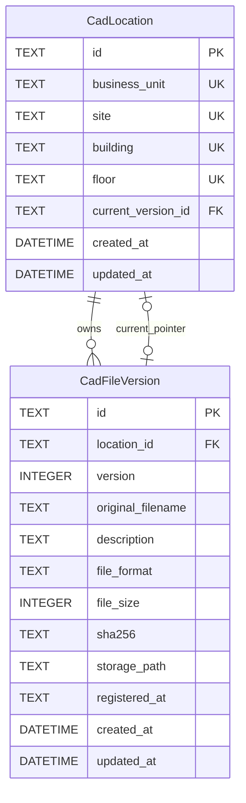

## R2 #65 — Global OutlineType / 최신 Greenfield FK 설계 (구현 전, 2026-10-31)

이 절이 새 schema의 단일 기준이다. 새 `G7-GREENFIELD-OUTLINE-TYPES-20261031-1` / `202610310003_greenfield_outline_types_baseline` 및 그 전용 checksum을 정의한다. 기존 `202610310002_greenfield_memo_m45_baseline`은 previous memo baseline 상수로 보존한다. 이전 old/scene/business/anchor/memo baseline 검증은 종전 exact DDL을 사용한다. 설치 함수는 빈 DB에만 아래 최신 variant를 생성하며 기존 runtime DB에 ALTER/migrate/rewrite하지 않는다. 과거 DDL 검증 호환은 기존 설치의 release identity/schemaId/version/image 승인 호환을 뜻하지 않는다. 새 릴리스가 과거 volume을 자동 활성화하도록 greenfield-auto/서명 gate의 identity 검사를 완화하지 않는다.

| 객체 | 필드·제약 |
| --- | --- |
| OutlineType | id UUID PK; name TEXT 1..100, name_key TEXT UNIQUE BINARY NOT NULL; description nullable 최대500; active INTEGER CHECK0/1 default1; sort_order INTEGER CHECK0..9999; revision INTEGER CHECK>=1 default1; created_by_id/updated_by_id User FK NO ACTION; created_at/updated_at UTC text. Global 고정이므로 Site/scope 컬럼 없음. name_key는 서버가 trim/NFC 이름에 toLowerCase/NFC를 적용해 계산한다. SQLite가 Unicode NFC/full-fold를 계산한다고 주장하지 않는다. |
| OutlineTypeAudit | id UUID PK; actor_user_id User FK, outline_type_id OutlineType FK; action CREATE/UPDATE/DEACTIVATE/REACTIVATE; before_revision nullable/after_revision>=1; outcome SUCCESS; timestamp_utc, request_id. 이름/설명 전문·세션·비밀번호 미포함. 변경과 같은 transaction으로 append. |
| CadOutline 최신 CREATE variant | 기존 모든 컬럼/CHECK/FK/trigger 의미 보존, nullable outline_type_id에 FOREIGN KEY REFERENCES OutlineType(id) ON DELETE NO ACTION ON UPDATE NO ACTION 추가. 과거 CAD_BUSINESS_DDL의 CadOutline 문자열은 변경하지 않는다. FK 목록/위반 실제 시험 필수이며 단순 application lookup/trigger만으로 FK를 대체하지 않는다. |
| Index/Trigger | OutlineType 전역 name_key Unique 및 목록용 sort_order/name_key/id index; id/created_at/created_by_id 불변 및 물리 DELETE 금지 trigger. OutlineTypeAudit type/time index 및 UPDATE/DELETE 차단 trigger. 기존 CadOutline immutable/삭제/Anchor/Memo guard는 유지. |

변경·비활성/복구는 typeId를 유지하므로 기존 외곽선 FK가 남는다. 비활성 타입은 새 할당에서 제외하지만 기존 참조를 지우지 않는다(실제 신규 할당은 #71). 타입 Audit는 기존365일 보존 원칙을 따르되 승인되지 않은 자동/물리 purge를 구현하지 않는다. 인가 실패는 공통 G4 AuditEvent로 남기고 성공한 타입 변경의 구체적 action/revision은 OutlineTypeAudit에 보존한다. 기존 AuditEvent enum/DDL을 변경하지 않는다.

Prisma는 새 OutlineType/OutlineTypeAudit 및 CadOutline optional relation을 표현하되 과거 nullable scalar 조회와 호환되어야 한다. installer, assertG7GreenfieldSchema, assertG7RuntimeSchema, schema ID/baseline 판별·authority 검증, 테스트 fixture 및 Migrator 명시 COPY/실행 smoke를 함께 갱신한다. historical marker의 동일 checksum과 DDL이 계속 통과하고 변조된 새/과거 schema는 계속 거절해야 한다. 복구 시험은 새 private 일회용 DB의 동일 snapshot backup/restore이며 기존 볼륨 rollback/데이터 이관 증거로 주장하지 않는다.

## #88/#90 M6/M7 DB 불변성 (2026-10-31)

신규 DB 객체/Prisma 마이그레이션/Greenfield baseline/트리거 변경 **없음**. 기존 live CadMemo+Version의 동일 SHA, Location/Building/Site/Product/BusinessUnit 및 User, optional M4/M5 Feature/Group JOIN. 동일 signed Site 조건에서 Count+Page를 트랜잭션 조회하며 Page25/50/100; soft delete, inactive Site, 기타 Site 누출 금지. 기존 `ix_cad_memo_version_live` 포함 인덱스 활용, 100k 검색 성능 측정 전 신규 FTS 없음. [Issues88-90](Issues88-90.md).

---

## #85/#86 new EMPTY G7 Memo sidecars (2026-10-31)

G7-GREENFIELD-MEMO-M45-20261031-1 / 202610310002_greenfield_memo_m45_baseline adds CadMemoGroup (UUID, Version/SHA, owner, Revision, soft delete), CadMemoFeature (Memo UUID PK/FK, group FK, visible, schedule flags/date-only, completion status/server UTC), indexes and immutable triggers. Historical Business/Anchor SQL fingerprints remain intact; no legacy ALTER/adoption. [Spec](Issues85-86.md).

---

## #84 M3 + #167 S6 신규 영속 스키마 (2026-10-31)

- 새 Greenfield baseline `202610310001_greenfield_anchor_baseline`, ID `G7-GREENFIELD-ANCHOR-20261031-1`. 이전 `202610300002_greenfield_business_baseline` 및 Scene/old exact SQL fingerprint는 보존. 신규 `CadMemoAnchor`(memo_id FK/PK, version_id, source_sha256, status ATTACHED/BROKEN_ANCHOR, target_origin/target_id, local_x/y, timestamps), target index, immutable trigger. 구 설치에 자동 추가/이관하지 않음.
- Memo world `anchorX/Y`는 final resolved WCS, local anchor는 target inverse 변환 기준. TARGET soft delete 시 anchor row는 BROKEN/target=NULL, Memo 좌표는 보존. 대상 변형의 Memo Revision+Audit와 기존 CadOutline CAS는 동일 writeTransaction.
- S6 ALL은 CAD Version별 정확 live Memo/Outline snapshot과 G7 권한·Memo author 검사 후 각각 deletedAt/deletedById/revision 업데이트 + append-only Audit. Raw DB DELETE 및 원본 DXF/SceneAsset/Current 변경은 수행하지 않음. 최신 설계 [Issues84-167](Issues84-167.md).

---

## #98/#83 업무 영속 신규 empty Greenfield DDL (2026-10-30)

Schema ID G7-GREENFIELD-BUSINESS-20261030-1, baseline 202610300002_greenfield_business_baseline. DDL source: src/server/cad-business/schema-ddl.ts, Prisma model src/prisma/schema.prisma. CadOutline: server UUID, immutable Version/FK·SHA·author·createdAt, scene_revision, origin APP_CREATED, independent WCS base/effective geometry, derivation/source refs, transform operations, revision CAS, logical deletedAt/by; OutlineType null until #65. CadMemo: Version/FK·SHA, title/content plain, WCS anchor+offset, author, revision CAS, soft delete. CadBusinessAudit: actor/site FK, version text, target, action, before/after revision, requestId, UTC time, UPDATE/DELETE blocked by triggers. Version hard delete linked rows 409. Existing Scene checksum, password triggers and old baseline markers immutable; business rows only present in new-empty install. [상세](Issues98-83.md).

---

## #166 S5 (0.47.0 후보) — DB 변경 없음

일반 Render ObjectRef·DXF_IMPORTED 작업 차분·APP_CREATED 외곽선/독립 WCS 메모 연계는 브라우저 세션 상태이다. Table/Column/Index/Constraint·SceneAsset/CurrentScene CAS·CAD Current·Session/Grant/Audit 정책과 원본 저장 locator는 변경하지 않는다. 새 DB migration/영속 업무 API를 도입하지 않는다. #98/#83/#73/#84의 서버 업무 CRUD/앵커/트리·복원은 해당 이슈 후속이며 S5 성공으로 소급 완료하지 않는다.

---

## #164/#165 Scene metadata/CurrentScene 설계 계약 (2026-10-30, 구현 전)

본 절은 신규 Schema 구현 지시이며 실제 DB 적용 기록이 아니다. 구현 후 정확한 Prisma/SQL 필드·제약을 대조하여 보충한다. #168 순수 도메인을 재사용하고 대용량 Scene bytes는 DB에 넣지 않는다.

- **Immutable SceneAsset:** 서버 발급 asset ID, 소유 Version ID/source SHA, derivative digest/byte length, format/schema/builder/renderer/frame, manifest, 서버 전용 storage locator, createdAt. DB identity에 Object3D.uuid를 사용하지 않는다. 게시된 blob/manifest는 수정하지 않고 새 Asset으로 교체한다.
- **CurrentScene:** Version별 pointer 최대 1개, Asset 소유권을 Version에 결속하고 revision은 단조 증가한다. 최초 expectedRevision=null과 갱신 expectedRevision=N을 구분하며 CAS 경쟁은 409다. 기존 CAD Current/Version 선택과 독립한다.
- **Transaction:** 최신 Version/source와 권한을 재확인하고 Asset metadata·CurrentScene pointer/revision·SCENE_PUBLISHED Audit을 같은 거래로 갱신한다. Storage prepare/readback은 거래 밖에서 실행한다. 실패하면 기존 READY pointer를 변경하지 않는다.
- **수명:** Scene은 파생 데이터이며 기존 원본 삭제/cleanup 계약을 보존한다. Version 소유 관계와 DB 삭제 처리를 구현에서 명시하고 orphan blob은 참조 재확인·유예 없이 지우지 않는다. APP_CREATED/#98 CadOutline 및 #83 Memo의 독립 테이블/API를 여기서 추가하지 않는다.
- **Greenfield:** 신규 exact baseline/schema identity와 기존 exact baseline을 구분한다. 기존 marker를 수정하거나 미지 DDL drift를 허용하지 않는다. 기존 baseline Scene API는 LEGACY_DISABLED로 구분하며 일반 MISSING과 혼동하지 않는다. 신규 빈 DB와 격리 migration만 시험하며 실 DB 자동 이관/activation은 하지 않는다.

API 계약: `POST scene {manifest,bytesBase64,expectedRevision:null|number}`, `GET scene {status:LEGACY_DISABLED|MISSING|READY|REBUILD_REQUIRED,manifest?,assetId?,revision?,contentUrl?}`. contentUrl은 Version/immutable assetId의 ID-only API이고 locator/endpoint/credential을 노출하지 않는다. UNAVAILABLE은 fetch/network 장애의 Viewer 표시로 구분한다.

### 구현 필드 대조 (개발 중, 운영 적용 아님)

| 모델 | 필드/제약 |
| --- | --- |
| SceneAsset | `id`, `version_id` FK, `source_sha256`, `manifest_json`, `digest`, `byte_length>0`, `format=CUSTOM_DTO`, unique `storage_locator`, `created_at`; `(version_id,id)` unique |
| CurrentScene | `version_id` PK/FK, `asset_id`, `revision>=0`, `updated_at`; `(version_id,asset_id)` composite FK로 타 Version Asset 연결 차단 |
| SceneOrphanJob | `id`, unique `asset_id`, unique `storage_locator`, `state=PREPARING/VERIFIED/UNCERTAIN/CLEANUP`, `attempts>=0`, 생성/갱신 시각. Version 삭제 뒤에도 cleanup 추적을 유지하도록 Version FK 없음 |

schema/builder/renderer/frame 및 stable Scene ID는 검증된 `manifest_json`에 보존한다. SQL 후보는 `src/deploy/scene-assets/migration.sql`이며 기존 정확 7개 migration history 밖에 둔다. 신규 Greenfield installer가 명시적으로 포함하는 baseline ID는 `202610300001_greenfield_scene_baseline`, 기존 `202610290001_greenfield_baseline`은 별도 exact hash로 검증한다. AuditEvent CHECK에 `SCENE_PUBLISHED`만 추가하기 위한 table 재구성은 기존 행을 그대로 복사하고 append-only UPDATE/DELETE trigger와 기존 제약을 재설치한다. Version 삭제는 기존 암호·권한·Audit 거래 안에서 CurrentScene을 분리하고 각 SceneAsset의 CLEANUP job을 기록한 뒤 metadata와 Version을 삭제한다. blob은 유예 cleanup까지 보존한다. 실제 해당 삭제 회귀는 TestReport에 기록한다. 이 SQL의 운영 적용은 이번 범위가 아니다.

---

## #161–#163 Scene S0 계약만 추가 (2026-10-30)

**DDL/Prisma/기존 DB 변경 없음.** SceneAsset(Version ID, sourceSha256, asset byteDigest/byteLength, format, builderVersion, rendererVersion, sceneSchemaVersion, coordinateFrame, state), SceneObject(immutable scoped app ID/Origin, optional sourceRef/derivedFrom, working transform/visibility/revision), AppObject(별도 ID/WCS geometry/revision/업무 연계)는 순수 도메인 계약이다. source byte SHA와 derivative byte SHA는 서로 다른 identity이다.

S3의 영속 모델은 #98 Outline/#83 Memo 및 #96 Site/Auth/Audit와 통합하여 별도 결정한다. immutable Asset 게시 + manifest pointer CAS + 관련 업무 변경은 같은 논리 거래로 처리; 저장 blob 검증 완료 전 READY 금지. source 삭제·asset TTL·업무 soft-delete는 자동 cascade로 합치지 않는다. reset A/B, BROKEN_ANCHOR, Undo 수명은 [Architecture](Architecture.md)의 Scene 절이 정본이다.
#161–#163 구현 결과: DB Table/Column/Index/Migration 변경 0. SceneAsset/Manifest/WorkingRevision은 순수 Domain/테스트 메모리 계약이며 S3에서 별도 DB 설계·CAS·업무 소유권을 재검토한다.


---

## #109 초기 DB 계약 — 일반 Docker Compose (2026-10-30)

- 새 **빈** `/data/db/cad.sqlite`에 `G7-GREENFIELD-20261029-1` final schema를 최초 1회 생성하고 `_prisma_migrations`에는 `202610290001_greenfield_baseline` **한 건만** 저장한다. 구 6/7 Migration 기록을 합성하지 않는다.
- 삭제 암호 INSERT/UPDATE 트리거 둘, G7 Auth/Session/Grant/Audit, G3LoginAttempt 등의 보안 제약, sqlite_master DDL fingerprint, `PRAGMA quick_check` 및 `foreign_key_check`를 검사한다.
- `/data/db/g7-install.json`(0600)은 App/Migrator reference/version/Schema/Source 설정+설치 ID를 보유하는 **신규 설치 식별자**다. `/data/db/first-admin.code`(0600)은 브라우저에 노출되지 않는 최초 관리자 256-bit 임시 코드다. 둘 다 앱 UID 소유. 설치 완료 marker는 Code와 Schema를 만든 후 마지막으로 작성한다.
- 초기 데이터: `BusinessUnit/Product/CadSite/Building/CadLocation/CadFileVersion/User/AuditEvent` 모두 **0건**. 첫 Admin은 DB 원자 거래로 User/Role/Audit를 만들되 Site Grant는 0건. Site는 인증된 Admin이 웹 기준정보로 만든 후 별도 Grant한다.
- 기존 DB, 손상·불일치 Schema, marker 누락·오염/파일 권한 이상, 다른 이미지 쌍을 만나면 DDL·UPDATE·DELETE·RESEED를 하지 않고 차단한다. 정상 restart도 기존 SQLite·CAD·Audit 데이터를 변경하지 않는다.

---

## #153 Greenfield DB 최초 Schema 계약 (2026-10-29)

빈 독립 SQLite 파일에 CAD/Auth 현재 기능의 DDL을 처음부터 만든다. 과거 6→7 이관/이력 복제는 수행하지 않는다. 설치 기록은 단일 `202610290001_greenfield_baseline`과 고정 checksum. Auth/User/Role/SiteGrant/Session/Audit 및 CAD 관련 Table/Index/Trigger/ForeignKey를 엄격히 검증하고 `cad_version_delete_password_insert/update`를 최종 Schema에 포함한다. 이미 초기화된 DB나 비어 있지 않은 저장소에는 재설치 거부. 새 BusinessUnit/Product/Site/Building/Location과 이후 수동 DXF 업로드로만 데이터를 생성한다.

# Database Schema — 단일 기준 문서

## #153 — Runtime Schema 수용 경계 (2026-10-29)

기존 활성 CAD Migration 6개와 격리 `202610260002_g7_operational_auth` 7번째 SQL을 재사용하며 신규 Table/Column이나 활성 이력의 자동 승격은 없다. Runtime은 정확한 완료 이력·SQL 체크섬·전체 Schema fingerprint·8개 Auth Table·FK·append-only trigger와 승인 Site 존재를 검증한 DB만 연다. 부분 적용·이력/Schema drift는 기능 활성화를 차단한다.

CAD 거래와 Audit는 동일 Prisma transaction, 계정/Grant 변경과 Audit는 기존 G4 SQLite transaction을 사용한다. 365일 보존 방향을 유지하며 자동 삭제 API는 노출하지 않는다. 이전 6개 Schema로의 복귀는 역방향 DDL 추측 적용 대신 같은 Snapshot의 DB+Local CAD+versioned S3-export 전체 복원으로 시험한다. 실제 운영 DB에는 적용하지 않는다.

## #154 S3-5-R0 — DB/Schema/운영 원본 불변 (2026-10-28)

- Site Owner는 B2/C 수용 완료를 보고했으나 DB/원본 서명·현장 위치/OCI Digest·private SNAP은 반출 불가, GitHub에는 `OWNER_ATTESTED_FIELD_ACCEPTANCE_COMPLETE`만 기록. PR Unit 합성 fixture는 실 현장 데이터가 아니다.
- S3-5-R0의 Release Identity/Source/Schema/SNAP 바인딩은 **인메모리** 검사일 뿐 실제 운영 SQLite/CAD/S3/Prisma Schema·Migration History·Audit·Current/Version/Rollback 데이터의 조회·수정/실행을 수행하지 않는다. 신규 7th Auth SQL은 그대로 격리, 운영 DDL 자동 승격 금지.
- S3-5별 별도 승인·정식 Migration/릴리스 롤백 준비/배포는 Issue #153 및 #109/#96의 후속 범위. C0/R0 합성 긍정으로 `operationalGo=false/runtimeActivated=false`.

## #151 S3-4-C0 — 영수증·신뢰 키는 현장 내 보유, DB 무변경 (2026-10-28)

- S3-4-C0 준비 코드/합성 테스트는 기존 앱 DB·Prisma `src/prisma/**`, Auth 7th candidate SQL, CAD Version/Current, SQLite/S3 백업·원본·Audit 행에 접근하거나 변경하지 않는다. `src/server/g7-operational/s3-4-c.ts`는 호출자가 사내 메모리로 제공하는 작은 Receipt Bytes만 해시/검증한다.
- 실 현장 `SNAP-*`, OCI Digest/Manifest, Source Revision, SQLite/CAD/S3 원본 SHA/Version, QA/Owner 신원·서명과 별도 사내 Trust Anchor는 비반출/비공개. 공개 GitHub에는 상태·고정 Reason만 남긴다. 실제 DB·S3 물리 Restore/복구·정식 Migration은 미실시·미확인.
- 서명된 로컬 Receipt 무결성이 확인되어도 `privateSourceAuthenticated=false`, `sameSnapshotRestored=false`, `operationalGo=false`. 실제 Source/Backup/Restore의 독립 수용과 DB/Schema cutover는 #142/#109/#96 및 S3-5 별도 승인 전 차단.

## #142 B2-5 — 실제 DB/Schema 변경 0건 (2026-10-28)

- B2-5는 읽기 전용 합성 증거 참조 교차검증으로 SQL/Schema/Prisma Migration, 운영 CAD/DB/Current/Version/Local·S3 Bytes 변경 없음. S3-4-A 체크의 FK/Audit/Current/SHA/Restore 증거 ID·스냅샷 연결만 교차 대조하며 실제 DB/S3 원본은 읽지 않는다.
- 운영 WAL-consistent SQLite 백업/Versioned S3/실 Restore와 Auth/CAD Write 활성화는 여전히 별도 승인 단계. Runbook: src/deploy/g7-s3/S3-4-B2-5.md.

## #142 B2-4 — 합성 SQLite 복원 바이트 기준 및 Auth Candidate 분리 (2026-10-28)

- Source/rollback은 CAD 6 Migration baseline SQLite Buffer, candidate는 격리된 G7 Auth 7번째 SQL 적용 Buffer라는 합성 세 단계. Rollback SQLite는 `Buffer.equals(source.sqliteBytes)` **전체 바이트** 일치 필수. 로컬/S3-export 오브젝트 Buffer도 DB Version/Locator/S3 VersionId claim(신뢰되지 않음)별 Source·Candidate·Rollback 모두 바이트 일치, 누락·중복/변조 차단.
- 후보 SQLite는 기존 B2-3의 QuickCheck·FK·CAD hierarchy/Current/nextVersion/SHA·8 Auth Tables/Audit Event append-only(예외 + 실제 Row 불변) 검사 재사용. 실제 WAL-consistent SQLite online backup, 현장 Schema rollback, OCI 이전 이미지 호환성, ORM/운영 Prisma Migration·데이터 변경은 검증 또는 실행하지 않음.

## #142 B2-3 — Audit AFTER Trigger 예외와 실제 행 불변식 분리 (2026-10-28)

- 격리 Auth 후보 `AuditEvent`는 `g1_audit_no_update`, `g1_audit_no_delete` Trigger가 실제 행 UPDATE/DELETE를 허용하지 않아야 한다. **예외 발생 자체는 불변식 증명이 아님.** SQLite `RAISE(FAIL)`이 AFTER Trigger에서 발생해도 변경·삭제가 남을 수 있으므로 메모리 Clone의 `SELECT * ORDER BY id` 전체 Audit Row를 매 시도 직후 최초 Snapshot과 비교한다.
- UPDATE/DELETE 각각에 대한 예외+행 동일성 조건을 모두 충족할 때만 `auditAppendOnlyChecked=true`, 어느 조건 실패라도 `AUDIT_NOT_APPEND_ONLY/BLOCKED`. 활성 Prisma Schema/실 DB·마이그레이션 SQL/운영 Trigger는 변경하지 않는다.

## #142 B2-3 P2 — Local CAD StoragePath/DB Owner 불변식 (2026-10-27)

- `CadStorage.publish`는 실제 DB `CadFileVersion.location_id/id`에서 `<Location UUID>/<Version UUID>/original.(dxf|dwg)` Local `storage_path`를 구성한다. 기존 B2-3 Byte verifier의 정규식 모양 검사와 DB·Asset 제공 문자열의 동일성만으로는 잘못된 소속을 탐지하지 못한다. B2-3은 정규식 그룹을 DB `location_id`와 `id`에 직접 비교해 어긋남을 `LOCAL_LOCATOR_OWNER_INVALID/BLOCKED`로 차단한다.
- before/after Snapshot 둘 모두 같은 잘못된 Local 경로라도 양성으로 보지 않는다. `S3ObjectStorage.prepare`의 S3 객체 UUID와 DB Version UUID는 별개이므로 동일성 강제 금지. 실제 Schema/active Prisma Migration/운영 DB 변경 없음.

## #142 B2-3 — 기존 CAD 6 + quarantined Auth 후보 1 (2026-10-27)

- `src/prisma/migrations`의 활성 6개 CAD 이력과 후보 폴더 SQL 복사본의 동일성 검사, G7 격리 `202610260002_g7_operational_auth`는 `src/deploy/g7-s3/prisma/migrations`에만 유지. 기존 운영 Prisma History/DDL 무변경.
- UID-owned Disposable CLI에서 `_prisma_migrations`의 성공 7건 및 8개 Auth Tables 확인. 합성 6→7 메모리 검사에서는 CAD 7 Tables 전체 Row/Current owner·nextVersion·Version/Storage Path/File Size/SHA/Local+S3 Byte 보존과 SQLite Quick Check/FK=0, Auth 8개, `g1_audit_no_update`·`g1_audit_no_delete` Trigger 실제 기능을 확인. CLI 결과와 seeded SQL 전후 결과는 별개의 증거.
- 합성 후보 검사기는 실제 DB·CAD·S3 출처/Registry/Writer·Owner GO를 인증하지 않음. [Runbook](../src/deploy/g7-s3/S3-4-B2-3.md).

## #142 B2-2B P2 — CadFileVersion.storagePath Unique 무결성 (2026-10-27)

- 공식 `src/prisma/schema.prisma`의 `CadFileVersion.storagePath String @unique(map: "uq_storage_path")`는 S3 Object Locator를 서로 다른 DB Version에서 중복 사용할 수 없도록 하는 **별개 Unique 제약**이다. `@@unique([locationId, version])`/DB Version ID/opaque V Key 중복 검사로 대체되지 않는다.
- B2-2B는 합성/격리 메모리 SQLite의 Unique 인덱스가 생략되거나 깨져도 중복 S3 locator를 `DUPLICATE_S3_LOCATOR`로 차단한다. 독립된 Object UUID와 DB Version UUID는 계속 허용한다. 회귀에는 고의로 Unique Index를 생략한 손상 모사와 인덱스가 있는 정상 3 Version 시나리오를 분리한다. 운영 Schema·Prisma Migration/DB 데이터 변경 없음.

## #142 B2-2B P2 — S3 storage_path 객체 UUID ≠ DB Version UUID (2026-10-27)

- `CadFileVersion.id`는 `CadRepository.register()`에서 생성되지만 `CadFileVersion.storage_path`가 S3형이면 `S3ObjectStorage.prepare()`가 **사전에 독립 생성한 UUID**의 `s3:bucket:cad/<object_uuid>/original.(dxf|dwg)`가 저장된다. 두 UUID를 일치 제약으로 오해하면 정상 버전이 잘못 차단된다. B2-2B 합성 mapping은 DB Version ID와 분리된 `s3ObjectLocator`를 받아 DB의 실제 `storage_path`와 정확 대조한다.
- Local 저장 경로 `<locationId>/<dbVersionId>/original.ext` 계약은 기존 그대로이며, 스키마/마이그레이션·실 운영 DB 변경은 발생하지 않는다. 객체 Locator 값과 버킷·원본 경로는 사내 자료로 취급하고 공개 리포트/로그에 출력하지 않는다.

## #142 B2-2B — 격리 SQLite Buffer 검사, 운영 Schema 불변 (2026-10-27)

- B2-2A의 FK/QuickCheck/Current/Audit=0은 주장이다. B2-2B는 합성 `CAD_BASELINE` SQLite Buffer를 메모리에서만 열어 실제 `PRAGMA quick_check`·`foreign_key_check`, `CadLocation(id,current_version_id,next_version)`, `CadFileVersion(id,location_id,version,file_size,sha256,storage_path,file_format)` 전체 결과를 opaque V/L-key ↔ disposable UUID map과 대조한다. 재조회 pathname·DB Write/SQL DDL/운영 WAL 접근 없음.
- Auth 후보 Table이 존재하면 본 B2-2B baseline 단계는 BLOCKED. 후보 7번째 Migration과 append-only Audit Trigger의 독립 실제 검증은 B2-3. `src/prisma/schema.prisma`·활성 `src/prisma/migrations/**`·`src/scripts/deploy.ts`와 운영 CAD Version/Current 변경 없음.

## #142 B2-2A — 원본 DB 데이터·스키마 불변 (2026-10-27)

- 오프라인 패킷 검증은 별도 SQLite 연결이나 운영 DB Read를 실행하지 않으며, 임의의 FK=0/Current 정합성/Audit 정합성 **주장**을 검사할 뿐 진짜 SQLite의 무결성을 보증하지 않음. `src/prisma/migrations/**`, 운영 G7 7번째 격리 SQL, Auth Schema, `src/scripts/deploy.ts` 불변.
- S3 `storageVersionId`는 별도 승인된 오퍼레이터가 사내 S3 버전 객체로 확인해야 하는 캡처 증거 항목이며 현재 CAD DB 컬럼에서 자동 추출됐다고 가정하지 않음.

## #142 S3-4-B2-1 — 운영 Schema/Prisma 불변 (2026-10-27)

- 이 증분은 OCI byte-only source/Schema 계약 확인이다. `src/prisma/migrations/**` 활성 6개와 `src/scripts/deploy.ts` 자동 Migrator **불변**. 7번째 Auth 후보는 `src/deploy/g7-s3/prisma/migrations/202610260002_g7_operational_auth`에 격리됨.
- OCI config의 `com.planner77.g7.schema-id` 라벨만 읽어 일치성을 평가할 수 있지만 실제 SQLite tables·Migration history·FK나 snapshot restore는 **입증하지 않는다**. B2-3/B2-4 실 복제본 시험·B2-5 내부 증거 필요.

## #109 PR #141 — Unit 실패 및 P1/P2 보완 (2026-10-27)

- [PR CI #40444154044](https://github.com/planner77/layoutManager/actions/runs/40444154044), HEAD `b5f340e69bd28aed939bb1c443df355c1652f5bf`: Unit/Integration 404 중 5 실패, Typecheck/ESLint·Docker PASS, Build/E2E SKIPPED. 5개 공통 직접 원인: 정상 Manifest Sorted Key 기대 순서 오타→`SNAPSHOT_MANIFEST_MISMATCH`.
- [Codex P1 #4384813274](https://github.com/planner77/layoutManager/pull/141#discussion_r4384813274) key order 수정. [P2 #4384813277](https://github.com/planner77/layoutManager/pull/141#discussion_r4384813277) SQLite source path 재오픈 TOCTOU를 검증 Buffer→메모리 DB로 교정, [P2 #4384813278](https://github.com/planner77/layoutManager/pull/141#discussion_r4384813278) 8개 Auth table 완전/완전부재 검사로 수정. 관련 회귀 테스트·B1 Runbook 추가. **신규 HEAD CI 전 PASS 미확인**.
- S3-4-B1은 격리 readonly/합성 clone 무결성 검사 준비이며 실제 운영 Snapshot 동시성·실 Registry OCI·실 Migration/Restore/rollback은 NOT RUN. Auth/Write/운영 SQL·Compose/Nginx·GHCR·실 DB/CAD/S3·Issue 종료 금지.


## #109 S3-4-B1 — read-only restored clone boundary (2026-10-27)

- 운영 `src/prisma/migrations/**` 6개 CAD 이력 불변, 후보 Auth SQL은 `src/deploy/g7-s3/prisma/migrations/**` 격리 유지. B1은 자체 migration 명령 없이 **격리 복원 DB에 대한 읽기 전용** `PRAGMA quick_check`/FK 및 Version/Current/nextVersion·SHA 대조만 수행한다.
- 7번째 후보 테이블 존재 상태는 B1 `G7_CANDIDATE` marker와 맞아야 하며, marker만의 진위/운영 Schema 적용 근거는 불충분. 별도 B2 private Prisma migrate deploy+DB/CAD/S3 restore/rollback 실증 필요.


## #109 S3-4-A — Prisma Migration과 Snapshot 복원 범위 (2026-10-27)

- 현재 운영 자동 `src/scripts/deploy.ts`는 `src/prisma/migrations/**`에 있는 CAD 6개만 자동 migrate deploy. 추가 Auth SQL은 `src/deploy/g7-s3/prisma/migrations/202610260002_g7_operational_auth/**`의 **격리 후보**이며 이번 S3-4-A에서 승격·실행 금지.
- S3-4-A 패킷은 후보 이력 byte 동등/격리 여부, 사내 복제 DB Migration dry-run, FK=0·Version/Current·원본 SHA·삭제해시/감사 무결성, DB/CAD/S3 단일 Snapshot 복원과 rollback의 내부 증거 ID를 요구하지만 **직접 DB에 접속하지 않는다**. 후보 Migration CI Fixture PASS와 실 운영 Snapshot 복구를 혼동하지 않는다.
- S3-4-B 별도 사내 복제 볼륨과 완전 복구 실증 전 운영 Migration **NO-GO**.


## Issue #109 S3-3 — CAD API 권한·Audit 원자성 준비, 운영 OFF (2026-10-27)

- **기능:** 기존 CAD Multipart POST·Current PUT·Version DELETE에서 서버 DB의 최신 Session/Role/Site를 같은 Prisma Transaction 안에 재조회하고 승인된 Editor/Admin+Site만 쓰기 허용한다. DELETE는 기존 삭제 비밀번호도 요구하며, CAD DB 변경과 CAD_UPLOADED/CAD_CURRENT_CHANGED/CAD_VERSION_DELETED Audit INSERT 중 하나라도 실패하면 DB를 롤백한다. 기존 업로드 보상·삭제 Job, 익명 GET/Viewer·CAD 데이터 규약은 유지한다.
- **운영 차단:** `NODE_ENV=production`에서는 S3-3 프리뷰 활성화 불가. 정확한 S3-2 disposable DB/marker/7 migration, loopback origin, `G7_S3_AUTH_API_PREVIEW_ONLY=true`, `G7_S3_CAD_PREVIEW_ONLY=true`, `G7_AUTH_ENABLED=false`, `G7_CAD_WRITE_CUTOVER_ENABLED=false` 조건만 격리 시험 허용. 별도 Prisma Client와 0700 root 하위 로컬 CAD 저장소 이용. 운영 Migration·실 DB/CAD/S3·Compose/Nginx/.env·GHCR 게시·인증/쓰기 활성화 없음.
- **시험·잔여:** synthetic integration(Unit) 검증 코드 추가; 실제 PR CI는 시작 전이므로 결과 `NOT RUN`. 일회용 Preview Cookie의 Path는 `/api/g7-operational`이므로 다른 CAD 경로의 프로그램 시험에서는 테스트용 Cookie를 명시적으로 넘기며 운영 브라우저 인증이 활성된 상태는 아님. S3-4는 OCI/운영 Migration/실복구·신뢰 release binding, S3-5는 릴리스별 Owner GO 및 현장 수용. 기존 유사범위 PR #128은 미병합·충돌 상태이며 자동 병합하지 않는다. #109/#96 OPEN/BLOCKED.
- **후속 정확 Squash:** `#109 | S3-3 Isolated CAD write and Audit [G7-S3-3-NO-GHCR]` 및 개별 파일 allowlist만 GHCR 미게시. 내부 로그/비밀번호/IP/실 도면 반출 금지. [S3-3 Runbook](../src/deploy/g7-s3/S3-3.md).


## #109 S3-2 — 영속 Auth/Admin 거래와 DB 출처 경계 (2026-10-26)

- S3-1 정식 후보 `202610260002_g7_operational_auth`를 가진 **일회용 SQLite DB만** S3-2 preview open 가능. 공유 `disposable-target.ts`를 Prisma 설정과 HTTP/Admin CLI에서 같이 사용해 canonical `/tmp/cad-g7-s3-*/fixture.sqlite`·UID 0700/0600·marker/Nonce/Schema ID/양쪽 DB URL을 대조. `preview-db.ts`에서 `_prisma_migrations` 성공 행/8개 Auth 테이블·`PRAGMA foreign_key_check`를 확인하고 DB 연결 실패는 API 503(데이터 정보 비노출).
- G3 로그인/세션·비밀번호 갱신, G4 Role/Site/SpecialGrant/Disable·권한/감사 adapter는 검증된 SQLite BEGIN IMMEDIATE 거래 사용. S3-2 Admin 계정 생성은 먼저 DB users:manage 권한검사+Audit를 수행하고, KDF 수행 후 **같은 거래에서 세션/역할 재검증과 User INSERT+ACCOUNT_CREATED Audit**. 최초 비밀번호 변경 필요·역할 자동부여 0. G2 초기 Admin·복구는 Secret 0600·명시 CLI, nonce 해시 1회와 session 회수·AdminRecovery Audit 원자성.
- 운영 `src/prisma/migrations` 추가 SQL **0**, 운영 `scripts/deploy.ts`/`src/prisma.config.ts`/실 DB/CAD/S3 변경 0. 프로덕션 운영 DB에 User/Auth 테이블은 이번 PR로 추가되지 않는다. 운영 API 라우트도 프로덕션 OFF이며 실 Auth DB/Migrator 통합은 S3-4 릴리스별 승인까지 금지.


## Issue #109 S3-1 — 운영 Prisma 모델 통합 / 정식 후보 Migration 분리 (2026-10-26)

- **모델:** `src/prisma/schema.prisma`에 `User`, `AuthSession`, `UserRoleGrant`, `UserSiteGrant`, `SpecialGrant`, `AuditEvent`, `AdminRecoveryNonce`, `G3LoginAttempt`를 G7 S1의 검증된 Prisma 계약에서 **운영 Client Schema로 통합**. 기존 CAD `BusinessUnit/Product/CadSite/Building/CadLocation/CadFileVersion/CadDeletionJob` 모델·관계·Current/Version/해시 계약 보존. `CadSite.siteGrants`/`auditEvents` 관계 추가. User/Site FK·역할/Scope 제한·세션 불변·append-only Audit/복구 nonce 제한은 격리 후보 SQL에 정의.
- **Migration 경계:** 활성 운영 `src/prisma/migrations`에는 **CAD 6개만 유지**(`scripts/deploy.ts`가 배포 시 자동 prisma migrate deploy). 신규 후보 이력은 `src/deploy/g7-s3/prisma/migrations`에 기존 CAD 6개 **바이트 동등 복사** + `202610260002_g7_operational_auth/migration.sql` 총 7개로 작성. 이는 **실제 운영 승격 전 별도 승인 대기 중인 정식 형식의 Migration 후보**이며, S1 `202610260001_g7_staging_auth`·G1 fixture를 활성 운영으로 단순 복제한 것이 아님. 별도 승인 전 운영 SQL 적용 불가.
- **겹침 위험 차단:** `src/deploy/g7-s3/prisma.config.ts`는 실 운영 기본 Prisma config를 사용하지 않고, `G7_S3_MIGRATION_TEST_ONLY=true`·Auth/Write OFF·UID 소유 canonical `/tmp/cad-g7-s3-*/fixture.sqlite`(0700 디렉터리/0600 SQLite/0600 유효 marker) 및 `DATABASE_URL=G7_S3_TEST_DATABASE_URL` 일치 검증 후에만 Prisma에 URL 전달. 불일치 시 `G7_S3_DISPOSABLE_MIGRATION_ONLY`를 throw하여 SQL 미실행. 테스트는 7개 공식 Prisma deploy + 기존 CAD SQL 행·Current·SHA·삭제 암호 hash 논리 스냅샷, FK/유니크/Audit/강제 실패 rollback을 별도로 확인.
- **실 운영 적용 시 미충족:** 활성 migrator 이력 승격/과거 DB 보전, 스키마 적용 전·후 동일 snapshot DB/CAD/S3 복원 실증 및 rollback Pair 검증, 승인된 App/Migrator OCI 두 digest 필요. #109 S3-1 완료만으로 이 조건을 충족했다고 간주하지 않는다. [Runbook](../src/deploy/g7-s3/README.md).


## Issue #109 / PR #125 P1 — Staging Prisma CLI Migration 실행 전 대상 강제 검증 (2026-10-26)

- **원인:** Staging 전용 `src/deploy/g7-staging/prisma.config.ts`가 기존에는 `G7_STAGING_DATABASE_URL`의 실제 경로·UID·symlink/manifest 정합성을 확인하지 않고 Prisma datasource로 전달했고 기본 fallback URL도 포함했다. 운영 DB 경로를 실수로 지정하면 G1 Auth Migration DDL이 사용자 DB에 적용될 위험(리뷰 [r4374313165](https://github.com/planner77/layoutManager/pull/125#discussion_r4374313165)).
- **보완:** config import 즉시 `resolveG7StagingGate(process.env)`를 실행해 전용 `/tmp/cad-g7-staging-*/fixture.sqlite` realpath·UID·symlink·manifest Schema ID·고정 digest 형식·`DATABASE_URL`/`G7_STAGING_DATABASE_URL`/CAD 경로/Stage-only Operation Flag 전부 확인. 불일치 시 `G7_STAGING_PRISMA_TARGET_DENIED` 예외가 **Prisma Migration SQL 실행 전에 발생**하며 fallback은 없다. 정상 검증된 파일만 `datasource.url='file:'+target.databasePath`로 설정.
- **운영 범위:** 기존 운영 `src/prisma/schema.prisma`·`src/prisma/migrations/**`·기본 `prisma.config.ts`/deployment migrator는 불변. 새 `g7-staging-prisma-config.test.ts`는 임의 DB sentinel 불변·nonzero를 검증하도록 작성했고, 공식 Staging migration E2E는 새 HEAD CI 결과로 별도 확인한다. 이 수리는 운영 DB Migration GO가 아니다.


## Issue #109 G7 S1 — Staging 전용 정식 Prisma 계층 (2026-10-26)

- **정식 Staging Migration, 운영 OFF:** `src/deploy/g7-staging/prisma.config.ts`는 config 파일 기준 상대 경로의 Staging Schema·Migration만 사용한다(Prisma 7). 기존 CAD 6개 Migration의 동일 내용 및 `202610260001_g7_staging_auth`가 순서대로 적용될 일회용 SQLite에 별도 Prisma migration history 기록. **운영 `src/prisma/schema.prisma`/migrations와 운영 Migrator/실 DB 불변**.
- G1 User/Role·Site·SpecialGrant/Session/Audit/RecoveryNonce SQL, G3LoginAttempt, 감사 안전 Site FK/append-only, 3-session trigger, 365일 cutoff(실 purge 금지)를 Staging Schema에 투영. CAD_CHANGED/UPLOADED/DELETE Staging Audit action은 target_kind VERSION+DB Site 필수, 업무 변경+Audit는 BEGIN IMMEDIATE 내 일괄 commit/rollback. 삭제 암호 검사는 거래 직전 강도 높은 KDF 후 거래 내 해시·Session/Scope 재검증.
- `G7_STAGING_ROOT`가 Linux uid 소유 `/tmp/cad-g7-staging-*/`이고 DB 이름 `fixture.sqlite`·`DATABASE_URL` 일치·CAD 별도 경로·Release manifest 일치인 경우만 API를 오픈한다. 운영 파일 복사/임의 fixture 마이그레이션 직접 실행 금지.
- 신규 영속 Outline/Memo/Type/Logs나 Audit purge, 실제 운영 Migration·S3 접근·Origin/SHA 원본 변경 0. #109 Owner S2 운영 GO 이전 배포 불가. [Issue109](Issue109.md), [Operation](Operation.md).


## Issue #109 G7 — 정식 Migration, 동시점 백업·롤백 경계 (2026-10-26)

- G1 `src/tests/fixtures/auth-g1/{migration.sql,schema.prisma}`는 **합성 DB 전용**, 운영 `src/prisma/schema.prisma`/정식 migrations에 아직 배선되지 않았다. G7 후속 코드 PR에서 정식 User/Session/Role/Site/SpecialGrant/Audit/Nonce + 기존 CAD 테이블 FK/Unique·Audit append-only·Version→Site 계약의 동등성을 검토·시험해야 한다. 현 문서 PR은 DDL/DB 변경 0.
- 승인 후에만 운영 쓰기 정지 → **같은 snapshot ID**의 SQLite 안전 backup(단순 실행중 파일 복사 금지) + CAD local bytes + S3 object/version manifest·SHA → 격리 restore/migration dry-run → 승인된 App/Migrator 두 digest 및 정식 migration → FK/Unique·원본 bytes/SHA·Version/Current/delete hash 불변 확인. 무검증 fixture SQL 복사나 운영 `prisma db push` 금지.
- 실패 시 구 App만 신규 Schema에서 가동하지 말고 **호환 구 App/Migrator pair 및 동일 snapshot DB+CAD+S3 전체** 복원·세션 폐기·유실 업무 재처리/Owner 확인 후 운영 재개. Audit 365일 초과 purge 주기/복구본/예외 세칙 미승인으로 실행 금지. [Issue109](Issue109.md), [Operation](Operation.md).


## Issue #108 / G6 — 합성 백업·복구 DB 불변식 (2026-10-26)

G6 자동 검증은 별도 cad-auth-g1-*/fixture.sqlite에 **기존 여섯 CAD Schema Migration**을 재현하고 BusinessUnit/Product/CadSite/Building/CadLocation/CadFileVersion/CadDeletionJob의 전체 row, Version ID/순번/sha256/file_size/storage_path, Current 소속을 스냅샷 비교한다. 합성 local CAD와 mock-S3 mirror의 실제 바이트 SHA가 DB와 일치해야 한다. SQLite online backup을 별도 fixture로 복제해 G1 auth fixture migration.sql 적용 후 foreign_key_check=0·기존 CAD 행 불변을 확인한다. 손상 주입 후 DB와 두 파일 mirror를 복원해 원상/해시 동등성 확인. 이는 실제 원격 S3, 승인된 운영 Prisma dry-run/DB rollback의 증거가 아니며 실 Prisma/schema/migrations/원본 DB·CAD 불변. #109 전 Audit 물리 purge/운영 마이그레이션 금지. [Issue108](Issue108.md).


## Issue #106 / PR #120 P1 — G1 AuditEvent 안전 Site Scope 보완 (2026-10-26)

G1 일회용 fixture Audit CHECK가 과거에는 `SITE_GRANTED`/`SITE_REVOKED` 외 사건의 `site_id`를 반드시 NULL로 강제하여, G4의 scoped permission/Outline Audit에서 **DB Version→Site 추적정보가 소실되는 결함**이 있었다. [PR #120 P1 r4373235027](https://github.com/planner77/layoutManager/pull/120#discussion_r4373235027).
- 변경된 비운영 CHECK: Site Grant/Revoke = affected_user_id AND site_id 필수; Outline Create/Edit/Delete = target_kind OUTLINE AND site_id 필수; AUTHORIZATION_GRANTED/DENIED = site_id NULL(글로벌/세션) 또는 target_kind SITE/VERSION/OUTLINE인 경우에만 Site FK 허용; 기타 Account/Session/Role 사건은 site_id NULL. Site FK와 append-only, UTC, Revision, immutable Actor 기록은 보존.
- G4 fixture에서는 grant/update와 함께 동일 BEGIN IMMEDIATE 거래에서 DB version 실제 Scope를 해석하여 저장하며, 틀린 Site FK/비관련 action에 임의 Site/Outline site 누락을 TC009에서 거부 검증한다.
- 위 SQL 확장은 `src/tests/fixtures/auth-g1/migration.sql` 전용. `src/prisma/schema.prisma`, `src/prisma/migrations`, 실제 운영 DB·CAD/S3/기존 공개 GET는 변경하지 않는다. G7 Owner #109 승인 전 OFF. [Issue106](Issue106.md).


## Issue #106 G4 — Audit/Grant 격리 DB 계약 (2026-10-26)

G1 disposable migration.sql의 AuditEvent Action CHECK에 AUTHORIZATION_GRANTED만 추가하며 기존 DENIED/Role/Site/Account/Outline 사건, actor_user_id/affected_user_id/site_id FK, revision/outcome/UTC/requestId, append-only UPDATE/DELETE 차단 trigger를 유지한다. 운영 src/prisma/schema.prisma 및 src/prisma/migrations는 변경하거나 실행하지 않는다.
G4 SQLite adapter의 권한 검사/Grant/User disable/Session revoke/합성 ShadowOutline CAS/Audit는 BEGIN IMMEDIATE로 직렬화하며 Version→CadLocation→Building→CadSite를 실제 DB 관계로 판정한다. 401/403 거부는 안전 Audit commit 후 반환, DB Busy/Audit 장애는 503 fail-closed/원복. last_seen 단조 touch도 같은 거래에서 수행한다. G4ShadowOutline은 테스트만을 위한 테이블이며 #98 운영 CadOutline이 아니다.
365일 cutoff와 자동 파기 권한은 별개. G1 AuditEvent DELETE trigger를 보존하며 물리 정리/백업본 삭제/복구 SOP는 #108/#109 승인 전 미실행. [Issue106](Issue106.md).


## Issue #105 G3 — 기존 격리 Session 모델 재사용 (2026-10-26)

**새 운영 Table/Column/Index/Prisma migration 없이** #103 G1 `User/AuthSession/Grant/AuditEvent`와 #104 recovery 계약을 사용한다. G1 Session의 must-change 계정 INSERT 거부, 8h·30m·3개·불변 tokenHash/issued/expires·단조 lastSeen 트리거를 유지한다. 초기 변경은 credential 재확인 거래로 passwordHash/must-change 갱신+전체 revoke+Audit 후 새 로그인하며 별도 provisional Session은 만들지 않는다.

G3 login은 `BEGIN IMMEDIATE`에서 검증에 사용한 현재 hash·ACTIVE·must-change 확인→슬롯 count→Session INSERT→LOGIN_SUCCESS Audit을 묶는다. logout revoke/Audit와 password change/revoke/Audit도 원자 처리한다. authenticate는 DB 현재 User/Role/Site/SpecialGrant를 조회하고 유효 수명 안에서만 lastSeen을 갱신한다. token 원문은 DB/Audit에 저장하지 않는다. 두 연결 경쟁과 hash 변경 경쟁·Audit 실패 rollback을 [Issue105](Issue105.md)의 TC004~009로 검증한다. G1 disable/G2 recovery가 G3 session을 전량 무효화해야 한다.

G3 fixture 전용 `G3LoginAttempt(key_hash TEXT PRIMARY KEY, count INTEGER CHECK 1..5, until_at INTEGER >=0)`를 추가한다. 서버 peer+정규화 계정 key의 SHA-256만 저장하고 `BEGIN IMMEDIATE`에서 5회/60초 예약·창 만료 갱신을 직렬화하며 성공 후 해당 key를 reset한다. 이미 commit한 로그인/암호 변경의 reset 정리 실패는 성공 응답을 취소하지 않고 남은 창의 60초 만료에 맡긴다. G1 AuthSession 존재 확인 후에만 이 테이블을 생성하며 운영 Prisma/DDL로 복사하지 않는다. 기존 G1 세션/계정 제약은 유지한다. 실 DB/CAD/S3 및 운영 `src/prisma/**`는 변경하지 않는다. 향후 운영 Schema 반영·실 데이터 복구·활성화는 #108/#109의 별도 수용 범위다.

## Issue #104 G2 — G1 일회용 인증 DB 활용/운영 DDL 변경 0 (2026-10-26)

- 신규 운영 Table/Index/Prisma Migration **없음**. 격리 `User`/`UserRoleGrant`/`AuthSession`/`AuditEvent`/`AdminRecoveryNonce` 및 G1 BEGIN IMMEDIATE·Unique·append-only trigger 재사용.
- 최초 빈 인증 DB에만 User UUID + Admin RoleGrant + `must_change_password=1` + `ADMIN_BOOTSTRAP` Audit(actor=null/affected=User ID) 원자 생성. 다른 User/이력 존재 시 자동 승격 금지, 재시작 UUID/Hash/Role 불변.
- 기존 ACTIVE Admin 복구는 nonce SHA-256 unique+불변, passwordHash/초기 변경·Session revoke·`ADMIN_RECOVERY` Audit(actor=null/affected=대상 UUID) 단일 transaction. 재사용·실패 rollback, nonce 원문/비밀번호 로그·DB 저장 없음.
- 운영 `src/prisma/schema.prisma`/migrations 및 CAD Version/Current/SHA/삭제 비밀번호, 실제 DB/CAD/S3 변경 0. 실 데이터 Migration/Restore는 #108/#109. [Issue104](Issue104.md).

## Issue #102 G0 — 익명 CAD Read와 인증된 Mutation·Audit 보존 계약 (2026-10-25)

- 기존 도면 목록·위치·Version·Current·Viewer·원본 GET/다운로드는 Owner 승인 **익명 사내망 조회**. **익명 조회를 위해 User/AuthSession/UserSiteGrant/가상 Reader 행을 생성하지 않는다**. 공개 GET에는 Site 단위 사용자 기밀성 제약을 적용할 수 없음을 명시한다. 신규 CadOutline/Memo/Type 및 로그·Audit 영속 GET에는 자동 상속 금지.
- `PUT Location.currentVersionId`는 로그인한 **Editor 또는 Admin + 해당 Location의 Site Grant** 및 서버 소유 Site/Version 연관 검증 필수. `DELETE CadFileVersion`은 같은 Actor/Grant 조건에 **기존 삭제 비밀번호 검증**을 더한 AND 조건. 삭제 비밀번호 단독/클라이언트 User·Role·Site claim은 인가 아님. Mutation 성공·거부와 Revision/Actor/Audit DB 원자성은 G1/G4/D3 후속에서 설계·시험.
- 기존 `POST /api/cad-files` 권한은 **Editor 이상 + 담당 Site**로 Owner 승인(G0-BIZ-06); G7 이전 운영 Schema/Route 미변경.
- Admin 단발 Bootstrap/Recovery/Nonce가 실제 사람 책임 대신 DB 초기화 재시도에 노출되어서는 안 된다. 운영 담당자 실행, Owner 책임(실명/Secret 경로 비공개); G2 #104 SOP와 원자성 필요.
- Audit Event는 **365일 내 append-only 유지** 및 만료 이후 정리 대상이라는 방향이 승인됐다. 만료 판정(UTC), purge 주기/방법·권한, 운영 Backup에 잔존한 만료 원장의 Restore 후 처리, 예외 보존 정책은 **#106/#108/#109 승인 전 미확정**이다. 이번 문서 변경은 Prisma DDL·Migration·DB Job/데이터·복구 적용 **0**.
- 정식 Schema 활성화와 공개 CAD API의 Auth 쓰기 전환은 G7의 별도 Owner 승인이 필요하며 DXF bytes/SHA, Current 0~1·Version FK, 기존 deletePassword 계약은 보존한다. [ADR-051-R1](Decisions.md), [Issue102](Issue102.md).


## Issue #103 P1 교정 — 감사 대상 사용자·Site 영구 추적 (2026-10-26)

- PR #116 리뷰 [r4371167619](https://github.com/planner77/layoutManager/pull/116#discussion_r4371167619)에 따라 테스트 전용 `AuditEvent`에 `affected_user_id TEXT NULL`(User FK)와 `site_id TEXT NULL`(CadSite FK), `ix_g1_audit_affected_site_time` 색인 추가. `SITE_GRANTED`·`SITE_REVOKED`는 **두 컬럼 모두 필수**로 검사하며 다른 action은 `site_id IS NULL`을 요구한다.
- `actor_user_id`는 관리자, `affected_user_id`는 실제 권한 변경 대상 사용자, `site_id`는 대상 Site의 DB 식별자. 복합 문자열을 `target_id`에만 넣어두지 않는다. UserSiteGrant가 DELETE되어도 append-only Audit에는 누가 어느 Site에서 변경되었는지가 남는다. 이 변경은 독립 `src/tests/fixtures/auth-g1/{migration.sql,schema.prisma,store.ts}`에만 있으며 운영 Prisma/DDL 적용 **0**.


## #103 / #102 최신 Owner 업무 정책 연결 (2026-10-25)

#102 Owner는 기존 CAD GET 익명 조회 유지, Current=Editor/Admin+Site, Delete=Editor/Admin+Site+기존 삭제 비밀번호, Admin 초기/복구 담당자, Audit 365일 경과 이력 정리 원칙을 승인했다([PR #114](https://github.com/planner77/layoutManager/pull/114), 병합 미확인). 이 결정은 G1 User/SiteGrant DB 제약 자체를 바꾸지 않으며 G1의 `cad:read` 권한 테스트를 기존 익명 GET API로 연결하지 않는다. **Audit 물리 파기·백업 복원시 재출현 방지 SOP는 여전히 PENDING**으로 Fixture append-only/nonce 불변 정책을 유지한다.


## Issue #103 G1 — 격리 User/Session/Grant/Audit 물리 계약 (운영 DDL OFF, 2026-10-25)

적용 대상은 **기존 CAD 6개 SQL Migration을 실행한 일회용 DB 사본**뿐이다. `src/tests/fixtures/auth-g1/migration.sql`에 다음 7개 테이블의 실행형 SQL과 FK/Unique/CHECK/트리거를 명시했고, `schema.prisma`는 **검토용 독립 투영**(기존 CadSite의 id/관계만 표현)이다. 기존 `src/prisma/schema.prisma` 및 `src/prisma/migrations/**`는 수정·자동 적용하지 않음.

| 모델 / FK | 최소 무결성 계약 |
| --- | --- |
| `User` | 불변 PK id, normalized lowercase login_name unique(NOCASE/ASCII), password_hash, ACTIVE/DISABLED, must_change_password, UTC ms 시간. 비밀번호 원문 없음 |
| `AuthSession` → User | hash(토큰) unique, issued/lastSeen/expires/revoked 정수 UTC ms, expires=issued+8h, idle 30m, 3개 active 트리거/lock, clock rollback·reanimate 거부 |
| `UserRoleGrant` → User | 복합 PK(user, Reader/Editor/Admin), grant actor FK, 삭제시 다른 테이블의 referential history 보존 |
| `UserSiteGrant` → User/CadSite | 복합 PK(user,site), 기존 물리 CadSite FK; Version→CadLocation→Building→CadSite join으로 실제 소속 확인 |
| `SpecialGrant` → User | 복합 PK(user, permission); `audit:read`와 `logs:read` 별개, Admin role과 함께 검사 |
| `AuditEvent` → User? | 안전 actor/action/target/revision/outcome/requestId/UTC만; UPDATE/DELETE 트리거 차단; 365일 이후 실제 파기는 보류 |
| `AdminRecoveryNonce` → User | nonce_hash 64자리 sha256 PK, 원문 미저장; INSERT 후 UPDATE/DELETE 불가, 중복 복구 rollback |

세션 후보 생성 후 `BEGIN IMMEDIATE`에서 사용자 상태·active count와 DB 제약을 검사하고 INSERT를 원자 수행. Role/Site/Special 변경과 Audit, Disable+전체 Session revoke+Audit, nonce 해시 INSERT+비밀번호 변경+revoke+Audit는 같은 SQLite Transaction. 계정 비활성 시 대상 Session을 전량 revoke하며 실패 주입 시 이전 상태로 rollback. `AuditEvent`에는 Raw Token·Secret·CAD Geometry 등을 담을 열 자체를 만들지 않음.

기존 Version, Current, SHA, delete_password_hash 및 계층 5단계의 실제 컬럼 값을 전후 스냅샷으로 비교하고 `PRAGMA foreign_key_check`를 수행한다. SQL fixture의 기존 CadSite FK가 실패하거나 DDL 재실행하면 fail-closed. SQLite `NOCASE`는 완전한 Unicode case-fold가 아니므로 G2에서 계정명 정규화 계약 유지. `schema.prisma` 투영으로 운영 Migration을 생성/적용하는 것은 명시적 금지. 참조 [Issue103](Issue103.md), [ADR-051-G1](Decisions.md), [TestPlan](TestPlan.md).


## Issue #102 G0 / ADR-051-R1 — DB 계약 유지 (2026-10-25)

Owner는 외부 공개망 인바운드가 제한된 내부 사용자용 환경에서 **공격·탈취 대응 강화는 비범위**로 선택했다([Issue102](Issue102.md)). **DB 구조·원자성·FK/Unique/Grant/Audit/Session 수명·Admin RecoveryNonce 1회·365일 감사/정상 권한 허용/거부 및 DB/CAD/S3 백업/복구는 그대로 필수**다. 이는 해킹·탈취 방어의 보안시험이 아니라 업무 및 데이터 정합성 요구다. 추가 사내 CIDR/Host 공격 테스트는 DB G1/G6 선행 게이트가 아님. 신규 운영 Schema/Prisma Migration 적용은 여전히 G7 별도 Owner 승인 전 금지.


## Issue #96 — D1~D6 승인값 / 물리 DB 비활성 (2026-10-25)

- D1 최초 Admin/복구 .env + Secret 파일 단발 정책, D2 비밀번호 최소 8자/scrypt local-v1/강제 초기변경, D3 절대 8시간·idle 30분·동시 세션 3개, D4 명시적 Site Grant/Admin 전용 권한관리, D5 감사 365일/별도 audit:read, D6 LAN 접근제한+HTTP 위험 수용 원칙 승인. ADR-051이 기존 D0 미결정 표기보다 우선한다.
- 개념 User/AuthSession/UserRoleGrant/UserSiteGrant/AuditEvent 표와 FK 설계는 유지하며 **src/prisma/schema.prisma, src/prisma/migrations에 이번 변경 없음**. Session token은 해시만 저장하고 4번째 발급은 미래 DB 원자 count+insert로 거부. 단발 복구 nonce는 DB CAS/불변 이력으로 재사용 차단해야 한다. 실제 append-only/365일 Audit 조회·파기 정책 및 Version FK 구현은 차후 승인 대상.
- 원본 CAD/Version/Current/SHA·기존 CAD 삭제 비밀번호는 불변. 복제 DB 백업→Migration dry-run/foreign_key_check→복원, CIDR·권한 E2E 및 별도 Owner 배포 승인 없이는 새 Schema/API **OFF**. [Issue96](Issue96.md).


## Issue #97 / P4-D2 — 원본/Transform 서버 검증은 DB 변경이 아님 (2026-10-25)

- 새 `src/server/outline/transform-attestation.ts`가 서버 보유 immutable DXF bytes Version/SHA → Stable Root Handle·WCS Canonical baseGeometry/algorithmVersion·tolerance 0.02 → 명시적 Translate/Rotate → **서버 계산 effectiveGeometry**를 검증해 반환한다. 전역 `OutlineType` FK/활성 여부·영속 UUID는 여기서 판정하지 않는다.
- **Prisma `schema.prisma`/migration/데이터 모델/Current/Version/SHA/Source bytes를 수정하지 않는다.** D1 #96 인증·Role/Scope/Audit 및 D3 #98 `CadOutline` CRUD/revision CAS(409)/soft-delete/Memo reconcile/Version FK/Backup 시험 없이는 이 결과를 저장할 수 없다. 기존 D0 개념 Schema 제안을 실제 DB에 적용했다고 해석 금지.
- 구현·차단·후속 판정은 [Issue97](Issue97.md), [ADR-050](Decisions.md), [TestPlan](TestPlan.md) 참조.

## Issue #31 P4 D0 Owner 승인 설계안 — **DDL 미적용** (2026-10-25)

**우선순위:** 최신 Owner [ADR-048/049](Decisions.md) 승인 정책이 아래 과거 #41/#42의 OIDC/Scope-key 미결정 예시보다 우선한다. 이는 **개념 모델**, 배포된 `schema.prisma`/migration이 아니다. 신규 DB/CRUD 활성화는 별도 구현·검증 승인 전 BLOCKED.

| 제안 Model/Column | D0 계약 (물리형식·세부값은 후속 migration ADR) |
| --- | --- |
| `User(id PK, loginName unique, passwordHash, displayName, status, createdAt, updatedAt)` | 로컬 계정, 불변 ID가 감사 주체. 초기 Admin 발급·비밀번호/회수 정책 미확정 |
| `AuthSession(id/tokenHash PK, userId FK, expiresAt, revokedAt?, createdAt)` | 서버 소유 난수 세션; 원시 토큰 DB/감사 로그 기록 금지, HTTP-only cookie + SameSite. 일반 HTTP 서버 IP에서 Secure 쿠키 동작을 주장하지 않음. TTL/동시 로그인 미확정 |
| `UserRoleGrant(userId, role)` / `UserSiteGrant(userId, siteId, permissions?)` | Reader/Editor/Admin 및 담당 Site Scope; Version의 실제 Site 관계 서버 검증, 무범위 기본 거부. 실제 Grant/Unique 구조·관리자 범위는 D1에서 구체화 |
| `OutlineType(id, name, nameKey, description?, active, sortOrder, revision, ...)` | **단일 Global Catalogue**. Site/사업부별 Scope Key로 분리하지 않음. `nameKey`는 전체 앱 고유성, Unicode/NFC case-fold 규칙 및 DB index 검증 이후 확정. 관리 Admin만 허용, 참조 타입 물리 삭제 금지 |
| `CadOutline(id UUID, versionId FK, sourceSha256, kind, outlineTypeId FK?, name, sourceEntityRefs, algorithmName/Version, canonicalBaseGeometry, transform, revision, status, createdById, updatedById, createdAt, updatedAt, deletedAt?, deletedById?)` | GENERATED 서버 발급 ID; Source immutable bytes+SHA+stable Handle/instancePath 검증. `kind`=CONVEX/PRECISE이며 `outlineTypeId` 업무 분류와 독립. Geometry WCS XY, Translate/Rotate 강체 affine만 허용. 서버가 결과 Geometry 계산, 필요하면 파생 캐시로만 보관. `status=ACTIVE|DELETED` 논리 삭제; CAS `expectedRevision` / 409 |
| `AuditEvent(id, actorUserId?, action, targetKind/Id, siteId, versionId, beforeRevision, afterRevision, outcome, requestId, timestampUtc, safeMetadata)` | Create/Edit/SoftDelete/Grant 및 거부 이벤트, append-only. 원본 도면·비밀번호·세션·전체 Geometry 기록 금지; 보존 기간·읽기 권한·물리 삭제 미확정 |
| `CadMemo(...anchorStatus, targetOrigin, targetId?, lastResolvedWcsXY, revision...)` | #83/#84 담당. 영속 GENERATED target 삭제 시 동일 트랜잭션으로 `BROKEN_ANCHOR`+마지막 WCS 저장+연결 해제, 메모 행은 유지; 실제 FK/트랜잭션·Version 삭제 정책 후속 확정 |

- `CadOutline.visible` 공유 필드는 **추가하지 않음**. 외곽선 개별/그룹 Show/Hide는 각 사용자 **세션 상태**이고 Catalog·다른 Editor 데이터/Revision을 갱신하지 않는다. Reload/다중 탭 지속 정책은 미정.
- 글로벌 업무 타입도 사용자의 도면 Version/Site Read/Edit 권한을 확대하지 않는다. Editor는 할당된 Site/Version Scope 내에서 공동 편집하되 최초 작성자·source SHA/Version은 불변; 메모 Editor 권한은 승인된 것으로 확대 해석 금지.
- SOURCE 참조는 `{versionId, sourceSha256, handle, instancePath?}`, GENERATED는 서버 영속 UUID와 Origin. 클라이언트 local-N/UUID를 신뢰되는 DB ID로 취급하거나 다른 Version으로 자동 재연결 금지.
- API는 `/api/cad-files/[versionId]/outlines[/id]`를 후속 제안으로만 유지. 모든 읽기/쓰기에서 Session→Role/Scope→Version/SHA→서버 canonical/Transform 검증→revision CAS→DB/Audit atomicity. 인증 없는 미승인 신규 GET/POST/PATCH/DELETE를 만들지 않는다.
- **보류:** Version 물리 삭제와 논리 삭제 객체·감사/메모 FK 처리, Audit retention/복원·파기, Session TTL/계정 초기화, legacy typed v1/v2 이관, HTTP LAN 접근 범위. 백업→격리 migration dry-run→FK/변경 불변/복구 시험 승인 전 DDL 적용 금지.


## Issue #42 / v0.35.0 — 영속 Schema 변경 없음 (U5 safe contract)

- `outlineTypeId/outlineTypeName/name`은 **브라우저 `SavedOutline` DTO 및 선택적인 v2 다운로드 JSON 메타데이터**일 뿐, Prisma Column/FK/DDL/마이그레이션에 추가하지 않았다.
- #65 실제 `OutlineType` table/Scope/Unique/Revision 및 #31 `CadOutline` P4는 미승인 상태. `outlineTypeId`를 DB FK로 추가하거나 브라우저 JSON을 그대로 저장하면 안 된다. 서버 authoritative file SHA/Version/Handle/Geometry 검증, RBAC/Scope/CAS/Audit 승인 후 별도 Migration 설계 필요. [Issue42](Issue42.md).


## Issue #41 / v0.34.0 — OutlineType 영속 Schema는 미승인 (DDL 없음)

- 이번 단계는 **schema.prisma와 migration 변경 없음**. `/lab/outline-types`의 목록은 React state만 사용; 신규 DB 테이블, 임의 사용자, 서버 CRUD, FK 없음. 원본 CadFileVersion/CadLocation 및 #31 CadOutline 제안 불변.
- **승인 후 제안:** `OutlineType(id UUID PK, scope_key <미결정>, name NFC, name_key NFC+lowercase, description?, active BOOL, sort_order INT, revision INT, created_at UTC, updated_at UTC)` 및 scope별 Unique(name_key), CHECK/Index. `name_key`의 case folding/Unicode DB 구현, NULL scope와 key 구성은 Owner 결정 및 SQLite 실제 충돌 검증 뒤 확정. 조회 Scope 누락 시 기본 거부.
- 추후 `CadOutline.type_id`는 OutlineType.id FK를 참조하고 이름변경/비활성 뒤에도 보존; 타입 물리 DELETE 미제공. `revision` CAS UPDATE(expectedRevision)→409, 트랜잭션 FK/Unique와 감사 event(행위, actor, scope, result, timestamp, revision)를 원자적으로 기록.
- 기존 백업·복제 dry run→migration→foreign_key_check→복구 검증 및 IdP/CSRF/RBAC(Reader/Editor/Admin)/Audit 보존 승인 없이는 DDL·쓰기 API 시행 금지. [Issue41](Issue41.md) / ADR-037.


## Issue #31 v0.28.3 — CadOutline 미배포 상태와 정합성 사전 게이트

- 이번 브랜치는 **Prisma schema, Migration, 기존 DB, 원본 DXF, Storage locator를 수정하지 않는다**. 기존 P4 제안 Schema는 계속 *미승인*이다.
- 저장 로직 구현 선행 조건: 검증 가능한 IdP(OIDC issuer/audience/JWKS) 또는 별도 로컬 로그인/HttpOnly 세션 정책, Reader/Editor/Admin Roles와 Site·Version scope, 운영 관리자·감사 기록 보존 기간 확정. 임의 HTTP 헤더/삭제 비밀번호/공유 토큰만으로 쓰기 허용 금지.
- 코드의 `server/outline/attestation.ts`는 향후 저장 시 서버가 `CadFileVersion.id/sha256`와 immutable Source bytes 일치를 확인하고 stable Handle을 재파싱·Polygon을 재계산하여 Client 좌표 위·변조를 거부하는 **쓰기 기능이 없는** 보조 계약이다.
- 권한 승인 이후 기존 제안 CadOutline FK/Revision 및 Version 삭제 정합성(ON DELETE 정책), 감사·복구·백업 dry run, 영구 overlay load/update/delete API를 구현해야 실제 P4 완료라고 평가할 수 있다.


## Issue #31 P4 — 영구 저장 Schema 제안 (DDL / Migration 미적용)

**이 절은 제안이며 배포 DB schema가 아닙니다.** 사용자/Owner가 인증·인가 수단, 역할 및 Scope, 감사 보존 기간을 결정하기 전 새 Table·Route·Migration을 적용하지 않는다.

| 제안 필드 | 정책·DB 정합성 |
| --- | --- |
| `CadOutline.id` | 서버 생성 UUID PK, Browser 임시 ID 별개 |
| `versionId` + `sourceSha256` | `CadFileVersion`에 버전·원본 Hash 동시 귀속, 복합 FK/unique anchor 검증. Current 교체·새 Version에 자동 재바인딩 금지 |
| `name`, `kind`, `algorithm` | 이름 정규화·길이 제한, CONVEX/PRECISE 및 허용 Algorithm만 |
| `sourceEntities`, `geometry`, `parameters` | JSON; **server-owned DXF에서 Handle/WCS canonical Geometry를 재계산**하여 client-supplied JSON과 대조. 좌표·polygon 수와 요청 body 상한 |
| `revision`, `createdAt`, `updatedAt` | revision >=1, CAS UPDATE (id+expected revision) / 409 동시 변경. 시간 UTC |
| `createdBy`, `updatedBy` | 인증된 사용자 ID 기반 변경자 감사 (원본 경로·패스워드·RAW geometry 로깅 금지) |
| Version 삭제 | Version DELETE transaction 내 outline 연쇄삭제/이력 보존 정책 중 선택. 현재 원본 삭제 구조의 승인·Storage cleanup 안전성 유지 |

제안 Route: `GET/POST /api/cad-files/[versionId]/outlines` 및 `PATCH/DELETE /.../outlines/[id]` (현재 **미구현**). POST/PATCH/DELETE는 서명 검증된 JWT나 안전한 앱 세션, RBAC/Version scope, CSRF/Origin, validation/recompute, FK/409/413를 갖춘 뒤 개방. 삭제용 비밀번호/클라이언트 임의 헤더를 외곽선 편집 권한으로 재사용 금지.

운영 Migration 게이트: 같은 시점 DB/CAD local·S3 백업→격리 복제 DB dry run→fk_check/Version·Current·hash/행 수 검증→단일 app stop/migrate/start→오류 시 동일 시점 백업 복원. 실제 데이터·Schema 변경은 Owner 승인 후 별도 구현·시험.


상태: 2026-10-15 Issue #24 구현. Prisma/Client/SQLite adapter 7.10.0과 실제 migration이 존재한다. 현재 단일 기준은 아래 `0.25.0 기준정보 계층` 절, `src/prisma/schema.prisma`, `202610150001_master_hierarchy`이며 그 이전 네 문자열 CadLocation 표와 그림은 migration 전 역사 기록이다.

## GitHub #6 — 0.19.0 추가 schema

- `CadFileVersion.drawingName` → `drawing_name TEXT NULL`, 기본 NULL. 사용자 지정 이름만 저장하며 NULL은 위치 및 실제 version으로 만든 기본 표시 이름을 뜻한다. 기존 행은 NULL로 유지하고 원본 파일명 등 모든 기존 Column을 수정하지 않는다.
- additive migration `202609110003_drawing_name`에서 nullable column을 추가한다. 이름 정규화/255 UTF-16 길이/제어문자 검증은 Domain 경로에서 강제한다. 이름은 경로·Unique key가 아니며 기존 FK·Index·Current/순번 제약을 보존한다.
- 기존 등록 후 metadata 편집 제외 계약은 유지한다. migration 파일과 실제 검증 결과는 구현·QA 후 갱신한다.

## 관계

### Unit DELETE 추가 schema — 0.17.0 도입 / 0.17.1 제약 보완

아래 정의가 이 Unit의 schema 기준이다. `202609110001_delete_password`는 필드·삭제 작업과 기존 순번 초기화를, `202609110002_delete_invariants`는 삭제 locator Unique와 양수 순번 trigger를 추가한다. 실제 적용·검증 결과는 TestReport를 기준으로 한다. 아래 기존 표/그림은 0.16.0 상태이며 새로운 Column/Table은 이 절과 함께 읽는다.

| 모델 / Column | 타입·Null·초기값 | 계약 |
| --- | --- | --- |
| CadFileVersion.delete_password_hash (`deletePasswordHash`) | TEXT/String?, migration 기존 행은 NULL | 서버 전용 scrypt encoding. SQL default 비밀번호/hash 없음. backfill 완료 후 모든 활성 행 non-null; 신규 INSERT의 NULL/빈 hash는 DB trigger로 거부하며 기존 hash를 NULL/빈 값으로 돌리는 UPDATE도 거부. 공개 DTO에서 제외. |
| CadLocation.next_version (`nextVersion`) | INTEGER/Int NOT NULL DEFAULT 1, INSERT/UPDATE trigger로 > 0 강제 | migration에서 Location별 기존 MAX(version)+1로 채움. 등록 transaction이 이 값을 순번으로 사용하고 1 증가시킴. 삭제 시 감소하지 않음. 기존 `(location_id,version)` Unique 유지. |
| CadDeletionJob.id | TEXT/String PK | 삭제 작업 자체의 랜덤 UUID. 삭제된 Version을 참조하는 FK는 두지 않음. |
| CadDeletionJob.version_id (`versionId`) | TEXT/String NOT NULL | 삭제 승인된 Version UUID. 대상 행 삭제 뒤에도 작업 식별을 위해 보존한다. |
| CadDeletionJob.storage_path (`storagePath`) | TEXT/String NOT NULL UNIQUE | 승인된 삭제 대상 locator. 원본 정리 성공 때까지 보존하며 새 경로를 입력받지 않음. |
| CadDeletionJob.created_at (`createdAt`) | DATETIME/DateTime NOT NULL DEFAULT now | 삭제 승인 transaction 시각. 완료 job은 제거하고 원본 이름·설명·비밀번호/hash를 job에 복사하지 않음. |

삭제 transaction은 Current가 대상을 가리킬 때 먼저 NULL로 해제하고 job INSERT→Version DELETE를 같은 transaction에서 수행한다. 기존 Current 소속 복합 FK, Location 소유 FK 및 Unique/CHECK를 그대로 유지한다. 마지막 Version이 삭제된 Location은 유지되며 nextVersion으로 과거 순번을 재사용하지 않는다.

Migration/backfill은 쓰기 중지·백업 후 진행한다. additive SQL로 위 필드/Table/trigger와 nextVersion 초기화→Node backfill이 NULL hash 행 각각에 독립 랜덤 salt로 `1234` hash 계산→조건부 NULL 행 UPDATE→NULL 수 0/foreign_key_check/기존 Current·행 수·원본 식별 일치 검증 순서다. hash 계산은 짧은 DB 쓰기 transaction 밖에서 순차 처리한다. 중단 후 재실행은 남은 NULL만 처리한다. 이미 hash가 있는 신규/기존 행은 변경하지 않는다. 실행 중인 0.16.0 앱과 병행하지 않으며 migration 후 구버전만 재시작하지 않는다.

backfill은 `db:deploy`의 완료 조건으로 묶고 실패 시 Docker/start readiness를 열지 않는다. SQL만 적용하는 별도 경로를 사용했다면 backfill 검증 전 서비스 재개를 금지한다. 신규 INSERT trigger는 실수로 구버전이 hash 없이 작성하는 것을 차단한다. hash encoding의 유효성은 server 검증과 시험으로 확인하며 SQL이 scrypt 계산을 검증하지는 않는다.



그림의 네 위치 UK는 각각 Unique가 아니라 **네 Column 조합 Unique**이다. 소유 관계는 1:N, Current는 Location당 선택적 단일 참조이고 해당 Location이 소유한 Version만 가리킨다. 독립 `is_current` Column은 만들지 않고 API/UI에서 pointer 비교로 계산한다.

## CadLocation

| Column | SQLite / Prisma 타입 | Null | Default/생성 주체 | 제약·의미 |
| --- | --- | --- | --- | --- |
| id | TEXT / String | 불가 | Service UUID | PK; 문자열 위치 결합값 아님 |
| business_unit | TEXT / String | 불가 | 없음 | 정규화된 사업부, 1–100자 |
| site | TEXT / String | 불가 | 없음 | 사업장, 1–100자 |
| building | TEXT / String | 불가 | 없음 | 동, 1–100자 |
| floor | TEXT / String | 불가 | 없음 | 층, 1–100자 |
| current_version_id | TEXT / String? | 허용 | NULL | 아래 복합 FK; 최대 하나 Current |
| created_at | DATETIME / DateTime | 불가 | UTC now | 생성 시각, migration에서 CURRENT_TIMESTAMP 기본값 |
| updated_at | DATETIME / DateTime | 불가 | 생성 시 UTC now | Current 변경 등 update 시 Service가 UTC 갱신; DB가 자동 갱신한다고 가정하지 않음 |

Unique: `(business_unit, site, building, floor)` BINARY 비교. 저장 전 trim+NFC, 대소문자/내부 공백 유지. DB CHECK로 길이/빈 문자열/앞뒤 ASCII 공백을 제한하고 NFC는 Service와 import 경로에서 보장한다. 임의 SQL이 Unicode 정규화를 수행한다고 가정하지 않는다.

## CadFileVersion

| Column | SQLite / Prisma 타입 | Null | Default/생성 주체 | 제약·의미 |
| --- | --- | --- | --- | --- |
| id | TEXT / String | 불가 | Service UUID | PK |
| location_id | TEXT / String | 불가 | Service | FK→CadLocation.id |
| version | INTEGER / Int | 불가 | transaction 내 다음 정수 | CHECK > 0; Location별 1부터; UI는 V 접두어 |
| original_filename | TEXT / String | 불가 | Upload basename metadata | 1–255자; 경로로 사용 금지, 제어문자 거부 |
| description | TEXT / String | 불가 | `''` | Version별 도면 설명. 생략 시 빈 문자열, 최대 2,000 UTF-16 code units, 저장 전 trim/NFC·개행 정규화 |
| file_format | TEXT / String | 불가 | 검증된 확장자 | CHECK IN ('DXF','DWG'); enum 사용 여부는 ORM 검증 후 |
| file_size | INTEGER / Int | 불가 | 실제 받은 bytes | CHECK > 0; 기본 상한은 앱 설정, Prisma Int 범위 내 설정만 허용 |
| sha256 | TEXT / String | 불가 | server streaming hash | 소문자 hex 64자 CHECK, Unique 아님 |
| storage_path | TEXT / String | 불가 | Storage key 생성 | Unique; local 상대 키 또는 S3 locator. 아래 Unit S3 정의 참조, client 경로 아님 |
| registered_at | TEXT / String | 불가 | 사용자 날짜, 기본 서울 오늘 | YYYY-MM-DD 달력 날짜; Service에서 실제 유효 날짜 검증 |
| created_at | DATETIME / DateTime | 불가 | UTC now | 생성 시각, migration CURRENT_TIMESTAMP 기본값 |
| updated_at | DATETIME / DateTime | 불가 | 생성 시 UTC now | update 경로에서 명시적으로 갱신 |

파일 bytes, location_id, version, storage_path는 등록 후 변경 불가인 서비스 계약이다. 파일 삭제는 초기 범위에서 제외했으나 Unit DELETE로 선택 Version 삭제를 추가한다. 버전 이동/metadata 편집 API는 범위에 없다. registered_at은 시각과 혼동하지 않도록 날짜 문자열로 유지한다.

## FK·Unique·Index

| 종류 / 이름(개념명 포함) | Column / 대상 | 목적 |
| --- | --- | --- |
| PK Location / Version | 각 id | 내부 식별자 |
| uq_location_key | Location(사업부,사업장,동,층) | 위치 중복 차단 |
| uq_location_current_owner | Location(id,current_version_id) | Prisma의 선택적 1:1 Current relation 표현 |
| uq_version_sequence | Version(location_id, version) | 동시 순번 중복 차단 |
| uq_version_owner_id | Version(location_id, id) | Current 복합 FK의 parent candidate key |
| uq_storage_path | Version(storage_path) | 파일 overwrite 방지 |
| fk_version_location | Version.location_id→Location.id | 존재하는 Location만 참조, DELETE/UPDATE NO ACTION |
| fk_location_current_owner | Location(id,current_version_id)→Version(location_id,id) | Current 소속 일치, DELETE/UPDATE NO ACTION |
| ix_location_current | Location(current_version_id) | pointer 역조회 |
| ix_version_registered | Version(registered_at DESC, created_at DESC, id) | 기본 목록 정렬 |
| ix_version_format_registered | Version(file_format, registered_at DESC) | 형식 filter |
| ix_version_sha256 | Version(sha256) | 중복 식별 |

위치별 Version 조회는 uq_version_sequence prefix를 활용한다. 임의 조합 위치 filter나 filename substring은 작은 SQLite P.O.C.의 scan을 허용하며 근거 없이 모든 column에 index를 추가하지 않는다.

Current FK 설계의 핵심 SQL 형태는 다음과 같다. **문서 예시이며 실행된 Migration이 아니다.**

```sql
-- CadFileVersion 제약
UNIQUE (location_id, version),
UNIQUE (location_id, id),
FOREIGN KEY (location_id) REFERENCES CadLocation(id)
  ON DELETE NO ACTION ON UPDATE NO ACTION

-- CadLocation 제약
UNIQUE (business_unit, site, building, floor),
FOREIGN KEY (id, current_version_id)
  REFERENCES CadFileVersion(location_id, id)
  ON DELETE NO ACTION ON UPDATE NO ACTION
```

`current_version_id`가 NULL이면 Current가 없는 상태를 허용한다. 값이 있으면 복합 FK가 자기 Location의 Version만 허용한다. 모든 DB connection에서 `PRAGMA foreign_keys=ON`을 확인해야 한다. 복합 FK는 parent key Unique가 필요하며 NULL을 포함하는 child key의 동작은 SQLite 공식 문서에 따른다. [SQLite Foreign Key Support](https://www.sqlite.org/foreignkeys.html)

## Transaction과 동시성

1. 신규 Location은 Current=NULL로 생성한다.
2. Version 생성 transaction에서 해당 Location의 MAX(version)+1을 계산하고 insert한다. Unique와 SQLite 쓰기 직렬화를 함께 사용하고 busy/충돌은 명시적 오류로 처리하고 commit 불확실 작업은 자동 재실행하지 않는다. transaction 밖에서 순번을 미리 확정하지 않는다.
3. `makeCurrent=true`이면 같은 transaction에서 Location.current_version_id를 새 Version ID로 바꾼다. false이면 pointer를 건드리지 않는다. 기존 Version flag를 별도로 update하지 않는다.
4. 기존 Version Current 변경은 Location/Version 존재·소속을 확인하고 단일 transaction으로 pointer와 updated_at을 갱신한다. 동일 ID 재요청은 멱등이다. 동시 유효 요청은 마지막 commit이 Current가 된다.
5. 예외 시 전체 rollback한다. FK는 API를 우회한 직접 SQL에서도 소속 위반을 거부해야 한다. 물리 파일과 DB의 실패 보상은 Architecture를 따른다.

Current 0개 허용, 다른 Location의 Current 독립, 잘못된 소속/존재하지 않는 Version/Current가 가리키는 Version 삭제 차단, 경쟁·rollback을 자동 시험한다.

## Migration 초기 계획 (당시 기록)

- Unit 0B에서 Prisma/SQLite driver 연결·정확한 버전·설정 로더를 검증하고 Unit 1에서 두 Table과 constraint를 구현한다.
- Prisma relation에서 소유 FK와 복합 Current FK의 겹치는 scalar 및 순환 relation을 검증한다. 선언만으로 불충분한 CHECK/복합 FK는 **검토 가능한 migration SQL**로 유지한다. Schema 대조 테스트로 누락을 방지한다.
- migration은 `src/prisma/migrations/`에 보관한다. 신규/기존 임시 DB 모두에 적용하고 `foreign_key_check`, table/index/FK introspection, 관련 DB 테스트로 Database.md와 대조한다.
- 기존 데이터를 변경할 때 사전 백업과 영향 분석을 한다. 운영에서는 검토된 migrate deploy 계열만 사용하고 reset/db push를 자동 실행하지 않는다. 실행 가능한 명령은 Unit 0B/1 완료 때 Operation에 확정한다.
- Prisma+SQLite에서 계획 제약을 표현/유지하지 못하면 실패 근거를 기록한다. ORM/DBMS 대체처럼 구조 영향이 큰 변경은 사용자와 확인한다.
- SQLite WAL/busy timeout은 driver 실제 지원과 concurrency 시험 후 설정하고 값을 문서화한다. 아직 활성화됐다고 보고하지 않는다.

## Schema 변경 이력

## 0.25.0 기준정보 계층 (schema 단일 기준)

`BusinessUnit(id, name, active) → Product(id, business_unit_id, name, is_unclassified, active) → CadSite(id, product_id, name, kind, active) → Building(id, site_id, name, active) → CadLocation(id, building_id, name, active)` 순서다. 각 이름은 1~100자 trim/NFC이며 부모+이름 Unique다. `CadSite.kind`는 `SITE|LEGAL_ENTITY`, 각 사업부의 `is_unclassified=1` Product는 최대 하나다. 일반 편집은 ID, 부모 FK, 미분류 표식을 바꾸지 않으며 미분류 제품 이름도 변경하지 않는다.

| Table | 핵심 필드와 기본값 | Unique / FK / 시각 |
| --- | --- | --- |
| BusinessUnit | `id TEXT PK`, `name TEXT`, `active INTEGER DEFAULT 1` | `name` Unique; `created_at`, `updated_at`은 `CURRENT_TIMESTAMP` 기본 |
| Product | `business_unit_id`, `name`, `is_unclassified INTEGER DEFAULT 0`, `active DEFAULT 1` | `(business_unit_id,name)` Unique, BU FK; `is_unclassified=1`은 사업부별 partial Unique; 두 timestamp 기본 |
| CadSite | `product_id`, `name`, `kind TEXT DEFAULT 'SITE'`, `active DEFAULT 1` | `(product_id,name)` Unique, Product FK, kind CHECK; 두 timestamp 기본 |
| Building | `site_id`, `name`, `active DEFAULT 1` | `(site_id,name)` Unique, CadSite FK; 두 timestamp 기본 |
| CadLocation | `building_id`, `name`, `active DEFAULT 1`, `current_version_id NULL`, `next_version DEFAULT 1` | `(building_id,name)` Unique, Building FK, Current 소유 복합 FK; 기존 `created_at`,`updated_at` 보존 |

CadLocation은 기존 UUID를 층 ID로 그대로 사용한다. `current_version_id`, `next_version`, timestamps와 CadFileVersion의 모든 열은 보존한다. `(location_id, version)` 및 `(location_id, id)` Unique와 `(CadLocation.id,current_version_id) → CadFileVersion(location_id,id)` 복합 FK가 층별 Current 소속을 강제한다. 신규 등록은 다섯 ID가 실제 같은 활성 chain인지 transaction 안에서 재검증한다.

`202610150001_master_hierarchy`는 FK를 잠시 끄고 즉시 transaction을 시작해 master dedup/backfill과 CadLocation 재구성을 원자 작업으로 수행한다. 복사 행 수/NULL 연결 guard와 `pragma_foreign_key_check` guard가 실패하면 commit하지 않는다. migration 후 이전 문자열 열이 없으므로 0.24 이하 이미지는 새 schema에 연결할 수 없다.

| 날짜 | 단계 | 변경 | Migration / 검증 |
| --- | --- | --- | --- |
| 2026-09-07 | 설계 초안 | Location/Version, 소속 검증 복합 Current FK, 순번/파일 식별/날짜 정의 | 없음 / 구현 전 |
| 2026-09-07 | 0.2.0 / Unit 1 | 두 모델·복합 Current FK·Unique/Index·위치/크기/형식/hash CHECK 구현 | 202609070001_locations / DB integration 6개 통과 |
| 2026-09-09 | 0.14.0 / Unit DESC | Version 설명 TEXT NOT NULL DEFAULT '', 기존 행 호환, description literal 검색 | 202609090001_description / 관련 Unit·E2E 검증 |
| 2026-10-15 | 0.25.0 / Issue #24 | 5단계 master, Product 미분류 표식, Location 층 ID 보존·master FK 전환 | 202610150001_master_hierarchy / TC-MASTER-001~007 |

실제 연결은 adapter의 FK 활성화를 PRAGMA 시험으로 확인했다. 쓰기는 단일 프로세스 queue로 직렬화하며 SQLite busy timeout 5초, transaction timeout 10초이다. commit 결과가 불확실한 작업을 자동 재실행하지 않는다. WAL은 아직 활성화하지 않았다. 운영 범위는 단일 Node 프로세스이다.

Unit 9A(2026-09-08): 실제 schema.prisma/migration의 두 Table, Column/Null/Default, 복합 FK 및 Unique/Index와 문서를 재대조했다. Schema 변경 없음. TC-DB-007 회귀 통과. 초기 계획의 retry 문구를 실제 단일 프로세스 queue/명시적 실패 정책과 일치시켰다.

## Unit S3 저장 위치 계약 — 0.11.0

Table/Column/migration 변경 없음. 기존 `storage_path TEXT NOT NULL UNIQUE`에 backend가 포함된 불투명 locator를 저장한다.

| Backend | storage_path 형식 | 의미 |
| --- | --- | --- |
| local (기존) | `<location-id>/<version-id>/original.dxf` 또는 dwg | CAD_STORAGE_PATH 기준 상대 키 |
| s3 | `s3:<bucket>:cad/<object-uuid>/original.dxf` 또는 dwg | DB transaction 전에 만든 object ID, 해당 bucket의 object key |

S3 object UUID는 Version ID와 다르다. 업로드 전 location/version을 DB에 미리 생성하지 않는다. SHA-256은 수신된 원본 bytes 기준이고 locator는 중복 hash마다 별도로 생성된다. Version/Location/Current FK/Unique는 불변이다.

CAD_STORAGE_BACKEND는 새 업로드 위치만 결정한다. 조회는 각 행의 locator를 따라 local/S3를 선택하고 S3 bucket은 행에 기록된 값을 사용한다. endpoint/credential은 DB에 저장하지 않는다. 현재 한 개 S3 endpoint를 사용하므로 기존 S3 데이터가 있을 때 endpoint 변경만으로 다른 저장소로 이동할 수 없다.

이전 앱(0.10.0 이하)은 S3 locator를 해석하지 못한다. S3 업로드 이후 무조건 이전 바이너리로 rollback하지 말고 호환 앱 또는 일관된 DB/원본 백업 복구 절차를 사용한다. 자동 데이터 이동/locator 변경은 구현하지 않았다.

| 날짜 | 단계 | 변경 | Migration / 검증 |
| --- | --- | --- | --- |
| 2026-09-08 | 0.11.0 / Unit S3 | storage_path에 S3 locator 의미 추가; 기존 local 키 호환 | 추가 migration 없음 / TC-S3-001–003 |
